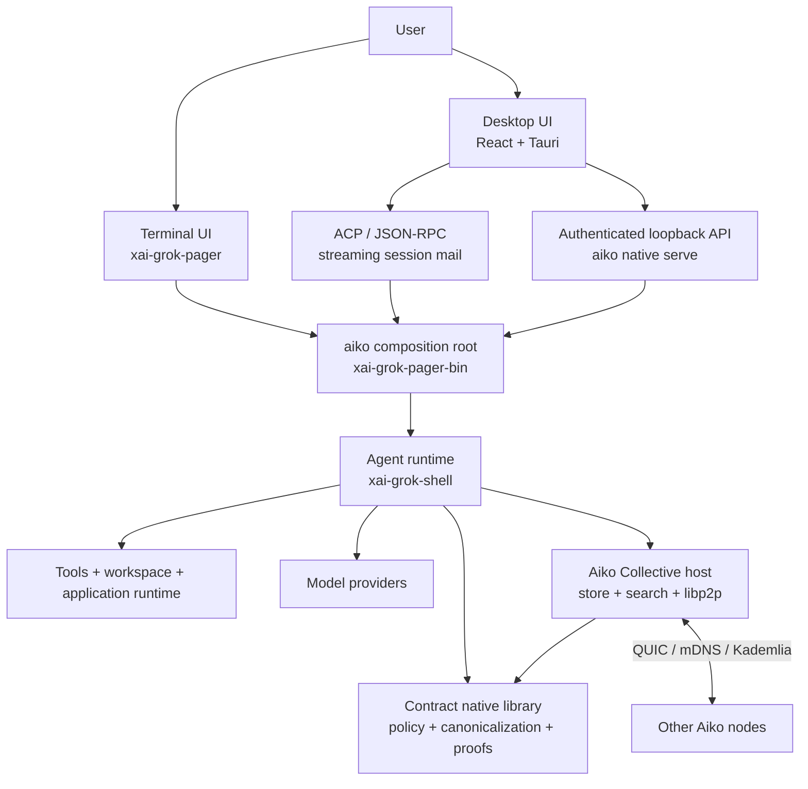
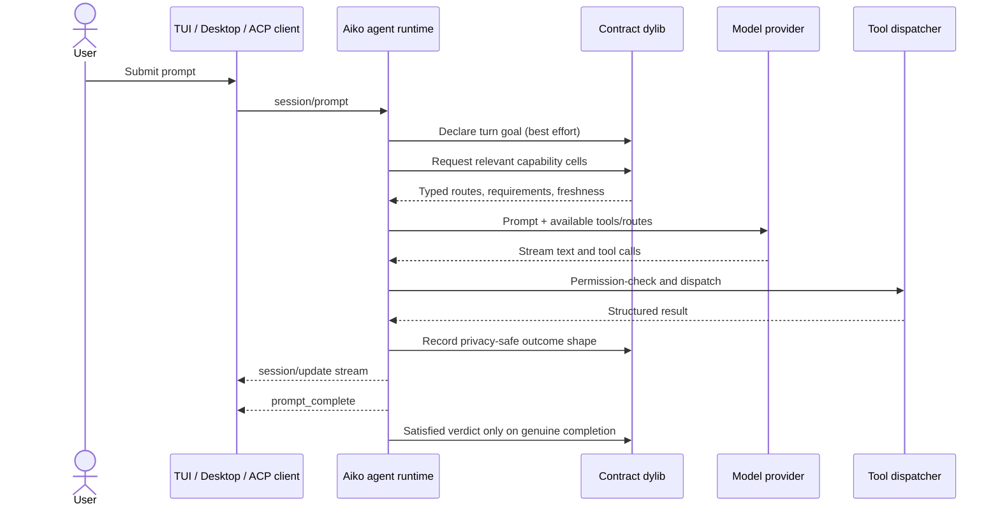
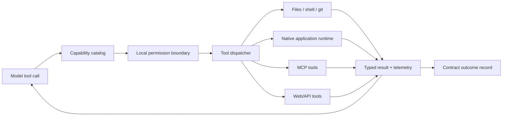
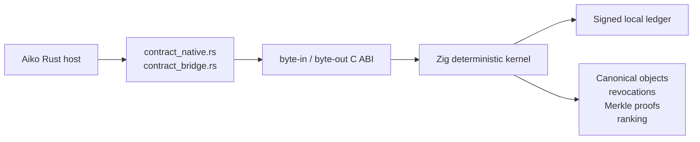
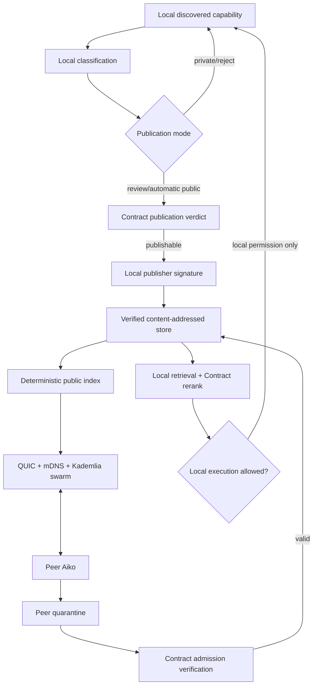
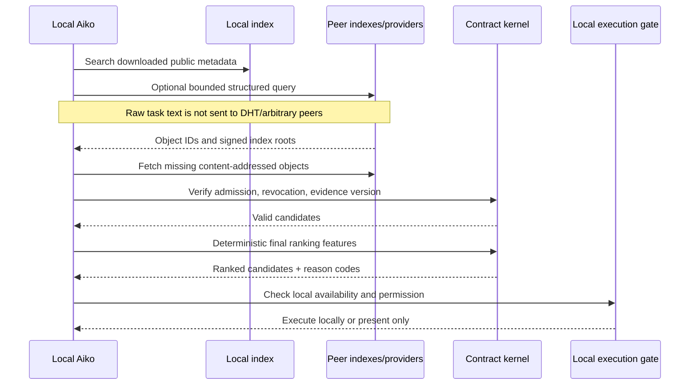
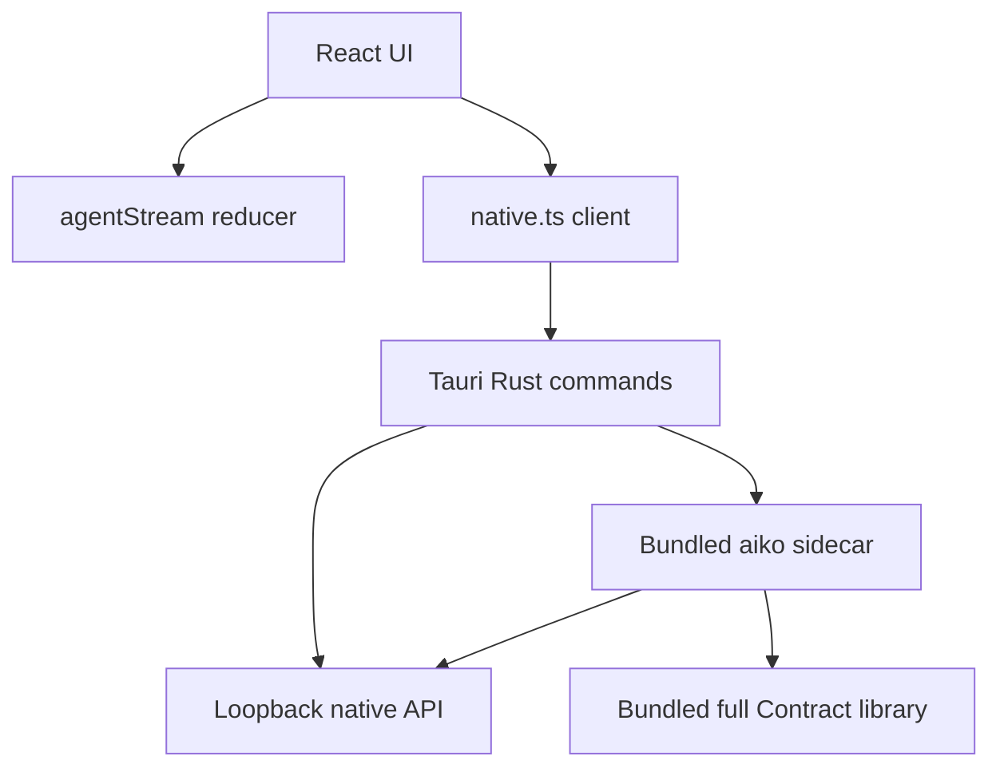
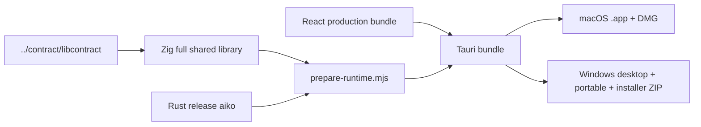

# Aiko repository: visual field guide

This is the repo-wide orientation document for Aiko. It describes what runs,
which layer owns each decision, where state lives, how messages and contracts
move, and where a change belongs.

The short version: **Aiko is the agent and product; Contract is its native
deterministic trust substrate; the Collective lets Aiko nodes exchange safe,
content-addressed capability metadata without requiring a cloud service.**

> Source names beginning with `xai-grok-` are retained for workspace and
> upstream compatibility. They are implementation names, not separate Grok
> products. User-facing code, binaries, configuration, and packaging are Aiko.

## One-screen system map



The important boundary is between reasoning and authority:

- The model and Aiko decide what work to attempt.
- Aiko owns process, filesystem, UI, networking, permissions, and execution.
- Contract owns deterministic schemas, canonical bytes, signatures,
  publication verdicts, revocation, evidence semantics, checkpoints, and final
  public ranking math.
- A peer can supply bytes and discovery hints, but it cannot grant local
  execution authority.

## Repository atlas

```text
aiko/
├── apps/
│   ├── desktop/                 React + Tauri desktop product
│   └── aiko-gigs/               auxiliary application workspace
├── crates/
│   ├── codegen/                 generated/upstream-compatible product crates
│   ├── common/                  reusable Aiko-owned runtime primitives
│   └── build/                   protobuf/build helpers
├── sdk/aiko-native/             JS/TS native API client
├── plugins/aiko-persistence/    persistent-task Codex plugin
├── docs/                        architecture and API documentation
├── scripts/                     build, install, audit, and toolchain helpers
├── third_party/                 pinned/vendored source dependencies
├── spikes/                      bounded architecture experiments
├── prod/                        optional deployment adapters/proxies
├── dist/                        finished macOS and Windows deliverables
├── plan-arch.md                 Collective architecture and acceptance plan
├── Cargo.toml                   generated Rust workspace root
└── ../contract/                 sibling Contract source repository
```

### Top-level ownership

| Path | What it owns | What it must not own |
|---|---|---|
| `apps/desktop` | Desktop presentation, Tauri lifecycle, sidecar launch, native bridge | Agent semantics or a second transcript database |
| `crates/codegen/xai-grok-pager-bin` | `aiko` executable, CLI mode selection, worker/native server startup | Rendering details or Contract policy |
| `crates/codegen/xai-grok-pager` | Ratatui state, input, scrollback, modals, Collective view | Provider or trust-kernel rules |
| `crates/codegen/xai-grok-shell` | Agent orchestration, providers, native APIs, Contract and Collective host integration | Canonical public-object policy |
| `crates/codegen/xai-aiko-collective` | Local collective storage, indexing, peer transport, replication | Signing/policy/ranking truth or remote execution |
| `crates/common` | Reusable tools, protocols, application control, tracing | Product-level UI decisions |
| `../contract/libcontract` | Deterministic ledger/trust/proof/ranking kernel and C ABI | UI, sockets, peer configuration, or Aiko state |
| `prod` | Optional infrastructure adapters | A mandatory runtime dependency |

### Auxiliary and experimental surfaces

| Path | Status and purpose |
|---|---|
| `apps/aiko-gigs` | Evidence-gated templates for finding, bidding on, fulfilling, and settling freelance gigs. It is a documented workflow collection, not part of the core runtime or desktop bundle. Human approval gates bidding and delivery. |
| `plugins/aiko-persistence` | Codex plugin for witness-gated persistence of long multi-step tasks. Its Python helper is plugin infrastructure rather than the Aiko agent loop. |
| `spikes/iroh-transport` | Reproducible three-node Iroh comparison. The recorded decision keeps rust-libp2p in production because Aiko also needs Kademlia, mDNS, peer exchange, and request/response behavior. |
| `prod/cf/openai-proxy` | Optional Cloudflare OpenAI-compat adapter (Surplus upstream). Production session path is the sibling `aiko-proxy` Worker behind `aiko.theclarityproject.net`. Not required for a pure local binary build. |
| `prod/mc/cli-chat-proxy-types` | Shared wire types for an optional CLI chat proxy integration. |
| `.agents`, `.claude`, `.hallmark` | Local agent/skill and design-workflow metadata. These guide development tools and are not shipped as runtime architecture. |
| `.agent-grid`, `traces` | Local coordination/diagnostic artifacts. Do not treat them as product state or stable APIs. |
| `bin` | Hermetic development tool entry points, including DotSlash-managed tools. |

## Runtime surfaces

Aiko exposes the same agent through several shells:

| Surface | Entry | Transport | Typical use |
|---|---|---|---|
| Interactive terminal | `aiko` | In-process TUI | Normal local work |
| One-shot/headless | `aiko --single "…"` | stdout/JSON | Scripts and workers |
| ACP stdio/leader | CLI agent/leader modes | ACP JSON-RPC | Editors and multiple clients |
| Desktop | `Aiko.app` / `aiko-desktop.exe` | ACP WebSocket + native HTTP | Native graphical product |
| Native worker | `aiko native serve` | loopback HTTP/WebSocket | Trusted local frontend integration |
| Contract worker | internal worker mode | Contract claims → headless child | Durable scheduled tasks |

All of them converge on the composition root in
`crates/codegen/xai-grok-pager-bin`. The desktop does not contain a second
agent; it launches the bundled `aiko` sidecar and speaks the existing APIs.

## Turn lifecycle



Key implementation points:

- `xai-grok-pager-bin/src/main.rs` selects TUI, headless, ACP, native, leader,
  or worker mode.
- `xai-grok-shell` owns sampling, provider selection, prompt/tool assembly,
  session leadership, and Contract integration.
- `xai-grok-pager` reduces input and agent events into view state.
- `apps/desktop/src/lib/agentStream.ts` reduces the same ACP stream for React.
- Contract failure is non-blocking for ordinary turn bookkeeping. Permission
  checks and high-risk governed actions still fail closed where required.

## Tool and application execution



The native application layer lives in
`crates/common/xai-application-runtime`. It talks CDP directly and exposes two
conceptual primitives: read-only observation and permission-gated action.
External browser automation is not a hidden runtime requirement.

The general tool protocol is split across:

- `xai-tool-types`: serializable tool and result types;
- `xai-tool-protocol`: wire contracts;
- `xai-tool-runtime`: dispatch/runtime mechanics;
- `xai-grok-tools` and `xai-grok-tools-api`: concrete agent-facing tools;
- `xai-grok-workspace`: filesystem, VCS, command, and checkpoint behavior.

## Contract boundary

Contract is deliberately a sibling repository, packaged as a native dynamic
library. Aiko loads it through a narrow C ABI.



There are two related integrations:

1. `xai-grok-shell/src/contract_native.rs` handles the local turn/task/agency
   ledger and capability routing.
2. `xai-aiko-collective/src/contract_bridge.rs` handles public object
   canonicalization, publication/admission verdicts, signatures, merging,
   ranking, checkpoints, and inclusion proofs.

The full library must retain both legacy harness symbols and additive
collective symbols. Packaging a reduced collective-only DLL as `contract.dll`
would break normal turns and is explicitly prevented by the packaging scripts.

## Collective publication and replication

The Collective makes a collection of Aikos behave like the public Unbrowse
surface. There is no privileged master node.



Safety properties:

- Participation and publication are disabled/private by default.
- Public data is metadata, schemas, provenance, and sanitized aggregate
  evidence—not credentials, prompts, request bodies, response bodies, account
  identifiers, or arbitrary local binaries.
- Remote bytes enter quarantine first and reach the admitted catalog only
  after a Contract verdict.
- Discovery score never grants execution permission.
- Revocation stops future discovery, while local erase removes this node's
  copy; already replicated immutable bytes cannot be globally recalled.
- Repository, DNS, community, and optional Aiko seed lists are equivalent
  bootstrap hints. Established peers do not require any operated seed.

### Collective module map

| File in `xai-aiko-collective/src` | Responsibility |
|---|---|
| `contract_bridge.rs` | Sole dynamic ABI bridge to Contract collective semantics |
| `identity.rs` | Stable local publisher identity and signed envelopes |
| `object_store.rs` | Quarantine, verified blobs, pins, quotas, GC, packs, erase |
| `metadata.rs` | Reopenable redb catalog projection |
| `publication.rs` | Settings, preview, review queue, and audit trail |
| `wire.rs` | Bounded `aiko-collective/1` request/response schema |
| `libp2p_transport.rs` | QUIC sessions, mDNS, Kademlia, peer exchange, relay role |
| `replication.rs` | Resumable, chunk-verified object transfer |
| `replication_policy.rs` | Seed parity, rarity-aware pins, announcement policy |
| `index_segments.rs` | Deterministic signed/indexed public metadata segments |
| `search.rs` | Local Tantivy lookup without broadcasting task text |
| `ranking.rs` | Public-evidence projection and Contract final reranking |
| `transparency.rs` | Witness roots, equivocation detection, execution separation |
| `network.rs` | Participation gate; disabled means no transport activity |
| `events.rs` | Typed privacy-safe UI/TUI events |

`xai-grok-shell/src/collective_host.rs` composes these primitives into the
long-lived product host: settings, stores, search, transport, peer sync,
publication, evidence sharing, review actions, revocation, and snapshots.

## Collective query flow



## Desktop architecture



Desktop source responsibilities:

| Path | Responsibility |
|---|---|
| `src/app/App.tsx` | Main shell, navigation, active session surface |
| `src/components/Composer.tsx` | Prompt entry and send behavior |
| `src/lib/agentStream.ts` | ACP event-to-message state reducer |
| `src/bridge/acp.ts` | ACP transport |
| `src/bridge/native.ts` | Typed native HTTP/Tauri bridge |
| `src/features/SettingsSurface.tsx` | Runtime, models, Collective, publication controls |
| `src/generative` | Sanitized JSON-rendered UI catalog |
| `src/styles` and `tokens.css` | Aiko visual system and Fonetika setup |
| `src-tauri/src/runtime.rs` | Sidecar discovery, launch, and Contract environment |
| `src-tauri/src/native_api.rs` | Native command façade |
| `src-tauri/tauri.conf.json` | Bundle identity, sidecar, resources, icons, targets |
| `scripts/prepare-runtime.mjs` | Target-clean runtime and full Contract embedding |
| `scripts/package-windows.mjs` | Windows portable and installer assembly |

The React UI should remain a projection of native state. It must not recreate
permission, ranking, ledger, or publication policy in TypeScript.

## Terminal UI architecture

The TUI lives in `xai-grok-pager`:

- `app/`: application state, commands, dispatch, effects, turn completion;
- `input/`: keyboard/mouse routing and text editing;
- `scrollback/`: conversation blocks and state;
- `views/`: welcome, prompt, dashboard, settings, file search, and contracts;
- `actions/`: action definitions;
- `acp/`: ACP client-facing behavior;
- `settings/`, `slash/`, `voice/`, `worktree_cmd/`: focused features.

The Collective panel is in `views/contracts`. Its commands dispatch through
`app/dispatch/contracts.rs`, while side effects call the shell host and return
typed state. The TUI and desktop therefore operate on the same underlying
collective, not separate stores.

## Native API and SDK

The native server is loopback-only and writes a mode-`0600` discovery file at
`~/.aiko/native/api.json`. The file contains the active URL and a bearer token.
It is a local credential.

- HTTP routes provide health, manifests, Contract/Collective state, signals,
  and explicitly confirmed paid capabilities.
- `/v1/agent-mail` is the ACP full-duplex session WebSocket.
- `/v1/agentmail/*` is disposable Internet email and is intentionally distinct.
- `sdk/aiko-native` is the JavaScript/TypeScript client.
- `docs/aiko-native-api.openapi.json` is the machine-readable HTTP contract.

The server is a façade, not a second permission or task system.

## Persistent state map

New installs use `~/.aiko`; `AIKO_HOME` overrides it. `GROK_HOME` remains a
compatibility alias and legacy state may be migrated when no Aiko state exists.

```text
~/.aiko/
├── config.toml                         user configuration; created on first run
├── auth.json                           login/provider state where applicable
├── lib/libcontract.{dylib,so,dll}      installed Contract runtime
├── native/api.json                     mode-0600 loopback discovery credential
└── collective/
    ├── settings.json                   participation/publication/evidence choices
    ├── seeds.json                      bounded bootstrap hints
    ├── store/                          quarantine, admitted blobs, metadata, pins
    ├── search/                         rebuildable local public search index
    ├── witnesses.json                  transparency observations
    ├── peer-store/addresses            retained peers for restart recovery
    ├── publication-audit.jsonl         privacy-safe publication decisions
    └── publication-review/             bounded pending review objects
```

First run creates `config.toml` with `models.default = "mimo-v2.5"`. Existing
user config is preserved. Secrets must not be copied into Collective objects,
logs, review metadata, or documentation.

## Crate inventory

The root `Cargo.toml` is generated; edit individual manifests. The workspace is
large because it preserves upstream-compatible component boundaries.

### Product and orchestration

| Crates | Role |
|---|---|
| `xai-grok-pager-bin`, `xai-grok-pager`, `xai-grok-pager-minimal`, `xai-grok-pager-render`, `xai-grok-pager-pty-harness` | Binary composition, terminal application, rendering, and PTY tests |
| `xai-grok-shell`, `xai-grok-shell-base`, `xai-grok-shell-session-support` | Agent orchestration, providers, leaders, native integration, sessions |
| `xai-grok-agent`, `xai-agent-lifecycle`, `xai-chat-state`, `xai-prompt-queue` | Agent lifecycle, conversation state, and queued prompts |
| `xai-aiko-collective` | Decentralized public capability host |
| `xai-telegram-daemon` | Persistent Telegram limb/reference daemon |

### Tools, workspace, and computer control

| Crates | Role |
|---|---|
| `xai-grok-tools`, `xai-grok-tools-api` | Tool catalog and implementations |
| `xai-tool-types`, `xai-tool-protocol`, `xai-tool-runtime` | Shared typed tool boundary |
| `xai-grok-workspace`, `xai-grok-workspace-client`, `xai-grok-workspace-types` | Workspace service and contracts |
| `xai-application-runtime` | Native CDP/Electron control |
| `xai-computer-hub-core`, `xai-computer-hub-sdk`, `xai-computer-hub-mcp-adapter` | Computer capability hub and MCP adapter |
| `ptyctl`, `ptyctl-cli`, `xai-fast-worktree`, `xai-file-utils`, `xai-fsnotify`, `xai-gix-status`, `xai-hunk-tracker` | Terminals, files, worktrees, watches, Git status, and edit tracking |
| `xai-codebase-graph` | Codebase structure/index graph |

### Models, providers, auth, and policy

| Crates | Role |
|---|---|
| `xai-grok-models`, `xai-grok-sampler`, `xai-grok-sampling-types` | Model catalog and sampling |
| `xai-grok-auth`, `xai-grok-secrets`, `xai-grok-env`, `xai-grok-http` | Authentication, secrets, environment, and HTTP clients |
| `xai-grok-config`, `xai-grok-config-types`, `xai-grok-paths` | Configuration layering and paths |
| `xai-grok-mcp`, `xai-acp-lib`, `agent-client-protocol` dependency | MCP and ACP integrations |
| `xai-grok-plugin-marketplace`, `xai-grok-hooks`, `xai-hooks-plugins-types` | Plugins and lifecycle hooks |
| `xai-grok-subagent-resolution` | Agent/subagent resolution behavior |

### Presentation and interaction

| Crates | Role |
|---|---|
| `xai-ratatui-inline`, `xai-ratatui-textarea`, `xai-tty-utils` | Terminal UI primitives |
| `xai-grok-markdown`, `xai-grok-markdown-core`, `xai-grok-mermaid` | Markdown and diagram rendering |
| `xai-grok-voice` | Voice interaction |
| `xai-grok-announcements` | Product announcements |

### Reliability, telemetry, and infrastructure

| Crates | Role |
|---|---|
| `xai-circuit-breaker`, `xai-interjection-core` | Runtime safety and interruption primitives |
| `xai-crash-handler`, `xai-system-power` | Crash and system lifecycle handling |
| `xai-grok-telemetry`, `xai-tracing`, `xai-tracing-macros`, `xai-mixpanel` | Observability |
| `xai-sqlite-journal`, `xai-grok-memory`, `xai-grok-compaction`, `xai-token-estimation` | Persistence, memory, context compaction, token estimates |
| `xai-grok-update`, `xai-grok-version` | Updating and version identity |
| `xai-grok-test-support`, `xai-test-utils` | Test helpers |
| `xai-proto-build` | Protocol build tooling |
| `prod/mc/cli-chat-proxy-types` | Optional proxy wire types |

Third-party graph and Mermaid crates under `third_party/` are pinned source
dependencies. Update `third_party/sources.lock.toml` when changing their
provenance.

## Build and packaging map



Common commands from the repository root:

```sh
# Agent/TUI
cargo run -p xai-grok-pager-bin
scripts/contract-runtime.sh build-aiko-only
cargo check --release -p xai-grok-shell -p xai-grok-pager -p xai-grok-pager-bin

# Collective acceptance suite
cargo test --release -p xai-aiko-collective -- --test-threads=1

# Desktop frontend
npm --prefix apps/desktop run build
node --test apps/desktop/src/lib/agentStream.test.mjs

# macOS desktop bundle (after building full Contract and Aiko release)
npm --prefix apps/desktop run tauri -- build --bundles app,dmg

# Windows packaging
npm --prefix apps/desktop run package:windows

# Combined CLI + Contract package/install
# Requires sibling ../contract and ../neuron (or AIKO_CONTRACT_REPO).
# See README.md → Installation for PATH, login, and registry bootstrap.
scripts/contract-runtime.sh build-aiko
scripts/contract-runtime.sh install
export PATH="$HOME/bin:$PATH"
aiko --version
# Docs witness: bash scripts/check-install-docs.sh
```

`build-aiko-only` builds the Rust binary without rebuilding Contract or
refreshing a package. `build-aiko` builds both runtimes and emits the combined
package, including admitted skills and the registry SDK, under
`target/aiko-package/`.

Finished deliverables live in:

- `dist/macos-arm64/` — DMG, zipped app, checksums;
- `dist/windows-x86_64/` — installer ZIP, portable ZIP, checksums;
- `target/aiko-package/` — combined CLI/native-library package generated by
  `contract-runtime.sh`.

The macOS DMG in the current verification record is ad-hoc signed, not Apple
Developer ID notarized. Windows artifacts are x86-64 PE binaries; see
`collective-verification.md` for the precise verification boundary.

## Test map

| Area | Primary evidence |
|---|---|
| Contract kernel | `../contract/libcontract`: `zig build test` and collective conformance vectors |
| Collective units | `xai-aiko-collective` module tests |
| Cross-language ABI | `tests/contract_vectors.rs` |
| Real decentralized flow | `tests/lan_end_to_end.rs` |
| Abuse resistance | `tests/adversarial_simulations.rs` |
| Desktop stream | `apps/desktop/src/lib/agentStream.test.mjs` |
| Generative UI safety | `apps/desktop/src/generative/sanitizeSpec.test.mjs` |
| TUI/host integration | release checks for shell, pager, and pager-bin |
| Distribution | checksums, archive integrity, binary format/export inspection, DMG mount/signature verification |

## Where to change what

| Desired change | Start here | Also inspect |
|---|---|---|
| Add/change a CLI mode | `xai-grok-pager-bin/src/main.rs` | pager argument types, shell entry points |
| Change agent/provider behavior | `xai-grok-shell/src` | models, sampler, config crates |
| Add a normal tool | `xai-grok-tools` | tool types/protocol/runtime, permission policy |
| Add native app control | `xai-application-runtime` | capability catalog and Contract routes |
| Change Contract turn behavior | `xai-grok-shell/src/contract_native.rs` | sibling Contract ABI and docs |
| Change public-object semantics | `../contract/libcontract/src/collective_*` | golden vectors, Rust bridge |
| Change Collective networking | `xai-aiko-collective/src/libp2p_transport.rs` | wire bounds, host, adversarial tests |
| Change publication defaults | `xai-aiko-collective/src/publication.rs` | desktop/TUI settings and privacy fixtures |
| Change Collective ranking | Contract `collective_rank.zig` | Rust feature projection and version tests |
| Add Collective UI data | `xai-aiko-collective/src/events.rs` | shell host, native API, both UIs |
| Change terminal UX | `xai-grok-pager/src` | stream/events from shell |
| Change desktop UX/theme | `apps/desktop/src` and `tokens.css` | Tauri bridge when native data changes |
| Change sidecar startup | `apps/desktop/src-tauri/src/runtime.rs` | Tauri bundle config and prepare script |
| Add native HTTP route | `xai-grok-pager-bin/src/native_api.rs` | OpenAPI, interface registry, SDK, desktop bridge |
| Change default model/config | `xai-grok-config/src/loader.rs` | config types and model catalog |
| Change install/update behavior | `scripts/contract-runtime.sh`, `xai-grok-update` | Tauri/Windows packaging |
| Add a persistent channel | `xai-telegram-daemon` reference | Contract task health check and native surface |

## Debugging compass

When a message cannot be sent:

1. Check the UI composer event and `agentStream`/TUI reducer.
2. Check ACP connection, initialization, session creation/loading, and leader
   availability.
3. Check `session/prompt` reaches the shell runtime.
4. Check provider credentials/model selection and streamed update handling.
5. Treat Contract bookkeeping errors separately unless a governed permission
   boundary explicitly rejected the action.

When the Collective finds nothing:

1. Confirm participation status and publication mode.
2. Inspect local store/search counts and review queue.
3. Confirm Contract full-library loading and ABI compatibility.
4. Inspect connected peers, retained addresses, seeds, and index roots.
5. Distinguish discovery rank from local execution availability.

When packaging fails:

1. Build the full Contract library for the target.
2. Build the target Aiko runtime.
3. Run `prepare-runtime.mjs`; it removes stale libraries from other targets.
4. Build Tauri/package Windows.
5. Inspect the archive/app contents, exported Contract symbols, and hashes.

## Non-obvious invariants

- Do not hand-edit the root generated `Cargo.toml` for ordinary dependency
  changes; edit the owning crate manifest.
- Do not add a second transcript, permission system, ranker, or evidence ledger
  in a frontend.
- Do not let remote popularity imply local execution permission.
- Do not publish arbitrary filesystem paths, credentials, account IDs, prompt
  text, request/response bodies, or local binaries.
- Do not put transport logic in Contract or canonical trust policy in Aiko.
- Do not require `prod/` infrastructure for local/peer operation.
- Do not package the reduced collective ABI in place of the full Contract
  runtime.
- Do keep native schemas, OpenAPI, SDK types, desktop bridge, TUI events, and
  tests synchronized when an interface changes.

## Current architectural status

The implemented end state matches `plan-arch.md`: three Aikos can publish,
replicate, discover, rank, and execute a public capability on a LAN without a
hosted service. A retained peer can serve the object after the publisher goes
offline. Public metadata is globally queryable through mirrored indexes and
providers; final ranking and execution approval remain local.

For exact commands and limitations of the latest verified build, see
[Collective verification](collective-verification.md).
