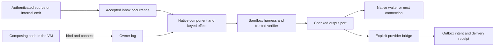

# Typed internal channel integration (S24.C13–C23)

The current actor, Bun server and Cloudflare host mount this package, its native components and private sandbox layer when trusted bindings are configured. The assembly below documents that integration for maintainers. Preserve the existing harnessLibrary options, imports, tools and component; mounts alone do not configure a registry, grant or provider adapter. The [architecture plan](../../../docs/self-composing-harness-plan.md#24-self-created-inboxoutbox-channels-as-harness-bindings) explains how actors compose their own inboxes, outboxes and hooks.

## Design: a hook is a retained connection

Code creates owner-scoped ports, then connects an input schema to a verified harness and its permitted output. The connection is durable data: port identities, generations, handler/contract pins, authority references and a source watermark. An inbox projects accepted occurrences and processing receipts; an outbox projects delivery intents and their settlement. The existing actor host runs the connection through native components and keyed effects.



The reusable library artifact contains code, schemas, effect declarations, verifier and derived `SKILL.md`. The owner retains credentials, channel instances, source cursors, child-operation identities and pending deliveries. A familiar occurrence takes the verified execution path directly. Inference is used to acquire a missing capability or repair a failed contract.

There are three readiness results to inspect: the internal port exists, the verified handler is connected, and any external provider subscription is active. `channels.bind` creates the first; `channels.connect` checks the second. Inspect its returned `status`: incompatible schemas, effects or handler eligibility can produce a retained `failed` connection without throwing. Require `status === "active"` before enabling the source or emitting input. External activation needs its own provider binding and receipt. A webhook uses the existing host ingress for durable admission, allowing its sandbox handler to sleep between executions.

Composing code and explicitly granted registry handlers now share the scoped native package bridge. `channelRegistryContinuations` runs pinned `channel.manage` handlers through native code dispatch, retained package calls and independent final contract verification. Ordinary handlers retain the `pure`/`channel.reply` path. Sandbox filesystem or network access never grants channel-management authority.

An enduring hook belongs to the native component's projection of retained connections. Each trigger produces finite keyed work. A caller awaiting one checked result uses the durable continuation exposed by `channels.request` or `channels.wait`. Completing the composing code does not itself attest handler completion or external delivery. Rebuilding the connection view performs no sandbox execution, provider subscription or send.

`channels.connect` consumes accepted occurrences on its named input port; it does not subscribe to arbitrary actor-log event types. The browser-result, knowledge-change and private-login adapters below select allowed owner-scoped facts, retain source identity and causal lineage, and advance their cursor after durable admission or rejection. Additional source kinds require their own declared mapping and grants. Internal `emit` checks schema identity and bounds at admission; the pinned handler input schema checks payload shape before execution is claimed. An admission receipt alone does not establish payload correctness or a checked outcome.

Autonomous composition uses these same boundaries: reuse a compatible active connection or verified artifact; derive and verify a missing handler; bind its ports and connect it; then enable its source. Retain setup identities and readiness receipts under the composing operation. Later occurrences reuse the connection and artifact, with a separate invocation and checked result for every source occurrence. Only current, matching authority allows reuse. The [plan's autonomous creation policy](../../../docs/self-composing-harness-plan.md#24-self-created-inboxoutbox-channels-as-harness-bindings) describes the target selection loop; these package mounts provide its execution seams.

### Returning a hook from a library harness

A channel-creating harness should return a checked description of the connection it established. This is a proposed composition result convention over the existing package operations; no `channels.createHook` method or new runtime service is required. Retain the private result under the creating operation so another authorized composition can recover it after the creating VM exits. Recovery of that description and permission to admit later input are separate checks.

| Result evidence | What its consumer can establish |
| --- | --- |
| Input and output port references, schemas and generations | Which typed endpoints were created; current grants still control their use |
| Connection identity and exact handler/contract pins | Which checked action is wired between those endpoints |
| Creating operation and lifecycle reference | Which task owns cleanup, and whether a recorded standing adoption exists |
| Source binding/cut and readiness receipt, when requested | Which source was attached and whether external activation actually completed |
| Creation witness and retained result reference | What the factory's independent verifier checked and where authorized code can recover its result |

Resolve readiness from current retained facts when reusing the result; an old creation witness cannot reactivate an expired hook. Store the factory's code, contract and derived `SKILL.md` as reusable artifacts. Keep instance IDs, provider addresses, receive capabilities and pending deliveries in private owner storage. Documentation describes how to create and inspect a hook without exporting a live inbox or treating its identifier as a receiving grant.

The existing managed bridge remains narrower than owner-native code: a `channel.manage` handler can create internal child ports through `bind`, `connect`, `emit`, `request` and `wait` within its retained grant. It cannot independently attach an arbitrary log source, publish a provider endpoint or adopt itself as a standing hook. Owner-native composition uses the separately configured source/provider/lifetime capabilities for those steps.

For an enduring hook, use this handoff: **managed factory returns its checked internal connection → owner-native code records eligible standing adoption → attach and activate the source → verify readiness**. The outer composing operation owns the enduring-hook creation contract; the child factory verifies internal construction only. Parent completion fences managed task hooks, so returning handles cannot itself promise an active hook after return. The current `channels.adopt` path permits an eligible completed parent within its original deadline, requires current standing policy and resolution of uncertain custody, and records fresh watermarks. It never restores cancelled queued input. Keep the source disabled until the handoff completes. If adoption is unavailable, expose that limitation instead of presenting the internal construction witness as enduring readiness. Within a still-running task, the child can remain task-scoped and serve `channels.request` without standing adoption.

Keep the execution boundaries explicit:

1. The factory returns only after its requested creation contract is checked. Internal wiring and external activation have separate readiness receipts.
2. Each admitted occurrence invokes its pinned handler and produces a new checked output. The factory's success is not that occurrence's completion.
3. A connected downstream hook consumes the output as its own invocation, preserving causal lineage with a distinct effect identity. A waiting task uses `channels.request` or `channels.wait`; a user message additionally goes through the authorized outbox policy and provider evidence.

For a known deterministic handler this path requires no new composition or inference. A future adaptive action selector may choose an eligible network or browser implementation under the same semantic contract, but must retain that choice before executing the occurrence. Today's `channels.connect` pins a concrete harness/contract pair; it does not silently follow a changing registry head.

### Chaining the ports a harness creates

Use a shared typed port as one connection's output and the next connection's input. It needs both `inbox` and `outbox` directions, compatible handler schemas and current grants. The wiring component records a verified output as an accepted occurrence on that port; the downstream connection claims its own invocation. Preserve causal lineage while keeping each invocation's identity distinct.

For `input → handler A → intermediate → handler B → output`, configure in this order:

1. Create the three scoped ports and select the verified handler/contract pairs.
2. Connect `intermediate → handler B → output`, then `input → handler A → intermediate`.
3. Establish the required lifetimes and output consumer, then enable the input source.

This order matters because `start: "after-registration"` excludes occurrences already recorded on the input port. Replay setup with its retained identities; do not compensate for a setup gap by blindly re-emitting an input that may already have caused an effect. Reuse existing bounded backlog, hop limits and backpressure on each connection. A managed factory still needs the owner-native adoption handoff above for an enduring chain; creating a downstream hook does not extend its parent's lifetime.

<a id="proposed-log-source-bindings"></a>

## Log-source bindings

The first three source adapters are production-mounted by `channel-log-source.ts`. Configure Bun `createService(config, {logSources})` or the trusted Worker `AIKO_LOG_SOURCES` function with `(owner) => ChannelLogSourceGrant[]`. The default registry filters exact-owner, active, unexpired grants whose receiving authority equals `registry-internal:${owner}`. A grant contains `{owner,id,kind,receivingAuthority,active,expiresAt,maxBindings}`; `kind` is `browser-result`, `knowledge-change`, or `private-login`, and `maxBindings` is 1–32. Missing registry sandbox, verifiers, current owner authority or source grants reports unavailable. Custom registry factories retain their override and may supply `RegistryHostBinding.logSources` alongside their existing receiving checker.

Code-mode uses the existing private `tools.call` package: `channel_source_catalog`, `channel_source_bind`, `channel_source_status`, and `channel_source_revoke`. There is no arbitrary log-query tool. These tools require actor `aiko` and exact thread `user-${owner}`. They are not installed in generated managed-handler sandbox bindings; `channel.manage` does not grant source access. `channels.bind/connect/emit/request/wait` remain the typed composition surface.

Each configured default includes three fixed independently verified sandbox acknowledgment harnesses. They return only `<source-kind>:<source-sequence>` in `text.message.v1`, never a verified session, private summary or delivery assertion. The catalog returns the exact handler and contract pins. Activate one with actual code:

```js
const [source] = await tools.call({name:"channel_source_catalog", arguments:{}});
if (!source) throw Error("No standing source grant");
const input = await channels.bind({name:"observations",schema:source.schema,
  directions:["inbox","outbox"],authorityRef:source.receivingAuthority,operationId:"obs-in"});
const output = await channels.bind({name:"acknowledgments",schema:"text.message.v1",
  directions:["inbox","outbox"],authorityRef:source.receivingAuthority,operationId:"obs-out"});
await tools.call({name:"harness_evaluate",arguments:{digest:source.handler.harness,evaluationId:"obs-check"}});
await tools.call({name:"harness_promote",arguments:{digest:source.handler.harness,evaluationId:"obs-check",expectedGeneration:0}});
const wiring = await channels.connect({name:"observation-ack",generation:1,
  input:{channel:input.channel,generation:input.generation},accepts:source.schema,
  handler:{harness:source.handler.harness,contract:source.handler.contract},
  output:{channel:output.channel,generation:output.generation,mode:"port"},
  start:"after-registration",authorityRef:source.receivingAuthority,operationId:"obs-wire"});
if (wiring.status !== "active") throw Error(wiring.reason ?? "Hook is not ready");
const binding = await tools.call({name:"channel_source_bind",arguments:{
  operationId:"obs-source",source:source.kind,sourceAuthority:source.id,
  receivingAuthority:source.receivingAuthority,
  port:{channel:input.channel,generation:input.generation},
  expiresAt:Math.min(source.expiresAt,Date.now()+3600000)}});
// Real producer facts now enter the typed inbox; the known handler needs no inference.
await tools.call({name:"channel_source_status",arguments:{id:binding.id}});
// Later: await tools.call({name:"channel_source_revoke",arguments:{id:binding.id}});
```

Activation is future-only, with at most 24 hours per binding, 32 source occurrences per native batch and 128 per binding lifetime. Historical backfill is unavailable for source creation; internal wiring's separately granted backfill remains supported. Reaching 128 retains `Exhausted`; new explicit composition is required. The fixed metadata mapping has a retained recipe pin. Both grants are rechecked after asynchronous sealing inside the existing shared `wiringJournal` gate. Acceptance and the source disposition/cursor commit in one native transaction. A retained cut without activation is recovered by the mounted native component, including lost tool acknowledgments. Missing private history anchors, shortened/replaced history and unavailable mapping pins stop with a retained gap.

Indexer facts are read only from `background-${owner}-indexer`. Its existing actor mounts a keyed native Router relay; signals contain no producer payload or authority. Registration schedules its own scan, so an earlier signal cannot lose a later fact. Consumer cursor changes wake pending capacity without a polling timer. Knowledge changes derived from the fixed acknowledgment harnesses receive an explicit `source_ack_feedback` rejection, preventing documentation of the acknowledgment from triggering itself indefinitely. Other handlers remain subject to the lifetime occurrence bound.

The native host fixtures exercise Bun and Worker default code-mode mounts, actual browser redaction/private-login metadata producers, actual indexer snapshots and Router relay, checked sandbox outputs, registration/custody interruption, storage restart, backpressure drain, missing anchors, truncated source history, foreign owner rejection and explicit revoke. They use no real provider login or send. Browser and login tests invoke the production producer boundary with controlled data; they do not attest a live browser or provider session.

Use two retained connections: **source fact → typed input port**, then **accepted input → pinned handler → output port**. Source normalization belongs to a trusted, bounded adapter with a declared observation schema. Learned transforms and actions execute as verified sandbox harnesses after typed admission. This lets several sources feed the same handler, and lets the handler use a verified network routine or a browser implementation under the same action contract. Neither an event payload nor an adapter's `SKILL.md` can choose a new owner, source thread, credential scope or reply destination.

The current source adapters project these existing facts:

| Source | Authoritative location and code | Permitted hook input |
| --- | --- | --- |
| Browser tool result | Owner-bound browser trace retained in the account log; [shared trace decoder and redaction](../../../docs/shared-browser-runtime.md) | Allowlisted action/category, success or unknown, bounded duration, source sequence and opaque occurrence reference. Keep URLs, selectors, page content, typed values and network bodies out of this schema. |
| Entity-learn change | `AikoKnowledgeChanged` in the existing owner indexer; [snapshot producer](background.ts) | Current/previous semantic root, completeness, change count, source sequence and opaque occurrence reference. The current payload contains no observation IDs or leaf evidence. A separate authorized capability must resolve any evidence needed by the handler; raw subjects, URLs and observation payloads stay outside this schema. |
| Login observation | `AikoPrivateLoginObserved` from the [private-state allowlist](native-login-observation.ts) | Attempt/challenge identity and revision, observation kind, sequence and expiry. Passwords, OTP values, DOM and secret hashes remain in the private login path. Even an observed `verified` kind is not the trusted terminal receipt that resumes a login operation. |

The host resolves each source from the current owner and a supported source kind. For knowledge changes it selects the existing `background-<owner>-indexer` thread; accepting a caller-supplied `owner` field or scanning only `user-<owner>` would not establish this source. Use existing native Router handoffs to signal that the source may have progressed. A source-side keyed effect stays pending until native admission of that handoff is retained. Only then advance or coalesce its wake cursor; replay retries an unresolved handoff under the same identity. Treat each signal solely as a wake hint, including when the sender claims a source link: admission uses facts read from the host-resolved stream and their existing trusted producer boundary. Public ingress cannot append reserved source, binding or cursor facts.

Retain a source binding with these fields and responsibilities. The names below describe application data, not a new Tardigrade SDK type:

| Retained value | Meaning |
| --- | --- |
| Binding identity, generation, owner and composing operation | Repeated composition recovers one binding; conflicting parameters under the same operation fail. |
| Source kind, exact stream identity and mapping revision/digest | Select an allowed producer and observation schema; exclude arbitrary event-name queries and executable predicates in the host. |
| Target port/generation/schema and grant references | Check both source-read scope and target receiving scope at registration and immediately before admission. Artifact verification establishes neither grant. |
| Start cut and source-history anchor | Declare which source position precedes the first eligible occurrence; retain an integrity anchor so shortened or replaced history cannot restart silently from zero. |
| Lifetime, bounded backfill decision and stop policy | Registration retries cannot renew authority or widen history. Task/standing scope follows the lifecycle policy below. |
| Cursor and per-occurrence disposition | Record durable accepted-input identity, explicit rejection, or a pending/gap outcome; handler execution keeps its separate cursor and outcome. |

History anchors and occurrence references must be opaque owner-scoped references or canonical value-free identities. Do not publish a hash of a raw private log payload as a substitute for retaining it privately.

For a future-only binding, activation is defined at the retained source cut, not at a wall-clock timestamp. Read a source snapshot through a native effect and retain its stream identity, watermark and anchor as that operation's result. Finalize the binding with that same cut before returning activation. A restart reuses the retained cut; if the read never produced a retained result, activation is still incomplete and a later read may establish a new cut. Do not claim to have subscribed during that uncommitted interval. The source and destination logs need not commit in one transaction: after activation the component scans every eligible occurrence after the retained cut, including facts appended between the snapshot and binding commit. A first sweep is triggered by registration itself, so an earlier or lost wake cannot lose those facts. Historical source backfill remains unavailable; the current API rejects caller-selected ranges.

Admit with a stable occurrence identity derived from the binding generation, source stream and original source occurrence. Preserve two legitimate identical payloads as two occurrences. Record target acceptance before advancing the source cursor; when both records use the owner journal, prefer the existing serialized transaction gate. If a crash leaves only acceptance recorded, retry the same occurrence and use its existing receipt. A different payload under that identity is a conflict. Projection rebuilding selects pending work without executing a model, adapter build or provider call.

An over-capacity port keeps the source occurrence pending. Resume a finite keyed effect when a recorded consumer cursor frees capacity, using the existing native lifecycle; do not spin on a self-generated polling event. Process bounded batches and retain continuation work for a remaining batch. Malformed allowed-source data needs an explicit rejection before its cursor advances. Unrelated log facts can advance a scan watermark without generating semantic input. Missing or incompatible source history halts with a gap/unavailable outcome; it never resets the cursor or fabricates missing facts. Revocation and expiry stop new admission while already admitted invocations retain their recorded lifecycle and pins.

Verify the full handoff before advertising a source adapter: race input with registration, stop after source read and after target admission, reopen the host, fill and drain the target backlog, truncate or replace source history, revoke between read and admission, and deliver forged wake hints. Check exactly one accepted occurrence per source identity, no skipped pending work, no private fields in hook payloads, and no model or provider effects from projection replay. Exercise the indexer's actual thread, not a synthetic foreground copy of its event. The controlled source fixtures described above cover the implemented adapters; provider and internal-port tests alone do not attest a new source kind or a live browser session.

## Lifecycle ownership

Managed child hooks now retain `lifetime: "task"`, `queuedWork: "cancel"`, their parent execution, namespace and absolute deadline with the management grant. `channelWiringAppendAllowed` fences admissions at parent completion, cancellation or expiry, before cleanup effects run. The existing wiring component records `HookCleaned` with stable cleanup identity and pending custody dispositions; Started without a terminal receipt stays `unknown_retained`. It cancels outstanding child waiters without inventing a checked result or retrying an uncertain job. Existing `channelWiringNextWake` supplies the deadline to Bun/Worker alarms. Root host files need no additional mount.

A trusted `RegistryManagementPolicy.standingHooks` explicitly permits adoption with `{maxLifetimeMs, handlers: [{harness, contract}]}` (maximum one day). Its absence denies adoption even with an internal receiving or management grant. The existing production management factory installs this policy into the shared wiring instance through `setAdoptionPolicy`; a custom assembly must install its own trusted policy through that same seam. It checks the registered parent, exact child pins, pure/reply effects, current receiving grant and policy digest. Sandbox-generated managed calls do not receive `hooks`, `adopt` or `retireHook`; these are owner-native channels package operations:

```js
const hooks = await channels.hooks({authorityRef: "registry-internal:123"});
// Select the intended retained parent execution; IDs alone convey no authority.
await channels.adopt({execution: hooks[0].execution, operationId: "adopt-reviewed-hook",
  authorityRef: "registry-internal:123", expiresAt: Date.now() + 30_000});
await channels.retireHook({execution: hooks[0].execution, operationId: "retire-reviewed-hook",
  authorityRef: "registry-internal:123"});
```

Adoption is one immutable retained decision, not artifact promotion. It preserves port/wire IDs, pins and resource limits, takes a new source watermark atomically, and never revives cancelled queued inputs. It may follow completed-parent cleanup while the original task deadline is still valid; cancelled, expired and explicitly retired tasks cannot be adopted. Outstanding unknown invocations must be reconciled first. Once adopted, parent completion does not retire the standing hook. Its own expiry/revocation does, with a separate stable cleanup identity. Each subsequent admission rechecks the exact retained policy digest and current receiving grant after private sealing in `HostedChannels`' serialized gate. An adoption replay cannot extend expiry or refresh permission implicitly.

Evidence: `registry-management-host.test.ts` exercises actual configured Bun and Worker entries with exact trusted parent/child artifacts, local isolated jobs, private native package calls, independent output verification, parent cleanup, restart, explicit adoption/rejection, later-input reuse and policy revocation. `channel-hook-lifetime.test.ts` additionally exercises a native deadline wake and Started-without-terminal custody through restart. No provider authority is inherited and no external service is contacted.

Limits: this lifetime applies to managed **internal** child ports/hooks. It does not add a lifetime argument to ordinary `channels.bind`, adopt external subscriptions, or remove provider resources. The native code reactor serializes code executions, so the demonstrated owner-native adoption happens after the parent finishes, not from a second code script while it is parked. A host without an executable registry has no receiving capability; cleanup receipts are driven when its existing wiring component is mounted again. Physical deletion of retained private artifacts is a separate retention policy. The full S24 parent remains open.

Keep three independent outcomes visible: the port exists, its verified handler is connected, and any external source is active. A checked handler output may prepare an authorized outbox intent; recipient delivery needs its own provider evidence. During retirement, stop new admission and reconcile subscriptions and outstanding effects under their retained identities. Never use a replayed creation call, a missing private payload or an uncertain send as permission to allocate or dispatch again. External provisioning and retirement remain dependent on explicit provider adapters and their verified receipts.

## Native assembly

1. Resolve an owner-bound `ChannelWiringBindings`. For the real registry use `channelHarnessHandlers(harnessBinding, harnessJournal, authorizeReceivingCapability)` from `channel-host.ts`. It verifies evaluated immutable harness/contract pins in the current context. The injected authorization callback must validate the exact input/output scopes, operation and backfill range; channel IDs and harness witnesses do not grant receiving authority. It is called again on dispatch with the retained wire.
2. Create one `createHostedChannels(owner, () => host, providerAdaptersOrUndefined, { ...existingPolicy, wiring: handlerBindings })` per owner/physical host. Internal ports work with undefined provider adapters; external operations then fail closed. Use its single shared journal/gate; do not create another wiring journal or admit internal events via arbitrary HTTP JSON.
3. Install the private custody/sandbox binding described below. Add `options.channels.wiring.component` to the owner actor components when present. Add `options.channels.wiring.package` to the existing `codeMode([...])` package list. Keep the existing channel runtime, scoped agents and harness library mounts.
4. Add `channelWiringEventKey(e)` from `channel-wiring.ts` to each host's existing `keyOf` chain. On the Cloudflare native transaction guard combine `channelWiringAppendAllowed(batch, read)` with the existing automation/channel guards. Do not replace either existing guard. Native same-owner Router handoffs require these keys and this guard.
5. Include `channelWiringNextWake(log, owner)` in the existing native alarm minimum. It returns the earliest unresolved waiter deadline or uncleaned task/standing-hook expiry + 1, or undefined. Retain `beforeCommit` durable wake coverage and normal host wake after API admission. There is no additional scheduler or internal-channel HTTP listener.
6. Keep public arbitrary event append/seed unavailable, including all `AikoChannelWiring*`, `BlockedOn`, and internal waiter reply metadata. Native package scope additionally checks actor `aiko` and thread `user-${owner}`.

`HostedChannels.wiring` exposes `{package, component, api, view, sandboxLayer}`. `api` methods are native Effects: host tests may use `hosted.run(wiring.api.bind(...))`; production application code calls the package below. `wait` uses Tardigrade Park/BlockedOn and a keyed native reply, not an in-memory Promise waiter. Only one checked output with matching handler pins/schema/port/correlation and a timely host acceptance timestamp can resume it successfully. Deadline expiry is a distinct result. The existing model may summarize a completed code segment; handler execution and code continuation themselves require no inference.

## Exact code-mode activation

The following examples form one internal text-echo connection. `verifiedHarnessDigest` and `verifiedContractDigest` refer to the evaluated `channel.text.echo` seed throughout. Media uses the same composition operations with its own verified schemas, pins and custody binding.

```js
const input = await channels.bind({
  name: "text-input", schema: "text.message.v1", directions: ["inbox", "outbox"],
  authorityRef: receivingGrant, operationId: "task-42:input",
  maxBytes: 65536, backlog: 128, maxHops: 8
});
const output = await channels.bind({
  name: "text-output", schema: "text.message.v1", directions: ["inbox", "outbox"],
  authorityRef: receivingGrant, operationId: "task-42:output"
});
const wiring = await channels.connect({
  name: "text-handler", generation: 1,
  input: {channel: input.channel, generation: input.generation},
  accepts: "text.message.v1",
  handler: {harness: verifiedHarnessDigest, contract: verifiedContractDigest},
  output: {channel: output.channel, generation: output.generation, mode: "port"},
  authorityRef: receivingGrant, start: "after-registration",
  operationId: "task-42:connect", maxAttempts: 2
});
if (wiring.status !== "active") throw Error(wiring.reason ?? "Hook is not ready");
await channels.emit({
  port: {channel: input.channel, generation: input.generation},
  schema: "text.message.v1", value: {text: "fixture input"},
  occurrence: "source-occurrence-42", correlation: "task-42",
  authorityRef: receivingGrant
});
```

For a scoped reply use output mode `reply-to-accepted-input` with exactly the input channel/generation; its output schema must match that port. No input field can provide a reply destination. For history use `start: {from: 1, through: 12, authorityRef: boundedBackfillGrant}` (inclusive, at most 128 occurrences, ending no later than registration). An upgrade uses the same wiring name/input and generation + 1; the old generation retains its pre-upgrade source window and pins. Operation replays cannot change an existing generation.

`channels.wait({port, handler:{harness,contract}, schema, correlation, deadline, authorityRef})` registers a future-only waiter and parks the native code segment. Register it before the output you intend to await; pre-registration outputs are excluded. The producer must run independently after that registration: sequential `emit` then `wait` can miss an immediate result, while awaiting `wait` before `emit` parks before sending. For a task that produces input and awaits its checked reply, use the implemented atomic `channels.request` below. For interrupted invocation inspection, call `channels.reconcile({invocation, operationId, authorityRef})`; it reads/reconciles the same operation, never repeats an uncertain write. Attempts are bounded and exhaustion is retained.

Registry contract `applicability.hook` must contain `accepts`, `emits`, `inputSchema` for the typed value, and declared `effects`. The ordinary handler path restricts effects to `pure`/`channel.reply`; an explicitly granted `channel.manage` handler uses the [managed continuation path](#activated-pinned-registry-continuations) below. The top-level contract input schema validates `{value, schema, correlation}`; its output schema validates the returned typed value. The handler digest and contract digest must be registered and evaluated before connecting. Unsupported predicates/transforms require a new verified handler artifact; JavaScript closures are never accepted.

## Atomic native request/reply

`channels.request` matches one directly connected handler and reply port; it does not automatically await the terminal output of an arbitrary chain. A managed parent that needs a combined result can use direct child requests and return its own independently checked outcome. A standing chain gives its final port an explicit consumer.

`channels.request({operationId, send, reply})` is implemented in the same application package. `send` has exactly the `channels.emit` arguments; `reply` has exactly the `channels.wait` arguments. The two correlations must match. Both the send receiving grant and reply connection grant are checked; use opaque grant references. At delivery, `authorize(owner, reply.authorityRef, "connect", retainedWaiter)` rechecks the reply scope using the waiter's port, handler, schema and safe correlation reference. The handler/contract must already be connected by exactly one current active wiring from the send port to the reply port, covering the next source occurrence. An ambiguous connection, historical-only backfill, foreign port/generation, incompatible schema, expired initial deadline, or previously accepted source is rejected without either fact being committed.

```js
const result = await channels.request({
  operationId: "task-42:echo",
  send: {
    port: {channel: input.channel, generation: input.generation},
    schema: "text.message.v1", value: {text: "Hello"},
    occurrence: "task-42:echo-input", correlation: "task-42:echo",
    authorityRef: receivingGrant
  },
  reply: {
    port: {channel: output.channel, generation: output.generation},
    handler: {harness: verifiedHarnessDigest, contract: verifiedContractDigest},
    schema: "text.message.v1", correlation: "task-42:echo",
    deadline: absoluteDeadlineMs, authorityRef: receivingGrant
  }
});
// Branch on result.status before reading result.value.
```

The shared journal transaction writes WaitRegistered with the future-output watermark followed by Accepted. Neither half is appendable alone. The waiter pins the source identity and the exact handler invocation (owner, wiring ID/generation, source), so another checked invocation with copied correlation cannot satisfy it. The existing native handoff, Started/reconciliation receipts, and Park/BlockedOn continuation handle execution and return. No HTTP listener, timer loop, queue, or process-local promise is added. Immediate results remain eligible even before BlockedOn is logged. `wait` and `emit` retain their existing behavior.

All request arguments are sealed before PackageCalled by the existing sandbox wrapper. The operation identity and argument fingerprint are owner-keyed private references; only safe references enter registration/admission facts. Replaying the same native call requires identical arguments and reuses the original pair. Reusing an operation ID from another native call fails closed instead of attaching a second continuation. This is not a cross-task request lookup API. Wire upgrades retain the admitted request's original generation window.

Results are `satisfied` (with private value hydrated inside the authorized continuation), `expired`, or `unavailable` for missing source/checked output bytes. Other rejected/exhausted handler outcomes currently remain pending until the deadline; uncertain work uses existing explicit `channels.reconcile`, never a fresh execution. A deadline or cancelled continuation does not retract already admitted work or undo provider effects. Revoked reply authority records WaitCancelled and suppresses hydration/wake; the containing turn needs its normal cancellation path. Missing retained package results can abort VM recovery; they do not authorize repeating a write.

This operation admits an **internal typed occurrence**. It does not create external subscriptions or directly request an arbitrary provider send. Existing explicit provider bridges may consume eligible checked output under their independent send scope. The mounted package discovers the additive operation automatically; no actor/server/Cloudflare changes are required. The architecture plan uses this operation for code-created hooks that need a checked reply.

Controlled evidence lives in `test/channel-wiring.test.ts` and `test/channel-custody.test.ts`: real native codeMode, immediate completion, racing request replay, append-pair fences, copied-correlation rejection, SQLite close/reopen at admission and handoff, timeout/cancel/revocation, deleted blobs, and complete trace/disk privacy scans. Test-only transition withholding simulates stopping native dispatch at a durable boundary; execution after release uses the actual component and host. These witnesses do not attest real provider behavior or close the full goal.

The independent process-boundary fixture in `scripts/fixtures/self-composing-channel-boundaries.ts` now passes all seven recovery cases with the opt-in CodeHarness retained-tool-result binding. After restart, the matching waiter resumes successful guest code using its authorized retained value, without duplicate native tool/acquisition receipts or repeated handler execution. Missing input before claim or after handoff becomes unavailable with zero sandbox execution; late, cancelled and uncertain outcomes remain distinct. Argument comparison now uses canonical JSON, so custody key ordering does not reject an identical request. Evidence: `/tmp/native-channel-canonical-recheck/report.json`. These are controlled native-path results, not production host-mount or whole C23/C27/C28 attestation. Old transient receipts cannot recover absent bytes; final code outputs and workflow inputs remain transient.

## Remaining seams / unsupported features

- Actor, Bun and Cloudflare mounts exist. Runtime availability still depends on the trusted registry factory, verifier set, receiving grant and sandbox transport; public ingress and provider bridging additionally require their configured bindings. Presence in source does not prove deployment or provider activation.
- Provider-scoped public admission and the explicit text bridge are implemented in `channel-ingress.ts`; install the additive mounts below. Configured default Bun/Worker registries additionally support [generated `signed-json-v1` adapters](provider-adapter-integration.md): verified planner acquisition, private ingress arming before subscription, signed receipts, correlated sends and explicit lost-acknowledgement reconciliation. `provider_adapter_control` supplies bounded explicit polling, renewal, reconciliation, pause/resume and retirement. A trusted `automaticControls` policy also enables [finite polling/renewal plans through native alarms](provider-adapter-integration.md#finite-automatic-controls-native-host-no-separate-scheduler); automatic renewal additionally requires verified `signed-lease-v1` expiry evidence. Acquisition does not subscribe, and binding remains pending until verified activation. The general external channel API still uses owner credentials; provider ingress uses its separate receive-only capability and signature. Other protocols, synchronous challenges, account/mailbox creation, external standing-hook adoption and physical retention remain unsupported by this path. Controlled host tests do not attest live providers or deployment.
- Internal ports currently support immutable schema/generation 1; wiring generations upgrade. Changing a port schema requires another explicit port binding. Cross-owner wiring fails closed; no cross-owner receiving-capability exchange is implemented.
- External decoder-to-typed-port admission and checked typed result-to-provider outbox routing require an explicit retained bridge scope. Unbridged external inputs keep the existing actor inference wrapper. Previously selected typed input never falls back to inference when its bridge is disabled.
- Queue bounds are conservative: unconsumed retained source/output occurrences count against backlog. There is no implicit consumer acknowledgement or retention deletion. Eight unresolved invocations may be claimed per owner; uncertain claims hold capacity until checked/rejected/exhausted.
- Independent S24 requirement/parent attestation remains the reviewer's responsibility. This narrow Contract does not close the full goal.


## Receive-only public ingress and explicit provider bridge

Additional imports from `channel-ingress.ts`: `createChannelPublicIngress`, `channelBridgeEventKey`, `channelBridgeAppendAllowed`, `ChannelSourceGrant`, and `ChannelBridgeBindings`.

- Extend the existing owner host policy with `bridge: bridgeBindings` alongside `wiring`. Add `hosted.bridge.component` to owner actor components. Compose `channelBridgeEventKey` into the existing host key chain and `channelBridgeAppendAllowed` into the existing atomic guard, preserving all other guards. Source admission, typed handoff receipts and bridge outbox receipts use the same `HostedChannels` serialized journal. No additional database, queue, scheduler or internal-channel listener is required.
- Register a bridge after the internal wire is active. The external binding normally must be active; the supported provider path also permits a pending binding with `ingressBeforeSubscribe` so it can arm bounded private ingress before subscribing. Decoding and handler execution still require verified external activation. The owner-bound `bridgeBindings.authorize(owner, operation, spec)` must validate the exact external/input/output/wiring scopes, expiry and receiving/send capability references for `bind`, `revoke` and `send`. The adapter's existing `authorize(..., "send", ...)` is still required. Revocation/expiry are rechecked after awaited sender authorization and at prepared/started outbox commits.

```ts
const bridge = await hosted.run(hosted.bridge!.api.bind({
  operationId: "task-42:provider-bridge",
  external: { channel: providerChannelId, generation: 1 },
  input: { channel: internalInput.channel, generation: 1 },
  output: { channel: internalOutput.channel, generation: 1 },
  wiring: { id: typedWire.id, generation: typedWire.generation },
  decodeSchema: "provider.message.v1",
  authorityRef: scopedBridgeGrantRef,
  sendAuthorityRef: scopedProviderSendGrantRef,
  expiresAt: explicitGrantDeadline,
}));
```

The finite lifecycle API is `hosted.bridge.api.bind(spec)` / `hosted.bridge.api.revoke(bridge.id)`. Binding records are immutable. Changing scope requires explicit revocation and a new operation ID. This bridge supports decoded text (`{kind:"external", schemaVersion, text}` from the existing adapter) to typed `{text}` values, and checked typed `{text}` replies to the same external binding. Other transforms need a verified handler; attachments and arbitrary destination transforms are unsupported.

Create ONE public receive handler at the existing API surface, before broad account authentication:

```ts
const receiveChannel = createChannelPublicIngress({
  lookup: async (routeKey, receiveCapability) => {
    // Authenticate an existing receive-only capability using trusted storage.
    // Return undefined for unknown/revoked tokens; routeKey alone grants nothing.
    // Return exactly this configured capability shape, never provider JSON:
    return trustedSourceLookup(routeKey, receiveCapability);
  },
  hosted: async owner => existingOwnerChannelHost(owner),
  wake: owner => existingOwnerWake(owner),
});
// Only /v1/channel-ingress/<opaque-route-key> is delegated here.
// Delegate before account login; do not fabricate an owner principal.
return receiveChannel(request);
```

`trustedSourceLookup` returns a `ChannelSourceGrant` with `{owner, channel, generation, bridge, capabilityRef, scope:"receive", expiresAt, verify}`. `capabilityRef` is a non-secret retained evidence reference. Its configured `verify(binding, request, boundedBody)` must authenticate the provider signature, provider/account identity and provider-specific timestamp/replay rules, returning a `VerifiedIngress` with the binding's exact source principal, stable occurrence, conversation, partition, ancestry and evidence. The capability token arrives ONLY via `X-Channel-Receive-Capability`; a broad `Authorization: Bearer ...` is insufficient. The body is bounded by the configured channel before verification.

Activation route: `POST /v1/channel-ingress/<opaque-route-key>` with that receive capability and the provider's signature headers/body. No list, lifecycle, GET, query-routing or arbitrary event append is exposed. The trusted lookup chooses owner/channel/generation; the HTTP body cannot. `202` means authenticated raw input plus the exact bridge selection reached durable custody, not handler completion or provider delivery. Invalid source authority/signature returns `403`, absent capability `401`, stale/disabled scope `409`, oversized input `413`, and unconfirmed custody `503`. Wake failure after durable commit retains `202`; existing durable alarm recovery remains required.

Decoded acceptance and typed source admission are one transaction. Schema mismatch or a bridge/wiring upgrade before decode records an explicit source rejection; it does not invoke a newer handler or fall back to inference. Once a typed occurrence exists, its checked old-generation reply retains its pins. Only that invocation's exact source link, output port, handler generation and host-minted correlation may enter the provider outbox. Reply destination/conversation/occurrence are reconstructed from authenticated context. Ordinary emitted typed data, copied correlation fields, delivery receipts and correlated echoes cannot produce another send. Disabled/revoked output scopes record rejection; provider status still comes from the existing outbox's verified delivery/reconciliation receipts.

Controlled disk-host evidence is in `test/channel-ingress.test.ts`. The Bun and Cloudflare HTTP mounts exist; actual provider signature/capability configuration and live provider verification remain outstanding. No real third-party sends, subscriptions or deployments were performed by these controlled tests. These tests and narrow Contract do not substitute for independent requirement or parent attestation.

## Private custody (S24.C28): additive binding and sandbox layer

The public ingress URL, receive capability shape, provider signature verifier and bridge lifecycle API above are unchanged. Host mounts must now supply the existing sealed blob store for typed channels:

```ts
const handlers = channelHarnessHandlers(harnessBinding, harnessJournal, authorizeReceivingCapability);
// channelHarnessHandlers carries harnessBinding.blobs automatically.
const channels = createHostedChannels(owner, () => host, providerAdapters, {
  ...existingPolicy,
  wiring: handlers,
  custody: harnessBinding.blobs, // optional override; otherwise wiring.blobs is used
  bridge: bridgeBindings,
});
```

Custom `ChannelWiringBindings` must provide `blobs` from the owner's existing `HarnessLibraryBinding.blobs`, or use `harnessBlobStore(existingPrivateWorkflowKV, existingCustodyKey)`. No new database or storage protocol is introduced. Typed operations fail closed with `channel_custody_unavailable` when no custody store is configured. The facade calls **putPrivate**, never public content-addressed `put`, for values, correlations, occurrences, evidence and package arguments/results. Reference digests are the existing owner's keyed private identities, not guessable payload SHA hashes. Reference ownership is checked before every hydration.

Native code execution must install `channels.wiring.sandboxLayer(codeHarness.sandboxLayer())` around the existing private CodeHarness sandbox layer. This returns the same native Sandbox reference layer; install it on the code effect boundary if the host overrides global Sandbox ports. Preserve the CodeHarness private final-result behavior. This wrapper seals channel package arguments *before* native `PackageCalled` logging, and hydrates sealed `PackageReturned` values only inside the scoped sandbox. Do not invoke the raw package directly with plaintext arguments: its methods require the wrapper's private argument reference. Direct trusted host `api` calls retain their existing argument shape and perform their own owner/authority checks.

All new typed Accepted/Claimed/output receipts contain `valueRef` and byte counts. Correlation and caller occurrence values use keyed private identities/references. Settled receipts contain an `evidenceRef`; WaitReady contains a value reference, and router wake text is the constant `Channel waiter ready`. Projection/reconstruction never loads private blobs. Native handler dispatch, an authorized parked code continuation, and provider dispatch are hydration boundaries. Revoked scope is checked before source hydration; cancelled parked calls record WaitCancelled without delivering a continuation or loading its result.

With custody configured, the same serialized host gate also seals provider Received body/context/digest, decoded observation/context, bridge reply context, and outbox input/digest. Provider decode and dispatch open only their required retained receipt. Body/observation/output text and authenticated private conversation addresses therefore do not enter the native trace. Configured binding names/source/destination/authority references remain control metadata: use opaque capability references there, not private addresses or credentials. Adapters resolve such references at their authorized boundary.

Missing input bytes produce an explicit unavailable rejection before invocation. Missing checked output yields `unavailable` to a waiter; missing provider payload yields an unknown/unavailable outbox receipt. Missing retained package results abort VM replay rather than rerunning package writes. Dispatched operations continue to use reconciliation identities; lost private bytes never authorize another send. Existing plaintext historical receipts are not rewritten by this change; any historical migration requires a separate explicit custody/retention procedure.

Validation: `test/channel-custody.test.ts` executes actual native codeMode through a disk-backed restart and scans complete native traces plus SQLite bytes. It covers deleted source/output/package blobs, owner isolation, revoked authority and cancellation. `test/channel-ingress.test.ts` additionally covers sealed provider text/private conversation addresses, deleted raw input/outbox blobs and no-repeat-send recovery. The real registry fixture in `test/channel-wiring.test.ts` checks that runtime output text is absent from both native and registry receipts. These are controlled runtime witnesses, not independent parent/S24 attestation or proof of production provider configuration.

### Retained native tool results in code continuations

The application `CodeHarness` accepts a sixth constructor argument:

```ts
new CodeHarness(owner, thread, transport, redact, workflows, {
  blobs: harnessLibrary.blobs,
  authorize: async ({ owner, thread, callId, tool, definitionDigest }) => {
    // Trusted host policy: current owner/thread access, invocation not cancelled,
    // and current permission to read this exact tool's retained result.
    return currentResultReadPolicy({ owner, thread, callId, tool, definitionDigest });
  },
});
```

The configured Bun server and Cloudflare Worker code-mode constructors now supply this binding through `codeResultCustody`, with current account/thread policy, registered tool definition and native invocation checks. Custom constructors and permitted child harnesses must supply the binding on every reconstruction. Existing `wiring.sandboxLayer(harness.sandboxLayer())` remains unchanged. The callback is required; channel grants do not automatically authorize reading all native tool results. It runs before initial tool dispatch and before/after private result hydration. A thrown policy check denies access. Native tools still enforce their own action authorization.

With the binding, tool arguments are sealed before `PackageCalled`; outcomes are sealed before `AikoCodeToolSettled` and `PackageReturned`. Existing owner-private KV holds the bytes. Native receipts carry owner-keyed refs and public operation metadata only. Replay validates owner, thread, exact call ordinal, current tool definition, and sealed arguments before returning a value to the VM. Missing bytes or failed retention report unavailable, without another native tool call. A retained Started without settlement remains unknown; this change cannot recover an interrupted external write or infer its result.

The constructor option remains optional for custom assemblies; configured Bun and Cloudflare code-mode hosts install it automatically. Old transient receipts are not migratable from absent bytes. Final code outputs and workflow inputs still use the existing transient facade; this change durably retains `tools.call` outcomes for parked continuation replay, not every private facade value. Independent reviewer fixtures must reconstruct CodeHarness with the binding to exercise this path. No provider or browser permission is granted by retention.

## Attenuated management bridge for native sandbox continuations

`channel-registry.ts` now provides `retainedChannelManagement(journal, blobs, authorize)` and `ChannelManagementGrant`. The journal must be the existing initialized owner journal, using `channelWiringEventKey` and `channelWiringAppendAllowed`; `ManagementGranted` shares their existing key prefix and append fence. Trusted host code alone calls `grant(...)`. It seals the immutable grant in owner custody; the log retains only its ref. Reissuing an identical grant is idempotent; replacing it under the same execution identity fails. Revocation belongs to the required current authorization callback, which must check the retained parent's exact harness/contract/claim, cancellation and host policy. A grant cannot be reconstructed from sandbox JSON or an attachment.

Mount the returned binding as the optional second argument to `wiring.sandboxLayer(harness.sandboxLayer(), management)`. All five child methods (`bind/connect/emit/request/wait`) then use existing native package effects/receipts, sealed call arguments, and Park/Router continuation. Every call and returned private value rechecks the current grant. Ports and child operations derive IDs from owner, execution, parent operation, grant revision and native call ordinal. The sandbox omits `authorityRef` and `operationId`; supplying either where host-owned is rejected. `bind` supplies schema/directions, `connect` supplies generation 1, typed pins and `after-registration`, and other arguments follow the ordinary channel API. Only ports created in this parent namespace and host-allowlisted handler pins are accessible. There is no provider subscription/network permission, backfill, reconcile, lifecycle API, or automatic grant inheritance.

The grant caps calls (64 maximum), nesting depth (8 maximum), bytes, backlog, hops and absolute deadline. The trusted resolver must derive child depth from retained parent lineage, never caller assertions. A child handler needs a separate explicit attenuated grant. Grant disappearance, changed revision, deleted bytes, expiry and cross-owner resolution fail closed. Already accepted work keeps its own receiving authorization; revoking management access alone stops further management/continuation reads, not an independently authorized accepted pure handler.

## Activated pinned registry continuations

`channelRegistryContinuations(options)` now supplies `{accepts, execute, reconcile, component, sandboxLayer, management}`. This is the actual handler executor, not a one-shot callback adapter. The native integration fixture dispatches a pinned parent artifact, whose sandbox code creates child ports, connects an immutable child handler, parks on an atomic request, resumes after SQLite restart and passes its own independently registered output verifier.

Assembly in trusted owner-host code:

```ts
let registry;
const delegate = {
  accepts: (...args) => registry.accepts(...args),
  execute: (...args) => registry.execute(...args),
  reconcile: (...args) => registry.reconcile(...args),
};
const handlers = channelHarnessHandlers(libraryBinding, ownerJournal, receivingAuthority, delegate);
const hosted = createHostedChannels(owner, () => host, adapters, { wiring: handlers });
registry = channelRegistryContinuations({
  binding: libraryBinding, journal: ownerJournal,
  wiring: () => hosted.wiring,
  transport: codeHarness.transport,
  authorize: currentPinnedHandlerAuthority,
  grant: retainedParentDerivedGrant,
});
// Include registry.component alongside hosted.wiring.component and the existing
// codeMode([hosted.wiring.package, ...]) component. No inference is needed to run it.
const sandbox = registry.sandboxLayer(hosted.wiring.sandboxLayer(codeHarness.sandboxLayer()));
```

`ownerJournal` must append through the host's existing serialized native log gate and admit both registry and native internal events. It must not be the provider-only channel custody journal, which intentionally rejects non-channel facts. Keep `channelWiringEventKey`, `channelWiringAppendAllowed`, normal native code keys, and harness library keys mounted. The current Bun, Worker and actor source assembly mounts this bridge conditionally through `registry-management.ts`, where an explicit standing policy, current receiving grant and sandbox transport are available. These mounts do not attest deployment or supply a provider capability.

The initial standing policy pins permitted parent definitions and child handler pairs. It allows one management level with pure/reply children, derives the grant from the retained root claim, and checks policy revision, cancellation and current receiving authority. Registration preflight covers only its fixed cases; the normal managed invocation and final output verification remain separate requirements. The architecture plan includes a [managed-handler code example](../../../docs/self-composing-harness-plan.md#24-self-created-inboxoutbox-channels-as-harness-bindings) that deliberately omits host-owned authority and operation IDs.

A trusted `authorize(pin, operationOrUndefined, signal)` callback checks current management authority and parent cancellation. Undefined operation is the eligibility query; it grants no execution by itself. `grant(pin, operation, execution, signal)` derives the attenuated grant from the retained parent claim. Its owner, parent operation, execution identity and deadline are checked; code cannot supply or replace it. The original library authorization also applies at admission, replay hydration, final verification and output read. Child management requires another explicit host grant; recursive authority is never ambient.

`HandlerDispatched` and `ManagementGranted` are committed together before `CodeDispatched`. Source and input are held in operation-bound private envelopes; the public code event contains a fixed placeholder. The sandbox layer resolves the pinned source, hydrates current-authorized input, and exposes only `channels` plus input. Managed executions use the same isolated code-segment transport and native package reactor as CodeHarness, while their final result uses durable sealed custody instead of the ordinary transient facade. Multi-file JS libraries, Python management handlers and network runtime management remain unsupported and fail closed.

Native `CodeSettled` holds an execution-bound sealed output ref. A keyed component feeds that retained output into `HarnessLibrary.run`, preserving the actual registered schema, independent verifier, current authorization and checked witness. Only a satisfied witness can deliver parent output. A wrong final value is violated; deleted source/input/output is unavailable. A retained verification Started without its witness stays unknown rather than rerunning the handler or guessing success. The checked fact triggers one native reconciliation event so the existing channel component can finish parent delivery. Its latency field measures this final verification stage, not total parked handler elapsed time; aggregate measurement belongs to the runtime measurement layer.

Tests in `channel-registry.test.ts` use real native codeMode, isolated local SandboxJobs for the child and preflight cases, and a fresh host/private store over the same on-disk SQLite after interruption. The parent preflight cases exercise its pure preflight branch; the separate normal invocation exercises actual management and is independently checked against the exact output contract. They are controlled integration evidence, not a claim that those two preflight cases exhaustively evaluate arbitrary management programs. Tests reject a forged final output, revoke authority, delete each private envelope, and check no duplicate ports, child executions or waiter delivery. The broader S24 acceptance and deployment configuration remain open.
