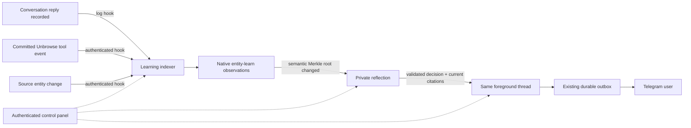

# One conversation, background actors

Aiko keeps one foreground thread per account: `user-<account>`. Telegram and the account SDK use that same durable conversation. Existing identities, history and delivery records are preserved.

Two long-lived background threads are created lazily: `background-<account>-indexer` and `background-<account>-reflection`. They use native Tardigrade components under the stable `aiko` identity, recorded parent/depth relationships, and separate SQLite logs. All actors belonging to an account share its real entity-learn database and `aiko:<account>` scope. Other accounts cannot read, cite, control or select those threads.



## Control panel

Open **http://127.0.0.1:4242/control** on the existing host and enter its private `AIKO_OPERATOR_TOKEN`. The token stays in tab memory. Operators can inspect all registered accounts; account bearer credentials can inspect only their own data and need a write grant to pause/resume hooks.

The panel exposes foreground/background states, paginated events, causal IDs, Merkle transitions, decisions and citations, native memory search, source state, and Telegram delivery outcomes. Payloads render as text. Page/API responses prohibit caching. Locking or switching accounts clears rendered account data.

Pause/resume records `AikoHooksConfigured`. Accepted learning hooks remain queued while paused and resume after restart. An already-running inference can finish; publication waits for resume. Proactive notification preparation and dispatch recheck the current pause policy. A physical send already started cannot be withdrawn or treated as safe to repeat.

## Proactive notification preferences

`GET /api/control/proactive?account=<account>` returns `{account, revision, preferences, writable}`. Omit `account` to select the authenticated account. An account write credential can update its registered foreground thread through `POST /api/control/proactive`:

```json
{
  "account": "123",
  "expectedRevision": "default",
  "operationId": "notification-preferences-1",
  "preferences": {
    "version": 1,
    "enabled": true,
    "quietHours": {"timeZone": "Asia/Singapore", "startMinute": 1320, "endMinute": 420},
    "cooldownMs": 60000,
    "dailyLimit": 8,
    "batchWindowMs": 2000,
    "dismissedTopics": []
  }
}
```

Use the revision from GET and send the complete preferences object. A first successful write returns 202; an identical operation replay returns 200. A stale revision or conflicting operation ID returns 409. Preferences live in `AikoProactivePreferencesSet` facts in the owner's existing log and survive reconstruction. This API does not add preference controls to the current panel.

Defaults are enabled, no quiet hours (`null`), zero cooldown/batch window, eight dispatch reservations per UTC day and no dismissed topics. Quiet hours use local minutes in an IANA time zone, including overnight and daylight-saving transitions. Bounds are seven days for cooldown, 200 daily reservations, one hour for a batch window and 128 dismissed topic digests. A zero daily limit disables updates. Topic digests identify owner-scoped evidence subjects; they are retained with proactive decisions and contain no message text.

Deferral uses the native `proactiveWait` method and host deadlines. Preference changes and relevant settlement events wake pending decisions early. The first retained batch deadline stays fixed; replacing an entire older update requires a newer decision to cover all its topics. Decisions expire 24 hours after creation. Pending bound deliveries reserve admission capacity until settlement or that expiry; they do not imply that a provider was called.

Before preparing speech and again before dispatch, the outbox checks current citations, topic identity and policy. It atomically retains an exact `AikoProactiveDispatchAuthorized`/`AikoDeliveryStarted` pair, confirms that its own claim committed, then checks evidence and policy again. Current proactive replies carry no attachment references, so the sender is invoked directly without awaiting empty attachment hydration after that check. Ordinary attachment-bearing replies retain their delivery-time authorization after `AikoDeliveryStarted`. Dispatch must begin in the claim's UTC day. Failed or unknown dispatch claims conservatively spend that day's slot, including a claim that becomes a known no-send after the final check. An uncertain started delivery is never automatically repeated. These dispatch limits currently govern bound proactive Telegram sends; an API-only prepared conversation update does not spend a Telegram dispatch reservation.

See [proactive-policy.ts](../apps/agent/src/proactive-policy.ts), [the native outbox](../apps/agent/src/actor.ts) and [the channel hook plan](self-composing-harness-plan.md#24-self-created-inboxoutbox-channels-as-harness-bindings). Policy facts and delivery receipts support inspection and recovery; they do not by themselves attest the full relevance or channel-composition acceptance criteria.

## Capability outcomes and routine learning

Native `harness_acquire` calls retain their originating owner, thread, turn and call identity, including the epoch for a reopened invocation. Initial and legacy invocations use epoch zero. The association comes from the actual native invocation; generated arguments cannot attach an acquisition to another task. An exact native cancellation request invalidates notice eligibility before terminal cancellation is recorded. A new verified acquisition can propose one cited capability notice through the existing indexer, reflection and foreground outbox. Promotion records and passively derived `SKILL.md` records still enter learning, but settle silently. Ordinary conversation indexing, connection indexing and user-saved notes also receive a deterministic silent decision before reflection inference.

Native silent decisions retain current citation IDs without requesting inference or delivery. When a decision has an ingestion receipt, it checks that exact database commit and cites its own observation only if it remains current and belongs to the triggering change. Concurrent changes cannot substitute for missing ingestion evidence. Other silent decisions inspect at most eight changed IDs. `supportStatus`, `supportCoverage`, `supportLimit` and the available `supportScopeVersion` describe that bounded validation separately from the historical Merkle snapshot. Missing or stale evidence leaves an explicit unavailable citation status. Model-generated silent outputs still use empty notification text and supports; only a `notify` decision can enter the publisher.

A capability notice must match the current promoted artifact, contract, context, generation and satisfied verification witnesses. It also rechecks current execution authority and context through the configured `HarnessLibraryBinding` before admission, speech preparation and dispatch, then rereads retained state before applying policy. Revocation, retirement, cancelled task association, missing evidence or unavailable context prevents the notice; historical verification does not establish present availability. The actor selects the same registry library as acquisition and enables its source-dependency checks when source tools are mounted. Custom assemblies must supply that binding to `foregroundHooks` and the outbox policy, including the `sourceAware` option when they use source-backed acquisition.

Source eligibility confirms that its retained source relation and head still match after loading the immutable snapshot. Readiness also fences the final asynchronous context query with that source pin. A source refresh during either check makes that query unavailable; a subsequent query can establish eligibility against the new head. These checks do not withdraw a physical operation that already started.

The semantic notice identity comes from the owner and promoted route/artifact generation, independent of generated wording or an individual acquisition request. Requests sharing that verified build coalesce; later artifact reuse does not create another capability notice. Each task execution still retains its own result. This policy covers task-bound acquisition outcomes, not arbitrary provider-hook relevance. Authenticated external learning hooks continue through their own cited reflection decision, and all accepted user updates remain subject to preferences and delivery checks above.

## Selective memory erasure

For an explicit permanent deletion request, the native `memory_erase` tool takes `{subject, expected, expectedScopeVersion}`. Use the current observation ID and `sourceVersion` from a fresh `memory_scan`. The native database transaction rejects a changed head or scope; recovery uses the original tool identity and returns its existing erasure receipt after an acknowledgement loss. `memory_forget` remains retrieval suppression.

Erasure removes the selected subject's history and known `supports`/`dependsOn` dependents. Ordinary navigational links do not make their subjects deletion dependencies. Those facts retain their content and history with removed links and new canonical observation IDs; the receipt's `replacements` maps old IDs to the retained replacements, separately from deleted `observationIds`. Unrelated memory stays available. Tombstones and cumulative replacement proofs prevent replay from reconstructing the deleted native memory content.

Native memory results carry host-only observation dependencies into code-mode custody. Retained result envelopes, derived working-data chunks/manifests and returned working-data handles preserve those dependencies. The configured Bun and Worker bindings retire copies of both deleted observations and the old IDs of rewritten observations. The private store fences reads and future writes before removing the registered ciphertext; independent content and the new canonical observations remain available. Generated JSON cannot attach this host metadata. These dependencies cover registered result paths, not arbitrary copies of matching text.

The receipt includes `resume`, the original owner-scoped native erasure receipt key. If private-copy cleanup fails after the database deletion, the tool reports `outcome: "error"`, `result.erased: true` and `result.copies.status: "pending"`. A new native call to `memory_erase({resume})` resumes that exact cleanup after restart without another memory mutation. The host verifies the original journal receipt and derives its fixed deletion closure; a foreign receipt, ordinary memory receipt or mixed resume/new-deletion request is rejected. A completed cleanup reports `copies.status: "erased"`. An older pending tool return remains a historical receipt; inspect the new cleanup result. No automatic retry scheduler is added.

Cloudflare retains the latest native erasure checkpoint in a host SQL table outside the memory archive and account KV snapshot. Entity-learn's synchronous `onErasure` callback writes that checkpoint inside the deletion transaction; a failed checkpoint write rolls back deletion. An existing verified live journal can initialize the host checkpoint. An empty recovery target cannot infer a zero checkpoint: its trusted host must supply `AIKO_MEMORY_RESTORE_AUTHORITY(owner)`. This is an application capability function, not a Wrangler JSON variable or an archive field. If both local and external authority exist, they must agree.

Account import and both backup restore modes check that authority before accepting an archive, including exact import retries that skip the native memory sidecar. VM-only recovery also requires matching native erasure history in the live account: restore account memory first if it is missing. An empty journal with a retained nonzero checkpoint cannot accept new memory writes until a transaction restores its matching erasure history. If a configured external authority is missing or invalid, new writes to that empty journal also fail closed.

Backup recovery authenticates the bounded `account.json` file before staging VM files, pins the manifest, and rechecks the checkpoint during transfer and before publication. A shared owner gate excludes native erasure, including its private-copy cleanup, while restore runs. A queued erase rechecks cancellation after acquiring the gate. `checkArchiveErasure` is a non-mutating structural, artifact and checkpoint preflight; it explicitly returns `chainVerified: false`. Actual memory import still verifies the journal chain atomically with native history import.

These guards prevent restoration of an older memory checkpoint; they do not certify the contents of every restored store. Earlier actor/chat logs, inputs stored before result association, untracked copies, existing model context, VM/browser stores, backups and forensic disk remnants need separate cleanup. In particular, a matching memory checkpoint does not attest that private-copy cleanup finished or that archived actor/KV/VM data is sanitized. The local authority table does not survive loss or rollback of the entire host database: replacement hosts need independently retained current authority. Automatic external checkpoint custody, the equivalent Bun host integration and full backup sanitization remain open. Legacy unguarded library imports remain compatible; Cloudflare's application routes use the guarded boundary.

## Hook ingress

`POST /v1/hooks` accepts exactly the following fields:

```ts
import { createAikoClient } from "@unlock/sdk/aiko";
const aiko = createAikoClient({ baseUrl, token: accountCredential });
await aiko.hooks.publish({
  id: "release-check-000042", // stable occurrence ID, reused on retry
  subject: "aurora/release",
  title: "Aurora release check",
  kind: "entity",
  type: "release",
  payload: { status: "review_required", check: "Recovery verification failed" },
});
```

Credentials bind the owner. Bodies cannot select an account, thread, filesystem path, memory scope or producer authority. Retrying identical normalized input returns `duplicate`; changing content under the same ID returns 409. Native entity-learn validates JSON and sensitive material, normalizes structured entity identities, records immutable observations, refreshes sources, applies corrections, and supplies recall/citation checks. This is the real vendored 0.2.0 core from `/home/deck/work/entity-learn`. Its incompatible Tardie 0.5 adapter is not loaded. No additional semantic NER engine is claimed.

For the playground's committed browser trace, call `await aiko.hooks.unbrowse(event)` with a native `BrowserNetworkToolPrepared` event (`POST /v1/hooks/unbrowse`). The pinned browser-runtime decoder verifies the definition digest, source digests and exact summary. Only verified summary fields and digests enter memory. Raw request definitions, page dumps and session material are excluded. Connect the producer at its durable trace append boundary and replay the same committed event after an interrupted callback. This endpoint does not launch discovery, copy unrelated existing playground state, or authorize the learned tool to execute.

## Native execution and recovery

The foreground log-memory follower reads actual native sequence numbers in windows of up to 25 events. Each effect processes at most 32 windows. A durable `partial` receipt schedules the next keyed native effect from its committed cursor, including after reconstruction, without another user message. Existing first-attempt keys remain valid. Entity-learn must confirm the window before the cursor advances; an error or sequence gap stops that turn's catch-up with an explicit error receipt. Artifact indexing uses only the validated, committed portion of the window. This catch-up path is separate from semantic Merkle reflection and does not itself send a notification.

Learning provenance uses the existing foreground/indexer components and their keyed effects. `AikoLearningSourceScanned` retains a target digest, fixed upper source cut, contiguous cursor and metadata origins under `aiko-learning-origin/v2`. Each scan consumes at most 64 actual native rows, with bounded lookahead before the cut. It cannot chase receipts appended by its own work. A missing cause, gap or unavailable read settles that target explicitly; another source occurrence can establish its own search without inheriting the earlier failure. Scan progress records source lookup, not a database commit.

An origin binds the owner, actor instance, source thread, actual sequence, event identity/digest and validated window digest. Before forwarding, ingestion and snapshot creation, the component verifies the retained source bytes. Forwarded learning input must also match the same deterministic projection used by its producer. The indexer preserves the original source digest separately from its local receipt digest. Production Bun/Worker bindings supply trusted same-owner source paging; custom assemblies need `MemoryBinding.readSourcePage` to verify another thread. Public history ingress cannot supply native learning receipts or knowledge snapshots.

`AikoLearningIndexed.ingestion` identifies the original entity-learn refresh receipt: owner/scope, source revision, read key, normalized input digest, native database journal sequence/digest and original scope version. A retry recovers that receipt even after unrelated writes. The knowledge event carries the origin, available ingestion receipt, snapshot scope and start/end scope versions through reflection and decision records. A log-follower snapshot has its own source origin; it does not invent a new hook-ingestion receipt. Snapshot versions describe the whole observed corpus, so a trigger is not a claim that it alone caused every changed or removed leaf. Missing retained evidence remains unavailable instead of substituting current database state for the original commit.

- Keyed component effects and `Router.send` own every handoff. The receiver deduplicates before the sender records its receipt. Recovery resends the same key without another model call or Telegram send. There is no application agent scheduler or timer-driven job queue.
- The `aiko-memory-semantic/v2` Merkle policy hashes sorted current, non-stale memory content, excluding timestamps and occurrence IDs. Source revocation and stale dependencies remove evidence from the root; reauthorizing unchanged content restores the same content root. The v2 hash domains distinguish this eligibility policy from older snapshots. Raw log episodes remain searchable but do not move the semantic root. Reflection rechecks current evidence before assembling its input and excludes stale changed metadata; an entirely unavailable change records a silent decision without inference. Unchanged content and empty/deletion-only changes also stay silent.
- Reflection uses native inference and compaction with bounded cited evidence. It has no browser, shell or send tools. Its exact JSON decision contract requires current, non-stale, same-account citations from the changed set. Foreground acceptance validates evidence again.
- Accepted notifications use the existing outbox. Proactive Telegram delivery requires a previously verified private-chat event for that account. Prepared proactive speech becomes part of subsequent foreground model history, so users can respond naturally.
- Existing account/global model allowances cover reflection. Foreground work has priority when runtime capacity becomes available. Telegram control commands remain model-free.
- `AikoHooksActivated` is inserted after existing history at rollout. Old completed conversations do not become fresh alerts.
- Native source-approval recovery distinguishes interrupted registration from administrative revocation/quarantine. Revoked sources remain disabled. Background failures are recorded. Telegram send-start without acknowledgement remains `unknown` and is not blindly retried.

## Bounds and deployment

Semantic snapshots allow 256 accessible heads and a separate 4,096-episode context scan. Capacity exhaustion or inconsistent concurrent reads produces a background failure rather than a partial root reported as complete. Reflection input is bounded to 32,000 characters; oversized changes produce an explicit silent decision with an inspection reason. Hook ingress allows 30/minute and 10,000 lifetime occurrences per account, alongside existing model/admission limits. After repairing a failed source, use a new source occurrence ID for a deliberate retry; transport retries retain their original ID.

The control panel shares the loopback service and preserves Host/Origin checks. The custom embedded Bun host exposes durable traces through `/control`; do not run a second `tdg dev` host against this state. Account files are private under one OS identity, not separate adversarial OS sandboxes or encrypted custody. Existing host availability, off-host backup, retention and public deployment limits are described in [aiko-production.md](aiko-production.md).

Before the 2026-09-06 service update, nine state files were backed up offline to `/home/deck/.local/share/unbrowse/aiko/backups/pre-background-20260906`. The previous compiled executable is retained at `apps/agent/dist/main.before-background-20260906.js`. For rollback, stop the service and restore the complete verified snapshot to a new private directory, preserve the stable instance ID, and run the old executable from the agent package. Preserve newer state separately for reconciliation. Do not point the old runtime at the new background logs.

## Verification

Baseline: 27 native actor/memory/gateway tests passed. The completed workspace suite passed 219 tests with 33 existing database-dependent tests skipped; the additional Unbrowse HTTP regression also passed. `pnpm typecheck`, `pnpm build` and `pnpm aiko:build` passed. No model or dependency version changed. Regressions cover isolation, semantic deduplication, restart, two lost handoff receipts, approval/revocation races, rollout, invalid citations and proactive foreground history.

`artifacts/aiko-background/browser/` contains 21 functional browser checks at 1440px and 375px, screenshots, zero automated axe violations and two incomplete checks per viewport. The frontend-design skill informed the foreground/background lanes and event-first inspection. Native execution followed the Tardigrade skill; code-review-and-quality caught missing foreground notification history and reflection compaction.

`bun scripts/verify-aiko-background.ts --allow-paid` runs an isolated real-model canary with a three-request allowance and no Telegram transport. `--live` uses the existing provisioned account-plane credential on the running host. The canary is explicitly non-notifying and verifies native learning, reflection and duplicate admission. Provider cost and token totals are not measured; request counts are not dollar estimates. Staging/live metadata is retained under `artifacts/aiko-background/`.
