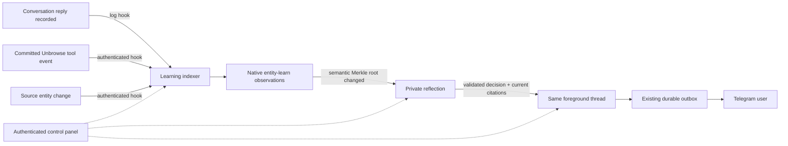

# One conversation, background actors

Aiko keeps one foreground thread per account: `user-<account>`. Telegram and the account SDK use that same durable conversation. Existing identities, history and delivery records are preserved.

Two long-lived background threads are created lazily: `background-<account>-indexer` and `background-<account>-reflection`. They use native Tardigrade components under the stable `aiko` identity, recorded parent/depth relationships, and separate SQLite logs. All actors belonging to an account share its real entity-learn database and `aiko:<account>` scope. Other accounts cannot read, cite, control or select those threads.



## Control panel

Open **http://127.0.0.1:4242/control** on the existing host and enter its private `AIKO_OPERATOR_TOKEN`. The token stays in tab memory. Operators can inspect all registered accounts; account bearer credentials can inspect only their own data and need a write grant to pause/resume hooks.

The panel exposes foreground/background states, paginated events, causal IDs, Merkle transitions, decisions and citations, native memory search, source state, and Telegram delivery outcomes. Payloads render as text. Page/API responses prohibit caching. Locking or switching accounts clears rendered account data.

Pause/resume records `AikoHooksConfigured`. Accepted hooks remain queued while paused and resume after restart. An already-running inference can finish; publication waits for resume. Already accepted outbox deliveries are not withdrawn.

## Hook ingress

`POST /v1/hooks` accepts exactly the following fields:

```ts
import { createAikoClient } from "@unlock/sdk/aiko";
const aiko = createAikoClient({ baseUrl, token: accountCredential });
await aiko.hooks.publish({
  id: "release-check-000042", // stable occurrence ID, reused on retry
  subject: "aurora/release",
  title: "Aurora release check",
  kind: "entity",
  type: "release",
  payload: { status: "review_required", check: "Recovery verification failed" },
});
```

Credentials bind the owner. Bodies cannot select an account, thread, filesystem path, memory scope or producer authority. Retrying identical normalized input returns `duplicate`; changing content under the same ID returns 409. Native entity-learn validates JSON and sensitive material, normalizes structured entity identities, records immutable observations, refreshes sources, applies corrections, and supplies recall/citation checks. This is the real vendored 0.2.0 core from `/home/deck/work/entity-learn`. Its incompatible Tardie 0.5 adapter is not loaded. No additional semantic NER engine is claimed.

For the playground's committed browser trace, call `await aiko.hooks.unbrowse(event)` with a native `BrowserNetworkToolPrepared` event (`POST /v1/hooks/unbrowse`). The pinned browser-runtime decoder verifies the definition digest, source digests and exact summary. Only verified summary fields and digests enter memory. Raw request definitions, page dumps and session material are excluded. Connect the producer at its durable trace append boundary and replay the same committed event after an interrupted callback. This endpoint does not launch discovery, copy unrelated existing playground state, or authorize the learned tool to execute.

## Native execution and recovery

- Keyed component effects and `Router.send` own every handoff. The receiver deduplicates before the sender records its receipt. Recovery resends the same key without another model call or Telegram send. There is no application agent scheduler or timer-driven job queue.
- The Merkle root hashes sorted semantic memory content, excluding timestamps and occurrence IDs. Raw log episodes remain searchable but do not move the semantic root. Unchanged content avoids model calls; empty/deletion-only changes record a silent decision.
- Reflection uses native inference and compaction with bounded cited evidence. It has no browser, shell or send tools. Its exact JSON decision contract requires current, non-stale, same-account citations from the changed set. Foreground acceptance validates evidence again.
- Accepted notifications use the existing outbox. Proactive Telegram delivery requires a previously verified private-chat event for that account. Prepared proactive speech becomes part of subsequent foreground model history, so users can respond naturally.
- Existing account/global model allowances cover reflection. Foreground work has priority when runtime capacity becomes available. Telegram control commands remain model-free.
- `AikoHooksActivated` is inserted after existing history at rollout. Old completed conversations do not become fresh alerts.
- Native source-approval recovery distinguishes interrupted registration from administrative revocation/quarantine. Revoked sources remain disabled. Background failures are recorded. Telegram send-start without acknowledgement remains `unknown` and is not blindly retried.

## Bounds and deployment

Semantic snapshots allow 256 accessible heads and a separate 4,096-episode context scan. Capacity exhaustion or inconsistent concurrent reads produces a background failure rather than a partial root reported as complete. Reflection input is bounded to 32,000 characters; oversized changes produce an explicit silent decision with an inspection reason. Hook ingress allows 30/minute and 10,000 lifetime occurrences per account, alongside existing model/admission limits. After repairing a failed source, use a new source occurrence ID for a deliberate retry; transport retries retain their original ID.

The control panel shares the loopback service and preserves Host/Origin checks. The custom embedded Bun host exposes durable traces through `/control`; do not run a second `tdg dev` host against this state. Account files are private under one OS identity, not separate adversarial OS sandboxes or encrypted custody. Existing host availability, off-host backup, retention and public deployment limits are described in [aiko-production.md](aiko-production.md).

Before the 2026-09-06 service update, nine state files were backed up offline to `/home/deck/.local/share/unbrowse/aiko/backups/pre-background-20260906`. The previous compiled executable is retained at `apps/agent/dist/main.before-background-20260906.js`. For rollback, stop the service and restore the complete verified snapshot to a new private directory, preserve the stable instance ID, and run the old executable from the agent package. Preserve newer state separately for reconciliation. Do not point the old runtime at the new background logs.

## Verification

Baseline: 27 native actor/memory/gateway tests passed. The completed workspace suite passed 219 tests with 33 existing database-dependent tests skipped; the additional Unbrowse HTTP regression also passed. `pnpm typecheck`, `pnpm build` and `pnpm aiko:build` passed. No model or dependency version changed. Regressions cover isolation, semantic deduplication, restart, two lost handoff receipts, approval/revocation races, rollout, invalid citations and proactive foreground history.

`artifacts/aiko-background/browser/` contains 21 functional browser checks at 1440px and 375px, screenshots, zero automated axe violations and two incomplete checks per viewport. The frontend-design skill informed the foreground/background lanes and event-first inspection. Native execution followed the Tardigrade skill; code-review-and-quality caught missing foreground notification history and reflection compaction.

`bun scripts/verify-aiko-background.ts --allow-paid` runs an isolated real-model canary with a three-request allowance and no Telegram transport. `--live` uses the existing provisioned account-plane credential on the running host. The canary is explicitly non-notifying and verifies native learning, reflection and duplicate admission. Provider cost and token totals are not measured; request counts are not dollar estimates. Staging/live metadata is retained under `artifacts/aiko-background/`.
