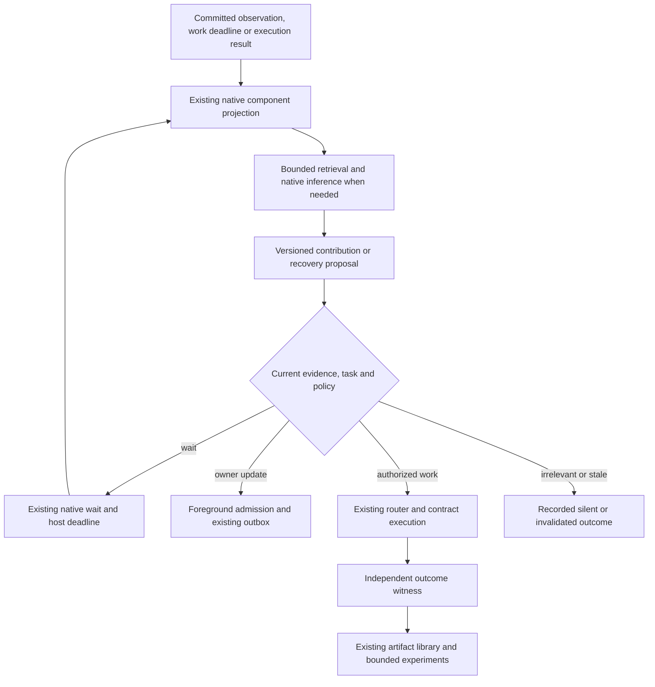

# Aiko: native recovery, procedural learning and proactive behavior

Prepared 2026-09-08. **Status: proposed implementation plan.** This document records the requested design; it does not enable optimization, change the running actor or establish measured gains.

Implementation progress and evidence are tracked in [the implementation status](aiko-cognitive-behavior-status.md). Acceptance criteria below remain the target.

## Outcome and scope

Aiko should recover from a failed approach, reuse procedures that have earned trust, and bring useful developments to the owner at an appropriate moment. Success means more completed work and less owner effort at an acceptable cost in time, inference and interruptions.

Extend the existing `aiko` actor and its native components. Preserve Tardie 0.22.0, Effect, entity-learn, the existing account boundaries, foreground conversation, background threads, tool router, contract/witness library and durable outbox. CoALA supplies a vocabulary; Soar supplies mechanisms to adapt. There is no proposed dependency on cognitive_base or a replacement Soar runtime.

This supplements [the self-composing harness plan](self-composing-harness-plan.md), especially section 21 on proactive updates, [the secretary operating model](secretary-operating-model.md), and [the evaluator plan](aiko-evaluator-improvement-plan.md). Their acceptance requirements remain intact. A passing experiment here cannot confer acceptance credit on an unverified parent requirement there.

## Research and the hypothesis to test

[CoALA](https://arxiv.org/abs/2309.02427) organizes agents around memory, actions and decision procedures; it does not establish a benchmark-winning implementation. [Soar chunking](https://soar.eecs.umich.edu/soar_manual/04_ProceduralKnowledgeLearning/) learns procedural rules from subgoal results. Our adaptation is a checked executable procedure, not a claim to implement that formal algorithm. [Voyager](https://voyager.minedojo.org/) supplies task-specific evidence for reusable skills. [GEPA](https://arxiv.org/abs/2507.19457) supplies evidence for trace-guided, evaluated improvement. Neither transfers its reported gains to Aiko automatically.

**Proactiveness reference:** [Proactive Conversational Agents with Inner Thoughts, Liu et al., CHI 2025, arXiv:2501.00383v2](https://arxiv.org/abs/2501.00383). The framework separates triggering, retrieval, contribution formation, evaluation and participation, with retention and revision of unspoken contributions. Its simulation study used 100 conversations and 10 human evaluators; 82% of pairwise preferences favored Inner Thoughts. A separate Slack study involved 12 participants; preferences varied, and most rating differences between proactivity styles were not significant. These are findings about casual multi-party conversation, not verified task completion, durable execution or broad assistant SOTA. Task-oriented adaptation is a hypothesis. We take the separation of useful content from participation timing, but omit random chatter and increasing motivation merely because the agent has been silent. Our proposed pending contributions are bounded, evidence-backed task records, not a stored stream of private reasoning or a simulation of human experiences.

[ReFind](https://arxiv.org/abs/2608.12888), an August 2026 preprint, motivates retaining a simple searchable-history baseline: elaborate memory structure must earn its cost empirically.

## Existing implementation and exact extension points

| Responsibility | Existing location | Planned extension |
|---|---|---|
| Main agent and delivery | [`actor.ts`](../apps/agent/src/actor.ts), `createAikoActor`, `voiceAndOutbox` | Mount revised native policies; preserve `aiko` identity and existing delivery route |
| Episodes and semantic knowledge | [`memory.ts`](../apps/agent/src/memory.ts), [`log-memory.ts`](../apps/agent/src/log-memory.ts), entity-learn | Retrieve bounded task evidence with provenance and freshness; retain existing correction/invalidation semantics |
| Background reasoning | [`background.ts`](../apps/agent/src/background.ts), `createReflectionActor`, `REFLECTION_OUTPUT` | Version the current notify/silent contract to support pending contributions and evidence-backed reevaluation |
| Notification timing | [`proactive-policy.ts`](../apps/agent/src/proactive-policy.ts), `proactiveWaitMethod` | Reuse admission, deadlines, quiet hours, dismissal, batching and dispatch reservations |
| Work and follow-through | [`commitments.ts`](../apps/agent/src/commitments.ts), [`secretary-coordination.ts`](../apps/agent/src/secretary-coordination.ts) | Bind contributions and recovery to current work versions and native deadline/result events |
| Execution authority | [`secretary-policy.ts`](../apps/agent/src/secretary-policy.ts), registry bindings | Reuse current mandates, context and tool checks for any suggested action |
| Reusable procedures | [`tool-workflows.ts`](../apps/agent/src/tool-workflows.ts), [`harness-library.ts`](../apps/agent/src/harness-library.ts), [`harness-acquisition.ts`](../apps/agent/src/harness-acquisition.ts) | Add evidence-backed applicability and recovery metadata to existing artifacts where needed |
| Learning experiments | [`harness-experiment.ts`](../apps/agent/src/harness-experiment.ts), registry optimization | Use fixed cases, native child trials, budgets, lineage and held-out comparisons |

Current background reflection handles committed semantic changes and returns `notify` or `silent`. Its notification supports must belong to the changed observation set. Foreground policy already defers eligible updates and revalidates delivery. Retaining an unsaid idea for a later context, or citing an older still-current task fact, therefore requires explicit versioned contracts and validation changes; a prompt edit alone cannot implement it.

Current proactive defaults are enabled, no quiet hours, zero cooldown/batch window and eight daily dispatch reservations. Preserve user settings. Any experimental defaults below belong to a versioned test policy, not an implicit migration. See [current behavior and limits](aiko-background.md).

## Native execution contract

Pure component projections derive state and schedule keyed native effects. I/O, inference and handoffs occur through those effects, native `Infer` and `Router.send`; waiting uses actor methods and host deadlines. Rebuilding state performs no inference, external work or notification. Resume only unsettled work according to the runtime's actual recovery semantics; do not promise exactly-once physical model calls after an uncertain provider boundary.

Keep `user-<owner>`, `background-<owner>-indexer` and `background-<owner>-reflection`. Add a native component only if the responsibility cannot fit the existing component cleanly. No application polling loop, interval-driven inner monologue, second scheduler or additional memory database is required. Reflection remains unable to send messages or execute external actions.

## Phase 0 — Freeze a useful comparison

1. Record the current source revision and dirty-worktree digest, dependency lock, actor assembly, provider/model, policies, task fixtures and initial memory snapshot. Baselines use isolated owner/thread state with equivalent histories.
2. Turn an initial 60 scenario families into executable fixtures: 20 recovery, 20 procedural transfer and 20 proactive timing/follow-through. Within each category use 10 development, 5 validation and 5 protected test families. Variants stay with their family. Include both action opportunities and situations requiring silence.
3. Reuse the Telegram evaluator's receipt-based completion and communication rubric. Use controlled native-host scenarios for timing and effect assertions; do not send benchmark messages to real contacts. Human quality ratings and deterministic correctness remain separate.
4. Compare current Aiko, current Aiko plus each individual mechanism, and the combined candidate. For memory-sensitive tasks include a tool-using searchable-history baseline with the same model, tools and budget. Add a direct notify/silent prompt baseline to isolate whether retaining contributions improves proactiveness.

Exit: runnable scenarios, fixed scoring and equivalent baseline traces. The existing 200-question bank is a source of candidates, not 200 already executable or protected cases.

## Phase 1 — Selective proactive contributions

Extend background reflection with a small reservoir of pending **contributions**, each representing a concrete useful result, suggestion or unresolved decision. The following fields describe a proposed versioned event contract, not an existing API:

| Field group | Required meaning |
|---|---|
| Identity | Owner, source thread/event/cursor, semantic topic, contribution ID and revision |
| Task | Native task/commitment reference and version, or explicit bounded evidence of an owner-relevant need |
| Evidence | Immutable observation/witness references, relevant dependency revisions, triggering change and coverage limits |
| Proposal | Short proposed contribution, intended recipient, usefulness/urgency/novelty assessments and a concise decision reason |
| Lifecycle | Proposed, deferred, eligible, accepted, suppressed, superseded, expired or invalidated |
| Timing | Creation, fixed expiry, next eligible native deadline and policy version |
| Delivery | Existing decision/outbox references and actual settlement status |

Treat scores as ranking features to calibrate, not probabilities or authority. Start with deterministic admission checks followed by at most one bounded inference that proposes up to three candidates. Rank task relevance, usefulness, urgency and novelty against interruption cost. Keep hard authority and evidence checks outside the model score.

Triggers are meaningful committed source changes, current work deadlines/results, and relevant foreground context changes. Raw conversation indexing remains silent by default. An authorized work deadline can matter without a new semantic Merkle root: route it through the existing work coordinator rather than manufacturing a memory change. Delivery bookkeeping cannot create fresh candidates.

Revisit a deferred contribution when its task/context changes or its existing native wait becomes due. Supersede it when the owner corrects the requirement; invalidate it when support expires, a task is cancelled or authority changes. Deduplicate by semantic outcome and topic, independently of wording. Retain short structured decisions and references; avoid copying private payloads into a second store.

For older supporting evidence, preserve the triggering changed-set reference separately from retrieved support. A versioned validator must establish owner, allowed source, exact identity, current status and task association for both. Update producer, decoder, event keys, cross-thread admission and outbox validation together. Old event versions keep their old validation semantics; legacy silent decisions do not become pending contributions on replay.

Participation outcomes are **silent, defer, notify owner, or propose an authorized next step**. Useful preparation may proceed through existing task execution when an existing mandate permits it. A model's judgment that an action is useful does not grant that mandate. Existing authorization is reused without another approval request. Owner handoff, pause, dismissal and recipient bindings continue to apply.

Proposed test bounds: 16 pending contributions per owner, three new candidates per relevant event, one decision call capped at 1,500 output tokens, and at most two reevaluations per contribution unless new material evidence arrives. Earlier expiry wins between the task deadline and 24 hours. Deterministically settle overflow and exhaustion with a reason. Preserve stricter host/account budgets and foreground priority. No silence-age boost or automatic quiet-hours override.

Acceptance: a useful update is retained during ongoing work, revised after a correction, and delivered once at a suitable opportunity; an irrelevant update stays silent without losing the genuine opportunity later. Test expired evidence, user dismissal, task cancellation, quiet hours/DST, backlog bounds, restart and uncertain send settlement. Background silence must not suppress a direct user question or required foreground response.

## Phase 2 — Explicit impasse recovery

Detect lack of progress from native tool outcomes and task state: repeated equivalent failure with unchanged relevant state, an unmet prerequisite, unavailable capability, or a failed independent check. Slow legitimate work and normal provider waiting are not impasses.

Record the parent task/version, goal and success condition, failure signature, relevant state digest, evidence, attempted strategies, remaining budget and proposed recovery. Resolve the smallest missing prerequisite through existing tools and native task/child execution, then resume the parent only after a checked result. Do not create a competing top-level task ledger.

Proposed initial bounds: after two equivalent failures, allow at most two distinct recovery strategies and one recovery subgoal level within the parent's remaining budget. Useful strategies include retrieving a prior verified resolution, refreshing a changed schema, finding another currently authorized capability, or obtaining information only the owner can supply. An uncertain write is reconciled before another attempt; a different transport must not repeat the same uncertain action.

Acceptance: recovery improves completion on held-out failure cases, reduces repeated identical tool calls and preserves cancellation/restart behavior. Exhaustion records an actionable blocker with completed partial work. Recovering a child does not mark the parent successful without its own outcome check.

## Phase 3 — Procedures learned from checked work

Use successful workflow crystallization and harness artifacts as the procedural memory. Derive reusable input parameters, initiation conditions, dependency/schema versions, terminal outcome contract and bounded recovery guidance from retained runs. Separate a narrow saved example from a generally eligible procedure.

Reuse existing acquisition, evaluation and promotion paths. Parameterization must succeed on new inputs and changed contexts; failures and unknown outcomes remain in lineage. A successful run can seed a candidate but cannot alone establish broad applicability. Invoke eligible procedures through the existing router and recheck current authority/dependencies on every run.

When a dependency changes, invalidate affected applicability and run a bounded repair experiment if the existing experiment policy permits it. Ordinary reuse does not launch optimization. Keep task execution, candidate generation and promotion distinct in the log. Optional repair suggestions feed the same contribution policy; routine learning remains quiet.

Acceptance: correct reuse on held-out inputs, rejection when prerequisites change, fewer repeated model/tool steps after warmup, and a complete native run/check/promotion/reuse trace. Measure acquisition and validation costs as well as warm-run savings; report the number of uses needed to recover those costs.

## Phase 4 — Tardigrade validation and controlled adoption

Follow the installed tardigrade skill's trace-guided GEPA workflow. Start with focused instruction changes where sufficient; versioned native state changes above require implementation and contract tests. Reuse the native experiment machinery rather than installing DSPy or another optimizer.

Keep the deployed actor identity `aiko` stable. Prefer artifact candidates already supported by our experiment library. If actor-source experiments need distinct names for CLI trace attribution, use them only in isolated evaluation assemblies; record their exact source/build digests and never rename or seed over the production actor/history. The local source/lock manifest is required even if the trace does not record an immutable actor digest.

For the implementation run, build the actual assembled actor and discover its methods through `tdg methods --json`; use `tdg call ... --thread ... --json` and `tdg events ... --json` on isolated fixture threads. Confirm installed CLI capabilities before fixing the invocation. The skill's relative CLI/server guide files were absent at the installed paths during this planning pass; resolve current documentation before CLI execution. No CLI build or experiment was run to prepare this plan.

Proposed first optimization budget: one unchanged baseline and at most four focused candidates per mechanism; at most 120 scored development scenario runs, two hours wall time and $10 total provider spend per mechanism, whichever limit arrives first. These are proposed ceilings, not spend incurred or enabled by this document. Reserve a separately recorded validation/test budget before starting; use native accounted limits and stop when spend cannot be bounded. Do not consume the protected test set during candidate search. A failed test requires a new independent test set for a later performance claim.

Before adoption, run focused native behavior/recovery tests plus the repository's `pnpm typecheck`, `pnpm test`, `pnpm build` and `pnpm aiko:build`. Exercise both Bun and Worker assembly paths. Preserve unrelated failures and source drift explicitly. Existing self-composing verifier pins are refreshed only through their established evidence workflow, never simply to make the gate green.

| Measurement | Proposed promotion criterion |
|---|---|
| Recovery | At least 10 percentage points better completion on the recovery validation set; no increase in repeated identical failures |
| Procedural reuse | Same or better checked correctness and at least 20% fewer warm-run model calls; disclose cold learning cost |
| Proactive decisions | At least 90% precision on judged-useful notifications and 80% recall on labelled opportunities; report numerator/denominator |
| Communication | No regression in direct answers; blinded ratings of usefulness and timing at least as good as current Aiko |
| Operational invariants | Zero observed duplicate external effects, cross-owner leakage or stale/unauthorized dispatch in the adversarial suite |
| Resource use | No more than 10% p95 foreground latency regression; remain within fixed model/tool budgets |

These are engineering targets, not research-derived guarantees. Small initial sets screen candidates and cannot establish population reliability. Run repeated trials for nondeterministic behaviors, report paired differences and uncertainty, and expand the evaluation before broad deployment. Count missed opportunities and unnecessary interruptions together so always-silent and always-speaking policies cannot win by optimizing one metric.

Adoption sequence: deterministic fixtures → isolated native provider evaluation → owner-scoped shadow decisions using current approved sources → limited enabled behavior on an authorized target. Shadow mode sends nothing and still accounts for inference. Enabling a broader rollout requires evidence and the existing target authorization. Rollback disables the new policy version while retaining history, receipts and current user preferences; it does not replay old pending contributions as new work.

## First implementation slice and completion evidence

Start with **one waiting commitment whose verified prerequisite becomes ready while the owner is busy**. Existing work evidence triggers reflection; Aiko retains a concise contribution, revises or cancels it if the commitment changes, and uses native `proactiveWait` plus the outbox to notify once when permitted. Include a restart between deferral and delivery and a correction before dispatch. This proves the central paper-inspired behavior on our existing design before adding broader recovery or learning.

The implementation is complete only with: source/build/lock and policy digests; exact native thread IDs and available Voyager trace URLs; comparable baseline/candidate scores; actual model tokens, spend, latency and tool calls; recovered-state witnesses; observed regressions; and the explicit rollout/rollback state. Label missing measurements unavailable. Until then, this remains a proposed plan with no SOTA or production-readiness claim.
