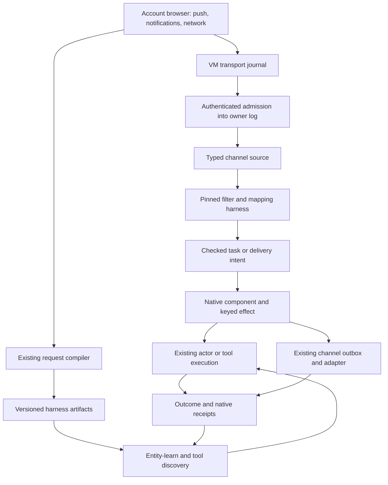

# Browser events and reusable tools through Tardigrade

Design and implementation plan, updated 2026-09-09. Grounded in the current Unlock working tree and its pinned `tardie@0.22.0`; this is an implementation plan, not a claim of deployment or live push support.

**Is this already done? Partly.** Request memory already learns supported network operations and recalls them with fresh inputs. The working tree also contains browser-event admission, new source kinds, and harness revision tools. The optional watch component is now mounted through the hosted channel assembly, with driver/VM lease handling and focused tests. Watch and Saved tools controls are mounted, with native actor/harness actions and optional deployment catalogs. The complete journey still needs the remaining production bindings and end-to-end verification. Code presence does not establish a working deployed feature; the [implementation evidence record](browser-events-status.md) tracks the remaining gates.

## Outcome and architectural decision

A person should be able to teach Aiko an operation once, use it with different inputs later, and ask Aiko to perform it when a connected site changes. For example: “Learn how to fetch a request's details. When this site announces a new request, fetch it and prepare a summary.” The person can inspect the learned operation, change it, test the revision, and choose which ongoing tasks use it.

Use **browser observations as typed channel sources, reusable operations as immutable harness artifacts, and ongoing tasks as retained connections between them**. Tardigrade's log owns admission, wiring, invocation, waiting and settlement. The browser VM supplies observations and execution capabilities. Entity-learn and the tool router help find existing knowledge and operations.

This extends the [self-composing harness architecture](self-composing-harness-plan.md), especially its channel design, and the [request-memory implementation](request-memory-and-workflows.md). It does not require another event bus, agent loop, workflow database or tool registry. A small VM transport journal remains necessary to survive a disconnected host; it is not the authority for task completion.



An event answers “what happened?” A tool answers “what can we do again?” A connection answers “when this happens, which authorized task should run?” One network observation can provide evidence for both an event and a tool, but those records have different identities and lifecycles.

## Existing implementation and exact gaps

| Area | Inspected implementation | Extension needed |
| --- | --- | --- |
| Runtime | [Actor assembly](../apps/agent/src/actor.ts), [Cloudflare host](../apps/agent/src/cloudflare-host.ts), native components, keyed effects, Router and code-mode continuations | Source and intent bridges use these host gates, keys, cancellation and alarms. Complete production mounting and the live journey while preserving actor identity and historical events. |
| Browser package | [Shared-source setup](shared-browser-runtime.md) and [agent dependency](../apps/agent/package.json) link `@unbrowse/browser-harness` directly to the sibling playground's `runtime/` | Put generic network capture/compiler work in that source package; owner custody, background-event capture and hosted lifecycle stay in Unlock. The user restored direct linking on 2026-09-08; do not recreate the former snapshot. |
| Capture and transport | [Browser learning](../apps/agent/src/browser-learning.ts), [event queue](../apps/agent/src/browser-event-queue.ts), and a new [background collector](../apps/agent/src/cdp-background-listener.ts) | The [watch runner](../apps/agent/src/browser-watch-runner.ts) integrates private lifecycle and independent forwarding in controlled tests. Verify real subscribed push, provider continuity and restart while preserving existing network evidence. |
| Sources | [Channel log sources](../apps/agent/src/channel-log-source.ts) now declare `browser-push`, `browser-notification`, and `browser-network` alongside the three existing kinds; [admission](../apps/agent/src/browser-events.ts) validates signed batches | Watch-owned producer configuration and source activation are tested. Verify supported-site coverage and real capture; `browser-result` remains tool outcome metadata. |
| Wiring | [Channel wiring](../apps/agent/src/channel-wiring.ts), [integration guide](../apps/agent/src/channel-wiring-integration.md), [hook lifetime](../apps/agent/src/channel-hook-lifetime.ts) | The task bridge reuses ports, concrete handler pins, receiving grants, watermarks, standing adoption and native waits. Finish the real hosted browser-to-action witness and exact action-cause propagation. |
| Learned requests | [Request memory](../apps/agent/src/request-memory.ts), [observed execution](../apps/agent/src/observed-network.ts), [tool router](../apps/agent/src/tool-router.ts) | Reuse search, caller parameters, fresh dependency resolution and eligible HTTP execution. Join them to the revision experience and watch dispatch. |
| Reusable code | [Harness library](../apps/agent/src/harness-library.ts), new [revision facade](../apps/agent/src/harness-revisions.ts), [code harness](../apps/agent/src/code-harness.ts), [tool workflows](../apps/agent/src/tool-workflows.ts) | The library exposes inspect/revise/evaluate/promote/recall tools. Complete the product journey and applicable executor bindings. A recorded network candidate is not automatically executable, and a successful example is weaker evidence than verified transfer to new inputs. |
| Existing automations | [Automations](../apps/agent/src/automations.ts) listen for broad event types and dispatch configured prose into the foreground actor | Preserve compatibility. The new precise browser rules use typed connections; an actor bridge reuses existing admission/serialization behavior when judgment is needed. |
| External channels | [Provider adapter](../apps/agent/src/provider-adapter.ts), [channel host](../apps/agent/src/channel-host.ts), existing outbox lifecycle and a new [webhook adapter](../apps/agent/src/webhook-adapter.ts) | Join configured webhook destinations to watch dispatch and both hosts. Adapter code alone does not establish delivery readiness or receiver idempotency. |

Current channel wiring restricts declared handler effects to `pure`, `channel.reply`, and explicitly granted `channel.manage`. Managed child handlers have additional restrictions. Connecting a learned HTTP operation as an unrestricted channel handler is therefore **not** an existing supported path. The first implementation uses a pure verified mapper followed by a trusted intent consumer that invokes the current execution adapter under its normal authority checks.

## 1. Capture facts at the browser boundary

### Push and notifications

First test CDP `BackgroundService.startObserving` and `setRecording` for `pushMessaging` and `notifications`. The domain is experimental and emits existing recorded events on observation as well as new events. Its `instanceId` groups related events; it is not specified as a universal unique occurrence key. [CDP BackgroundService](https://chromedevtools.github.io/devtools-protocol/tot/BackgroundService/).

Chromium's push implementation records receipt metadata and, for successful encrypted messages, a payload. This is evidence for a capture experiment, not proof that our pinned CloakBrowser exposes every field or that the application payload is semantically readable. [Chromium push implementation](https://chromium.googlesource.com/chromium/src/+/lkgr/chrome/browser/push_messaging/push_messaging_service_impl.cc).

Subscribe through the site's ordinary permission and account flow. The browser owns its push subscription and transport keys. The subscription endpoint is the destination used by the site's server, not a webhook URL we can replace with ours. [Push API](https://www.w3.org/TR/push-api/).

Inspect a site's service worker when needed to understand payload structure, notification mapping and follow-up requests. Record the inspected script/version as decoder evidence. Start with observation rather than modifying worker code. Worker injection introduces startup/update races and should be a separately demonstrated fallback. Do not suppress notifications or change site subscription behavior as a hidden consequence of enabling capture.

### Network observations

Continue capturing through the existing browser trace and request compiler. Derive two outputs from the same retained evidence:

- A bounded occurrence such as “this connection completed a matching request,” with status and an authorized result reference where available.
- A candidate callable request graph, with explicit caller inputs, response dependencies, schemas and execution requirements.

Scope subscriptions by connection, normalized origin, method, route template and outcome. Redact query values and private bodies before general log admission. A matching HTTP request does not by itself prove “a new order was created”; that semantic claim requires a versioned decoder and checked response or subsequent read. HTTP method alone does not prove whether an operation has side effects.

For the first slice, use the currently supported request/response observations. Service-worker network coverage, WebSocket frames, SSE payloads, streams and uploads require separate capability checks and adapters. Attaching CDP observation must not interfere with private login, navigation, cancellation or the existing browser controller.

## 2. Admit each occurrence once, then use native channel sources

Use the existing account host as the receiving boundary. A proposed internal browser-batch route authenticates a producer credential bound to the account, browser profile and current source generation. The body cannot select an owner, arbitrary native event type, destination thread or receiving grant. Keep `/v1/hooks`' existing learning-input contract intact.

Persist the occurrence identity and permitted payload before forwarding. A transport envelope needs these fields; this is a proposed application contract, not a new Tardigrade API:

| Field | Purpose |
| --- | --- |
| Producer identity and epoch | Trusted profile-bound identity; a new epoch after replacement/reset prevents cursor collisions. Ordinary reconnect retains the existing epoch. |
| Sequence and occurrence ID | Durable monotonic transport position and stable event identity, assigned before send. |
| Source generation and connection revision | Fence retired subscriptions, reassigned accounts and stale browser sessions. |
| Kind and schema/decoder version | Distinguish push receipt, notification display, network settlement and explicitly verified semantic events. |
| Origin and registration/request reference | Connect the observation to its actual source and retained evidence. |
| Observed time and received time | Explain delivery lag; neither substitutes for ordered stream cursors. |
| Cause and correlation | Link related events and originating tool/automation work without asserting correlation from timing alone. |
| Bounded structural fields and private payload reference | Support filters and authorized hydration without logging cookies, credentials or raw private response bodies. |

The receiver retains the identity-to-content commitment. Identical retries return the prior receipt; changed content under the same identity is a conflict. Acknowledge only a contiguous prefix of durably accepted or explicitly rejected items. A queue cursor advances after host acceptance, and a channel source cursor advances after inbox admission; these are different checkpoints. Partial batches, missing retained payloads and gaps stay visible.

Before journaling CDP replays, deduplicate with a versioned fingerprint including source identity, service, registration/storage scope, source timestamp, event name and available source message identity. Persist that mapping across collector restarts. Test the fingerprint against real repeated notifications; two messages with identical text are not necessarily duplicates. Where the source lacks enough identity to distinguish events reliably, report that limitation and require state reconciliation for consequential actions.

After admission, extend the existing channel log-source allowlist with explicit kinds such as `browser-push`, `browser-notification` and `browser-network`. Normalize them from trusted host facts into typed inbox values. Retain source sequence, provenance and causal references, using the existing source cursor/gap and receiving-grant machinery. Do not let arbitrary page JSON impersonate a checked harness result.

Default new subscriptions to the recorded registration watermark. CDP's historic replay must not silently trigger old work. Reconnect an existing subscription from its retained cursor. Historical backfill is an explicit bounded operation with its own admission policy; it does not rerun old effects by changing timestamps.

## 3. Wire events to finite work

The setup flow follows the existing native package operations:

1. Resolve the owner's requested task and current grants. Find a compatible active connection or verified handler before creating anything.
2. Create typed ports with `channels.bind`; wire downstream consumers before enabling producers.
3. Use `channels.connect` with exact harness and contract digests. Require its returned active status; a retained failed connection is not readiness.
4. For a continuing watch, complete the existing standing-adoption handoff under current policy before attaching its source. A task-scoped factory returning port handles does not keep them alive after its parent finishes.
5. Attach the declared source using the channel source binding path and record its watermark. Enable the browser collector only after admission and handler paths are ready.
6. Verify source activation separately from port creation and handler connection. Return one user-facing watch reference that resolves all three states.

A pinned pure handler filters and maps accepted input to a checked intent. A narrow host component consumes that intent through a keyed effect:

| Intent | Native execution path |
| --- | --- |
| Run a known operation | Resolve a pinned tool/harness, bind fresh inputs, recheck authorization and dispatch through the existing observed-network or harness executor. Record its result reference and checked outcome. |
| Ask Aiko to investigate | Admit a finite actor request with the event reference and saved instruction through existing account/foreground scheduling. Use native Router lineage for a child when independent execution is warranted. |
| Deliver a webhook | Admit an outbox intent bound to a configured destination and exact payload, then use the channel runtime's adapter and reconciliation lifecycle. |
| Resume a waiting task | Deliver the correlated checked result to `channels.request`/`channels.wait`, using existing Park/Router continuation behavior. |

The [watch orchestration module](../apps/agent/src/browser-watches.ts) implements this bridge with injected authorization, lease and execution bindings. The hosted channel assembly mounts its tools and component when a trusted watch factory is configured (`browserWatches` in Bun; `AIKO_BROWSER_WATCHES` in Worker configuration). Both hosts refresh retained grants before recovery and recheck current account authority. These factories are trusted in-process TypeScript callbacks; they are not Wrangler string/JSON bindings or request parameters.

The [native policy helper](../apps/agent/src/browser-watch-policy.ts) binds current connector authority, the same private runner, fixed HTTPS ingress and supplied source/action capabilities, preserving existing encrypted lease custody. It exposes absolute connection expiry so setup can honor the real deadline. The Worker now mounts this policy from an explicit deployment catalog using the same `capabilities.sandbox` as native sign-in. The catalog states supported events; a connected site does not establish push support. Real site coverage and subscribed delivery still require verification.

The owner API at `/api/channels/browser-watches` (also `/v1/channels/browser-watches`) reads status and current `discovery` choices and exposes `configure`, `renew`, `control`, `sample`, `reconcile`, and optional `acknowledge-gap` POST operations through the same native tools.

With no custom execution callback, a configured watch factory uses the [native harness action adapter](../apps/agent/src/browser-watch-actions.ts). Explicit `nativeActions.actor` and `nativeActions.webhook` capabilities add the [native actor adapter](../apps/agent/src/browser-watch-actor-actions.ts) and [native outbox adapter](../apps/agent/src/browser-watch-webhook-actions.ts); discovery cannot enable an absent capability. The webhook capability resolves a saved destination to its current owned channel generation and send authority. The complete human setup journey remains required. The bridge must validate the pinned connection, occurrence, selected operation, input schema and current execution authority; pure handler output is not a grant. Known deterministic work requires no model call. Work requiring judgment gets one native actor invocation, whose tools and outputs retain their normal receipts.

Actor and webhook admission now returns a pending receipt with an immutable deadline. `AikoBrowserWatchActionAccepted` retains the receipt in existing private custody; the checked source output continues to count against backlog until a terminal outcome is retained. The watch component observes native call/outbox receipts and the existing host alarm, including across restart. An unchanged receipt check is retained so recovery does not repeatedly check the same pending state. Explicit checks of an earlier unknown outcome use a separate named request and cannot resend the action.

The actor adapter creates its plan through the pinned runtime’s `actorCall` intent and lets the canonical `message` method create the actual input event. It uses this account’s existing actor, waits behind a busy foreground turn, and checks watch authority again through the Router and final native append fence. The actor capability also requires `commitCurrent(intent)`, a synchronous check of current account and connection authority. The owning host invokes it inside the actual native message commit transaction against an exact intent hydrated for that dispatch. An absent capability or missing dispatch context denies admission; a cached result from an earlier asynchronous check is insufficient. The Worker deployment adapter implements this through `ConnectorEngine.browserWatchCommitAuthority`, reading the existing connector record with `storage.kv.get` inside the Router transaction. Async-only stores cannot supply this authority. A completed response establishes that the actor turn finished; tools retain their own outcome receipts. Webhooks use `channelRuntime.prepare`, current destination pins, and the existing outbox and reconciliation components. Provider acceptance remains `accepted_by_provider`, rather than proof of downstream processing.

The webhook host passes a current-authority fence through the existing adapter to the transport. The Node transport awaits it after public DNS validation, immediately before opening the request. The remote sandbox transport now prepares the exact request in the private runner and obtains a single-use native permit through the encrypted runner channel before opening its socket. The permit rechecks authority inside the owning host’s guarded commit. Older transports with only job-admission checks cannot dispatch guarded watches. Local joined tests cover this boundary. The Worker also mounts configured destinations through the same adapter; deployment and real receiver verification remain open. Disabling the watch capability also blocks already queued watch sends and receipt requests; it cannot turn them into ordinary unguarded channel work.

A logical invocation key binds source occurrence, connection identity/generation and selected handler/tool version. Native effect keys prevent duplicate scheduling; operation receipts and destination semantics handle uncertainty after external dispatch. Check pause, cancellation, source revocation and connection replacement at dispatch and at the existing transactional append fence. Do not add an unfenced callback after a successful append.

Preserve cause IDs and suppress feedback from a watch's own tool calls by default. Only explicitly configured, bounded chains may consume their own descendants. Push receipt and notification display can share a cause when evidence supports it; select one trigger stage rather than firing twice. Never infer an exact cross-service correlation from a shared-looking ID alone.

Choose delivery semantics in the saved rule: process every admitted event with a bounded backlog, or coalesce by a declared entity key within a bounded window. Record which occurrences a batch represents. A cooldown that silently drops unrelated events is not an implementation of either policy. Overload produces visible lag, rejection or a reconciliation requirement. The runner retains one encrypted loss summary per producer generation, including an uncertain-count flag when a summary write was interrupted. Acknowledgement compares the current generation and missed count, keeps the loss history, and does not replay events or resume a paused watch. The channel wiring layer retries publication of an already checked output after downstream consumption; it does not rerun that handler.

### Hosted configuration

The Worker accepts `AIKO_BROWSER_WATCH_CONFIG` as JSON through the [deployment adapter](../apps/agent/src/browser-watch-config.ts). It reuses the existing account registry, receiving authority, encrypted custody, private browser and native actions. Set `AIKO_CODE_MODE=true` and configure the hosted native browser prerequisites in the [hosted guide](aiko-hosted.md). No watch starts merely because this catalog exists: the owner still chooses Site → When → Do and creates a bounded watch.

Example catalog (replace the owner, committed connection ID and public ingress origin):

```json
{
  "version": 1,
  "ingressOrigin": "https://aiko.example.com",
  "owners": {
    "123": {
      "sources": [{
        "connectionId": "12345678-1234-1234-1234-123456789abc",
        "label": "Requests",
        "origin": "https://requests.example.com",
        "sourceGeneration": 1,
        "events": [{
          "id": "new-request",
          "label": "Request list updated",
          "kind": "network",
          "outcome": "completed",
          "method": "GET",
          "route": "/api/requests"
        }]
      }],
      "actions": [{
        "id": "investigate",
        "label": "Ask Aiko",
        "supportsInstruction": true,
        "action": { "kind": "actor", "instruction": "Summarize the new request." }
      }],
      "defaults": { "expiresInMs": 3600000, "backlog": 8, "maxOccurrences": 256 }
    }
  }
}
```

Connection IDs are exact owner-scoped catalog choices. Discovery checks their committed native sign-in records, derives the current revision and absolute expiry, and excludes foreign, disconnected or mismatched origins. The fixed ingress is `${ingressOrigin}/v1/browser-events/${owner}`; incoming request headers cannot select it. Network routes and push/notification kinds must be explicitly configured from verified site behavior.

Saved harness choices use the existing `{kind:"harness", digest, contractDigest, input, eventInputs?}` action. Discovery reads owned artifacts and retained eligible evaluations without starting a VM or running evaluation. This establishes prior verification; execution separately checks the current runtime context, input schema, effects and authority. Captured requests without an independent passing evaluation remain candidates.

Changing this owner's catalog cuts the existing assembly's authority immediately and takes effect through host reconstruction. Retained producer/source grants also recheck the new catalog and current connector record, so removed sources, actions or old connection revisions cannot regain authority after restart. Existing receipts and history remain retained. Catalog retirement does not itself confirm private listener cleanup: an existing bounded lease can remain resident until expiry. Use the watch pause/disconnect lifecycle when immediate scoped cleanup is needed. Changing source identity, filters or backlog capacity requires a new watch; time and observation limits use the renewal path below.

The JSON mount requires native hosted sign-in, synchronous account storage and the enabled harness registry. It rejects an external vault sign-in backend, missing prerequisites, or simultaneous JSON and callback factories. The local Bun server rejects this deployment flag because its default sign-in and registry browser are separate sessions. Explicit in-process factories remain supported for correctly assembled hosts. Webhook choices use `{kind:"webhook", destination:"requests-v1"}` and an owner-scoped `webhooks` entry. Each entry supplies `id`, public HTTPS `url`, `signingKeyRef`, absolute `expiresAt`, `maxBytes` and `retentionMs`; optional fields are `idempotency:"delivery-id"`, declared `notAcceptedStatuses` and `reconcile:{url,receiptKeyRef}`. The separate deployment secret `AIKO_BROWSER_WATCH_WEBHOOK_KEYS` has shape `{version:1,owners:{"123":{reference:secretValue}}}`. Only that owner’s references resolve. Secret values never belong in watch arguments, catalog JSON or discovery responses. The deployment script forwards both bindings through its existing secret path; no deployment was performed by these checks.

The [actual Worker API tests](../apps/agent/test/browser-watch-config-host.test.ts) verify catalog discovery and reconstruction without provider calls. The [local workerd storage witness](../scripts/verify-browser-watch-kv.ts) verifies async/synchronous record coherence, revocation, rollback and cold restart. These checks establish configuration and storage behavior; genuine subscribed push, live browser-to-action delivery and rollout remain separate acceptance gates.

### Extend an existing watch

Use `browser_watch_renew` or POST `renew` with `{id, expectedGeneration, expectedLeaseRevision, expiresAt, maxOccurrences}`. Time and budget are absolute limits: raising a lifetime ceiling from 100 to 150 after 90 observations leaves 60, not 150. At least one limit must increase, neither can decrease, and the connection deadline and 24-hour lease bound still apply. Renewal preserves the producer, encrypted queue identity, source operation, registration watermark, cursor, action generation and existing receipts. An exhausted source cannot be rebound under another operation to reset its history or budget. If remaining capacity is consumed while a time-only renewal awaits confirmation, the renewal settles with zero capacity; only an explicit budget increase permits another observation.

`AikoBrowserWatchLeaseRenewalRequested` retains one exact private lease revision. The private runner compares its predecessor revision and expiry before changing that lease. The native host commits `AikoBrowserWatchLeaseRenewalChecked` and `AikoChannelLogSourceRenewed` together only after matching private status. Until then, native ingress and source admission retain their confirmed limits; private acknowledgement alone cannot authorize an action. The existing host alarm makes at most four attempts within a fixed 60-second window; each private call is also time-bounded. A lost acknowledgement is checked against retained status before another configure call. An uncertain revision blocks the next revision, action changes and resume; it still permits pause or deletion.

The watch panel shows cumulative usage and **Extend limits**. **Check renewal** retries the retained request, including after a page reload. Extending a paused watch leaves it paused. If an active lease expired, the runner records the unleased interval and advances its observation floor atomically with lease storage. Previously accepted queue entries remain available; observations from the lapse are excluded, and the missed count remains unknown. Reading an exact private confirmation after its requested expiry can retain that historical revision without activating collection; a subsequent explicit revision supplies future limits. No renewal extends an already accepted actor or webhook receipt deadline.

The [native watch tests](../apps/agent/test/browser-watches.test.ts), [joined runner/account tests](../apps/agent/test/browser-watch-assembly.test.ts) and [source renewal tests](../apps/agent/test/browser-watch-source-renewal.test.ts) verify these boundaries with controlled observations. Actual provider continuity remains a separate gate.

## 4. Learn, edit, test, save and recall operations

Use the existing request compiler and harness library as the single definition path. Each reusable version identifies its source evidence, code/request graph, input and output schemas, dependency pins, effect classification, session requirements, applicability context and outcome contract. A generated `SKILL.md` describes that exact artifact; Markdown is not the executable definition or an authority grant.

Separate three kinds of modification:

| Change | Required behavior |
| --- | --- |
| Different declared inputs | Invoke the same version with fresh parameters. Recompute response-derived IDs/CSRF and resolve current authentication. |
| New parameters, endpoint bindings, response projection or code | Create a new candidate digest linked to its predecessor. Preserve captured evidence and clearly identify inferred/edited bindings. Validate before promotion. |
| Different side effects, domains or credential requirements | Create a new candidate and reassess applicability and current authorization. Prior read evidence cannot authorize a new write. |

The revision flow is **inspect → derive candidate → evaluate against a fixed outcome contract → promote an eligible version → optionally upgrade selected connections**. Reuse `HarnessLibrary.record`, `run`, `evaluate` and `promote`; do not invent a second editable-tool store. An editing tool or UI should orchestrate those operations and retain its candidate even if evaluation fails.

The working-tree tool names are `harness_from_request`, `harness_inspect`, `harness_revise`, `harness_revision_evaluate`, `harness_revision_promote`, and `harness_recall`. `harness_from_request` accepts an owned indexed public read or a validated owned session-bound read, plus a registered contract independently classifying that exact source as a read. Browser learning now prepares supported session GET/HEAD JSON captures through the shared native read builder. The optional `defaultRegistryBinding({observedReads})` capability mounts the [observed-network library binding](../apps/agent/src/harness-observed-network.ts); without it, network candidates remain unavailable for execution. It runs edited immutable read graphs through `resolveObservedRead`, retaining original capture provenance and explicitly checking current host authority for the authored bytes. It cannot widen source origins, credential scope or methods into writes. Writes still require the existing `observed_network_run` approval path; integrating its approval and verifier-ready output recovery with the library remains required.

The production native-session bridge remains required. Reuse the private runner’s `NativeLoginVault` and existing SDK cookie checkpoint path; cookies need not enter the Worker or a fabricated external-vault grant. Pin the exact owner, profile, connection revision and request identity, and reject uncertain custody. Connection revision and cookie-jar revision are distinct: response-cookie rotation uses the existing CAS while sign-in authority remains pinned. The general browser request transport currently navigates, renews sign-in and may retry a session-required read; those behaviors cannot silently enter a pinned library run. Start with its supported headerless, bodyless GET/HEAD subset, explicit current-request admission and unknown-without-replay recovery before widening support.

The existing Apps menu now opens **Saved tools** in the normal mini-app surface. It lists retained candidates and saved versions, shows source and contract evidence, and lets the owner edit a candidate, test it, save an eligible version and run it with fresh inputs. Failed candidates and edit conflicts preserve the draft. Unknown runs expose result checks and hold another run; reopening reads retained native operation metadata. The [Saved tools API](../apps/agent/src/harness-library-api.ts) mounts the existing source-aware library in Bun and Worker at `/api/harness/library` and `/v1/harness/library`. GET lists metadata; POST operations are `inspect`, `revise`, `evaluate`, `promote`, `recall`, `run`, `output` and `from-request`. Inspect, recall and output require read scope; all mutations and execution require write scope plus the library's current effect authority. Recall itself performs no execution.

There is no second tool store, evaluator or run loop. Evaluation and run IDs stay stable across response loss, and promotion checks the expected catalog generation. The [native API tests](../apps/agent/test/harness-library-api.test.ts) verify actual library persistence, verification, authority and restart. The [rendered fixture](../apps/web/test/saved-tools.browser.py) verifies the controls and recovery interaction with controlled responses; it does not establish session-bound network reuse or a real site's multi-input journey.

Session material stays inside the existing observed-network resolver, never in artifact files, library inputs or sandbox job payloads. The explicit binding must provide authorized session custody; the native private-browser sign-in jar is not automatically available through the separate vault resolver. Read execution rechecks source, session revision, host policy and the exact candidate at each physical request after DNS. Evaluation uses its exact registered case identity and current evaluation grant independently of ordinary run permission. Interrupted reads retain unknown and do not replay to manufacture a verified result. The [read integration tests](../apps/agent/test/harness-observed-network.test.ts) cover real capture compilation, edited parameters, independent evaluation, promotion, fresh recall/run and revocation using controlled transport. Actual deployed session setup remains a separate acceptance gate.

Validate changed parameters against distinct representative inputs, dependency changes and renewed session material. Use an independent verifier for semantic results. Keep held-out cases separate from the candidate's development feedback where required by the library's evaluation contract. A compiler accepting the definition proves structure; one HTTP 200 or one successful run does not prove generality.

Promotion updates an eligible catalog route through the library's generation checks. Existing channel connections pin a concrete harness/contract pair and must not silently follow that route head. An upgrade records the new connection generation and an atomic source cut: accepted work retains its old pins; new work uses the new pins. Recovery/backfill across that cut cannot execute the same occurrence again merely because a newer tool exists. Rollback selects a previously validated version for future work, preserving all prior receipts.

Recall combines request-memory search and native tool/harness discovery. Search results expose availability, current applicability, required inputs and evidence level. Resolve the selected version before dispatch and recheck its dependencies and authority. Missing artifacts, revoked access or schema drift return unavailable/stale with a recovery action. Rebuilding discovery from retained facts performs no capture, model call or external execution.

Preserve the distinction between existing saved workflow examples and stronger checked harnesses. Declarative workflow reuse already pins successful-run schemas/effects and rejects stale dependencies; its mounted host dispatcher supports a narrower read surface. General network writes should continue through their existing approval/execution adapter until an explicitly authorized workflow binding exists.

## 5. Webhooks and uncertainty

Reuse the channel runtime's outbox, adapter operations and retained receipts. The current provider adapter requires a configured signed-JSON protocol, fixed endpoint policy and reconciliation support. A generic HTTPS webhook receiver does not automatically satisfy that protocol. Add a specific delivery adapter through the same contract rather than pretending every URL is an existing provider.

Destinations are saved owner-bound bindings with revisions and private signing material. Payloads are bounded and fixed before dispatch. Resolve destination/network policy at send time, including redirect handling and private-address restrictions; notification text cannot supply a destination or credentials. Record a stable delivery ID that receivers can use for idempotency.

Distinguish queued, dispatched, accepted by receiver, confirmed delivered, failed and unknown. HTTP acceptance establishes only the receiver's declared acceptance contract, not downstream business completion. Retry known safe failures under a bounded schedule; reconcile uncertain sends through a receipt/status API where available. Automatic resend after an unknown outcome requires an established receiver idempotency guarantee. Otherwise retain unknown and expose reconciliation to the user. Native effect keys alone do not provide exactly-once external delivery.

The private sandbox implements a request-specific dispatch handshake, mounted by the Worker’s configured webhook adapter. A guarded job carries `dispatch: {protocol: "host-request/v1"}` in its immutable job digest. The existing HTTP primitive prepares fixed bytes and validates/pins public DNS before requesting authority. The runner holds the actual job continuation behind an expiring, single-use nonce bound to the job and prepared-request digests. Only an exact decision can release that continuation. Restart loses the continuation and the existing sandbox job claim prevents another send; it does not create a second durable queue.

The retained `AikoBrowserWatchWebhookPermitted` fact is the durable point at which a remote request becomes **in flight**. Its native commit rechecks the current account, watch lifecycle, channel generation, destination/credential policy and exact request identity. Revocation before the permit denies sending. After a permit, the request may already be executing and must be reconciled; a permit is not proof of delivery. The private continuation still enforces cancellation and its original deadline. This makes the distributed boundary explicit: a host callback before VM job admission, or a reusable cached permission, cannot substitute for this per-request permit. The [joined native tests](../apps/agent/test/browser-watch-webhook-assembly.test.ts) exercise the actual mapper, outbox, encrypted handshake, guarded permit commit and local HTTP socket, including revocation and lost-acknowledgement restart. These controlled transports do not verify an external receiver or deployment.

The permit commit uses the host’s explicit `appendControl` capability. Cloudflare history import through `seed` deliberately bypasses the application guard, so it cannot grant dispatch authority. The Bun facade maps this capability to its existing guarded append path. A permit without a witnessed current-authority check remains unknown. The retained fact contains identities and digests; prepared URLs, signed headers and body stay inside the encrypted private exchange. Its slot binds the native operation, so changing the nonce, request, job or policy cannot obtain another send permit. The private continuation consumes the matching nonce synchronously. The HTTP primitive disables socket pooling to preserve the prepared DNS address.

The deployment mount composes `createWebhookAdapterHost` and `createSandboxWebhookTransport` with the existing channel adapters and private sign-in sandbox. It initializes destinations through the native channel runtime and resolves only an exact active retained binding. A retained pending binding requests native recovery without reconfiguration. Destination IDs are immutable and versioned: rotation creates a new ID and an explicit watch upgrade. The current watch action pins the destination string; silently redirecting that string to a new endpoint or key could change previously accepted work before its outbox preparation. Reconsider this restriction only after the action contract carries an explicit destination revision. Deployment metadata names owner-scoped secret references; the current secret/policy fingerprint participates in the permit fence. Same-ID URL/key drift stays unavailable across reconstruction, including work accepted before outbox preparation. Missing or foreign secret references hide the unavailable choice. Local tests verify the mount and bootstrap recovery; they do not establish a deployed receiver journey.

## 6. Lifetime, privacy and useful feedback

Browser subscriptions, browser process availability, collector attachment, recording state, transport progress and channel readiness are separate health signals. Chrome documents background-service recording windows of up to three days; renew recording state and test expiry recovery. This diagnostic buffer is not our durable queue. [Chrome background-service documentation](https://developer.chrome.com/docs/devtools/javascript/background-services).

An enabled live watch needs a browser availability policy in the existing Codegraff lifecycle. Retain a watch lease that prevents ordinary idle stop while watching is active and authorized; use existing native deadlines/alarms for lease expiry and recovery. The VM collector owns its CDP connection and transport reconnect loop, bounded by that lease. Do not hold an actor effect or model session open to listen indefinitely.

A stopped VM cannot capture a live push. Site tab closure, browser restart and VM stop/start are separate test cases. Browser diagnostic retention, push-service expiry/coalescing and site notification preferences mean this is not necessarily a complete change feed. Default push to “refresh relevant state”; offer a bounded reconciliation read using the learned tool when supported. Show unsupported coverage instead of promising every business event.

Raw push data may be as private as a page response. Structural logs contain permitted fields and opaque private references. Any retained content uses owner custody, bounded retention, authorized hydration and existing erasure/backup fences. A payload hash alone can reveal low-entropy content; use private keyed commitments where necessary. Missing private content means re-read/reconcile/unavailable, never fabricated reconstruction. Source data is untrusted input even when transport authentication succeeds.

Restoring a VM backup does not restore watch authorization. [Snapshot publication](../apps/agent/src/vm-backup.ts) installs a durable per-producer hold before exposing the restored store. It preserves producer/profile/epoch identities, fingerprints, sequence heads, acknowledgements and actual pause watermarks. Explicit VM restore then reopens the held runner; status reads remain passive. Startup failure does not retry a completed snapshot publication.

The owner-write `browser_watch_reauthorize` tool, also exposed as `POST /channels/browser-watches/reauthorize`, uses the existing watch component and native alarm. The caller supplies the watch ID, expected generation/lifecycle/lease revisions and displayed restore challenge. The host obtains private continuity proof itself. It requires a contiguous matching occurrence-prefix digest and `privateAcknowledged <= hostThrough <= privateHead`. Missing queue identity, rollback or a changed prefix stays held; no empty queue or pause watermark is invented.

A native `RestorePermitted` fact rotates a separate signed `deliveryEpoch`. Its actual guarded append rechecks current watch/connection authority and the native prefix. Observed-event admission also uses guarded `appendControl`, reads the latest epoch inside the transaction, and verifies the retained receipt before acknowledging a batch. Executable restore facts and observations arm recovery before commit. Queue encryption, source epoch/generation, event keys, sequence and item commitments exclude the delivery epoch, so a fresh transport authorization preserves historical deduplication. The private runner atomically stores the new epoch, reconciles the proven acknowledged prefix, retains the exact authorization receipt and clears the hold. A lost acknowledgement reuses that same permit.

The Watches panel explains the hold and offers **Verify and continue watch**. An uncertain response and page reload recover **Check restored watch** with the same challenge and revisions. Four native attempts share a fixed 60-second deadline; status reads grant no authority. [Joined checks](../apps/agent/test/browser-watch-assembly.test.ts) exercise the real private queue, guarded account log, mapper and action receipts; [snapshot checks](../apps/agent/test/browser-watch-restore.test.ts) verify publication and private restart separately. These are controlled local witnesses, not real subscribed-push or deployed-provider evidence.

Recovery after lifecycle or lease changes during an unresolved restore still needs completion: a pause or revision change after permit commit can make its private proof inapplicable. Do not weaken that comparison, rotate the source identity, silently mint another permit, or call a held source healthy. Retain the original request and report the unresolved state while adding an explicit, checked repair path. Disconnect, payload retention expiry and complete owner erasure remain distinct operations; queue age retention and complete derived-custody/backup erasure are still open.

The product surface is **Site → When → Do**, with a real captured example, a test action and pause control. Advanced details disclose filters, batching, pinned tool version and delivery policy when useful. Show “Watching” only when source, collector and receiving path are ready; show “Catching up,” “Needs sign-in,” “Needs attention” or “Paused” with a concrete cause. Last event received and last task completed are different timestamps.

Pause/resume uses a private lifecycle revision and a persisted queue watermark. The source keeps the same producer epoch, generation, sequence and history; after resume it records pre-pause queued observations as rejected history and admits only later observations from that exact producer. The runner rejects obsolete pause/configure revisions before they can stop a resumed listener, including after restart. Changing the source identity requires a new producer. Status reads and release attempts use the resident VM and do not start or resume it.

Stopping a watch disables new admission and applies a stated policy to already accepted work. Already dispatched effects may need reconciliation. Disconnecting a site revokes its binding and releases the watch lease; deleting retained content follows the existing custody policy. A reusable tool definition can remain inspectable while its execution becomes unavailable.

## Implementation sequence and acceptance

| Slice | Work and existing seams | Completion evidence |
| --- | --- | --- |
| 1. Browser feasibility | Probe the pinned browser through existing runner/CDP ownership. Capture real push and notifications plus current network observations. | Real subscribed push with the site tab closed, recorded metadata/payload availability, collector reconnect, recording expiry, browser restart and profile isolation. Synthetic DevTools push alone is insufficient. Record exact browser/runner versions. |
| 2. Durable source | Extend the queue, producer admission, trusted log-source kinds and source health. | Crash before send, after host commit but before acknowledgement, partial batch, replayed CDP history, conflicting identity, retired generation, missing payload and cursor gap. Each produces a deterministic receipt without duplicate source admission. |
| 3. Native watch | Reuse typed ports, pinned filter harness, standing adoption and native intent effects. Add source and task bindings in both hosts. | Real source → accepted inbox → checked mapping → one finite task, surviving host restart. Test pause/upgrade races, task-factory completion, self-trigger suppression, burst semantics and no inference for deterministic handling. |
| 4. Reusable revision | Connect existing request artifacts, memory/router and library evaluation to inspect/edit/test/save. | Learn a supported request, run on fresh inputs, reject an invalid revision, promote a valid revision, recall after restart, detect drift and upgrade one watch without replaying old work. Writes retain exact existing authority checks. |
| 5. External delivery | Add a controlled webhook adapter through channel outbox bindings. | Stable delivery IDs, valid signatures, rejected destinations, duplicate admission, receiver acceptance followed by lost acknowledgement, reconciliation and explicit unknown outcomes. |
| 6. Product and rollout | Add watch/tool projections and controls; opt in by source capability and owner configuration. | One joined journey from setup to first result, recovery, revision, pause and disconnect. Record latency, dropped/gapped coverage, browser uptime, model calls and cost where measurable. Unknown measurements remain unknown. |

For changed runtime behavior, extend nearby `browser-event-queue`, `browser-learning`, `channel-log-source`, `channel-wiring`, `channel-registry`, `automations`, `tool-workflows` and router tests. Use the repository's pinned CLI to discover `methods` and inspect actual native calls/events; keep the same actor identity. Run relevant typechecks, `pnpm test:aiko`, and hosted build/workerd checks as scope requires. Runtime integration tests and controlled endpoints precede an isolated hosted-browser probe. Local passes do not attest deployment or a real site's full notification coverage.

This design is grounded in working-tree source, local document links and upstream browser protocol references. The separate implementation evidence record distinguishes focused runtime and UI fixture checks from real subscription/provider experiments, unverified production bindings and deployment. Recheck that evidence as implementation changes. The skill's relative CLI/server guides were absent during the initial design review. The [upstream server guide](https://raw.githubusercontent.com/clavia-labs/tardigrade/main/docs/how-to/server.md) describes the log/projection model; the pinned local package and application source govern exact interfaces.

## Decisions and conditions for reconsideration

| Decision | Reason and tradeoff | Reconsider when |
| --- | --- | --- |
| Typed channels are the new browser-trigger path | They already retain pins, grants, source cuts, lifetimes and native waits. Requires explicit source/intent adapters. | Concrete verification exposes a missing native primitive that cannot be supplied by an application component. |
| Observe browser push before instrumenting service workers | Existing CDP evidence makes a small feasibility probe possible; its experimental behavior needs version checks. | The pinned browser fails the probe or required data is unavailable, with a demonstrated alternative capture path. |
| Pure mapping followed by authorized intent execution | Fits current channel effect restrictions and existing execution receipts. Adds one explicit host bridge. | A separately verified native handler binding supports richer effects with equivalent authority and recovery semantics. |
| Immutable tool revisions and explicit hook upgrades | Makes failures, rollback and in-flight behavior explainable. Requires evaluation and an upgrade step. | Never weaken identity/history; only simplify the interaction once compatibility checks can justify automation. |
| Keep source continuity separate from task durability | An event log can preserve accepted work without recovering events the browser never received. Requires visible health and reconciliation. | A site's authoritative change feed provides demonstrably stronger coverage. |
