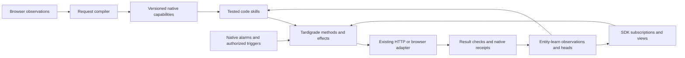

# Browser requests, reusable skills, and live memory

The consolidated actor, sandbox, registry and passive skill-derivation plan is
[Self-composing actor harness](self-composing-harness-plan.md).

Planning draft, 2026-09-07. Based on the current Unlock working tree, sibling
`../entity-learn`, and Tardigrade source. This document proposes changes; it does
not establish deployed behavior or verified Instagram/TikTok support.

Implementation update: [Request lab](request-lab.md) now provides executable
controlled checks and a visual dashboard. The authenticated HTTP transport defect
described below has been repaired and tested against a controlled endpoint.
Live subscriptions, generated skills and durable scheduled skill execution remain
planned; the lab labels its fixed example workflow and synthetic I/O explicitly.

The target is to learn an operation from browser activity, compile it into a
callable capability, compose capabilities into tested code, and execute that
code repeatedly through Tardigrade. The same capability supplies fresh data to
generated interfaces. Entity-learn connects definitions, results, preferences,
and execution evidence through versioned observations.

The proposed first slice prioritizes reusable skills and bulk execution, then
the live frontend SDK. “Cached environment” means cached code, dependencies,
request contracts, and reusable setup. Authentication is resolved at execution
time. Cached response values have explicit freshness and retention rules.



**What already exists**

| Existing component | Reuse and missing connection |
| --- | --- |
| [Browser learning](../apps/agent/src/browser-learning.ts), linked `@unbrowse/browser-harness` compiler | Observations already produce request DAGs and replay artifacts. Add stable capability identities and explicit validation state. |
| [Request memory](../apps/agent/src/request-memory.ts) | Structural pointers, semantic retrieval, fresh hydration, response fingerprints and check receipts exist. Add live value heads separate from check history. |
| [Observed network](../apps/agent/src/observed-network.ts) | Host HTTP execution, current-session resolution, approvals and operation receipts exist. Repair the default transport seam before relying on authenticated execution. |
| [Code harness](../apps/agent/src/code-harness.ts) | Native code mode and `code_workflow_run/save/list` exist. Strengthen dependency pinning, outcome checks and durable invocation data. |
| [Tool workflows](../apps/agent/src/tool-workflows.ts) | Bounded DAG execution and concurrent reads exist. The mounted dispatcher currently exposes reads. Keep general skill composition in native code mode. |
| [Automations](../apps/agent/src/automations.ts) | Native events and alarms exist. Add direct invocation of a pinned skill; current schedules dispatch a prose chat instruction. |
| [Execution graph](../apps/agent/src/execution-graph.ts) | Native Router children, evidence checks and descendant invalidation exist, but are not mounted in the application host. Integrate only when durable dependencies across tasks are required. |
| [Log memory](../apps/agent/src/log-memory.ts) | Structural execution receipts already enter entity-learn. Ingestion currently follows `AikoReplyPrepared`; live updates need settlement-driven ingestion too. |
| [SDK](../packages/sdk/src/aiko.ts) | Existing owner authentication, messages and memory access provide the starting surface. Add capability invocation, query subscriptions and skill jobs. |

Entity-learn v0.2 already implements immutable observations, content-addressed
payloads, scoped subject heads, exact `supersedes`, historical `supports`, and
current-input `dependsOn`. Its current API deliberately removed executable
command interpretation; the paper describes an older design. Keep retrieval
and execution separate. The vendored 23-file core was verified against sibling
commit `44ca591bc45835d5cd8e9c599f7e60f685d2eed9` using the repository checker.

**1. Make each captured operation a verifiable capability**

Extend the existing compiler output and router entry with:

- A stable logical name, immutable definition digest, input/output schemas,
  selected result projection, and source event references.
- Explicit bindings for caller inputs, prior response fields, current session
  material, generated timestamps/nonces, and constants.
- Semantic effect class, affected resources, supported transport, replayability
  limitations, and a versioned outcome verifier. HTTP method alone is insufficient
  to classify an operation as a read or a write.
- Validation state: observed, candidate, verified, stale, or unavailable.

Generate callable package methods and TypeScript declarations from that same
contract. Both an agent's `tools.call` and SDK calls resolve to the current native
registry and existing execution adapter. Typed bindings must retain host schema
and authorization checks.

Make catalog search/description available from the existing host registry and
durable definition evidence without starting a browser VM. Current browser-side
request-memory search/hydration still allocates or reuses the owned browser.
Warm reuse should need a browser only when the selected execution adapter does.

“1:1 callable” means equivalent operation semantics with explicit inputs. It
does not mean replaying an old request byte for byte: cookies, CSRF values, signed
upload URLs and temporary IDs can change. Capture evidence proposes bindings;
validation with different inputs and renewed sessions establishes which bindings
work. Temporal adjacency alone does not prove a dependency. Unsupported signing,
streaming or upload behavior stays explicitly unavailable until an adapter is
verified; the owned browser remains an execution option.

The first prerequisite is a concrete transport repair. The native runtime merges
the current session cookie into dispatch headers, while `sendObservedHttp`
currently rejects any cookie or authorization header before making a request.
An offline reproduction of the real runtime-to-transport path returned
`transport_failed` / `Artifacts cannot carry credentials`. Existing session tests
substitute a transport and miss this seam. The default transport also rebuilds
headers using accept/content-type, dropping response-derived headers such as
CSRF headers. Separate artifact admission from trusted dispatch-header handling,
then verify the actual default adapter with synthetic credentials and a controlled
endpoint. Do not weaken artifact admission by allowing captured credentials.
Verify cookie domain/path/secure/expiry scoping for each dispatched URL as part
of that repair; resolving an owner's session does not authorize attaching every
cookie to every step.

**2. Separate live names, immutable versions, and check history**

| Record | Meaning |
| --- | --- |
| Capability version | Immutable request/code/schema contract plus capture and validation evidence. |
| Capability name | Stable owner/site/operation subject whose head selects the accepted version. |
| Query instance | Capability plus canonical arguments, authenticated account and access scope. Use private opaque/keyed identity where arguments may be sensitive. |
| Value revision | Immutable digest of the selected response fields and a reference to their permitted value storage. |
| Value head | Current value revision for a query; changes only when selected values change. |
| Check receipt | Every refresh attempt, its time, status, freshness and native event reference. |
| Skill version | Code, environment/dependency lock, primitive versions, schemas and outcome-check version. |
| Preference | Attributed, correctable observation such as timezone, caption style or default account. |

The distinction solves two current problems. `request:${indexDigest}` and
`artifact:${digest}` are immutable subjects, so a new logical tool version does
not automatically stale dependencies on the old subject. Also, request-check
heads currently advance even for `changed:false`; depending on those receipts
would cause needless downstream recomputation.

The immutable capability DAG describes how to run an operation. Each run can
also have an immutable Merkle root over its definition version, selected inputs
and dependency value revisions. A mutable logical head selects the latest
accepted revision. A hash records identity and integrity; freshness requires a
check, and remote changes require a notification or refresh.

Add bounded journal change pagination and a rebuildable reverse-dependency
projection to `../entity-learn`, then update the vendored core through its existing
provenance/checking process. Preserve current canonical evidence checks and
scope isolation. Current dependency freshness is checked on reads, with bounded
reference closures; it is not a push scheduler. Large batches should use
task-level manifest references and paginated child receipts instead of forcing
hundreds of dependencies into a single observation.

Tardigrade consumes committed changes using durable cursors. A changed value
invalidates affected read/derived nodes; an unchanged refresh updates freshness
without running their code. Contract changes require dependent skill
revalidation. Preference changes affect future preparations and dependent
previews; already authorized publishing jobs remain pinned to their accepted
inputs unless explicitly revised.

Freshness and recomputation have separate checks. Entity-learn currently derives
`MemoryHit.freshness` from immutable observation expiry and dependency heads; a
new check receipt does not renew an older observation's expiry. A live-query
status projection must consult the latest check and source health for current
eligibility, while execution invalidation compares value revision digests.
Never mutate old observation timestamps. Failed or expired checks remain visible
even when the last known value is unchanged.

Keep edge meanings explicit: `supports` records evidence, `dependsOn` records
freshness dependencies, and task-order edges control execution. A relationship
or a retrieved page is never execution authority.

**3. Turn successful task code into reusable skills**

Use the existing native code workflow as the executable skill artifact. A
human-readable skill description or generated `SKILL.md` can document it, while
the immutable manifest remains the machine contract.

The learning loop is:

1. Read a bounded native event window and find useful successful sequences or
   repeated failures, linked to their exact capability definitions.
2. Generate a candidate program with explicit inputs and outputs using native
   package methods. Keep loops, transformations and reusable helper modules in
   the existing code sandbox.
3. Validate bindings and schemas; replay reads or use controlled fixtures for
   writes. Real mutations must belong to an authorized user task.
4. Verify a task-specific postcondition independently of the model's claim and
   the HTTP success code. Save immutable evidence and a held-out case.
5. Promote through the existing workflow store/router. Repeated runs call the
   saved program directly, with no required planning inference per item.
6. On drift, record the failed dependency and propose a new version. Preserve
   the pinned version for already-running jobs; revalidate before promotion.

Pinning preserves identity and history. Before each remaining external effect,
recheck that the pinned primitive is executable and the operation remains
authorized. Pause or fail an unavailable step; do not silently substitute a new
version or bypass revoked access.

Extend current dependency locking beyond input-schema hashes to include the
underlying observed artifact/definition, output schema, sandbox/package version
and verifier. A generic `observed_network_run` schema can stay unchanged while
the primitive's behavior changes.

Cache code and deterministic setup by this environment lock. Keep current auth
and private values outside reusable environment snapshots. Native Tardigrade
effects, package returns, cancellation and replay remain the execution authority.
The repository's separate code-fixer/PR loop can repair the product; learning a
user skill should not require rewriting and deploying the host for every task.

**4. Make skill runs durable, schedulable, and efficient in bulk**

Current private code values and workflow inputs live in process memory for 15
minutes. Saving source alone does not allow a run to resume after a restart.

Add an owner-scoped encrypted invocation store for retained job inputs, media
references and required checkpoints, with explicit expiry/deletion behavior.
Native events carry durable handles and minimal receipts. Transient response
bodies remain transient unless a task requires and authorizes a retained
projection. On recovery, either resolve a retained handle or re-read safely;
never infer that a missing value permits repeating an uncertain mutation.

Expose a native actor method conceptually taking
`{skillDigest, inputRef, operationId}`. It dispatches the existing code-mode
execution and records per-operation outcomes. Extend automations with a typed
target for this method, preserving current native alarm and cancellation wiring.

Represent a bulk job as a frozen manifest of items, selected accounts, content,
scheduled times, skill version and outcome expectations. Carry forward the
user's existing authority within that scope; support revocation and explicit
revision. Current observed-action approvals expire after ten minutes and bind
the current connection revision, so tomorrow's job cannot reuse today's token.
Introduce durable scheduled intent and resolve fresh credentials plus dispatch
receipts when due.

Use bounded concurrency, per-account/resource ordering, provider rate budgets
and backpressure. Reuse the native host's thread scheduling. Mount the existing
execution graph only for dependencies spanning durable tasks; code mode composes
the skill and the request DAG resolves HTTP prerequisites. Integrate its trusted
ingress, event keys, append fences and independently registered checks together.

Operation IDs identify each authorized item and step across retries. Use remote
idempotency where supported; otherwise reconcile by recorded remote identifiers
and read-back checks. A crash after sending a write but before recording its
result is `unknown` until reconciled. At-least-once native delivery does not imply
exactly-once external publishing. Graph invalidation may refresh views; it must
not automatically republish a completed post.

**5. Expose the same system through a live frontend SDK**

Proposed API shape, not currently exported:

```ts
const posts = await aiko.queries.open({
  capability: "social.posts.list",
  connectionId,
  input: { limit: 20 },
});

const unsubscribe = posts.subscribe(({ value, revision, checkedAt, status }) => {
  renderPosts({ value, revision, checkedAt, status });
});

await posts.refresh();

const job = await aiko.skills.run({
  skillDigest,
  input: approvedBatch,
  operationId: batchId,
});
```

Generate this client and its types from the capability/skill registry. The proxy
accepts registered capability identities and validated inputs, resolves current
credentials server-side, and invokes the same native actor methods. It should
not accept arbitrary credential-bearing URLs from frontend code.

Implement cursor-based subscription delivery, initially using a simple
authenticated event stream with bounded buffers and snapshot recovery on gaps.
Trigger refresh from supported webhooks, completed mutations, explicit refresh,
or native alarms for active polling subscriptions. A live pointer cannot detect
an external change without one of those signals. Coalesce simultaneous refreshes
and reuse valid reads; pause or reduce polling when views are inactive.

Serve selected JSON projections with revision/freshness/error metadata. Keep
an optional bounded private value cache separate from the request index; a
restarted cache can hydrate again. Render structured data through our components.
Rendering a view never authorizes a mutation. This first SDK targets Aiko or
generated frontends; modifying a third-party site's own frontend would require
a separate, site-specific extension or injection adapter.

Feed progress and verified outcomes to the existing native response/outbox path
so the web view and the originating Telegram conversation agree. Record message
delivery receipts separately from task completion; a published post and a
delivered notification are distinct outcomes. Missing login uses the existing
inline Sign in flow and resumes only after the connection is verified.

**6. Prove the design with a scheduling workflow**

Start with one verified account/transport and a small batch: select media,
prepare editable captions and times using explicit preferences, authorize that
manifest, schedule pinned runs, upload/publish when due, verify remote status,
and update both the calendar view and Telegram.

Instagram's documented publishing interface uses media containers followed by
publication, with status checks. Model those as distinct primitives and create
temporary server resources near execution time rather than retaining arbitrary
captured temporary IDs. [Meta's Instagram API collection](https://www.postman.com/meta/instagram/documentation/6yqw8pt/instagram-api?entity=request-23987686-ab559ffb-8e2c-4b0a-b43a-5737b6d2f672).

TikTok's Direct Post flow includes current creator information, initialization,
media transfer and final status verification. Its documented UI requires user
control of posting metadata and consent to upload; unaudited clients have
visibility restrictions. The first TikTok integration must establish the
available account/app route before promising unattended public publishing.
[Direct Post](https://developers.tiktok.com/docs/en/content-posting-api-reference-direct-post),
[sharing guidelines](https://developers.tiktok.com/docs/en/content-sharing-guidelines),
[publication status](https://developers.tiktok.com/docs/en/content-posting-api-reference-get-video-status).

Captured browser primitives and supported API adapters should share the same
capability contract. Select the verified route available to that account. This
plan does not claim that arbitrary Instagram/TikTok requests have already been
captured, generalized or replay-tested.

Media transfer is a separate implementation gate: the current default request
body path is JSON/string-oriented and the host response limit is 256 KiB.
Multipart, binary or chunked uploads require a verified native package/transport
adapter, with durable media handles and resumable upload receipts. Bulk media
must not pass through the model context or the ordinary JSON response cache.

**Implementation order and acceptance evidence**

| Increment | Observable acceptance criterion |
| --- | --- |
| Transport prerequisite | Current session material and response-derived CSRF headers reach a controlled endpoint through the real default adapter; captured credentials remain excluded from artifacts and logs. |
| Capability and live identity | Capture once, invoke with two distinct inputs and a renewed session; definition drift is detected. An unchanged read advances freshness without downstream execution. |
| Reusable skill | Generate and promote one program, run a held-out input directly, and verify the remote/fixture postcondition. Changing a primitive contract makes the saved skill require revalidation. |
| Durable batch and schedule | Restart before dispatch, during work, and after an uncertain write. Completed operations are not duplicated; unknown results remain visible until reconciled. Revoked jobs do not start new effects. |
| Reactive SDK | Changing query A updates descendants B/C and their view, while unrelated D does not run. Cursor reconnection recovers missed changes; different owners cannot share private values. |
| Platform demonstration | One scheduled batch produces verified platform objects and matching web/Telegram outcomes through an established account route. Measure notification delivery separately. |

Benchmark the same task and inputs before and after skill promotion: correctness,
model calls/tokens, browser starts, HTTP requests, wall time, cost where available,
and recovery behavior. Report cold and warm runs separately. Faster bulk work is
the objective; this planning audit does not establish a measured speedup.
