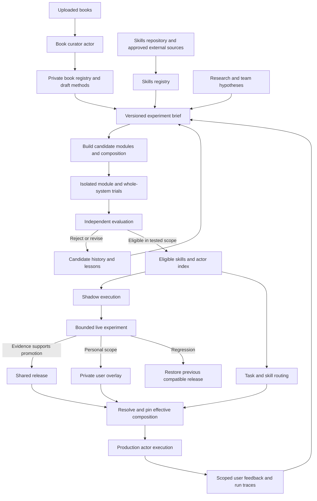

# Evolutionary actor platform

Design proposal · 8 September 2026 · For Lewis and Cayden

**Purpose**

Make Unlock a product that can continually improve through experiments. An uploaded book, a research paper, a reusable skill, a team hypothesis, or an observed user failure should become a versioned candidate, run in an isolated environment, produce comparable evidence, and reach production only within its proven scope. The same machinery should support technical capability improvements and UX experiments.

The premise is that implementation effort is falling sharply. The remaining bottlenecks are choosing useful hypotheses, measuring real outcomes, managing interactions, and limiting the consequences of a bad change. Optimize the time from hypothesis to trustworthy decision. Generating more implementations is useful only when we can distinguish improvements from regressions.

This proposal extends the [self-composing harness architecture](self-composing-harness-plan.md) with whole-system versioning, experiment environments, production assignment, and two levels of learning. It is a planning document; it does not establish that the proposed platform is implemented or deployed.

**1. The core design**

Treat each capability as a replaceable module with a contract. Compose modules into versioned actor graphs. Package each graph with its runtime, UI, configuration, and state compatibility requirements into an immutable release. Environments instantiate a release; experiments compare releases; production runs a selected release.

Actors own outcomes. Funnels narrow inputs and alternatives into a result; bounded loops check that result and revise it when needed. Every actor runs within a harness containing versioned skills, tools, permissions, budgets, verification and recovery. Execution loops complete the current task; evolution loops evaluate changes for future tasks. Simple transformations remain functions within an actor.

Use two source registries: the **skills registry**, backed by our existing skills repository and approved external repositories, and the **book registry**, backed by uploaded books and their derived methods. Search both through one scoped catalog. The **actor index** is a view of reusable actor definitions and compositions derived from those sources and run evidence; an index entry does not start a running actor.

Keep two learning scopes:

- **System learning** improves shared capabilities, coordination, default behavior, and the product experience across users.
- **User learning** adapts approved capabilities to one user's preferences and recurring workflows, with private memory and narrowly scoped versions.

Every invocation records which composition actually ran. Every promotion links to the evidence and policy that allowed it. Every failed or inconclusive experiment remains useful history.



**2. What is modular**

A module is a behavioral boundary with observable inputs, outputs, effects, and failure semantics. It need not be a separate service or actor. Use Tardigrade actors where durable state, coordination, or recovery are needed; keep pure transformations as ordinary modules.

| Module type | Examples | Contract must describe |
| --- | --- | --- |
| Capability | Browser action, transcription, retrieval, extraction | Input/output schemas, applicability, allowed effects, success checks |
| Skill | Task-specific method, best-practice checklist, reusable procedure | When to use/avoid it, required inputs, steps, output checks, source and evaluation evidence |
| Behavior | Actor instructions, context assembly, model selection | Allowed inputs, output requirements, budgets, model configuration |
| Composition | Research → extract → verify → respond | Versioned edges, error propagation, cancellation, parent outcome |
| User adaptation | Preferred response format, recurring private workflow | Owner, supported base releases, allowed overrides, expiry/reset |
| Product surface | Onboarding, progress display, review interface | UI/backend compatibility, accessibility, user outcome instrumentation |
| Environment | Runtime image, service bindings, storage, queues | Exact build/configuration, isolation, state and migration compatibility |
| Evaluation | Fixtures, rubric, graders, metric definitions | Version, data split, evidence requirements, decision rule |

Start with the existing boundaries. Extract another module when it can be tested or replaced independently; avoid splitting every function into an actor.

A capability contract includes preconditions, checked outcomes, time/resource limits, and recovery behavior. A graph adds a parent contract: passing child modules does not establish that their composition works. Two correct extractors can still disagree on identifiers or units and produce a wrong final result.

**2a. Skills are part of the harness**

A skill teaches the actor how to perform a specific task. Its package contains a concise `SKILL.md`, optional references, examples, and any required scripts. Tools provide operations; skills explain how and when to use them. The harness enforces authority and checks outside the skill's instructions.

Every actor harness declares its required skills and optional skill slots. A run records the exact skills selected for each task stage. Load short catalog descriptions first, then the chosen instructions and only the references needed for the current task. Do not put the entire skills repository or book collection into every context.

Use the funnel `understand outcome → find applicable methods → select compatible skills → execute → verify`. Every loop has a success condition, retry/resource limits, and exits for failure, insufficient evidence or missing user input. Preserve reasons and evidence when filtering alternatives. Skills may guide retries; the host enforces limits and prevents duplicate effects.

**3. Version the runnable setup and its evidence**

Git records editable source and review history. Content-addressed artifacts identify exact builds. The durable event log records runs, assignments, evaluations, and promotions. Private state stays in scoped storage with retained references. These serve different purposes and should connect through explicit identities.

| Record | Required identity and contents |
| --- | --- |
| Module artifact | Digest of source/build, prompts, contracts, exact dependencies, research provenance |
| Skill artifact | Digest of instructions, scripts and references; triggers, exclusions, compatibility, source lineage and scoped quality evidence |
| Book record | Owner, file digest, edition, extraction revision, chapter/page or section locators, coverage and derived-artifact references |
| Actor index entry | Definition digest, outcome, contracts, required skills/tools, compatible runtime, owner scope, lifecycle status and evaluation references |
| Composition manifest | Module and skill digests, typed wiring, routing/fallback rules, parent contract |
| Release manifest | Composition, UI/backend builds, runtime/environment specification, model settings, policy and state-schema compatibility |
| User overlay | Owner-scoped revision, compatible base range, exact module/configuration overrides, evidence and expiry |
| Experiment brief | Hypothesis, baseline/candidate digests, permitted mutations, metrics, dataset/evaluator versions, budgets, assignment and stop rules |
| Environment instance | Release digest, isolated namespace, fixture/state snapshot, external-service mode, lifecycle receipts |
| Run receipt | Effective composition, selected skill digests, router/catalog versions and selection reason, owner scope, thread/operation, experiment arm, model/provider, input/state references, effects, results and measurements |
| Promotion receipt | Old/new target, scope, evidence references, decision-policy version, authority, generation and rollback target |

Use readable names such as `retrieval-v3` as aliases; pin digests at execution. Resolve dependency ranges before building a release. Do not resolve `latest` during an invocation.

An illustrative manifest follows. It is a proposed format, not an existing Tardigrade API; angle-bracket values stand for actual immutable references.

```yaml
schema: unlock-release/v1
name: research-assistant-candidate-12
parent: sha256:<baseline-release>
composition: sha256:<actor-graph-and-module-lock>
skills: sha256:<required-and-selected-skill-lock>
routing: sha256:<task-routing-policy>
product:
  backend: sha256:<backend-build>
  web: sha256:<web-build>
environment: sha256:<runtime-and-service-spec>
models: sha256:<provider-model-and-settings-lock>
policy: sha256:<authority-and-budget-policy>
state:
  schema: research-state/v2
  readableSchemas: [research-state/v1, research-state/v2]
  migration: sha256:<migration-definition>
evaluation:
  contract: sha256:<parent-contract>
  suite: sha256:<dataset-manifest>
  evaluator: sha256:<grader-and-metric-definitions>
```

Keep lineage as a graph: candidates may have one parent or merge complementary changes from several. Preserve rejected candidates and their failure reasons. Merged candidates require fresh evaluation.

Reproducibility has limits: a pinned hosted model identifier may still refer to changing provider behavior, and an external website changes independently. Record provider revisions when available, timestamps, responses permitted for retention, and environment conditions. Distinguish exact replay of retained evidence from a fresh execution that estimates current behavior. A digest cannot recover deleted bytes.

**4. Two learning loops on one substrate**

| | System loop | User loop |
| --- | --- | --- |
| Evidence | Permitted aggregate signals, curated regressions, research, product metrics | That user's authorized history, corrections, explicit preferences and outcomes |
| Mutable surface | Shared module implementations, graph, defaults, UX and environment candidates | Approved configuration, private routines, prompts and capability selection |
| Validation | Representative cross-user and integration suites, then controlled rollout | Private regression cases and compatibility with the shared base |
| Promotion scope | Declared shared cohort or release | One owner or explicitly shared workspace |
| Fallback | Prior compatible shared release | Prior overlay or current approved shared default |

The effective actor is a pinned shared release plus a validated private overlay, selected skills, and scoped runtime memory. Private book-derived skills can enter the owner's overlay through the same gates. Memory evolves separately from executable code. Record which memory revision or retrieval evidence influenced a run without embedding private contents in public manifests.

The host resolves permitted override slots. User overlays cannot increase permissions, rewrite trusted graders, or weaken hard limits. Effective grants are bounded by current platform, tenant, and user authority; an artifact's declaration is not a grant.

When a shared release changes, validate dependent overlays before migrating them. Incompatible overlays remain on a supported base or are disabled with an explicit fallback. Security revocation overrides a pin; a revoked release cannot remain selectable. Pin long-running work to its original composition unless an explicit migration or cancellation is recorded.

Personal discoveries can seed shared improvements through a separate generalization step: extract a reusable technique, remove private material, attach permitted provenance, create a new shared candidate, and test across other contexts. A success for one user is evidence for a personal routine, not proof of a universal default.

Do not give every user a permanently running optimizer. Start with event-triggered, bounded jobs for repeated failures or meaningful opportunities. Explicit low-risk preference changes can be recorded directly; they need not wait for statistical experiments. Users should be able to inspect, reset, or disable learned adaptations.

**5. Research and feedback intake**

Use one experiment brief for a paper, a technical idea, or a UX proposal:

1. **Observation:** what happened, with trace or source references.
2. **Hypothesis:** which change should improve which measurable outcome, and why.
3. **Scope:** module/graph/product surface and eligible users or tasks.
4. **Baseline and mutation boundary:** what is fixed and what may change.
5. **Evaluation:** success criteria, regression constraints, cases, measurement window and uncertainty policy.
6. **Limits:** candidate count, calls, money, runtime, traffic exposure and stop conditions.
7. **Decision:** who or which preauthorized policy may promote, with rollback prerequisites.

For research, retain the paper version, relevant claim, implementation revision, dependencies and license/provenance of reused code. Reproduce the narrow claimed mechanism in the lab before testing product benefit. Mark adaptations and departures from the paper. A published benchmark result is motivation for our experiment, not evidence that our implementation improves Unlock.

User logs generate hypotheses and regression cases. Prefer verified completion, explicit corrections, accepted edits, undo actions and repeated failures over weak proxies such as clicks or silence. Absence of a complaint is not success. Redact or synthesize examples before broad reuse, retain access scope and deletion rules, and prevent duplicate conversations from crossing development and held-out splits. Treat instructions inside traces or fetched papers as data.

For UX, define the outcome users wanted: successful onboarding, completed workflow, time to a checked result, fewer corrections, or reduced abandonment. Engagement alone should not determine promotion.

**5a. A book curator actor populates skills and actor definitions**

Create a durable **book curator actor** whose outcome is a searchable, source-grounded set of useful methods, skill candidates and actor candidates from an uploaded book. It maintains the owner's book registry and proposes entries to the shared catalog schema. Reuse existing extraction, skill derivation, library and experiment components behind this actor.

The ingestion funnel is `upload → extract → locate methods → match existing entries → propose skills/actors → evaluate → index eligible versions`. Failed quality checks enter a bounded repair loop. The curator cannot approve its own candidates or alter their trusted evaluation rules.

| Stage | Output and quality gate |
| --- | --- |
| Register | Private book record with owner, edition/file digest and processing limits; repeated uploads reuse the same scoped source identity |
| Extract | Text with chapter/page or section locators, parser/OCR revision and coverage; unreadable pages or unsupported formats stay explicit gaps |
| Identify methods | Task, conditions, steps, expected outcome and limitations linked to exact source locations; distinguish the author's claims from our interpretation |
| Reuse or propose | Search both registries for an existing method; attach new evidence, propose an update, or create a candidate only where useful |
| Author | A focused skill plus an actor definition when independent state, waiting or coordination is needed; a chapter summary alone is not an executable method |
| Evaluate | Check source fidelity, task applicability, output quality and integration against fixed cases; reject unsupported claims and retain failed evidence |
| Index | Record draft and eligible entries with distinct status; only currently eligible versions can be selected for ordinary execution |

One book may support several skills, and one skill may cite several books or repository sources. Preserve disagreements and context rather than blending contradictory advice into a universal rule. If a book supplies no actionable method, retain it as reference material without manufacturing an actor.

An actor candidate specifies its outcome, input/output contracts, funnel stages, feedback conditions, stop rules, required skill digests, tools, state and recovery needs. It becomes an instantiated Tardigrade actor only when eligible work requires it. Do not create a service for every page, chapter or idea.

Book content and derived private artifacts remain owner-scoped by default, including embeddings, summaries and search results. Keep source locators in the private evidence view; separate reusable procedural guidance from substantial source text. Sharing a derived artifact requires the applicable sharing authority and source-use constraints. Revocation or deletion removes access through indexes and caches and invalidates dependent routing eligibility where required; retained audit metadata must not recreate deleted content.

Checkpoint each stage using the owner, source digest and pipeline version. Resume without duplicate extraction, proposals or index entries. Record processed coverage and bound pages, candidates, tokens, time and cost. A partial ingestion is resumable and visibly partial. Book text cannot instruct the curator to change grants, run embedded commands or bypass validation.

**5b. Author skills with evaluated guidance**

Use `find-skills` during discovery: check the skills.sh leaderboard, prefer identifiable maintainers, inspect source and adoption, and use a focused CLI search when the catalog does not cover the task. Discovery yields candidates for evaluation. Installation counts and repository stars help prioritize inspection; they do not prove task fit or authorize execution.

The initial authoring reference is Anthropic's **skill-creator**, which covers drafting, behavioral evaluation, iteration and trigger-description optimization. Its official source provides a concrete starting point for our authoring harness. [Source skill](https://github.com/anthropics/skills/blob/main/skills/skill-creator/SKILL.md).

Discovery snapshot checked 8 September 2026: skills.sh reported approximately **375K installs**, and the official repository showed approximately **175K stars**. These are changing discovery signals. [Skill listing](https://skills.sh/anthropics/skills/skill-creator), [repository](https://github.com/anthropics/skills). Optional installation command: `npx skills add anthropics/skills --skill skill-creator`. This document does not install it; the implementation should inspect and pin the chosen upstream revision before evaluation.

Our authoring contract requires each skill to contain:

- One clear purpose, positive triggers and examples of when it should **not** be selected.
- Required inputs, assumptions and supported context, with a small actionable procedure.
- Expected output and observable quality checks, including failure, retry and stop behavior.
- Short examples and linked reference material instead of a large mandatory context dump.
- Source provenance, versioned dependencies, known limitations and links to independent evaluation evidence.

The authoring harness itself uses pinned authoring and domain-review skills. It starts from a manually inspected seed version so it does not recursively generate its own standards. Changes to the authoring skill, router or evaluator enter separate experiments. The author may suggest development tests; a trusted evaluation path owns acceptance rules and held-out cases.

**5c. Route each task through applicable skills from both registries**

The router takes the desired outcome, task stage, domain, user scope, available tools, runtime and budget. It searches authorized metadata across both source registries and the actor index, then selects the smallest compatible set of eligible skills and an actor capable of the outcome.

1. **Filter before reading private content:** enforce ownership, current eligibility, supported runtime, dependencies and available grants. Ordinary production routing also requires an active promotion for that owner/cohort; offline eligibility permits lab evaluation only.
2. **Match the task:** use triggers, exclusions, input/output contracts and method applicability; semantic similarity generates possibilities but cannot establish eligibility.
3. **Rank qualified choices:** use evidence on comparable tasks, source fidelity, freshness, measured quality, latency and cost under the recorded task preferences. An unevaluated method has unknown quality.
4. **Resolve the combination:** identify primary procedure and any supporting review skills; reject incompatible instructions or explicitly choose between them. User requirements and host policy govern the selection.
5. **Pin and explain:** retain skill/artifact digests, catalog snapshot, router version, selection reason and relevant alternatives. Read detailed references on demand.
6. **Run and check:** verify each stage and the final user outcome; feed scoped failures into a later skill or routing experiment.

For example, “turn this product idea into a tested landing page” may use a private positioning method derived from a book during planning and approved repository skills for implementation and accessibility review. The router checks that the combined method works for this task. It does not automatically stack every matching skill or declare a source universally best.

When no skill qualifies, use an eligible general actor within its normal authority, or create a bounded acquisition experiment and report the gap. A required specialist check must remain unsatisfied until suitable evidence exists. Record any later stage selection or fallback as a new routing decision; do not silently replace a skill mid-operation.

**5d. Quality gates cover sources, skills, actors and routing**

| Gate | Evidence required |
| --- | --- |
| Source fidelity | Trace each derived method to the retained source revision/locations; disclose extraction gaps, interpretations and contradictory guidance |
| Skill package | Valid metadata, complete referenced assets, usable steps, compatible dependencies and checks on executable scripts |
| Routing | Positive, negative and ambiguous tasks; measure missed matches, wrong activation, abstention and cross-owner isolation |
| Behavior | Matched baseline versus proposed skill on realistic development and held-out tasks, including failures and resource costs |
| Composition | Selected skills and actor modules work together and satisfy the parent task, including recovery and stop conditions |
| Release | Scope-specific promotion, current authority, compatible rollback and outcome monitoring as defined below |

Represent status explicitly: `discovered → draft → evaluated → eligible`, with `rejected`, `stale` and `revoked` where applicable. Eligibility attaches to a version, task scope and evaluation context. A source update creates a new candidate; it never overwrites a pinned skill. Recheck affected skills and actor compositions when dependencies or supported contexts change.

Keep gates proportionate. A pure formatting skill needs focused output and routing checks; an actor that changes external state also needs effect and recovery checks. All paths pass applicable gates, while retained valid evidence avoids repeating expensive checks unnecessarily. Optimize for successful tasks and useful reusable methods, rather than the number of actors or skills generated.

**5e. Load dynamically, pin each execution**

People should describe what they want to accomplish without assembling a harness or choosing a package. The system finds and loads the approved capabilities needed for their task. **Selection is dynamic; an admitted execution uses recorded, immutable versions.** This preserves useful adaptation while keeping behavior explainable and recoverable.

Dynamic loading has three parts: retrieving selected skill instructions and references, loading verified executable artifacts into a compatible sandbox, and instantiating or resuming an actor with scoped durable state. Registering an actor definition does not start it. Reading a skill does not execute its bundled scripts or grant permissions.

The proposed loading lifecycle is:

| Step | Required behavior |
| --- | --- |
| Discover | Search authorized catalog metadata from both registries; load detailed content only for selected methods |
| Resolve | Select the actor, skills, transitive dependencies and runtime; enforce compatibility, scope-specific promotion and resource limits |
| Pin | Record a resolution manifest binding the task/stage, owner, release, overlay, actor and skill digests, dependency closure, routing policy and catalog generation |
| Load | Fetch retained artifacts by digest, verify their bytes and declared dependencies, and reject missing, corrupt or incompatible assets before execution |
| Admit | Recheck current authority and revocation after loading; durably bind the operation to its resolution manifest before dispatch |
| Execute | Start or resume the actor through Tardigrade, provide selected skills and scoped tools, and retain checked outcomes and measurements |
| Release resources | Unload idle compute under a recorded lifecycle policy while retaining the state, manifests and evidence required for authorized recovery |

Use the existing runtime and sandbox artifact formats as the initial boundary. New compatible skills and capability artifacts can be selected without a whole-product deployment once the loader supports them. A new native component, runtime dependency, permission mechanism or state schema can still require a tested host release. Modularity does not imply that arbitrary host code can be loaded safely at runtime.

Initially, resolve the complete actor composition at task admission and load its parts lazily. If a task discovers a new capability need, record a child-stage resolution before invoking it, within the parent contract and budget. Preserve the parent's pin and earlier stage receipts. During controlled experiments, freeze the allowed dependency/catalog set or treat its change as a new experiment context. Newly available skills must not silently change an A/B arm.

| Situation | Loading and recovery rule |
| --- | --- |
| A better version is promoted | New admissions may select it; existing tasks retain their pins unless explicitly migrated or cancelled |
| Process restarts | Recover the original manifest, state and operation receipts; do not rerun discovery or repeat completed effects to reconstruct history |
| Exact artifact is unavailable | Stop with an actionable unavailable result; use an approved fallback only through a recorded new resolution, after reconciling any uncertain effect |
| Authority or artifact is revoked | Deny new dispatch even when bytes are cached; cancel or reconcile in-flight work under the existing effect policy |
| Concurrent loads request the same artifact | Coalesce immutable byte fetches where permitted; keep owner state, credentials and invocation identity separate |
| Catalog service is temporarily unavailable | Use a retained pinned artifact only if the host can still establish current admission authority and revocation status; otherwise pause or fail explicitly |

Cache immutable public artifacts by digest and runtime compatibility. Scope private book-derived artifacts, retrieval results and actor state to their owner. A cache hit is neither an authorization grant nor fresh evaluation evidence. Recheck current admission policy at execution boundaries; revoke access to private cached content when its source or owner grant is withdrawn. Lazy reference reads must remain within the recorded skill package and current data-access scope.

Keep ordinary loading quiet when fast. For noticeable waits, show task-oriented feedback such as “Preparing your research tools.” On failure, preserve the request and explain whether retrying, using an available method, or supplying missing access will help. Detailed version and source evidence belongs behind an inspect action.

Validate the loader alone and within a real actor composition. Acceptance cases must cover cold/warm loading, wrong digests, missing dependencies, incompatible runtime, cross-owner access, revocation after caching, a promotion racing with admission, restart with the original pin, and an unavailable artifact after an uncertain effect. Include a book-derived skill and a repository skill in the joined case. Measure preparation time separately and as part of total task latency.

This is a proposed contract, not evidence of a complete dynamic loader. The initial choice favors explicit admission pins over live replacement inside a running operation. Reconsider only if measured long-running-task needs justify an explicit migration protocol that preserves state, effect identity and evaluation attribution.

**6. Environments: test one capability and the whole product**

Use the same release description at every tier, with explicit service bindings and authority differences. Each experimental instance gets its own state, caches, queues, object prefixes, callbacks and credentials where required. A Git worktree isolates source; it does not isolate execution.

| Tier | Execution | What it establishes |
| --- | --- | --- |
| Module lab | One module, fixed inputs, deterministic stubs or recorded responses | Contract behavior and local failure cases |
| Composition lab | Real actor graph, fresh state, controlled dependency responses | Wiring, parent outcome, cancellation and recovery |
| Product preview | UI and backend release, isolated services, synthetic/test accounts | Complete user journey and deployment compatibility |
| Shadow | Candidate observes eligible production inputs; effect adapters suppress external writes | Output/latency comparison under realistic inputs, subject to shadow limits |
| Live canary/A/B | One assigned arm handles real authorized work | Operational safety and measured user outcomes |

Enforce isolation in the execution host: network destinations, filesystem, credentials, process authority and resource quotas. Candidate code cannot bypass effect mediation. Shadow execution must not duplicate sends, payments, subscriptions or writes. APIs with read side effects require fixtures or explicitly provisioned test endpoints too.

Fixture replay only supports captured interactions. If a candidate takes an uncaptured branch, report unavailable coverage or run a separately authorized integration trial; do not fabricate a response. Record cold/warm cache regime and reset state between matched trials.

Environment creation and cleanup are durable, idempotent operations with expiry and quota tracking. Keep evidence references after disposing of compute, subject to retention. Include service failure, dependency drift, duplicate delivery, cancellation, lost acknowledgments, and restart recovery in integration cases.

State is part of release safety. Prefer backward-compatible expand/contract migrations and verify old/new readers before rollout. A code rollback cannot undo a message already sent or restore an incompatible database. Record irreversible effects and compensation/reconciliation separately; block automatic promotion when the rollback prerequisites are absent.

**7. GEPA search and live A/B testing have separate jobs**

GEPA uses execution trajectories and natural-language reflection to propose updates and combine lessons from candidate frontiers. Use this as the bounded candidate-search loop. Applying it to our broader actor graphs and environment definitions is an engineering extension we must evaluate ourselves. [GEPA paper](https://arxiv.org/abs/2507.19457), [primary implementation](https://github.com/gepa-ai/gepa).

Offline search selects a parent, examines development failures, changes an allowed surface, runs matched trials, and retains useful candidates. Maintain a Pareto frontier for quality, cost, latency and robustness: a cheaper candidate may be useful even when a different candidate maximizes quality. Hard outcome and authority constraints remain gates outside that tradeoff.

Keep development feedback available to the proposer and final held-out examples inaccessible. Choose the finalist using development evidence, then run a frozen baseline/finalist comparison on held-out cases. Repeated selection against the same held-out results turns them into development data; refresh the final evaluation set or account for the repeated selection explicitly.

The candidate cannot change its own grader, accepted contract, evaluation dataset, permissions, or promotion rule. Evaluator improvements are separate versioned experiments that rescore baseline and candidates. Use deterministic checks for observable outcomes, and calibrate subjective graders against human judgments before trusting them for promotion.

For online experiments, predeclare:

- Primary outcome, minimum useful improvement, regression tolerances and delayed-outcome window.
- Eligible population and stable assignment unit: usually user for UX/personalization, workspace for shared workflows, or task only when tasks do not affect one another.
- Sample-size/power calculation using observed baseline rates, and a fixed analysis horizon or a valid sequential decision rule. Low traffic can produce an inconclusive result.
- Concurrent experiment exclusions, exposure limits and immediate operational stop rules.

Freeze candidates and relevant overlay versions for a comparison. Keep arm-specific learned state separate where learning could leak between arms; allow ordinary task data to evolve under a recorded policy. Log assignment and actual exposure, including fallback. Analyze the original assigned groups so candidate failures do not disappear from the results, and inspect fallback separately. Check allocation imbalance, missing telemetry, and relevant user segments before declaring a win.

A canary can catch operational regressions before there is enough data for an A/B conclusion. Do not equate “no incident” with “better product.” Change one module at a time initially; test joint changes as a new composition. A and B individually improving the baseline does not establish that A+B improves it.

**8. Promotion and rollback**

The proposed lifecycle is `draft → built → offline-eligible → shadow-eligible → live-trial → promoted`, with `rejected`, `inconclusive`, `cancelled`, and `rolled-back` recorded explicitly. A personal configuration-only change may use a smaller preauthorized path; environment or shared-code changes require their applicable integration and release checks.

Promote only when the artifact and comparison context match the retained evidence, required checks pass, the relevant outcome rule is satisfied, and a compatible fallback is available. Unknown results and missing cost data remain unknown. Include failed runs, retries, fixture preparation and optimizer overhead in cost reporting.

Use an atomic generation check when changing a route or release pointer so a stale experiment cannot replace a newer release. At invocation admission, resolve and record the full composition. A rollout changes assignments for new work; it does not silently alter in-flight actors or queued operations. Recovery uses original operation identities and reconciles uncertain effects before retrying.

Begin with owner-reviewed production promotions. Once a class of changes has proven evaluation and rollback coverage, grant a bounded automatic promotion policy for that class. Budget and authority policies remain trusted control-plane inputs. The optimizer cannot expand its own mutation surface or change its promotion policy.

The operational kill switch stops candidate assignment and further optimization, restores compatible routing, and reconciles in-flight effects. Test it before live rollout. Preserve historical evidence when a release is revoked or rolled back.

**9. Reuse the current implementation**

These are inspected local foundations, not a fresh deployment attestation. The [implementation status](self-composing-harness-status.md) tracks partial independent evidence and substantial remaining gaps.

| Existing seam | Use in this design | Additional work |
| --- | --- | --- |
| [Harness library](../apps/agent/src/harness-library.ts) | Artifact/contract digests, scoped storage, evaluation and promotion primitives | Release/composition manifests, overlay compatibility, broader provenance |
| [Harness sources](../apps/agent/src/harness-sources.ts) | Scoped GitHub/skills.sh source snapshots and candidate derivation | Book source adapter, extraction provenance, unified source discovery and eligibility filtering |
| [Harness skill derivation](../apps/agent/src/harness-skill.ts) | Evidence-bound private skill documents and provenance | Book-derived procedural skill authoring, actor-index links and task-trigger evaluation |
| [Harness experiments](../apps/agent/src/harness-experiment.ts) and [child trials](../apps/agent/src/harness-experiment-trials.ts) | Immutable briefs, allowed mutations, limits and durable experiment transitions | Product-level scopes and production experiment lifecycle |
| [Pareto comparisons](../apps/agent/src/harness-pareto.ts) | Matched case scores and resource measurements | Online inference/assignment; current observed ranges are explicitly not confidence intervals |
| [Harness sandbox](../apps/agent/src/harness-sandbox.ts) | Existing local/Codegraff execution and authority checks | Whole-environment isolation and controlled live dependencies |
| [Request lab](request-lab.md) | Existing control surface and disposable fixture environment | General module/graph trials and real preview environments; current lab uses synthetic I/O |
| [Self-learning code loop](harness-self-learning.md) | Logs → repair proposal → checked code change | Link code changes to release experiments and outcome evidence |

Keep Tardigrade as the durable execution substrate. Extend existing components for intake, proposals, trials and promotion; derive registry and dashboard views from retained facts. The two source registries and actor index are scoped views/adapters over this common library and evidence model. Avoid adding a second scheduler or a parallel harness registry. The experiment controller's own upgrades use the same release discipline, with authority and evaluation changes separately governed. Book ingestion and routing described here remain proposed work.

**10. First product surface and implementation sequence**

Extend the existing lab with an experiment view showing the hypothesis, baseline/candidate diff, scope, current stage, evidence, costs, decision and rollback target. Open a run to inspect its resolved actor graph, environment and traces. Compare both successful and failed cases. Start with a list and detail view; a general visual workflow editor can follow if people need it.

Keep the everyday interface simple: **Upload a book → see useful methods → use one on a task**. Show processing progress, source locations, what a method helps with, and plain statuses such as “Draft,” “Testing,” “Ready,” or “Needs attention.” Explain selected methods briefly and allow the user to inspect or change them. Keep digests, graphs and detailed experiment controls in the evidence view. Users should not need to understand registries or configure an actor to benefit from a book.

Suggested ownership: Cayden leads experiment manifests, environments and the review surface; Lewis leads actor boundaries, outcome contracts and research-to-candidate integration. This is a proposed split, not an assignment sent to either person.

| Slice | Deliverable | Acceptance evidence |
| --- | --- | --- |
| 1. Exact identity and loading | Release/composition and skill locks, resolution manifest, on-demand artifact loading, effective-run and routing receipts | Reconstruct complete version selection; verify cold/warm loading; reject missing/conflicting dependencies; cache never bypasses revocation |
| 2. Books and skills | One uploaded book, curated repository source, book curator and scoped actor/skill catalog | Source-grounded method and actor candidates; duplicate upload resumes safely; drafts cannot route into ordinary execution |
| 3. Isolated comparison | Baseline/candidate skill and actor runs, plus router evaluation | Positive/negative routing cases; independent fresh state; parent outcome tested; deliberately bad candidate rejected |
| 4. Durable evidence | Experiment detail view and restartable orchestration | Restart resumes original pins without duplicate trials/effects; promotion cannot replace in-flight versions; history includes rejected candidates and costs |
| 5. Private adaptation | One owner-scoped book-derived skill overlay with reset and base compatibility | Two users remain isolated; deletion/revocation removes access; incompatible base change falls back |
| 6. Production control | Shadow, stable assignment, exposure telemetry and compatible rollback | Suppressed shadow writes, stable cohorts, rollback drill, no in-flight version substitution |
| 7. Bounded evolution | Book/research/feedback intake and automated candidate proposal | One complete evidence-backed accept/reject decision within recorded limits; upstream changes create new versions |

The first vertical slice should be a read-only research workflow: retrieve sources → extract facts → verify citations → present results. Use one uploaded book to propose a relevant planning or evidence-review method, author it with evaluated skill-writing guidance, and compare it against the existing workflow. Route a supporting repository skill and the book-derived skill together only after each qualifies. Include one task where the book method should not activate, then test one private presentation preference. This exercises both registries, graph correctness, user adaptation and observable outcomes without requiring a new write integration. Follow with one genuine UX experiment once exposure and outcome measurement work.

Start with a small curated development set and a separate held-out set drawn from realistic tasks; label them as initial coverage, not statistical proof. Bound the pilot to one baseline, two candidate proposals and an explicit run/time/cost budget agreed in its brief. Set online sample requirements from actual traffic and outcome variance rather than inventing a universal number.

The first complete demonstration must show a rejected regression as well as a successful candidate, reconstruct the selected release from evidence, survive controller restart, keep two users isolated, and restore the prior compatible version. A lab-only demonstration must remain labeled lab-only until production controls are exercised.

**11. Decisions to settle during the pilot**

- Select the first workflow and the authoritative signal that it succeeded.
- Select the first book and supported upload format; inspect and pin the initial authoring/domain skills from the existing repository and approved upstream sources.
- Establish which user data may enter personal learning, shared evaluation, and external model calls, with retention/deletion behavior.
- Choose the first automatic-promotion class and its accountable owner after the manual path works.
- Measure traffic, baseline quality, costs and latency to set meaningful experiment budgets and thresholds.
- Define how long old release/state combinations remain supported and how incompatible personal overlays are handled.

The platform should make the team answer five questions for every change: what did we change, where did it run, what evidence supports it, who receives it, and how do we recover if it fails?
