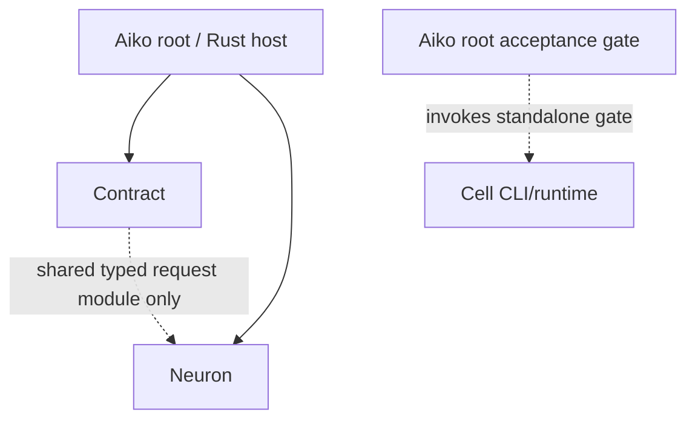
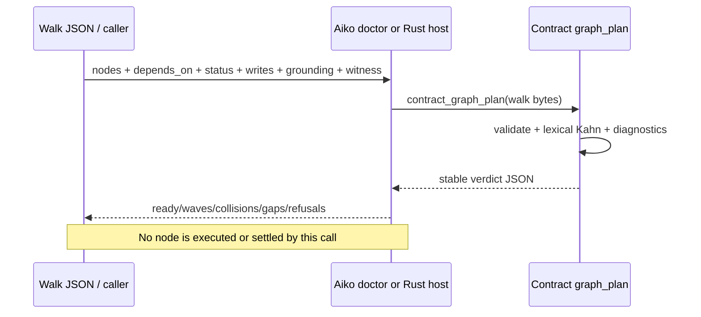
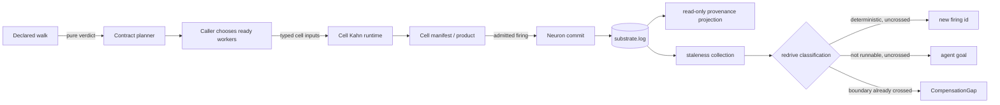

# Graph-engineering architecture

## Scope and authority

This document describes the checked-in working tree. Behavioral authority is executable code plus gates; prose is a map. The earlier [repository audit](repository-audit.md) records the state before this implementation and intentionally names gaps that later changes address.

There are three graph shapes in the repository:

1. an **obligation/task graph** analyzed and durably governed by Contract;
2. a **typed execution graph** inside each Cell composite;
3. a **committed derivation graph** projected by standalone Neuron.

Aiko composes them. It does not collapse them into one ambiguous “graph.”

## Dependency direction



The root Zig product composes Contract and Neuron; it does not import Cell's Python runtime. Cell remains a standalone repository surface aggregated by the root acceptance script. The second dotted arrow means Contract may consume the separately published typed-Neuron module. It does not permit Neuron to import Contract.

Forbidden directions:

```text
Neuron  -X-> Contract / Rust host
Contract-X-> Cell Python/YAML / desktop
Cell    -X-> Contract ledger ownership
Observer-X-> effect-safety or readiness verdict
```

The root graph gate searches source for these reversals and independently builds/runs the standalone Neuron surface. Keeping Neuron usable without Contract is the mechanical handoff evidence.

## Ownership by layer

### Contract: analysis and durable truth

`contract/libcontract/src/graph_plan.zig` is a pure analyzer. Given a JSON walk, it:

- selects active nodes (`pending`, `in_progress`, or `blocked`);
- validates required IDs, statuses, dependencies, and field shapes;
- rejects duplicate/empty IDs, malformed arrays, unknown dependencies, and cycles;
- emits lexically stable Kahn waves and the current frontier;
- detects declared path/glob write-scope overlap (`*` stays in one component, `**` can cross `/`);
- names grounding and witness gaps;
- assigns the small mechanical/judgement routing hint.

The same implementation is compiled into the C ABI (`contract_graph_plan`) and the root `aiko-doctor graph-plan` surface. Aiko points directly at the owning source rather than copying a planner.

The analyzer is **not** a scheduler, admission transaction, or settlement write. Contract’s other modules own the append-only ledger, W6H rows, occurrences and invalidation, durable graph materialization, dependency-ready leasing, evidence, and independent settlement. Do not infer durability merely because the planner lives in Contract.

### Cell: typed deterministic frontier execution

A Cell is either a leaf (`membrane + run`) or a composite (`membrane + organelles + wiring`). `cell/run.py` validates strict `<node>.<port>` endpoints, required input coverage, exactly one source for required inputs/outputs, recursion/cycles, declared input/output shape, and schemas.

For a composite, it builds deterministic Kahn frontiers. Within one frontier:

- Python, exec, HTTP, and composite siblings run serially in lexical order;
- Python/exec caps remain audit metadata rather than mechanical confinement;
- completions are observed and committed to the in-memory join in lexical name order;
- downstream work begins only after the frontier joins;
- a missing or unwritable manifest is failure.

The parent manifest pins canonical declaration/executable/descendant identities, input and output digests, wiring, child manifests and `produced_by`. This is Cell provenance, not a Contract ledger row.

### Neuron: firing and reactive provenance

Neuron owns canonical firing identity and the local append-only substrate. A committed row records artifacts with `produced_by` and evidence with cited `sources`. Those fields reconstruct derivation edges without a separate graph database.

The read-only observer:

- reads `substrate.log` without opening/locking the substrate;
- exposes committed firings at `/graph` and new commits as SSE;
- emits `cites` and `produces` edges;
- exposes artifact IDs, schemas and sizes, never payload bytes;
- defaults to loopback;
- handles compacted snapshots as final folded state rather than inventing lost history.

Because the observer cannot see attached effectors, determinism declarations, or live topology, it must not claim readiness, redrivability, or compensation routing. `telemetry stale` provides invalidation facts; `aiko redrive --dry-run` owns the topology-dependent verdict.

### Aiko: composition and native entry membrane

The root `aiko-doctor graph-plan` command exposes Contract’s pure verdict for diagnostic walk inspection. Separately, the normal Rust-host prompt path is durable and mandatory: it declares the turn with the context-aware ABI, derives the admitted Meta-Agent skill plan, calls Contract graph expansion, strictly validates the producing ABI plus the returned root/digest/unique children/hold state/complete waves, resolves a continuation, and starts the reasoning worker only after those steps succeed. A held node or non-runnable/malformed graph is a refusal. Aborted expansion terminalizes any partially declared children. ABI 13 also provides an observable graph-abandon operation that rescans durable direct children, terminalizes them before the root, and exposes incomplete cleanup. This is not the advisory skill-registry dry run and does not require a user command or feature flag.

The skill-registry dry-run annotation remains advisory and cannot issue launch or fan-out directives. The admitted prompt graph is authoritative because Contract materializes it in its ledger; the Rust host only validates and consumes that result. Aiko also exposes Neuron’s operational CLI and aggregates acceptance. It remains composition rather than becoming another planner or ledger.

## Planning flow



### Exact active-node semantics

Settled or otherwise non-active nodes remain valid dependency targets but do not appear in waves. A pending node whose dependency is settled can be ready. Unknown IDs are refused. If any active cycle remains, all waves and `ready` are empty—even if an acyclic prefix could otherwise run. This prevents a partial plan from masquerading as executable.

`kind` is intentionally local to the current decision:

```text
kind = graph  iff valid and len(ready) > 1
kind = chain  otherwise
```

`peak_parallelism` can therefore exceed one while `kind` is `chain`: parallelism may exist only in a later wave.

## Execution and evidence flow



This diagram is an ownership map, not a claim that one command automatically translates a Contract walk into a Cell YAML file and commits it to Neuron. Those seams are explicit caller/host responsibilities.

## Representation mapping

| Concept | Contract walk | Cell | Neuron |
|---|---|---|---|
| Node identity | `id` / durable row ID in execution substrate | organelle name + cell digest | firing ID / artifact ID |
| Dependency | `depends_on`, with richer durable input bindings elsewhere | typed `from` → `to` port | evidence `sources`; artifact `produced_by` |
| Read declaration | richer Contract execution binding; `reads` may be documentary in planner input | membrane input schema/value digest | cited, grounded source |
| Write declaration | `writes` scopes for collision report | membrane outputs and capabilities | committed artifacts/messages |
| Readiness | Kahn `ready` or Contract lease state | current Kahn frontier | not an observer verdict |
| Completion | durable settlement with evidence | returned outputs + atomic manifest | committed firing |
| Recompute | new obligation/lease as governed | same deterministic inputs → same bytes | redrive under a new firing ID |
| External effect | effect scope/authorization in durable graph | capability makes leaf serial | sent/read-back state selects case 3 |

The mappings preserve meaning; they are not a shared wire schema today.

## Invariants

1. **Edges carry something.** Declare a dependency only when data, evidence, authority, or settlement crosses it. Prose order is not an edge.
2. **Invalid plans fail closed.** Malformed shape, unknown dependency, or any cycle yields no executable frontier.
3. **Ordering is canonical.** Node input order and worker completion order cannot change lexical waves or manifest joins.
4. **A graph verdict is not launch authority.** Reported collisions and grounding/gating gaps remain obligations for the caller; the ABI does not suppress them.
5. **Independence is not effect safety.** Frontiers are topological, not concurrency authority. Only a mechanically confined and witnessed kind may ever parallelize. Cell serializes all same-frontier siblings because Python/exec caps are audit metadata. Overlapping writes still require isolation and reconciliation.
6. **Determinism proves termination.** A producer on the recompute path must be deterministic. Put model output at terminal edges or behind a pinned cache.
7. **Cite every dependency.** An uncited read is invisible to invalidation.
8. **Never re-cross a boundary.** Once independent read-back says an old product was sent, source movement creates compensation, not replay.
9. **Observation reports only visible facts.** Neuron’s read surface cannot infer topology-dependent decisions.
10. **The producer does not self-settle.** A named witness/evidence check judges the result at the edge; Contract owns durable settlement.
11. **No second durable truth.** Cell manifests and host projections complement, but do not replace, Contract’s ledger.
12. **Standalone Neuron remains standalone.** No convenience integration may reverse the dependency.

## Collision model and its bound

Planner collisions compare every active pair’s declared `writes`. Exact paths, directory scopes ending `/`, and globs are component-aware. The result is conservative declared-scope analysis; it does not inspect runtime syscalls, locks, databases, API resources, or undeclared writes. A clear report means only that declared scopes did not overlap. Safe parallel launch still needs honest declarations and appropriate isolation.

## Grounding and gating

A node is “grounded” for this analyzer if at least one of these arrays is present and non-empty:

- `invoke_skills` — an installed executable method;
- `inspire_from` — cited repository/corpus material;
- `capability_gaps` — an honest unresolved method gap.

That check validates shape/presence, not whether a named skill exists or was actually loaded. A gate is a non-empty `witness` string; the analyzer does not execute it. Execution and independent judgment must do both.

## Reactive invalidation and compensation

A new Contract occurrence invalidates prior resolved truth and descendants. Neuron reconstructs affected derivations only from `produced_by` and cited evidence sources. Redrive then has exactly three routes:

1. deterministic and runnable, nothing crossed: re-fire under a new ID;
2. not mechanically runnable, nothing crossed: open an agent goal;
3. already crossed an external boundary: emit `CompensationGap`, never re-fire.

Cell’s `system/redrive.cell.yaml` makes the same third route wireable from `manifests`, `prior`, and durable `prior_sent` digest read-back. It is a compositional organelle, not itself the authoritative external read-back or Contract settlement mechanism.

## Source vs. synthesis

The video directly discusses intent, planning with declared tools, execution, reflection, product bottlenecks, risk, generated-code debt, and hype resistance. The graph types, layer allocation, Kahn rule, typed ports, citations, witnesses, invalidation, and compensation above are Aiko’s design synthesis. Neither speaker is evidence that this architecture is correct; the repository gates are the behavioral evidence.
