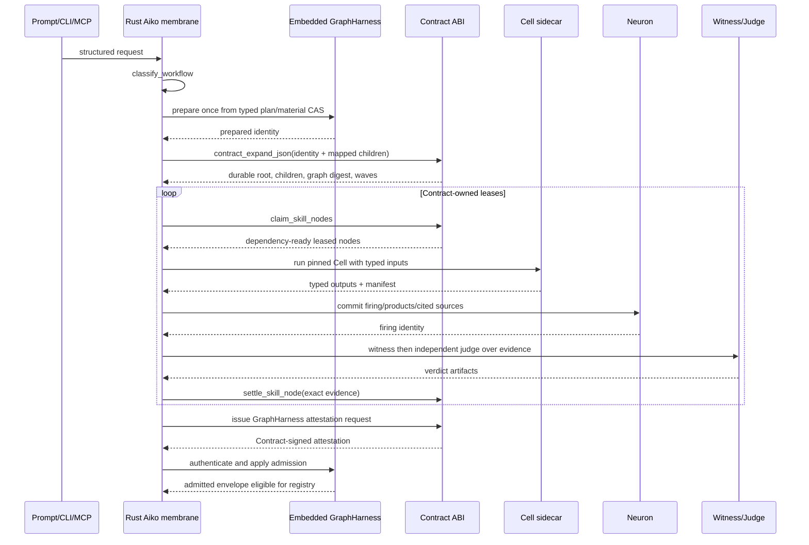
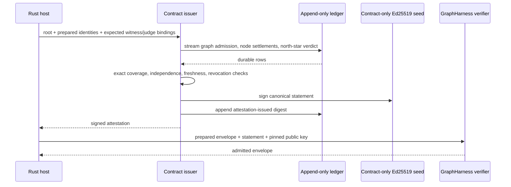

# GraphHarness on Aiko's main path

**Status: implementation-ready**

## Decision

GraphHarness becomes the Rust host's only authoring and behavioral-admission membrane for requests classified as workflows. It does **not** become a runner, scheduler, ledger, firing log, or effect oracle.

The ownership split is fixed:

| Authority | Sole owner | Main-path use | Explicit non-authority |
|---|---|---|---|
| Workflow declaration, canonical package identity, prepared/admitted lifecycle, registry compatibility | **GraphHarness in the Rust Aiko host** | Classify, prepare, inspect, authenticate admission, select an admitted package | No frontier leasing, node settlement, or effect replay decision |
| Durable root/child identity, dependency readiness, leases, evidence, judge verdict rows, graph terminal state, invalidation | **Contract** | Existing `contract_expand_json`, Skill-node claim/settle, abandonment; new attestation projection/issuer | No Cell execution and no package registry |
| Typed node-local input/output execution and manifest | **Cell** | One explicitly versioned `cell/v0` executor adapter | No Contract schedule, package admission, or durable truth |
| Actual firing identity, cited sources, `produced_by`, staleness and three-case redrive | **Neuron** | Existing Rust-to-Neuron bridge for every executed node | No Contract import and no readiness classification |
| Composition and public policy membrane | **Rust Aiko host** | Route, adapt, call owners, return structured state | No fourth scheduler and no second ledger |

“Primary” has a testable meaning: after the rollout flag is enabled, every structured workflow entering the Rust prompt, headless, ACP, workflow CLI, or Rust MCP path either carries an authenticated admitted GraphHarness digest or is first materialized as a prepared GraphHarness. It cannot reach `contract_expand_json` from a newly synthesized `skill_registry::plan_bounded` request alone. Unsupported workflows refuse; they do not silently take the old route.

This does not wrap standalone atomic Neuron verbs. `neuron`, `aiko-doctor graph-plan`, ledger/telemetry reads, and one bounded low-level recovery operation retain their present ownership.

## Independent audit grades

The three source audits were graded independently; the numbers are not an average or a vote.

| Audit | Lens | Grade | Judgment |
|---|---|---:|---|
| `/tmp/aiko-main-path/runtime-audit.md` | Runtime ownership and identity continuity | **9.4/10** | Correctly identifies `expand_turn_root`, `contract_expand_json`, the claim/settle loop, Cell closure risk, and the missing real issuer. It avoids a fourth scheduler. It stops just short of specifying a mechanically issuable Contract statement and the exact restricted authority under which a prepared graph may be evaluated. |
| `/tmp/aiko-main-path/cli-audit.md` | Public reachability and agent-native product surface | **9.1/10** | Excellent inventory of both binaries, ACP convergence, prompt-injected `--check`/`--best-of-n`, background re-planning, and MCP absence. Its suggestion to block first worker launch on an already external attestation is circular for a newly authored package unless a separate prepared evaluation is defined. |
| `/tmp/aiko-main-path/product-policy.md` | Fail-closed safety and migration policy | **8.8/10** | The strongest anti-laundering and break-glass policy, with useful machine failure semantics. It is intentionally broader than a first implementation and leaves the production issuer, prepared trial boundary, and executable Cell profile as implementation gaps. |

## Current evidence and embed/sidecar decision

The current paths establish four facts:

1. `scripts/graph_harness.py::_build_command` is an inert preparer and calls `_doctor_plan`; `Compiler.admit` is a verifier. Neither runs or signs.
2. `bin/aiko-harness` is a repository shell wrapper. Root `zig build` does not install it, and the Rust host under `aiko/` is deliberately outside the root Zig build. A packaged Rust Aiko therefore cannot rely on `../../bin/aiko-harness`, Python module paths, or a repo-local `zig-out/bin/aiko-doctor`.
3. `contract/libcontract/src/c_abi.zig:expandGraphJson` already validates direct dependency bindings, implementation shape, evidence requirements, effect fields and bounds, declares durable children, calls `muscle.schedule`, and records `skill_execution.admitGraph`. Replacing it would duplicate working authority.
4. `cell/src/main.zig` presently prints “use python run.py run”; the real runtime is `cell/run.py`. Its Python and exec leaves have ambient host authority, and root-YAML hashing alone does not authenticate descendants or entry code.

Therefore:

- **Embed the GraphHarness main-path compiler/adapter in Rust.** Do not subprocess `bin/aiko-harness`. The first slice accepts only the host-generated profile and authenticated bundles from the existing registry format; the Python compiler remains a conformance oracle and standalone repository CLI. Both consume `schemas/graph-harness-v1.schema.json` and shared golden vectors. The Rust profile uses schema-constrained JSON (no floats), sorted object keys and SHA-256 to implement the required RFC 8785 subset.
- **Use Cell as a pinned sidecar, not a partial Rust reimplementation.** The release must install a self-contained Cell runner artifact and its transitive closure, record its absolute path and SHA-256 in operator configuration, and pass a minimal environment. In a source checkout that artifact may be a hermetic Python zipapp containing `run.py`, `helpers.py`, schemas and referenced Cell files; a production installer must also guarantee the interpreter or ship a native equivalent. `AIKO_CELL_RUNNER` is deployment bootstrap, not a request field. Startup reports `cell_executor_unavailable` if it is absent or drifts. The host never falls back to repo-relative `cell/run.py` or to Cell's current Zig stub.

This asymmetry is deliberate: GraphHarness validation is a small pure admission membrane that must be present for every prompt; Cell is the owning runtime and must not be forked into a second executor.

## Routing policy

Add a deterministic classifier before graph materialization. It classifies typed request facts and the bounded native skill-plan shape, never asks a model whether its own prompt is “atomic.”

```rust
pub enum WorkflowRoute {
    GraphHarnessRequired { reasons: BTreeSet<RouteReason> },
    DirectAllowed { reason: DirectReason },
    CompatibilityEscape { policy_id: String, audit_ref: String },
    Refused { code: RouteRefusal },
}

pub enum RouteReason {
    ExplicitWorkflow, ReuseOrPublish, MoreThanOneLogicalNode, Dependency,
    JoinOrIndependentJudge, Generated, ScheduledOrDurable, Reactive,
    ExternalEffect, Recursive, WorkflowCompatibilityFlag,
}
```

`classify_workflow(request, preview)` returns `GraphHarnessRequired` when any fact above is present. `preview` is the typed output of the existing bounded Skill planner; `children.len() > 1`, a non-empty `depends_on`, a witness/discovery field, generated activation, authorization hold, or non-read-only effect is sufficient. Opaque `sh -c`, Python, Cell, or MCP payloads that request process/network/write authority are not atomic. Uninspectable composition refuses as `opaque_workflow`.

`DirectAllowed` is limited to help/schema/version, read-only observation, a single deterministic local transform, and an explicitly atomic existing public verb. A plain model turn may be direct only if its preview is exactly one bounded node with no dependency, generation, registration, schedule, external effect, or reuse intent; native Contract turn declaration remains mandatory.

`CompatibilityEscape` can only come from deployment policy, never `--legacy` supplied by the request. The policy record contains exact caller, command, digest, authority ceiling, owner and expiry. It cannot publish, schedule, recurse, cross an external boundary, or claim admission.

## Prompt to prepared package

The first implementation does not ask a model to invent a graph. `PreparedGraphAdapter::from_prompt` performs a deterministic projection of the existing `ContractSkillPlan` selected once:

1. Extract normalized goal once.
2. Call `skill_registry::plan_bounded` once under the GraphHarness recursion ceiling.
3. Classify the typed plan. A direct result takes the existing atomic Contract path.
4. For a workflow, convert every child and its explicit ports into a host-generated `graph-harness/v1` candidate. Reject missing direct data bindings, hidden fan-in, capability gaps, unsupported workers, or authority that the installed Cell profile cannot enforce.
5. Materialize all referenced bytes under `materials/<sha256>` in a CAS bundle: schemas, complete Cell definition closure, Skill declarations, witnesses, judges, source declarations and generator descriptor. A reference is to the CAS member, never a mutable cwd path.
6. Canonicalize, hash and emit `admission.state = prepared`. Run the embedded pure topology checks corresponding to `Compiler.semantic` and `GraphPlan.analyze`; collisions, grounding gaps and gating gaps are launch refusals even if an analyzer reports a ready wave.
7. Persist the prepared envelope and material CAS atomically before Contract declaration. The graph identity is `{api_version, subject_digest, transitive_digest, adapter_version}`.

The supported first profile is intentionally narrow:

- every executable node has exactly one closed authenticated executor identity: a complete strict `cell/v0` closure, one of the exact deterministic `aiko.meta.*` host transforms, or the exact `aiko.graph-harness-edge-model/v1` adapter;
- Cell remains the bounded typed executor for Cell nodes; deterministic host transforms and edge-model firings are not relabeled as Cell, and none owns a frontier, lease, or ledger;
- every Cell is either a composite whose leaves are in the supported profile or a JSON-stdio exec leaf whose executable digest is pinned and whose filesystem/network/process authority is enforceable by the existing host sandbox;
- Python/HTTP/ambient exec leaves refuse in production until confinement is mechanical;
- the ordinary subjective profile captures the producer product once, fans the witness model and the distinct judge model out independently from that snapshot (the judge has no dependency on or input from the witness), and permits deterministic settlement only when their typed evidence agrees;
- submission must carry the typed `subjective-independent-edge-review/v1` acceptance identity, which is pinned into the package. Goal prose never selects acceptance semantics. Objective artifact mode refuses until a bounded admitted acceptance profile exists;
- node shape checks and the terminal settlement programs are CAS-pinned and consume named durable evidence; they do not pretend that digest equality alone proves semantic correctness.

This slice can honestly become the main path immediately: all newly invoked supported workflows use it, while unsupported structured prompts visibly hold/refuse rather than bypass. It is not necessary to support every historical Skill graph before calling the path primary.

## Prepared, evaluated, admitted, and reused lifecycle

Prepared and admitted are distinct states. A compiler can never sign or self-admit.

```mermaid
stateDiagram-v2
    [*] --> Prepared: embedded build; inert bytes pinned
    Prepared --> EvaluationHeld: production effect / missing confinement
    Prepared --> Evaluating: isolated evaluation policy permits exact authority
    Evaluating --> Rejected: node witness, judge, cleanup, or read-back fails
    Evaluating --> Attested: Contract verifies durable graph and signs statement
    Attested --> Admitted: Rust/Python verifier authenticates exact statement
    Admitted --> Registered: immutable CAS publish
    Registered --> AuthenticatedHistory: pinned-key read-back + revocation tombstone check
    Prepared --> ContractRevalidation: typed submit with exact bundle ref
    AuthenticatedHistory --> ContractRevalidation: never launch on registry presence
    ContractRevalidation --> Attested: Contract evaluates; identical open roots remain idempotent
```



A prepared graph may execute only under `EvaluationPolicy`:

```rust
pub struct EvaluationPolicy {
    pub mode: EvaluationMode,              // IsolatedLocal | OperatorApprovedTrial
    pub max_authority: Authority,
    pub allow_external_effects: bool,       // false in first slice
    pub state_root: PathBuf,                // fresh isolated root
    pub deadline_ms: u64,
    pub signer_policy_id: String,
}
```

The first slice permits `IsolatedLocal` only and forbids network, secrets and external-boundary effects. A novel production-effect workflow is prepared and held; it must be evaluated against a sandbox/test boundary and admitted before a separate production occurrence. This resolves the apparent admission circle without laundering compiler success. A no-effect interactive evaluation may return its result, clearly labeled `prepared_evaluation`; it cannot be registered or scheduled until admission completes.

Aiko can reuse immutable **authoring bytes** by submitting the same exact `cas:<bundle>` and goal. It rehashes the closure, rechecks workspace/runtime authority, and asks Contract to revalidate the exact graph. An identical still-open request is idempotent and returns the same durable root rather than inventing a second occurrence. A historical admitted copy is authenticated for `status`/`inspect`, including the deployment revocation tombstone, but is deliberately not launch authority: the current Contract ABI cannot atomically recheck ledger revocation/current-key state while declaring a fresh graph. Until Contract gains that transaction-aware replay primitive, there is no admitted short-circuit and registry presence never launches work.

## GraphHarness to existing Contract bridge

`GraphHarnessContractAdapter::expand_request` is pure. It emits the existing request accepted by `contract_expand_json`; it does not compute a runtime frontier.

Top-level additions (currently harmless to the raw-request graph digest, but the Contract change below makes them durable) are:

```json
{
  "graph_harness": {
    "api_version": "graph-harness/v1",
    "state": "prepared",
    "subject_digest": "<64 hex>",
    "transitive_digest": "<64 hex>",
    "adapter": "aiko.graph-harness-contract/v1",
    "bundle_ref": "cas:<digest>",
    "evaluation_policy": "isolated-local/v1"
  }
}
```

Each package node maps to one Contract Skill child:

- `key` = package node ID;
- `depends_on` = exact package dependencies;
- `input_bindings` = explicit incoming data edges only, encoded as `dependency.port`; `$input` values are placed in a pinned root input artifact rather than pretending to be dependencies;
- `evidence` = the exact named producer outputs plus `cell_manifest`, `neuron_firing`, `witness_verdict`, and `judge_verdict`;
- `action = skill:<package-name>@<version>:host`, `worker=host`, `adapter=aiko.graph-harness-cell-v0/v1`;
- `effect_scope`, `read_only`, `reversible`, `requires_authorization` are a conservative projection of resources/effects. Multiple incompatible effects, residual scopes, or an external effect under evaluation refuse;
- `timeout_ms` is the minimum of node, package, parent and deployment remaining time;
- the node's Cell closure digest, witness ID/digest, judge digest, and GraphHarness identities are persisted in child extras.

Add a final host child `__graph_harness_north_star` depending on all terminal package nodes. It runs only the package witness and independent judge over durable named products. It performs no producer work. Contract thus leases package nodes and the acceptance edge using the same mechanism.

The host adapter performs, within one leased child, `Cell run -> validate manifest and outputs -> commit Neuron firing with actual source citations -> run pinned witness -> run pinned independent judge -> settle Contract child`. These are phases of one node settlement, not a host frontier loop. Cell output or exit zero alone never settles the child.



## Production Contract attestation issuer

The missing issuer is mandatory. Add ABI `contract_issue_graph_harness_attestation_json`. It is a projection of existing durable truth plus a signature; it is not a caller-supplied attestation copier.

Request fields are limited to `root_id`, `graph_digest`, the exact prepared subject/transitive digests, witness/judge expectations copied from the authenticated prepared envelope, and `admitted_by` descriptor. The function:

1. streams the ledger (using the streaming pattern already used by `latestGraphDigestStreaming`), finds exactly one matching `neuron_skill_graph_admitted`, and verifies its stored GraphHarness identities;
2. verifies every declared node is terminal-satisfied for that graph digest and has exact evidence requirements, a Neuron firing ID, evidence digest, witness verdict and judge verdict;
3. verifies the `__graph_harness_north_star` terminal row covers every package output and the package-declared judge digest;
4. rejects held, retried, died, missing, duplicate, stale/revoked, mismatched or self-judged evidence;
5. constructs `evidence_refs` and `verdicts` itself from those ledger rows, with `ledger_ref` naming the immutable graph-admission event;
6. loads the Ed25519 signing seed only from deployment bootstrap `AIKO_CONTRACT_ATTESTATION_SIGNING_KEY`, requiring an absolute, regular, non-symlink, owner-readable 32-byte file; derives the public key and `sha256:<SPKI DER digest>` key ID, and requires it to match the public verifier bootstrap;
7. signs canonical `graph-harness-attestation/v1` bytes with only `authentication.value` blank, returns the complete statement, and appends `graph_harness_attestation_issued` containing the statement digest and root identity.

The request cannot name a key, key path, signer command, verifier, time, evidence reference, verdict reference, or ledger reference. Contract supplies time and refs. The private seed is never passed to Rust, Python, Cell, Neuron, MCP, or a package. `Compiler.admit` and the embedded Rust verifier retain only the public key and therefore cannot self-admit. Reissuing the identical settled identity is idempotent and returns the same recorded statement or refuses under key-rotation/revocation policy; it does not invent new evidence.



## Exact implementation map

### Rust host

**New `aiko/crates/codegen/xai-grok-shell/src/contract_native/graph_harness.rs`**

- `WorkflowRoute`, `RouteReason`, `RouteRefusal`, `classify_workflow`;
- `GraphHarnessIdentity`, `PreparedGraph`, `MaterialCas`, `EvaluationPolicy`;
- `PreparedGraphAdapter::from_prompt(goal, cwd, plan, policy)`;
- `EmbeddedCompiler::{prepare, inspect, authenticate_attestation}`;
- `GraphHarnessContractAdapter::expand_request` and `validate_expand_response`;
- strict structs for `graph-harness/v1` and `graph-harness-attestation/v1` (unknown fields denied);
- golden parity tests against `scripts/graph_harness.py`.

**New `aiko/crates/codegen/xai-grok-shell/src/contract_native/graph_harness_cell.rs`**

- `CellRunnerConfig::from_deployment` accepts an absolute installed path and pinned digest only;
- `verify_cell_closure`, `execute_cell_node`, bounded stream collection, timeout/kill and isolated output root;
- `run_acceptance_edge` invokes pinned witness and judge separately;
- `GraphHarnessNodeEvidence` carries Cell manifest digest, output artifact digests, Neuron firing ID, witness and judge verdict digests.

**Modify `aiko/crates/codegen/xai-grok-shell/src/contract_native.rs`**

- `ground_turn`: classify before `declare_turn`; structured work prepares/loads GraphHarness, then declares and expands it;
- `expand_turn_root`: accept `TurnGraphSource::{GraphHarness(PreparedGraph), AtomicLegacy}`; delete its internal call to `plan_bounded` for the GraphHarness branch;
- `execute_neuron_skill_adapter`: dispatch only exact adapter ID `aiko.graph-harness-cell-v0/v1` to the new async module;
- `execute_claim_neuron_graph`: load the identity stored on the root/claim and node index from the immutable bundle; remove execution-time `plan_bounded` for new roots;
- `validate_admitted_turn_graph`: additionally compare returned GraphHarness subject/transitive/adapter identities;
- abandonment, claim, settle, continuation and Neuron bridge remain the existing paths.

**Modify `aiko/crates/codegen/xai-grok-shell/src/contract_native/skill_registry/graph.rs`** only to expose a stable typed plan input to the adapter; do not add admission or runtime behavior.

**Modify `aiko/crates/codegen/xai-grok-shell/Cargo.toml`** only for a JCS helper if golden vectors prove the constrained serializer insufficient. Existing `jsonschema`, `serde_json`, and `sha2` dependencies already cover validation and hashing.

### Contract

**New `contract/libcontract/src/graph_harness_attestation.zig`**

- `IssueRequest`, `ExpectedVerdict`, `SigningIdentity`;
- `issueJson`, `scanGraphEvidence`, `validateCoverage`, `canonicalStatement`, `signStatement`;
- streaming ledger scan and deterministic/idempotent issuance.

**Modify `contract/libcontract/src/skill_execution/common.zig`**

- extend `admitGraph` (or add `admitGraphWithIdentity`) to record subject digest, transitive digest, adapter version, bundle digest and evaluation/admitted mode in `neuron_skill_graph_admitted`;
- keep graph digest derived from the exact `contract_expand_json` request.

**Modify `contract/libcontract/src/c_abi.zig`**

- parse/persist the top-level `graph_harness` object in `expandGraphJson`;
- persist per-child Cell/witness/judge bindings in extras;
- export `contract_issue_graph_harness_attestation_json`;
- return GraphHarness identities in expansion response so Rust can compare them.

Do not modify `graph_plan.zig` to launch anything.

### GraphHarness CLI/registry and schemas

**Modify `scripts/graph_harness.py`** only to share new golden vectors and accept the exact durable issuer statement already defined by v1. Do not add `run`, signing, frontier, or Contract mutation.

**Keep `bin/aiko-harness`** as a source-tree compatibility CLI, not a Rust runtime dependency.

**Add `schemas/aiko-workflow-route-v1.schema.json`** and checked-in Rust/Python parity fixtures. Do not fork `graph-harness-v1.schema.json`.

### Public CLI and MCP

The implemented Rust binary namespace is backed by the same typed service used by prompts and ACP:

```text
aiko workflow schema [route|submit|status|inspect]
aiko workflow route <goal>          # or --goal <goal>
aiko workflow submit <goal> --acceptance subjective-independent-edge-review/v1
                                        # objective-artifact mode refuses without an admitted profile
aiko workflow status <bundle-ref>   # or --bundle-ref <ref>
aiko workflow inspect <bundle-ref>  # or --bundle-ref <ref>
```

`submit` carries typed `explicit_workflow` provenance into Primary preparation; it does not inject security-sensitive prose. `prepare` and `find` are intentionally not advertised until their service implementations exist. Direct DTO calls to those operations return stable unsupported-operation refusals. There is no public `issue-attestation` command: issuance remains an internal post-settlement Contract transition. Non-TTY stdout is one `aiko.workflow/v1` JSON line, and refusals are nonzero with stable codes.

The production MCP server lists and dispatches exactly `workflow_route`, `workflow_submit`, `workflow_status`, and `workflow_inspect` through the same service. Submit requires the exact typed `acceptance_mode`; the only first-slice value is `subjective-independent-edge-review/v1`. Their schemas are closed and cannot select rollout, roots, verifier, signer, Cell runner, or legacy bypass. Authentication and signing paths remain deployment-owned.

The Zig `aiko-doctor mcp` catalog remains compatible in the first slice. In the next rollout it may proxy these workflow calls only through an absolute, deployment-pinned Rust workflow-host executable/socket. It must not invoke ambient `aiko`, repo `bin/aiko-harness`, or accept key paths. Existing `aiko.gap.resolve`, `.redrive`, and `.bridge` stay atomic; composite use is routed to registered templates later.

## Compatibility, break-glass, and rollout

Old Contract roots lacking GraphHarness metadata finish through `legacy-native-skill-graph/v1`, are labeled unadmitted, and are never silently upgraded. `native contract-skills plan` becomes an observer projection of the prepared artifact; `--check`, `--best-of-n`, `contract-pair`, schedules and reusable templates select typed GraphHarness templates rather than injecting orchestration prose. Direct Neuron CLI verbs remain low-level and standalone.

Break-glass is a deployment policy record, not a request switch. It allows one named atomic existing verb when workflow infrastructure is unavailable and delay increases harm. It requires operator identity, incident/reason, exact command/object, authority ceiling, expiry and audit ref. It cannot execute a multi-node workflow, publish/register/admit, erase evidence, choose trust roots, replay a crossed effect, or report normal success. It must append/reconcile durable evidence afterward. CI rejects wildcard or unexpired-ownerless policies.

Rollout uses one enum-valued deployment policy, not scattered booleans. An absent setting means `Primary`; an unknown value refuses. `Observe` is available only as an explicit compatibility selection:

1. `Primary` (default): every structured new root has GraphHarness identity; CI mutation gates forbid the old synthesis seam.
2. `Observe`: explicitly selected compatibility observation; legacy behavior remains labeled and must not be mistaken for Primary evidence.
3. `Prepare`: structured work produces a byte-stable prepared bundle without claiming admission.
4. `EvaluateSupported`: supported confined Cell and pinned edge-model workflows use the complete Contract path; unsupported cases refuse.
5. Prepared authoring reuse: `workflow submit --goal ... --acceptance subjective-independent-edge-review/v1 --bundle-ref cas:<sha256>` reuses exact bytes only through Contract revalidation; identical open roots are idempotent and no historical admission shortcut exists.
6. `RemoveEscapes`: delete expired compatibility code after old roots drain.

`AIKO_MACHINE_CONTEXT=off` affects context projection only. It never disables routing, Contract declaration, GraphHarness identity, or admission checks.

## Anti-bypass inventory

The audits identify the following bypasses; each has a mechanical closure:

| Bypass | Closure |
|---|---|
| Ordinary TUI/headless/ACP prompt calls `skill_registry::plan_bounded` directly | One classifier/preparer in `ground_turn`; structured `expand_turn_root` requires `PreparedGraph` |
| Background worker re-plans current skills | Store bundle identity on root; `execute_claim_neuron_graph` loads immutable node index |
| `--check` and `--best-of-n` inject workflow prose | Typed templates with pinned independent judge |
| `native contract-skills plan`, `contract-pair`, scheduler `/loop` are parallel authors | Observer projection or GraphHarness template; schedules bind admitted digest |
| Subagents fan out outside package bounds | Spawn coordinator consumes remaining GraphHarness counters; exhaustion refuses |
| Standing-order/reflex effects occur during context build | Context stays observational; effects become leased nodes |
| Root Zig `agent run`, `resolve-gap`, swarm, bridge/tick compose workflows directly | Remain atomic primitives; host templates own reusable/composite use |
| Mounted MCP has no GraphHarness surface and uses ambient PATH | Rust MCP gets workflow tools; later Zig proxy uses pinned absolute host |
| Prepared/compiler/manifest/registry success laundered as admission | Only authenticated Contract statement transitions state |
| `cell_v0` or `aiko_skill_v1.expect_contains` laundered as acceptance | Projections are lookup views; package witnesses/judges remain required |
| `graph-plan.ready` treated as launch authority | Launch independently refuses collisions/gaps and asks Contract for leases |
| Caller selects verifier/signer or binary | Trust roots and executors are deployment bootstrap only |
| Root Cell YAML pins neither descendants nor code | Verify complete Cell closure immediately before every execution |
| Ambient Python/exec authority presented as confinement | Unsupported profiles refuse; declared caps alone prove nothing |
| Hidden workflow in one shell/Python/Cell node | Semantic authority/opaque-composition classifier refuses |
| Exit/stdout/producer testimony settles work | Exact evidence, witness, independent judge, Contract settlement required |
| Retry/compatibility/break-glass replays a crossed boundary | Neuron/Contract read-back selects compensation; never stale refire |
| Telemetry guesses topology/effect safety | Observer reports only journal facts; redrive owns classification |
| `AIKO_MACHINE_CONTEXT=off` bypasses gate | Routing and admission remain mandatory |
| Required executor missing falls through | Stable `executor_unavailable`, no root worker start |

## Acceptance gate and mutation falsifiers

Add `tests/graph-harness-main-path-gate.sh` and include it in `tests/graph-engineering-gate.sh` and root `zig build gate`. It drives public Rust CLI/ACP from an empty state directory; unit tests are supporting evidence, not acceptance.

Happy-path fixture:

1. Submit one prompt that deterministically adapts to `source -> transform -> judge`, with two independent initial nodes where safe and a typed join.
2. Assert route is `graph_harness_required`, output state begins `prepared`, and the material CAS plus subject/transitive digests are byte-identical over two builds and object-key reorder.
3. Assert the Contract ledger contains one graph-admission identity, exact children and dependency-ready leases; no registry row exists yet.
4. Assert Cell manifests and output artifacts exist, each Contract settlement names a real Neuron firing and cited source, and the north-star judge is a distinct pinned implementation.
5. Ask Contract to issue the attestation, authenticate it under the pinned public key, admit/register it, then find/reuse it under a fresh occurrence.
6. Move a cited source: deterministic local nodes become stale; an independently read-back boundary fixture creates `CompensationGap` and the prior effect is not rerun.
7. Fail after the first child declaration and assert `contract_abandon_graph` terminalizes every partial child and root before any reasoning worker starts.

The gate must prove its sensitivity with temporary-worktree mutations (or equivalent source substitutions), each expected to make the gate red:

- restore direct `plan_bounded` in structured `expand_turn_root`;
- make `execute_claim_neuron_graph` re-plan rather than load the bundle;
- remove the Cell invocation and fabricate its manifest;
- mutate a Cell descendant or entry executable after preparation;
- accept Python/exec caps without confinement;
- omit an explicit data edge/input binding;
- skip node witness, independent judge, north-star child, or Neuron citation;
- make producer and judge digests equal;
- replace the Contract issuer with the fixture attester or expose the private seed to Rust/Python;
- allow a request-selected verifier/signer/Cell path;
- admit on compiler exit or register a prepared envelope;
- report a collision/gap package launchable;
- remove GraphHarness identity from the Contract graph row or stop response comparison;
- allow missing Cell sidecar to fall back to the legacy worker;
- replay the boundary effect after invalidation;
- make break-glass authorize a workflow or claim admitted success.

The scoped implementation is complete—and deserves “main path”—only when `Primary` mode makes the acceptance gate green and the first two bypass mutations make it red. Supporting every legacy executor, arbitrary user-authored package, Python/HTTP Cell leaf, Zig MCP proxy, and production external-effect evaluation is explicitly later work; none may be hidden behind a permissive fallback.
