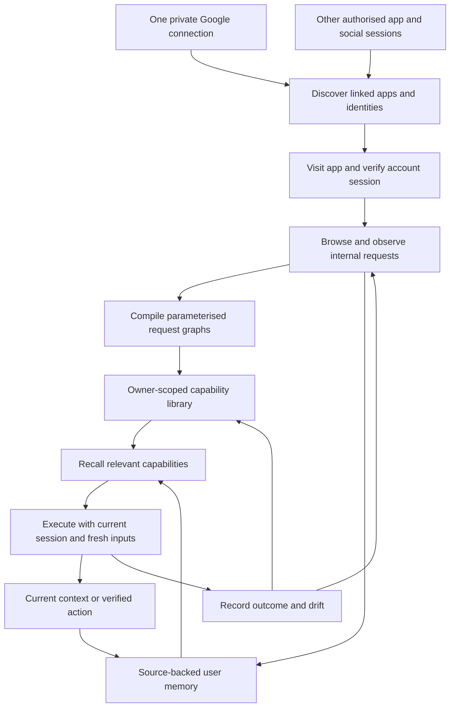

# Product prioritisation: the universal connector

Updated 9 September 2026. **Product direction: explicitly clarified by the owner. Implementation sequence, scores and targets: proposed.** This revision replaces the earlier single-app, read-only-first product focus. Existing implementation contracts keep their full acceptance requirements; this document neither enables access nor attests deployment.

## 1. The thesis: agents should spend their time using, not setting up

> The pain is continuous setup: connecting apps, reconstructing context, discovering APIs and building integrations again whenever the agent needs to do something.

**Unlock should be a universal connector that turns the user's authenticated apps and socials into durable, searchable, executable browser memory.**

Connect an identity once. Discover the apps associated with it. Reuse established access, visit those apps, observe their internal requests, and learn the dependencies as reusable API graphs. Use those graphs both to understand the person through current information and to perform authorised actions. Retain what was learned so the next task starts with useful capabilities and context already available.

Google is the first discovery and sign-in starting point. Gmail is one source in that connected environment. The product must demonstrate expansion across apps and include socials, not stop after answering an inbox question.

The central loop is:

**Connect → discover apps → establish sessions → browse and index → recall relevant API graphs → fetch current context or execute an action → verify → retain and maintain what was learned.**

Aiko is one client of this capability. Other agents should use the same owner-bound discovery, memory and execution surface. The product's value must survive a new conversation, a different task, a browser restart and another authorised agent using the same account.

### What we should heavily focus on

| Focus                                                    | Proposed share of near-term effort | Outcome                                                                                                                                        |
| -------------------------------------------------------- | ---------------------------------: | ---------------------------------------------------------------------------------------------------------------------------------------------- |
| Identity, app discovery and durable authenticated access |                                30% | One initial connection opens a continuing discovery path; users resolve exceptional challenges instead of routinely setting up each app again. |
| Browser indexing and executable API graphs               |                                35% | Visiting and using an app teaches reusable requests, inputs, dependencies and operations.                                                      |
| Graph recall, user context and action reuse              |                                20% | Agents find existing capabilities, fetch relevant current facts and act without rebuilding integrations.                                       |
| Incremental maintenance, recovery and user control       |                                15% | Learned access and capabilities keep working, or explain the precise exception that needs attention.                                           |

These shares express focus, not estimates or separate infrastructure projects. Authenticated replay, semantic memory and maintenance belong in the same first product proof. UI polish supports that proof; general optimisers, rich databases, calling and video expansion can wait.

## 2. What “connect Google once” should mean

**Target experience:** the person establishes Google access in Unlock's private browser and gives a clear standing scope for discovering and indexing their existing linked apps. Unlock then handles supported visits, session checks, indexing and ordinary reuse under that scope. The person should not have to name and reconnect every already eligible app or approve every read.

Google exposes an account surface listing linked apps, including Sign in with Google relationships. That is a concrete discovery starting point. Its categories also include apps with access to Google data and accounts linked in the other direction; these are not interchangeable. [Google: manage linked apps](https://support.google.com/accounts/answer/16363505?hl=en).

Existing Google sign-in and prior consent can remove repeated sign-in steps in supported apps. The receiving app still establishes its own application session. **Engineering implication:** discover a relationship, visit the app, complete an eligible existing sign-in, and verify the app account. A Google token or a catalog entry is not a universal third-party session. [Google: linked-app sign-in](https://support.google.com/accounts/answer/16670080?hl=en), [Google: application sessions after OpenID Connect](https://developers.google.com/identity/openid-connect/openid-connect).

### The experience we want, step by step

1. **Connect Google privately.** Establish the intended account and retain its supported browser session through the existing private custody path. Signing in to Unlock with a Google identity alone would not establish this browser session; the UI must describe the actual access being connected.
2. **Set the discovery/indexing scope once.** Explain that Unlock will inspect linked apps, visit eligible existing accounts and learn their information and capabilities. Offer exclusions and pause controls without making the owner configure every endpoint. Reading app data and sending/posting/changing things have separate authority.
3. **Discover the linked-app set.** Inspect the authorised Google connections surface. Record its coverage, categories, stable app identities where available, verified destinations and discovery evidence. Do not assume an undocumented public API can enumerate every app; use the browser to learn this surface too, if its captured calls can be safely reused.
4. **Visit eligible apps automatically.** Reuse an app session when present, or use its supported existing Google sign-in. Verify the destination account and workspace before indexing. A new consent screen, ambiguous account, signup path or MFA challenge becomes an exception with the current attempt retained.
5. **Index across apps in the background.** Perform an initial bounded sweep of the eligible app set. Learn navigation and request graphs, then progressively deepen useful areas. A task can use already indexed apps while the sweep continues; the user need not request each integration first.
6. **Include socials.** Discover Google-associated socials where present. Also accept owner-selected existing social sessions or a private sign-in for an independent social identity. Reuse that connection thereafter. No assumption that Instagram, LinkedIn, X or every other social account supports or uses Google sign-in.
7. **Keep the environment usable.** Restore verified sessions, refresh expiring access when supported, revisit only affected capabilities, and surface genuine challenges. A new task must not restart account onboarding, a full crawl or integration generation.

The initial standing grant must define whether newly discovered apps of that identity are included. If included, eligible discovery should proceed without per-app prompts. If excluded or ambiguous, discovery can show the candidate while access waits for the missing choice. App pages and model outputs cannot enlarge this grant. This is a proposed product contract, not a claim that broad discovery grants are already implemented.

### Scope of “universal”

Universal describes one extensible method for connecting and learning across applications, rather than a promise of complete coverage on day one. Every discovered app needs a truthful disposition: **usable**, **partly indexed**, **needs verification**, **excluded**, or **not yet supported**. Native/mobile-only services and undiscoverable/private endpoints need additional adapters or explicit limitations. The team should expand demonstrated coverage using the same system, not rename a small fixed catalog “all apps.”

## 3. AGENTS.md translated into this product

[AGENTS.md](../AGENTS.md) governs the design. Its simplicity principle means reducing the person's continuing effort, even when the implementation must handle real authentication and API complexity.

| Principle | Application to the universal connector | Evidence of success |
| --- | --- | --- |
| Human needs and accomplishment | Make the connected environment useful for real tasks. | A person asks for work and the agent already knows where and how to get the relevant information. |
| Maeda: reduce and time | Eliminate repeated sign-in, exploration, API reconstruction and manual context copying. | Warm tasks reuse sessions and graphs; user intervention falls after initial setup. |
| Maeda: organise and learn | Organise by apps, accounts, people, projects and usable capabilities. | The person does not need to know URLs, tool IDs, request headers or graph nodes. |
| Maeda: context and trust | Retain knowledge while preserving current account scope, corrections and source freshness. | An app switch or restart retains useful context without mixing accounts or reviving revoked access. |
| Wayfinding and feedback | Show discovery/indexing progress and a small list of genuine exceptions. | The person sees which apps are usable and what, if anything, needs them. |
| Visibility and progressive disclosure | Lead with usable apps and work; expand evidence and coverage on demand. | No graph editor, integration wizard or trace viewer is required for ordinary use. |
| Consistency and mental models | One reusable connection and capability system serves every agent client. | A capability learned through Aiko is discoverable through the existing authorised API. |
| Dalio: diagnose reality | Separate discovery, sign-in, capture, compilation, recall and execution failures. | A broken header binding is repaired instead of asking the user to reconnect an otherwise valid session. |
| Dalio: distinguish evidence from inference | A seen endpoint is a candidate; a checked execution establishes a usable capability. | Coverage and action readiness are evidence-backed, and uncertainty remains visible. |
| Fadell: own the whole experience | Own discovery, first learning, repeated use, drift, recovery and departure. | The product works on the next day and handles session expiry without abandoning the person's task. |
| Surgical engineering and reuse | Extend the existing native runtime, browser compiler, request memory, entity-learn and custody paths. | No parallel scheduler, graph database, integration registry or secret store without a demonstrated requirement. |

Quality and accessible controls remain completion requirements. A simpler screen must still let a person inspect scope, correct a mistaken association, pause indexing and disconnect an app.

## 4. Pain matrix: the cost of continuous setup

The owner supplied the thesis; prevalence and willingness to pay are not measured. Scores below are prioritisation judgments. Severity (S), recurrence across relevant tasks (F), and reach within the intended connected-app user group (R) each run from 1 to 5. **Pain score = S × F × R, maximum 125.** Scores rank pains; dependencies determine delivery order.

Severity 5 means an outcome is blocked or trust is lost; 3 means a substantial workaround; 1 means minor friction. Recurrence/reach 5 mean most relevant tasks/users, 3 a meaningful subset, and 1 rare/narrow. Evidence confidence concerns the mechanism, not its prevalence: H = direct documented limitation/check; M = partial implementation or architectural evidence; L = primarily a hypothesis. Effort M = several existing components; L = cross-boundary implementation and live-provider verification.

| Rank / pain | Work the person or agent repeats | S | F | R | Score | Evidence / confidence | Scope / effort |
| --- | --- | ---: | ---: | ---: | ---: | --- | --- |
| 1 · The agent cannot reuse the user's existing app access | Connecting services, selecting accounts, restoring sessions and explaining what is available. | 5 | 5 | 5 | 125 | [Private sign-in](connector-engine.md), [replay boundary](request-memory-and-workflows.md); H | P0: identity discovery and durable per-app sessions; L |
| 2 · Every task rebuilds an integration | Browsing screens again, finding endpoints, copying requests and reconstructing inputs. | 5 | 5 | 5 | 125 | [Request memory](request-memory-and-workflows.md), [adaptive execution design](self-composing-harness-plan.md); H | P0: reusable authenticated API graphs; L |
| 3 · Context is scattered across apps and socials | Copying messages, reconstructing relationships and explaining current projects. | 5 | 5 | 5 | 125 | [Entity memory](aiko-entity-learn.md), [secretary context model](secretary-operating-model.md); M | P0: cross-app evidence and semantic recall; L |
| 4 · Saved knowledge is stale when used | Rechecking old answers or making decisions from outdated facts. | 5 | 4 | 5 | 100 | [Fresh recomputation](request-memory-and-workflows.md), [knowledge](aiko-knowledge.md); H | P0: graph-based fresh retrieval and invalidation; L |
| 5 · Discovered apps still need manual onboarding | Naming every app and repeating an otherwise available SSO flow. | 5 | 4 | 4 | 80 | [Google linked-app surface](https://support.google.com/accounts/answer/16363505?hl=en), [Gmail scope](connector-engine.md#gmail-first-scope-and-verification); M | P0: identity-led discovery and one exception queue; L |
| 6 · A captured API cannot actually be called again | Rebuilding cookies, headers, body parameters, response IDs and execution placement. | 5 | 4 | 4 | 80 | [Request fidelity and session limits](request-memory-and-workflows.md#request-fidelity-instagram-readiness-and-login-reuse); H | P0: native-session replay and dependency producers; L |
| 7 · The agent knows facts but cannot do the work | Building a fresh action tool or leaving the user to click through the app. | 5 | 4 | 4 | 80 | [Observed actions](request-memory-and-workflows.md), [promises](aiko-promises.md); M | P0: one learned, authorised action reused with new inputs; L |
| 8 · New conversations or failures erase progress | Rediscovery, reindexing and repeated setup after restart, expiry or schema drift. | 4 | 4 | 4 | 64 | [Recovery](private-login-recovery.md), [native parity](native-harness-parity.md); H | P0: retained graph/session lineage and localised repair; L |
| 9 · Indexing creates work instead of understanding | Watching a crawler, answering low-value prompts and reading repetitive notifications. | 4 | 3 | 4 | 48 | [Background actors](aiko-background.md), [evaluator](aiko-evaluator-improvement-plan.md); M | P0: bounded autonomous sweep, clear coverage and quiet maintenance; M |
| 10 · Too much access or mistaken personal context | Auditing what was read, correcting false identity merges and trying to stop retention. | 5 | 3 | 3 | 45 | [Knowledge boundaries](aiko-knowledge.md), [retention gap](self-composing-harness-status.md); H | P0: standing scope, exclusions, correction and revocation; M–L |

Wrong-account access, credentials in learned artifacts, unauthorised writes, fabricated freshness and replay of uncertain mutations block release regardless of their numerical score. Routine read reuse and account discovery inside an existing grant should not produce repeated approval dialogs.

## 5. The product architecture: a graph that remembers how to use apps

These are logical responsibilities on the current runtime and storage. The diagram does not propose a new graph service. There are several related kinds of graph knowledge; keeping their meaning clear is necessary for correct reuse.

| Graph knowledge | Nodes and relationships | Why it matters |
| --- | --- | --- |
| Identity and access | Owner, identity provider, app, destination account/workspace, current session reference; linked-to and verified-as relationships. | Find candidate apps and bind every use to the right account. A relationship is not itself authority. |
| Navigation and coverage | Visited page/state, safe interaction, account area, pagination frontier, last visit and missing branch. | Continue exploration without starting over or pretending the whole app is indexed. |
| Executable request graph | Request/operation, input schema, output fields, response-derived IDs/cursors, header producers and session requirements. | Recompute an operation with new inputs instead of replaying a frozen HTTP recording. |
| User and work context | Source-backed people, projects, commitments, preferences and qualified relationships across apps. | Understand the user and retrieve the right facts without asking them to explain everything. |
| Evidence and lifecycle | Observation, graph version, verification, successful run, supersession, correction and revocation. | Decide whether knowledge is current and usable, and explain how it was obtained. |

### What an indexed API capability must retain

- A stable capability identity/version and a plain description of what its result or action means.
- App, account/workspace and source-page context, with opaque current-session requirements.
- Method, approved destination/route template and operation discriminator. Multiple GraphQL or RPC operations at one URL must remain distinct.
- Typed caller inputs; output fields and observed coverage; pagination and stopping conditions.
- Explicit edges for upstream outputs, cursor production, CSRF or other private header producers and prerequisite operations.
- Effect classification, permitted execution placements and an outcome check.
- Source evidence, verification scope/time, dependency pins and known failure/recovery conditions.

**Example:** a request lists workspaces; a selected workspace ID feeds a project-list request; a selected project ID feeds a paginated task request. A later action updates one selected task using its current revision. These are separate request dependencies. A memory relationship that a person works on that project is a semantic claim, not an executable dependency or a permission grant.

Do not infer an edge merely because requests occurred close together. Preserve page/dispatch attribution and test the data dependency. Shared endpoints, repeated IDs and concurrent tabs are precisely where an apparently plausible graph can become wrong.

### Two forms of memory, joined by provenance

**Procedural memory:** where and how to get information or perform an operation. Retain parameterised request graphs, applicability and checked run evidence.

**Personal context:** selected facts from authorised app responses, with source account, subject, observation time, evidence reference and correction history. This is what lets the agent understand people, projects and obligations. An endpoint description alone cannot provide that understanding.

Reuse entity-learn for facts and relationships and the existing request/harness library for executable definitions. Do not put entire private response bodies into the endpoint index. Extract only useful facts under the agreed retention scope; keep bounded working results transient unless explicit memory policy permits retention. A source edit invalidates its derived facts. Same name or email-like text alone is insufficient to merge people across accounts; use supported identifiers or an explicit user correction.

Remembering that “this API returns upcoming meetings” should lead to a current call when asked about tomorrow. Remembering a dated meeting observation can answer a historical question. Remembered procedures, remembered facts and current results must remain distinguishable.

## 6. P0 scope: build the complete reuse loop

P0 is a cross-app proof of the universal method. Individual implementation steps can be small; acceptance must span identity discovery, socials, graph memory and actions.

### P0-A · Discover apps from an identity, then preserve their access

Build a Google-linked-app discovery adapter on the existing private browser/controller. Establish a standing discovery/indexing scope, exclusions and an app/account inventory with source evidence. Cover pagination/categories and report partial enumeration. Verify destination domains independently; an app name or third-party URL is not enough to choose a credential destination.

Automatically visit eligible known apps, reuse sessions and complete supported existing Google sign-ins. Verify the actual destination account, workspace and authenticated read. Persist separate app session identities and their relationship to the Google identity. A shared Google cookie scope must retain its actual revocation semantics; the product cannot promise independently revocable cookies where the current custody policy shares them.

Use one exception queue for MFA, account ambiguity, changed consent or unsupported sign-in. Continue discovering/indexing other eligible apps while one waits. Retain completed work across closing the UI and restarting the host. Do not silently create a new app account through an SSO signup path.

For non-Google socials, reuse an explicitly connected session or provide one private connection handoff. An import/extension bridge to an existing local browser can be investigated as a separate delivery mechanism; the current hosted VM must not be described as automatically having the user's desktop cookies. The first scope does not depend on building a desktop product.

**Done when:** one initial Google connection discovers and verifies at least two distinct linked third-party apps without repeated credentials where their existing SSO permits it, with a recorded exception handled once. Include a social account in the test set, using its actual supported connection path. Demonstrate restoration and revocation for the individual app and root identity separately.

### P0-B · Index the authenticated environment, not just the current prompt

Run an initial discovery sweep over the in-scope apps after connection. Prioritise account/workspace identity, navigation, people, recent work and high-value list/detail/search surfaces; deepen the index progressively. A user task can raise a relevant branch's priority without being the only trigger for exploration.

Reuse the native indexing frontier and request observer/compiler. Record app/page/session/operation attribution, route coverage and continuation cursors. Deduplicate background refreshes, analytics noise and equivalent definitions. Support the necessary request shapes for the first app set, including GraphQL/RPC reads, parameterised bodies, pagination and required headers where observed.

Discovery must distinguish an interaction that reveals information from an action that changes it. Opening a conversation can mark it read; a POST can be a read; a GET can have effects. Capture known effects during already authorised use or controlled test actions. Do not click Send, Like, Follow, Delete or Publish simply to discover an endpoint. Candidate endpoints with uncertain semantics remain candidates until the required evidence is available.

Chrome's Network domain provides request/response events, identifiers and body inspection primitives. It does not supply a finished semantic dependency graph. The compiler and outcome checks must derive and validate that structure; protocol support must also be checked on the pinned browser. [Chrome DevTools Network protocol](https://chromedevtools.github.io/devtools-protocol/tot/Network/).

**Done when:** one bounded pass across the selected apps produces provenance-bound list/detail/search capabilities with varied inputs and real dependencies. Stop and resume the sweep without losing its frontier or mixing concurrent app responses. Report discovered, visited, indexed and executable counts separately.

### P0-C · Make captured authenticated requests reusable

This is a central blocker, not later optimisation. The [current replay documentation](request-memory-and-workflows.md#request-fidelity-instagram-readiness-and-login-reuse) says browser hydration is limited to same-origin GET/HEAD without custom headers/bodies; host replay uses a separate explicit vault assignment. Native browser sign-in does not automatically bridge to host HTTP. Instagram DM listing is explicitly unverified.

Extend the existing execution/session adapter to meet observed app requirements. Start with the correct eligible placement: requests requiring browser-held state run in the owned browser/session; direct sandbox or HTTP execution is used only when its binding and semantics have been verified. Do not force users to connect a second vault just because the agent chose the wrong transport.

Resolve credentials, cookies and required private header values through trusted current-session producers at dispatch. Preserve opaque references in graphs, not captured secret values. Recompute resource IDs, CSRF, cursors and optimistic-concurrency revisions from current responses. Honour actual origin, session and network constraints; never treat a failed permission check as a reason to route around it.

Keep network learning paused during private sign-in, MFA and consent. Their credentials and private requests never become general API-memory entries; only sanitised session outcomes feed the connection lifecycle. Resume app indexing after verified session custody and private-flow cleanup.

Promotion requires semantic comparison with an independent source/browser witness and fresh input variation. A single captured success is not proof of every parameter combination. For changing live data, distinguish a changed source from a bad compiler. Keep unsupported bindings explicit and repair only the affected graph.

**Done when:** a cookie-protected read and an observed header/body-dependent read both replay with new input values, current session material and fresh dependent IDs. Include the social case. Repeat after restart and session rotation without new user setup; reject stale graphs or missing producers before the affected call.

### P0-D · Turn graphs into context the agent already has

Make recall a standard early step for relevant agent tasks. Search the owner-scoped library and entity-learn together: select likely apps/entities, inspect the exact operation schema and scope, then call the known graph for current facts. Load full graph detail only when needed. Known capability IDs should not require relearning or reading generated documentation every time.

During initial indexing, compile a small, source-backed overview of the connected environment: available apps/accounts, active projects, relevant people and recent work within the permitted scope. Progressively update it as evidence arrives. Infer cautiously and label inferred preferences/relationships. The person should be able to inspect or correct useful understanding without manually writing an agent profile.

Keep context task-relevant and bounded. Distinguish source events from model interpretations, preserve original account scope and recheck source authority after compaction or restart. Source content cannot change the user's instructions or authorise new access/actions.

**Done when:** after indexing, an agent answers a previously unseen cross-app question using retained graph discovery and current API results, without asking the user where the data lives. Another authorised client can find the same capability. A source change, explicit correction and revocation each affect subsequent recall correctly.

### P0-E · Reuse learned actions as well as reads

Actions are part of the core thesis. Learn an action from a controlled example or work already authorised by the owner, parameterise its inputs/dependencies, and register its checked effect contract through the existing library/observed-action path. Reading an action's schema does not authorise performing it.

The caller asks for the outcome through the shared native tool/API surface. Resolve the current account, inputs and prerequisites; prepare the exact meaningful change through existing approval mechanisms; execute once; check the resulting object/state; retain the receipt. The owner approves the consequential change, not the internal sequence of setup calls already covered by that task.

A later request with different inputs reuses the capability definition and obtains the authority required for the new action. It should not rebuild the integration. A connection/indexing grant is not blanket permission to post, message, follow, buy or delete. Preserve current exact-payload approvals; broader standing action mandates require their own explicit supported contract.

**Done when:** one learned action works through the browser-derived graph, then handles a second authorised intent with different inputs without rebuilding. A lost acknowledgement remains uncertain and cannot trigger automatic replay or a browser fallback that repeats the change. Prefer a controlled low-impact action for the first live witness; social read coverage is still mandatory even if that action is in another app.

### P0-F · Maintain the graph and sessions with less work over time

Persist session custody, graph/artifact versions, source evidence, indexing cursors and execution receipts through the current native host and account storage. On return, check current authority and relevant dependencies, then reuse. Reconnection must not erase the library or make the user explain the app again.

Use relevant observed requests and changes to invalidate affected facts/capabilities. Refresh on demand and perform bounded background revisits under the standing indexing policy. Include rate-limit handling, cold/warm VM behaviour, interruption and missed-coverage states. Keep continuous indexing as finite durable work; do not hold a model or browser effect open indefinitely or run a full recrawl every turn.

For drift, identify the failed dependency/schema/session, retain unaffected capabilities and repair only that branch. Session expiry can need a private challenge; it does not imply all graph knowledge is invalid. Revocation blocks future use even when artifacts and historical receipts remain retained. Explain suppression versus erasure accurately, including known native-log retention limitations.

**Done when:** resume after a host/browser restart; rotate a session; change one endpoint; cancel an in-flight sweep; revoke one app. Preserve valid unrelated work, do no duplicate mutation and require no full reconnection/rebuild. Routine maintenance stays quiet; only actionable exceptions interrupt the owner.

## 7. What already exists, and where to put the work

These are documentation-backed starting points, not a fresh implementation or deployment audit. Recheck code, current bindings and relevant tests before implementation.

| Area | Existing foundation | Priority gap |
| --- | --- | --- |
| Google/private sign-in | [Connector engine](connector-engine.md), private controller, encrypted custody, Google-shaped SSO/OTP fixtures. | Identity-wide linked-app enumeration and automatic traversal under one scoped grant; real-provider verification. |
| Connected-state indexing | [Connector evidence](connector-verification.md), native indexing request, durable route frontier and background actors. | Cross-app sweep and independent per-app progress; diagnose the newer documented indexing/routing failure rather than relying on the older complete witness. |
| Request graph compilation | [Shared browser runtime](shared-browser-runtime.md), browser learning, request compiler and immutable definitions. | Expand observed request/dependency coverage for authenticated app/social workloads; preserve per-tab attribution. |
| Private session replay | [Request fidelity](request-memory-and-workflows.md#request-fidelity-instagram-readiness-and-login-reuse), browser transport, vault SDK and observed-network executor. | Bridge verified native custody to eligible execution without another user setup; headers/bodies/session requirements are first-class. |
| Semantic recall and personal context | [Entity-learn](aiko-entity-learn.md), [compiled knowledge](aiko-knowledge.md), endpoint descriptions and router. | Join app/identity discovery, executable recall and selected source-backed user facts; automatic contextual use across tasks. |
| Reusable actions | Existing observed actions, [promises](aiko-promises.md), [workflow library](request-memory-and-workflows.md). | Demonstrate capture → parameterise → approve → execute → reuse on an authenticated app. |
| Adaptive execution | [Self-composition design](self-composing-harness-plan.md), especially browser waiting and learned routine sections. | Make the eligible browser/network selection and scoped promotion work on this journey; broad optimisation is not required. |
| Ongoing updates | [Browser events](browser-events-and-reusable-tools.md), [status](browser-events-status.md), native deadlines and background reflection. | Incremental invalidation and bounded revisits now; validate real push/stream paths separately instead of promising universal event coverage. |
| Agent clients | [Native parity](native-harness-parity.md), [account SDK](../packages/sdk/README.md), existing tool discovery. | Expose the same reusable capability and context to authorised clients, without agent-specific connector rebuilds. |

The proposed logical contract is **discover / describe / invoke / inspect outcome / manage scope** on the existing surfaces. It is not a new claimed SDK export. Backend implementation should own credentials and execution; agents should consume schema, scoped references, current results and receipts.

Official API integrations remain useful when they already provide a verified capability. They should coexist with browser-learned operations under this shared contract. A hand-maintained provider catalog must not become the prerequisite for supporting a new website, and changing providers must not become another user onboarding project.

## 8. First acceptance demonstration: an environment that stays usable

A Gmail-only result cannot establish this thesis. The first proof must span apps, reuse and time.

**Test environment:** an authorised Google identity with at least two distinct existing linked third-party apps, plus one social account. The social may overlap a linked app only if it actually uses that identity; otherwise connect it once through its supported private path. Include two accounts/workspaces with similar names to exercise identity binding. Select actual apps from the consented test owner's real inventory; do not assume specific SSO providers for brand names.

1. Connect Google and establish the indexing scope once. Discover its eligible app set, record coverage and automatically visit the selected linked apps.
2. Establish the app sessions, resolve one authentic challenge if encountered, then continue the retained sweep. A pending app does not block the others. No account is newly registered as a side effect of exploration.
3. Index at least one useful API read per selected app. Across the set, include pagination, a response-derived identifier and a required header or body binding. The social case must use an authenticated source, not a public profile substituted for private-account coverage.
4. Retain the library and selected user facts. Ask a new cross-app question such as “What is happening with the launch across my tools and socials?” Return supported facts, current checks and gaps; use a fixed expected-result set for the controlled version of this test.
5. Perform a controlled authorised action through a learned graph, then a distinct new action with changed inputs through the same definition. Verify both outcomes separately; no new connector code or full exploratory browser sequence is needed for the second task.
6. Restart the host and browser. Change a source fact and rotate supported session material. Ask another relevant question. Verify fresh data, remembered constraints, graph reuse and no repeated account setup caused by Unlock.
7. Break one endpoint/schema. Repair or explicitly hold that capability; unrelated apps remain usable. Inject uncertain action delivery and prove it is not repeated.
8. Revoke one app and check recall, fresh calls and background indexing stop using its protected data. Then test root-identity disconnection with its actual shared-session consequences; retained history must not resurrect access.
9. Use a second authorised agent/API client to recall and invoke one of the learned reads. The user does not teach the second client the integration again.

Run controlled fixtures first to check precise effects, failure races and expected outputs, then a separately authorised real-provider/account witness. A real Google/app discovery result, private social read and browser-session reuse are required evidence. Synthetic Google-shaped pages and public-page reads cannot stand in for them. Preparing this plan makes no such external calls.

## 9. Delivery order and accountable outcomes

| Stage | Accountable area | Concrete outcome | Exit gate |
| --- | --- | --- | --- |
| 0 · Verify the two riskiest assumptions | Identity/access + request execution | Probe linked-app discovery in the intended browser and one authenticated social API capture/replay. | Real observed inventory semantics and request/session requirements, with named blockers. Do this before investing in a broad discovery UI. |
| 1 · Identity expands to app sessions | Connector/runtime | One root connection, retained app inventory, standing indexing scope, eligible SSO traversal and recoverable exceptions. | At least two linked apps verified; others show an honest disposition; restart preserves the attempt and sessions. |
| 2 · Browser use becomes durable capabilities | Browser compiler/session execution | Cross-app capture, dependency graphs and supported native-session replay, including the social read. | New-input and rotated-session reuse; no captured secret constants or per-app handwritten integration for the demonstrated operations. |
| 3 · Agents use the learned environment | Memory/router/action execution | Cross-app contextual recall, current reads, one reusable action and a second client. | Complete the acceptance story through repeated use; evidence distinguishes compilation, current result and action outcome. |
| 4 · Keep using it tomorrow | Runtime/indexing/product | Incremental maintenance, localised drift repair, coverage, cancellation and revocation. | Restart/expiry/drift cases pass and measured repeated setup burden falls. This is part of P0 acceptance, not optional later polish. |

One accountable owner must track the whole acceptance story. Component checks should support it, not replace it. These are suggested work boundaries, not assignments to named people or instructions to spawn workers.

### P1: expand demonstrated universality

- Grow the app/social corpus by observed authentication and API failure families: additional SSO providers, independent accounts, richer GraphQL/RPC patterns, uploads, streaming and browser-only requirements.
- Improve automatic account discovery from owner-authorised browser metadata, password-manager references or email evidence where useful. A discovered brand or marketing email does not prove an account exists. Each discovery source needs its own scope and provenance.
- Support more action semantics and recurring workflows through existing approval and receipt contracts.
- Add source events or subscriptions where they demonstrably reduce repeated refresh work. General push support is one mechanism, not the definition of live context.
- Improve cross-app relationship resolution and relevance from corrections and checked outcomes; preserve private account separation.
- Investigate a local-browser bridge only if measured session reuse or provider constraints justify its installation and maintenance burden.

### P2: avoid rebuilding the product around supporting machinery

General graph editors, rich live databases, skill marketplaces, broad book ingestion, automatic optimiser promotion, new agent personas, calling, video generation and multiplayer expansion wait unless they directly resolve a measured connector/context bottleneck. Preserve existing useful implementations and full historical contracts. Fix active correctness defects even in areas whose expansion is deferred.

## 10. Measure whether we removed setup

**Primary product metric: recurring setup burden per completed task after initial connection.** Track the human's effort and the agent's effort separately. Otherwise we can appear to remove user setup while secretly rebuilding every integration on every turn.

Define human setup minutes as time spent reconnecting, choosing already known accounts, re-entering information, manually configuring integrations or repeating known context. Define agent setup work as exploratory navigation, capability generation, dependency reconstruction and repair. Normal current-data retrieval and explicitly requested business actions are useful execution, not setup. Report initial learning cost separately and show when it is amortised by repeated use.

| Metric | Measurement | Proposed initial acceptance target |
| --- | --- | --- |
| Discovery coverage | Eligible existing linked apps found / independently reviewed in-scope inventory; record unknown and excluded separately. | Correctly account for every app in the controlled inventory; publish observed coverage for the real account, with no claim of universal enumeration. |
| Session reuse | Repeated eligible app uses needing no fresh credential entry / all repeated eligible uses. | No Unlock-caused repeat login across the acceptance run and restart/rotation cases. Provider-required challenges remain visible and counted separately. |
| Capability reuse | Warm supported task invocations using an existing verified graph / all supported warm task invocations. | At least 8 of 10 held-out warm tasks use retained graphs; zero unexplained full rebuilds for unchanged compatible capabilities. |
| Human setup burden | Minutes, credential prompts, repeated explanations and operator interventions on matched tasks. | At least 50% reduction from the current agent workflow across the pilot set; no regression hidden by excluding failed tasks. Hypothesis, not an observed saving. |
| Agent setup burden | Discovery navigation, generated code/graphs, model calls and time before useful execution. | Show lower warm setup effort on matched tasks while preserving outcome correctness; report one-time indexing and maintenance cost. |
| Context quality | Cross-app answers checked against source facts, latest changes, corrections and covered ranges. | Every required controlled scenario correct; no stale-as-current or unsupported identity merge. Human review checks whether the useful facts are actually selected. |
| Action reuse | Two separately authorised intents with changed inputs and independently checked outcomes using the same capability. | Both succeed; acknowledgement-loss test produces no duplicate effect. |
| Maintenance locality | Amount of relearning after one app/schema/session changes. | Unrelated sessions and graph versions remain reusable; no blanket recrawl or re-login. |
| Portability | Second authorised client discovers and uses the retained capability. | No second connector build, copied credentials or user re-explanation. |
| Cost and latency | Cold indexing, warm reads/actions, maintenance, failures and user waiting, per verified outcome. | Record actual provider/VM/model cost under an explicit pilot allowance. Optimise total recurring cost, not endpoint count. |

The denominators include unsupported/failed attempts in the overall adoption funnel, with a separate supported-capability breakdown. Do not turn “unsupported” classifications into an inflated success rate. Ten warm tasks are a useful acceptance sample, not a production reliability estimate.

Recruit a small pilot of people with multiple apps and at least one social account. Compare their current agent workflow with Unlock on the same outcomes. Observe first connection, a new task after indexing, and return use across a week. Ask where they still had to configure, reconnect, repeat context or supervise repairs. Track useful work completed and voluntary return, not merely apps discovered or requests indexed.

## 11. The everyday interface

The person should see **their connected environment**, not an integration builder.

- **Your apps:** discovered apps and selected account/workspace, with usable/partial/needs-you status. The background sweep can continue without holding the page open.
- **Needs you:** only account ambiguity, provider challenges, new authority outside scope and concrete consequential-action approvals. Resolve the retained exception and continue.
- **What Unlock understands:** a concise, editable view of important source-backed facts and relationships, with sources and observation times.
- **Use it:** ask Aiko or another authorised agent for work. Existing graphs are recalled automatically. Technical operation details stay expandable.
- **Control:** pause discovery/indexing, exclude an app, correct an association, disconnect access and inspect retention/deletion limits.

Example wording: “Found your linked apps. Six are ready; two need verification. I’m learning the remaining apps in the background.” Counts must come from actual discovery and verification states. Avoid “Everything is connected” or “Knows your whole life.”

Inside one app, show “Indexed projects and recent tasks; files are not covered yet” rather than a single misleading completion badge. A failed API producer should say that the app remains signed in but this capability needs repair. Do not ask the user to reconnect unless authentication is actually the problem.

Routine successful indexing and unchanged refreshes remain quiet. Alerts should explain what affects useful work. Status reads must stay responsive and must not start a VM, renew sign-in or reset an attempt merely because a UI poll ran.

## 12. Decisions and conditions for reconsideration

| Decision | Why / tradeoff | Reconsider when |
| --- | --- | --- |
| Universal browser connector is the product centre | Directly follows the owner's clarified thesis; requires cross-app and social proof rather than a narrow assistant demo. | Only an explicit product decision or strong observed evidence changes this direction. |
| Google is the first discovery root | One identity can reveal and simplify access to multiple existing apps; not every account is Google-linked. | The real discovery/SSO probe is blocked, or another root covers materially more of the pilot's apps. Preserve universal indexing/reuse as the objective. |
| Initial sweep plus progressive deepening | Prepares context before the next task; incurs upfront read/compute cost and requires explicit coverage. | Cost or missed relevance shows a different exploration order is better. Do not silently retreat to manual per-app setup. |
| Browser indexing is the acquisition foundation | Learns how apps actually operate without waiting for a custom integration; private APIs can drift or be browser-bound. | A verified existing API route is more dependable for a specific operation. Keep it behind the same capability interface. |
| Actions and socials belong in P0 proof | Otherwise the demonstration misses the user thesis; increases session/effect verification requirements. | Change the sample app/action if its provider blocks the witness; do not substitute public scraping or read-only single-app success for full acceptance. |
| Reuse native custody and execution | Avoids making users configure an extra runtime/vault to replay what the owned browser already knows. | A concrete unsupported requirement justifies a new trusted adapter; record its scope, cost and recovery behaviour. |
| Selective source-backed memory | Supports understanding without storing every private body; adds extraction and provenance work. | Actual tasks require additional retention, with an explicit scope and workable deletion policy. |
| Keep broad optimisation secondary | Repeated usable capabilities generate the evidence needed to optimise. | Measured warm-task cost or repair patterns become the limiting problem after correctness and access work. |

## 13. Evidence, remaining unknowns and documentation scope

The repository already contains much of the intended shape: browser request graphs, entity memory, private login, native continuation, workflow reuse and effect receipts. The crucial question is whether they compose into durable authenticated access and use across real apps. The [request-reuse readiness record](request-memory-and-workflows.md), [connector verification](connector-verification.md) and [browser-events ledger](browser-events-status.md) keep relevant missing witnesses explicit.

The next engineering pass must establish: actual Google app-enumeration behaviour in the owned browser; how existing SSO behaves for the selected apps; authenticated social request shape; required header/session producers; incremental crawl coverage; semantic correctness of extracted user facts; action verification and recovery. This plan does not assert these are solved.

Documentation reconciliation follows the clarified product direction:

- The earlier prioritisation's Gmail-only read milestone and action/reuse deferrals are superseded here. Google now means an identity/discovery starting point, and browser indexing/reuse defines the product.
- The [connector brief](connector-brief.md) should state universal identity-led discovery and browser learning; provider catalogs remain compatible implementation paths, not the product's scope boundary.
- The [feature brief](aiko-feature-plan.md), [self-composition plan](self-composing-harness-plan.md), [database plan](tardigrade-databases-plan.md) and their ledgers retain their full requirements. Prioritisation is not permission to mark incomplete historical goals complete.
- Old local-host, Arcade-first, TanStack Mini App and verification checkpoint text coexist with later changes. Use current configured routing and source-bound evidence during implementation; do not treat older counts as current readiness.

Review coverage from the initial synthesis remains: all **68 pre-existing Markdown files under `docs/`** inventoried—**56 project plans/guides/audits/status records** and **12 archived third-party references**—plus AGENTS, root/agent/SDK READMEs and the Mini App design guide. Reviewed product goals, constraints, implementation summaries, evidence and remaining-work sections; large ledgers by checkpoints/requirements rather than every historical line. This revision reread the core request-memory, private-login and adaptive-execution boundaries and checked the official Google and Chrome sources linked above. It is a planning revision, not a code audit, live private-app probe or deployment.

### Project document inventory

| Document | Treatment in this plan |
| --- | --- |
| [agents-principles-audit.md](agents-principles-audit.md) | P0 regression baseline; read the 9 September fixes before treating original findings as open. |
| [aiko-background.md](aiko-background.md) | Reuse hidden indexing/reflection, quiet routine learning, source authority and erasure boundaries. |
| [aiko-browser.md](aiko-browser.md) | Retain browser recovery and current synthetic UI gates; distinguish the local public-browser path. |
| [aiko-cloud-backup.md](aiko-cloud-backup.md) | Preserve recovery custody; no claim that a local restore establishes full production VM recovery. |
| [aiko-cloudflare-cutover.md](aiko-cloudflare-cutover.md) | Historical migration evidence; preserve identities and pending work, do not repeat cutover as onboarding. |
| [aiko-cognitive-behavior-plan.md](aiko-cognitive-behavior-plan.md) | P1 bounded relevant update; defer broad recovery/learning optimisation. |
| [aiko-cognitive-behavior-status.md](aiko-cognitive-behavior-status.md) | Partial and opt-in evidence; no measured performance improvement or default activation. |
| [aiko-entity-learn.md](aiko-entity-learn.md) | P0 memory foundation: bounded relevant retrieval, source evidence, corrections and scope. |
| [aiko-evaluator-improvement-plan.md](aiko-evaluator-improvement-plan.md) | Reuse outcome/clarity/latency evaluation and the small live sample; no population-level claims. |
| [aiko-feature-plan.md](aiko-feature-plan.md) | Preserve all 20 wishes; prioritise cross-app discovery, authenticated indexing, memory and action reuse. |
| [aiko-gateway.md](aiko-gateway.md) | Shared account/SDK path; local installation passages need separation from hosted onboarding. |
| [aiko-hosted.md](aiko-hosted.md) | Primary hosted entry, build, release and recovery reference; users do not need a local runtime. |
| [aiko-knowledge.md](aiko-knowledge.md) | P0 citation and correction semantics; semantic retrieval is not calibrated factual confidence. |
| [aiko-memory-graph.md](aiko-memory-graph.md) | Keep as inspectable evidence; do not make graph navigation part of ordinary setup. |
| [aiko-production.md](aiko-production.md) | Distinguish deployed, local and remaining product gates; recheck current release identity. |
| [aiko-promises.md](aiko-promises.md) | P0 learned-action execution and reuse; preserve exact approval and uncertainty. |
| [aiko-tardigrade-audit.md](aiko-tardigrade-audit.md) | P0 response and recovery evidence, including later checkpoints; avoid reopening repaired work. |
| [aiko-unlimited.md](aiko-unlimited.md) | Preserve requested task execution policy and cancellation; call count is not useful completion. |
| [browser-events-and-reusable-tools.md](browser-events-and-reusable-tools.md) | Reuse lifecycle and graph evidence for P0 maintenance; expand verified push and subscriptions later. |
| [browser-events-status.md](browser-events-status.md) | Outstanding real push/production journey gates limit any continuous-context promise. |
| [browser-request-skills-plan.md](browser-request-skills-plan.md) | Earlier live-memory/reuse direction, consolidated by self-composition; retain freshness distinctions. |
| [build-progress.md](build-progress.md) | Historical implementation chronology; not a current activation/readiness checklist. |
| [channel-response.md](channel-response.md) | P0 response intent, delivery and final-result distinctions. |
| [chat-response-incident.md](chat-response-incident.md) | P0 large-history and provider failure regression evidence; health is not conversation progress. |
| [codegraff-gap-audit.md](codegraff-gap-audit.md) | Historical parity gap inventory; consult subsequent implementation evidence before adding features. |
| [codex-goals-audit-2026-09-08.md](codex-goals-audit-2026-09-08.md) | Preserve broader incomplete goals and use 9 September E2E/typecheck corrections. |
| [composio-and-agentmail.md](composio-and-agentmail.md) | Read-only, owner-opted API path; API OAuth, browser sessions and inbox presence are distinct. |
| [compute-live-verification.md](compute-live-verification.md) | Dated compute/media checkpoints and later witnesses; retain working capability, defer expansion. |
| [connector-brief.md](connector-brief.md) | Revised product brief: identity-led universal connection and browser learning; catalogs remain compatible routes. |
| [connector-engine.md](connector-engine.md) | P0 private sign-in and Google identity expansion; per-app account verification and indexing scope. |
| [connector-vault-setup.md](connector-vault-setup.md) | Optional custody deployment/operator prerequisites; do not require every Aiko user to configure them. |
| [connector-verification.md](connector-verification.md) | Key P0 end-to-end gap: newer deployed indexing/routing failure follows older complete synthetic evidence. |
| [evolutionary-actor-platform.md](evolutionary-actor-platform.md) | Preserve experiment discipline and design direction; defer a broad experimentation product. |
| [harness-learn/20260906T193235Z.md](harness-learn/20260906T193235Z.md) | Historical fixer report; useful repeated-error evidence, not measured end-user demand. |
| [harness-self-learning.md](harness-self-learning.md) | Separate developer repair loop; not required for runtime onboarding or live context. |
| [inline-login-response.md](inline-login-response.md) | P0 task-to-private-sign-in bridge and shared native attempt continuity. |
| [main-actor-catalogue.md](main-actor-catalogue.md) | P0 completion discipline and bounded working context; operating policy is not universal verification. |
| [mini-app-login-incident.md](mini-app-login-incident.md) | P0 authentication expiry, immediate success and responsive progress regressions. |
| [native-harness-parity.md](native-harness-parity.md) | Reuse task workers, working data, context custody and coding guidance; no new orchestration layer. |
| [password-manager-connections.md](password-manager-connections.md) | Reuse existing secret-reference/session paths; wider managers can extend non-Google discovery later. |
| [private-login-recovery.md](private-login-recovery.md) | P0 missing-page recovery without credential replay and precise witness boundaries. |
| [request-lab.md](request-lab.md) | Controlled freshness/reuse experiments; synthetic I/O is not a live-app acceptance witness. |
| [request-memory-and-workflows.md](request-memory-and-workflows.md) | P0 authenticated graph recall, fresh retrieval and action reuse; central session/header/body gap. |
| [sdk-demo.md](sdk-demo.md) | Historical fixture SDK; do not present it as the current private integration quickstart. |
| [secretary-mode.md](secretary-mode.md) | Existing bounded workflow and channel-specific setup; avoid making Secretary Mode mandatory for Aiko. |
| [secretary-operating-model.md](secretary-operating-model.md) | Core intent/situation/authority/attention model and humane progressive setup. |
| [self-composing-harness-plan.md](self-composing-harness-plan.md) | P0 browser-driven acquisition and adaptive reuse; preserve full target and defer general optimisation expansion. |
| [self-composing-harness-status.md](self-composing-harness-status.md) | Partial acceptance and retained-source deletion gap; keep privacy language and readiness exact. |
| [shared-browser-runtime.md](shared-browser-runtime.md) | Developer prerequisite and source identity; hosted end users should not encounter sibling setup. |
| [structured-databases-design.md](structured-databases-design.md) | Use evidence/freshness principles; general flexible database scope remains later. |
| [structured-databases-status.md](structured-databases-status.md) | Preserve implemented editing/recovery; full live refresh/subscription acceptance remains open. |
| [tardigrade-databases-plan.md](tardigrade-databases-plan.md) | Existing artifact and domain boundaries; full database completion is not a P0 dependency. |
| [tardigrade-native-audit.md](tardigrade-native-audit.md) | Preserve native lifecycle/receipt repairs; fixture passes do not prove private login. |
| [telegram-primitives.md](telegram-primitives.md) | P0 useful progress and original-channel delivery; API recognition is not rendered delivery. |
| [tool-router-research.md](tool-router-research.md) | P0 task-intent routing and current discovery policy; catalog breadth is not usable access. |
| [vault-key-backends.md](vault-key-backends.md) | Optional custody/operator architecture; preserve the trusted boundary without requiring a second user setup for native-session replay. |

### Archived research references

All twelve were classified as dependency/protocol background. Their stored versions were not refreshed and do not establish current provider support.

- [research/1Password--onepassword-sdk-js--README.md](research/1Password--onepassword-sdk-js--README.md)
- [research/TanStack--query--README.md](research/TanStack--query--README.md)
- [research/TanStack--router--README.md](research/TanStack--router--README.md)
- [research/backend/oidc-provider.md](research/backend/oidc-provider.md)
- [research/better-auth--better-auth--README.md](research/better-auth--better-auth--README.md)
- [research/bitwarden--sdk-sm--README.md](research/bitwarden--sdk-sm--README.md)
- [research/buttercup--buttercup-core--README.md](research/buttercup--buttercup-core--README.md)
- [research/dani-garcia--vaultwarden--README.md](research/dani-garcia--vaultwarden--README.md)
- [research/microsoft--playwright--README.md](research/microsoft--playwright--README.md)
- [research/modelcontextprotocol--typescript-sdk--README.md](research/modelcontextprotocol--typescript-sdk--README.md)
- [research/panva--node-oidc-provider--README.md](research/panva--node-oidc-provider--README.md)
- [research/panva--openid-client--README.md](research/panva--openid-client--README.md)

### Other governing and entry documents

- [AGENTS.md](../AGENTS.md): governing product and engineering principles.
- [Root README](../README.md): product entry and historical-path distinctions.
- [Agent README](../apps/agent/README.md): local runtime background and setup drift to reconcile.
- [SDK README](../packages/sdk/README.md): current entry points and trust boundaries.
- [Mini App design guide](../design-system/aiko/MASTER.md): existing interaction and accessibility direction.
