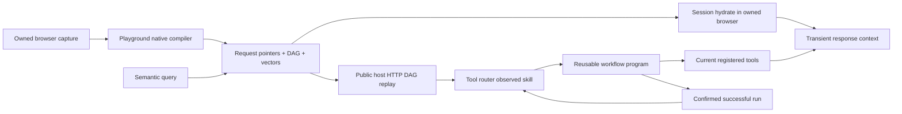

# Request memory and reusable tool workflows

Aiko learns how to fetch information again. The browser VM indexes an observed response with a local, pinned MiniLM embedding and stores its request pointer, schema, and dependency graph through the `entity-learn` library. Raw response bodies are transient. A semantic search finds pointers. Session-bound hydration can still recompute inside the owned browser. Indexed public GET/HEAD DAGs are also promoted into the tool router as observed skills and execute on host HTTP **without starting Chromium**.



## Browser request memory

- `request_memory_search` searches the response embeddings, returning pointers and required caller inputs.
- `request_memory_hydrate` recomputes a pointer from current responses inside the owned browser session. Dependency bindings use the current upstream result rather than an old captured value.
- `observed_network_run` executes a Merkle-validated DAG over host HTTP **without Chromium**. Public GET/HEAD use `toolDigest`. Session-bound and POST/PUT/PATCH/DELETE skills use `artifactDigest` from `AikoObservedActionPrepared`.
- Cookies come from the owner's **current** Unlock vault session at send time. Passwords stay in the vault login recipe and are never copied into the artifact, router, or tool receipt. CSRF and other response-bound values are produced from prior GET steps, not stored secrets.
- Writes first return `authorization_required`. The owner approves at `POST /v1/observed-actions/approval` with `{id,hash,decision}`, then retries once with `approvalId` and `hash`. An unknown outcome is never retried automatically.
- The tool router lists public reads as ready observed skills after indexing, and lists session/write skills with `executeWith: "observed_network_run"`. Session skills are `connected` only when the owner has a vault assignment for those domains.
- Native playground observation/compiler/runtime modules are imported directly from the linked `@unbrowse/browser-harness` package; `entity-learn` is imported from `packages/entity-learn`.
- The local embedding model is `Xenova/all-MiniLM-L6-v2`, revision `751bff37182d3f1213fa05d7196b954e230abad9`, quantized CPU inference, 384 dimensions. Text is not sent to an embedding API. Only public model assets are downloaded.
- The trusted browser session supplies implicit cookies. Explicit authorization headers, writes, missing dependencies, unsafe destinations, and unresolved session requirements cannot be replayed through this path.
- Semantic retrieval uses entity-learn's current-record keyset scan, bounded to 10,000 pointers or 16 MiB. It checks available native definition evidence and model identity, returns at most 24,000 bytes of items, and reports exclusions/coverage. It is not an unlimited vector index.
- Inspect **`/control` → Node graph → Browser indexing** for recorded request dependencies, preparation, keyed index receipts and failures. The graph is read-only: it does not provision a browser, call embeddings or replay requests. Historical receipts do not prove current pointer availability. See [admin graph](aiko-memory-graph.md).

### Host replay session material and recompute

- `observed_network_run` resolves the owner's current vault grant at execution time. An expired, still-renewable ready session is renewed mechanically: the agent posts `POST /v1/runtime/connections/:id/renew`, the vault runtime executes the stored renewal recipe server-side, and the agent polls status before retrieving material. Passwords never leave the vault; a non-renewable or revoked session fails closed.
- Cookies enter replay through the harness runtime's session adapter — a single seam. The transport observes final headers only, and material headers fill names the artifact does not already declare; artifact-declared headers always win.
- Responses recompute the run jar: a producer step's fresh `Set-Cookie` overrides stale base material per cookie name for later steps, the deletion form (`sid=; Max-Age=0`) expires the cookie, foreign-domain cookies are rejected, and unsafe values fail closed. Host-recomputed auth headers ride at dispatch and are never stored.
- The log records the lifecycle as value-free events: `AikoUnlockSessionRenewed`, `AikoObservedSessionResolved` (before execution), and `AikoObservedHeadersRecomputed` (after execution; counts and sorted names only). Cookie and header values never enter artifacts, inputs, receipts, or events.

Request and response values cross the VM bridge encrypted. Native tool logs contain opaque call handles and receipts. The inference seam expands only bounded transient results. User-facing answers may quote requested facts and enter normal conversation history; this does not mean the response body is retained in the request index.

## Workflow programs

`workflow_run` accepts JSON program source and JSON runtime inputs as strings, or a saved `workflowId`. These source strings allow arbitrary parameter names through strict model-provider schemas. The program is a bounded tool-call DAG, not a general Python or shell interpreter.

For example, the program below runs two independent registered tools concurrently. Substitute real IDs returned by the tool router and parameters matching their exact schemas:

```json
{
  "version": 1,
  "id": "parallel-research-v1",
  "parameters": ["query"],
  "steps": [
    {
      "id": "first",
      "toolId": "REGISTERED_TOOL_A",
      "dependsOn": [],
      "arguments": {"query": {"kind": "input", "name": "query"}}
    },
    {
      "id": "second",
      "toolId": "REGISTERED_TOOL_B",
      "dependsOn": [],
      "arguments": {"query": {"kind": "input", "name": "query"}}
    }
  ],
  "limits": {"maxConcurrency": 2, "maxCalls": 2, "timeoutMs": 30000}
}
```

A dependent step declares `dependsOn: ["first"]` and uses a binding such as `{"kind":"result","step":"first","path":["items","0","id"]}`. Runtime inputs and step outputs are not stored with the definition. Successful runs can be promoted with `workflow_crystallize`; `workflow_list` shows the saved programs. The router exposes promoted programs with `executeWith: workflow_run` and rechecks their constituent tools on later runs.

The shipped host dispatcher supports Arcade tools explicitly classified as non-destructive reads and existing owner-built public GET capabilities, preserving Arcade-first checks. The core supports exclusive writes through an authorized dispatcher, but this host does not expose workflow writes. Parallel public reads execute concurrently; Arcade retains its existing per-owner engine serialization. Authentication remains in the connector/browser layer. An uncertain call is never automatically retried.

Runs are atomically claimed before dispatch. Definitions are immutable by digest, and terminal receipts cannot be overwritten. The local host uses private SQLite; Cloudflare uses Durable Object storage transactions. A process crash can leave an unknown/running receipt requiring inspection, rather than triggering an automatic replay.

## Model roles

Set `AIKO_CONVERSATION_PROVIDER`, `AIKO_RAG_PROVIDER`, and `AIKO_BROWSER_PROVIDER` to `codegraff` or `cerebras`; corresponding `AIKO_<ROLE>_MODEL` values select the model. Credentials remain server-side in `CODEGRAFF_API_KEY` and `CEREBRAS_API_KEY`.

Temporary deployment setting (2026-09-06): conversation, background reasoning, RAG, browser reasoning and vision all use Cerebras `qwen-3.8-27b`. `AIKO_VISION_PROVIDER` and `AIKO_VISION_MODEL` select the fixed image adapter. `AIKO_REPLY_STYLE=direct` delivers the model's validated, redacted wording through the native response tool/outbox without a ThinkFeel model call. It does not relax destination binding, effect authorization or uncertain-send recovery. `/ready` reports the deployed routes and reply style without credentials.

Cerebras requires one strictness setting for the complete tool list. A closed tool set uses strict decoding with unsupported wire constraints removed; original host schemas stay unchanged. A set containing open connector argument objects uses non-strict decoding for all tools and preserves the original schemas. Host argument and authorization checks still decide whether a tool can execute. This handles the live provider's schema rejection without closing dynamic connector inputs into empty objects.

To restore the previous split, set `AIKO_MODEL` and `AIKO_CONVERSATION_MODEL` to `glm-5.3-flash`, `AIKO_CONVERSATION_PROVIDER=codegraff`, `AIKO_VISION_PROVIDER=codegraff`, `AIKO_VISION_MODEL=glm-5.3-flash` and `AIKO_REPLY_STYLE=thinkfeel`, then redeploy. Keep RAG and browser roles on Cerebras. The deployment values live in `apps/agent/wrangler.jsonc`; mirror the conversation/reply settings in the private Node environment when changing that host. Codegraff still supplies browser VMs and search tools. Local speech/transcription and request embeddings remain their existing local processors; they are not hosted LLM calls.

Routing uses completed native tool-call provenance in the current turn. Page text cannot select a provider. The first turn uses the conversation model; after a request-memory tool it uses RAG, and after a browser tool it uses the browser model. There is no silent provider fallback. Existing local model accounting remains in effect.

Verification artifacts are under `artifacts/request-memory/`. The live Cerebras smoke command is `bun apps/agent/scripts/verify-cerebras-routing.ts --tools`; it makes one model call and validates a generated tool call without executing it.

## Native Unlock authentication

The browser factory composes the Unlock broker beneath ordinary tools. It obtains current session material using the actual SDK, sends cookies over the private encrypted VM seam, and installs them through the SDK CDP adapter before navigation. Session installation, clearing and context identity are never offered as model tools. Runtime tokens remain on the host and passwords remain in Unlock's login/renewal recipes.

This path is configured by the existing owner-to-runtime assignments in `AIKO_CONNECTOR_VAULT_JSON`; see [vault setup](connector-vault-setup.md). It remains Arcade-first. Installation requires current verified metadata, exact domain assignments, and matching owner/context/generation/revision. Routine switching removes scoped cookies without revoking the vault session. Revocation retains a fence against stale session installation. Expiry or revocation clears private browser scope; an expired ready session may request mechanical renewal, while revoked or stale access remains blocked. Test fixtures prove this mechanism; a production login additionally requires a deployed vault and a real owner's assignment.
