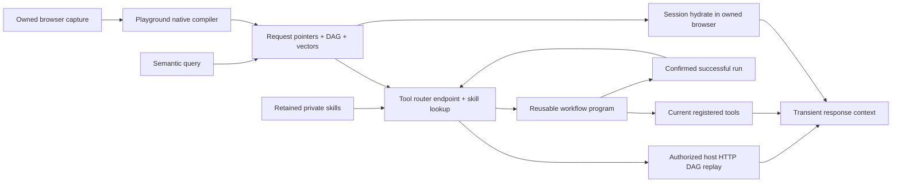

# Request memory and reusable tool workflows

For the proposed integration of browser push/network triggers, editable tool revisions and native channel execution, see [Browser events and reusable tools through Tardigrade](browser-events-and-reusable-tools.md). That design distinguishes current implementation from work still needed.

Aiko learns how to fetch information again. The browser VM indexes an observed response with a local, pinned MiniLM embedding and stores its request pointer, schema, and dependency graph through the `entity-learn` library. Raw response bodies are transient. A semantic search finds pointers. Session-bound hydration can still recompute inside the owned browser. Indexed public GET/HEAD DAGs are also promoted into the tool router as observed skills and execute on host HTTP **without starting Chromium**.



## Browser request memory

Delegated browser specialists use the [native worker index and graph tools](native-harness-parity.md#native-endpoint-retrieval-and-graph-inspection): `worker_index_search` retrieves grant-filtered endpoint metadata, `worker_index_describe` pages the pinned dependency graph, and `observed_network_run` executes it with fresh inputs. Worker retrieval reuses the router's lexical ranker; it is distinct from the browser-local vector search below. Neither lookup grants session or write authority.

- `request_memory_search` searches the response embeddings, returning pointers, router `toolId`s, value-free endpoint descriptions, observed output fields and required caller inputs.
- `request_memory_hydrate` recomputes a pointer from current responses inside the owned browser session. Dependency bindings use the current upstream result rather than an old captured value.
- `observed_network_run` executes a Merkle-validated DAG over host HTTP **without Chromium**. Public GET/HEAD use `toolDigest`. Session-bound and POST/PUT/PATCH/DELETE skills use `artifactDigest` from `AikoObservedActionPrepared`.
- Cookies come from the owner's **current** Unlock vault session at send time. Passwords stay in the vault login recipe and are never copied into the artifact, router, or tool receipt. CSRF and other response-bound values are produced from prior GET steps, not stored secrets.
- Writes first return `authorization_required`. The owner approves at `POST /v1/observed-actions/approval` with `{id,hash,decision}`, then retries once with `approvalId` and `hash`. An unknown outcome is never retried automatically.
- The tool router lists public reads as ready observed skills after indexing, and lists session/write skills with `executeWith: "observed_network_run"`. Session skills are `connected` only when the owner has a vault assignment for those domains.
- Native playground observation/compiler/runtime modules are imported directly from the linked `@unbrowse/browser-harness` package; `entity-learn` is imported from `packages/entity-learn`.
- The local embedding model is `Xenova/all-MiniLM-L6-v2`, revision `751bff37182d3f1213fa05d7196b954e230abad9`, quantized CPU inference, 384 dimensions. Text is not sent to an embedding API. Only public model assets are downloaded.
- The trusted browser session supplies implicit cookies. Explicit authorization headers, writes, missing dependencies, unsafe destinations, and unresolved session requirements cannot be replayed through this path.
- Semantic retrieval uses entity-learn's current-record keyset scan, bounded to 10,000 pointers or 16 MiB. It checks available native definition evidence and model identity, returns at most 24,000 bytes of items, and reports exclusions/coverage. It is not an unlimited vector index.
- Inspect **`/control` → Node graph → Browser indexing** for recorded request dependencies, preparation, keyed index receipts and failures. The graph is read-only: it does not provision a browser, call embeddings or replay requests. Historical receipts do not prove current pointer availability. See [admin graph](aiko-memory-graph.md).

### Request fidelity, Instagram readiness and login reuse

2026-09-08 — Reuse is **recomputation, not 1:1 browser impersonation**:

| Path | Cookie source | Important limit |
| --- | --- | --- |
| `request_memory_hydrate` | Current authorized cookie jar in the owned browser VM | Same-origin GET/HEAD only. The fixed browser adapter currently rejects custom request headers and bodies. |
| `observed_network_run` | Current explicit `AIKO_CONNECTOR_VAULT_JSON` assignment resolved through the vault SDK | Host HTTP uses `Aiko/1.0 (observed-network)`, its own network stack and approved header producers. It does not reproduce the browser's TLS/client-hint/IP profile. |
| Native private sign-in | Credentials and cookies in encrypted VM custody, restored through the SDK | A connected native browser is not automatically a cookie grant to host HTTP. No native-VM-to-host replay bridge is currently mounted by these hosts. |

The cookie-protected browser path can work without that separate host vault
bridge. An indexed browser-session recipe still must not be advertised as a
public HTTP read. Cookies alone also cannot resolve application headers:
synthetic messaging fixtures with `x-ig-app-id`, `x-asbd-id`, `x-csrftoken` or
`authorization` remain blocked without appropriate producers/adapters. These
are hypothetical observed-header cases, not a claim about Instagram's current
wire contract. See [readiness regressions](../apps/agent/test/request-reuse-readiness.test.ts).

**Instagram DM listing has not been live-verified.** The next acceptance check
requires a named owner-authorized test account connected through the secure UI:
observe the inbox request without sending messages or opening conversations;
identify its actual method, fields, pagination and session/header dependencies;
compile only a supported evidence-complete read; compare a fresh replay with the
browser result in controller memory; then retrieve it through the router and
repeat with fresh dependency/session values. Keep DM text, participant IDs,
cookies and credential values out of the index/report. Report only structural
comparison results. A missing binding, login wall or challenge is a blocker,
not permission to copy stale captured constants, bypass a challenge or declare
an arbitrary POST a safe read. Search of endpoint metadata is distinct from
retaining/searching a person's message contents.

Login reuse uses the existing private sign-in/renewal mechanism, **not** the
ordinary endpoint index. Network learning and actor browser tools are paused
during private sign-in. Verified credentials/session material may enter encrypted
vault custody; passwords, OTPs and private login requests never become generic
search results or reusable actor arguments. MFA/device approvals stay with the
owner. Session restoration does not prove a future login or site will succeed.

Verification performed for this audit:

- 105 deterministic/session/HTTP/login tests passed; five browser opt-ins initially
  skipped. The controlled HTTP test checks real received cookie scope, rotation,
  deletion, response-derived CSRF and host-specific headers.
- A fresh isolated Chromium profile plus the existing local HTTPS fixture ran
  39 tests successfully, including actual cookie-protected capture → local MiniLM
  indexing/search → browser hydration, private HttpOnly installation/revocation,
  and encrypted rotated-cookie restoration into an empty context. Two separate
  browser-start opt-ins remained skipped. Personal profiles were not attached.
- The isolated Google-shaped sign-in fixture passed its actual Chrome
  username/password → attempt-bound OTP → verified mailbox → encrypted reopen/
  session restore → disconnect test. It contacted neither Google nor Instagram.
- Seven new no-network messaging/header/bridge readiness regressions passed;
  the combined HTTP/readiness/vault run passed all 29 cases. Agent typechecking
  remains blocked by unrelated concurrent errors in `channel-log-source.ts`
  (TS2542) and `test/codegraff.test.ts` (TS2769), not the new test.

The value-free run summary is
[`artifacts/request-memory/cookie-reuse-readiness.json`](../artifacts/request-memory/cookie-reuse-readiness.json).

Reproduce the browser checks using the fresh-profile/host-mapping instructions
in [native harness parity](native-harness-parity.md) and the
[Gmail fixture guide](connector-engine.md#reproduce-the-isolated-gmail-browser-check).
For the replay fixture, run `request-memory-live-session.test.ts`,
`browser-session-transport.test.ts` and `native-login-vault.test.ts` with the
isolated endpoint in `AIKO_REPLAY_TEST_CDP`/`AIKO_SESSION_TEST_CDP` and
`AIKO_REPLAY_TEST_EMBEDDING=1`. All reported browser traffic used local synthetic
fixtures; no paid model, real social login, DM access, production restart or
deployment was performed.

### Host replay session material and recompute

- `observed_network_run` resolves the owner's current vault grant at execution time. An expired, still-renewable ready session is renewed mechanically: the agent posts `POST /v1/runtime/connections/:id/renew`, the vault runtime executes the stored renewal recipe server-side, and the agent polls status before retrieving material. Passwords never leave the vault; a non-renewable or revoked session fails closed.
- Cookies enter replay through the harness runtime's session adapter — a single seam. The transport observes final headers only, and material headers fill names the artifact does not already declare; artifact-declared headers always win.
- Responses recompute the run jar: a producer step's fresh `Set-Cookie` overrides stale base material per cookie name for later steps, the deletion form (`sid=; Max-Age=0`) expires the cookie, foreign-domain cookies are rejected, and unsafe values fail closed. Host-recomputed auth headers ride at dispatch and are never stored.
- The log records the lifecycle as value-free events: `AikoUnlockSessionRenewed`, `AikoObservedSessionResolved` (before execution), and `AikoObservedHeadersRecomputed` (after execution; counts and sorted names only). Cookie and header values never enter artifacts, inputs, receipts, or events.

Request and response values cross the VM bridge encrypted. Native tool logs contain opaque call handles and receipts. The inference seam expands only bounded transient results. User-facing answers may quote requested facts and enter normal conversation history; this does not mean the response body is retained in the request index.

## Endpoint and skill discovery contract

The owner-private router retrieves learned endpoints together with retained
skills, without copying captured request values or reading private result caches.
Router revision `aiko-tool-router/10` preserves the existing compiler and execution
paths; it adds descriptions and lookup wiring, not another replay engine.

After preparing a read tool or selected action, `BrowserLearning` durably appends
`AikoObservedEndpointDescribed` before enrichment/indexing. The self-digested,
redelivery-keyed record binds the definition/artifact digest, source trace,
request ID and bounded `har-response-semantics/1` evidence. The shared validator
admits only reviewed concepts, field paths, primitive types, roles and counts.
No raw response values, arbitrary model prose, credentials or captured input
constants enter this metadata. The record is trusted browser-ingress evidence,
not a signature or an execution grant; owner-log graph/definition validation
must succeed independently before the router uses it.

Descriptions name the selected endpoint's response concepts and fields, not
just its URL or its prerequisites' responses. Exact caller input schemas and
`requirements.execution` come from the existing validated definition. The
`output` field is explicitly **observed-only**, possibly truncated, not an exact
output guarantee. `requirements.recomputation` summarizes the pinned recipe:
fresh caller inputs, response-derived dependencies and current authorized
session material replace captured values on every new invocation.

The lookup sequence is:

1. `request_memory_search({"query":"restaurant ratings"})` for semantic recall.
2. Pass its returned `toolId`s to `tool_router_describe({"toolIds":[...]})`, or
   use `tool_router_route` to shortlist endpoints and skills for each task.
3. Supply the exact fresh inputs and follow `requirements.execution`. Public
   read DAGs use `observed_network_run` with `toolDigest`; selected session/write
   actions use `artifactDigest` with the existing session and approval checks.
   Missing producers stop the DAG before the affected downstream request.

The router remains a bounded lexical/schema ranker; request memory provides
semantic embeddings. Legacy definitions without description events remain
structurally discoverable with response shape marked unavailable. Failed or
incomplete observations do not become executable merely to increase coverage.
This does not index every raw exchange as an executable endpoint or backfill
responses that have already been discarded. New indexing documents include
the description; old pointers retain their original embedding identity.

Retained skills share the shortlist under `provider: "skill"`. Discovery checks
owner custody, artifact/contract digests, the retained SKILL.md and its declared
resources, without provisioning a runtime context or executing anything. It
examines at most 128 retained skill identities and reports unavailable/omitted
entries in `coverage.retainedSkillsOmitted`. Candidate and retired skills are
documentation-only (`requirements.documentation` → `harness_skill`). Only a
recorded promoted route supplies `harness_call`, which resolves the current
version for the named contract/context and reauthorizes the supplied input.
Supply a fresh `operationId` for a new call; preserve it only for the same-call
retry. `connected` is routing evidence, **not** a current-context or permission
check. Erasure and retirement invalidate lookup decisions. Checked write/mixed
effects cannot masquerade as reads through matching prose.

The fixed regression gates for this change are: semantic endpoint lookup after
restart; exact input schema and invocation mapping; exclusion of secret values,
forged/nested/mismatched description records and foreign skills; no browser or
HTTP work during discovery; response-derived IDs recomputed before downstream
HTTP; failure of missing producers; retained skill integrity and retirement
checks; and no read intent selecting a write solely because its prose matches.
The deterministic tests use native Tardie actors, injected transport and a fixed
embedding adapter; they do not establish live-site/provider correctness. No
production promotion, service restart or deployment was performed.

```bash
# From Unlock; requires the linked sibling runtime dependencies.
bun test apps/agent/test/observed-endpoint.test.ts apps/agent/test/tool-router.test.ts \
  apps/agent/test/harness-skill.test.ts apps/agent/test/request-memory.test.ts \
  apps/agent/test/browser-learning.test.ts apps/agent/test/observed-network.test.ts
cd apps/agent && bun run typecheck
```

2026-09-08 verification: 109 tests passed, one opt-in live-browser test skipped
across the broader 17-file endpoint/router/browser-ingress/capability suite;
Unlock agent typechecking passed. The linked playground's 22 focused tests and
external-package gate passed. Its complete `bun run verify` still stops at the
pre-existing duplicate `origin` property in
`runtime/test/harness-session-recompute.test.ts:132`. Parallel tab control is
unchanged by this discovery work.

## Workflow programs

`workflow_run` accepts JSON program source and JSON runtime inputs as strings, or a saved `workflowId`. These source strings allow arbitrary parameter names through strict model-provider schemas. The program is a bounded tool-call DAG, not a general Python or shell interpreter.

For example, the program below runs two independent registered tools concurrently. Substitute real IDs returned by the tool router and parameters matching their exact schemas:

```json
{
  "version": 1,
  "id": "parallel-research-v1",
  "parameters": ["query"],
  "steps": [
    {
      "id": "first",
      "toolId": "REGISTERED_TOOL_A",
      "dependsOn": [],
      "arguments": {"query": {"kind": "input", "name": "query"}}
    },
    {
      "id": "second",
      "toolId": "REGISTERED_TOOL_B",
      "dependsOn": [],
      "arguments": {"query": {"kind": "input", "name": "query"}}
    }
  ],
  "limits": {"maxConcurrency": 2, "maxCalls": 2, "timeoutMs": 30000}
}
```

A dependent step declares `dependsOn: ["first"]` and uses a binding such as `{"kind":"result","step":"first","path":["items","0","id"]}`. Runtime inputs and step outputs are not stored with the definition. Successful runs can be promoted with `workflow_crystallize`; `workflow_list` shows the saved programs. The router exposes promoted programs with `executeWith: workflow_run` and rechecks their constituent tools on later runs.

The shipped host dispatcher supports Arcade tools explicitly classified as non-destructive reads and existing owner-built public GET capabilities, preserving Arcade-first checks. The core supports exclusive writes through an authorized dispatcher, but this host does not expose workflow writes. Parallel public reads execute concurrently; Arcade retains its existing per-owner engine serialization. Authentication remains in the connector/browser layer. An uncertain call is never automatically retried.

Runs are atomically claimed before dispatch. Definitions are immutable by digest, and terminal receipts cannot be overwritten. The local host uses private SQLite; Cloudflare uses Durable Object storage transactions. A process crash can leave an unknown/running receipt requiring inspection, rather than triggering an automatic replay.

2026-09-08 — Declarative workflow crystallization now retains an `observed-success` applicability record: each step pins the owner, tool ID, input schema and read/write classification actually used by the successful run. Reuse checks all dependencies before its first call and resolves them again at each step. Schema drift also removes the saved procedure from router discovery. Authorization still runs for every invocation, and runtime inputs remain fresh parameters rather than cached results. This evidence describes one successful example; it does not verify semantic correctness, provider implementation versions or external-state freshness. Harness contracts and independent witnesses remain the route for stronger outcome claims.

Legacy saved workflows without dependency evidence remain inspectable, but cannot execute as trusted reusable procedures. Prepare a new definition ID, run it, and crystallize its successful receipt; never rewrite old evidence to match a changed dependency. Historical run receipts remain intact. [Workflow regression tests](../apps/agent/test/tool-workflows.test.ts) cover new inputs, changed/missing dependencies, mid-run drift and unknown outcomes; [router tests](../apps/agent/test/tool-router-workflows.test.ts) cover discovery after restart.

Browser learning commits prepared structural routes before enrichment. Failed action-preparation persistence now propagates and leaves the draft eligible for preparation again. [The process-boundary regression](../apps/agent/test/browser-learning.test.ts) exits a separate producer process from the enrichment callback, reopens its SQLite queue and decodes the retained route, with no private response values in the journal. It uses synthetic captured network input; it does not establish live-browser capture, power-loss durability or recovery of transient response enrichment. Retained-data and compaction recovery use the existing [native context tests](../apps/agent/test/code-data.test.ts).

## Model roles

Set `AIKO_CONVERSATION_PROVIDER`, `AIKO_RAG_PROVIDER`, and `AIKO_BROWSER_PROVIDER` to `codegraff` or `cerebras`; corresponding `AIKO_<ROLE>_MODEL` values select the model. Credentials remain server-side in `CODEGRAFF_API_KEY` and `CEREBRAS_API_KEY`.

Temporary deployment setting (2026-09-06): conversation, background reasoning, RAG, browser reasoning and vision all use Cerebras `qwen-3.8-27b`. `AIKO_VISION_PROVIDER` and `AIKO_VISION_MODEL` select the fixed image adapter. `AIKO_REPLY_STYLE=direct` delivers the model's validated, redacted wording through the native response tool/outbox without a ThinkFeel model call. It does not relax destination binding, effect authorization or uncertain-send recovery. `/ready` reports the deployed routes and reply style without credentials.

Cerebras requires one strictness setting for the complete tool list. A closed tool set uses strict decoding with unsupported wire constraints removed; original host schemas stay unchanged. A set containing open connector argument objects uses non-strict decoding for all tools and preserves the original schemas. Host argument and authorization checks still decide whether a tool can execute. This handles the live provider's schema rejection without closing dynamic connector inputs into empty objects.

To restore the previous split, set `AIKO_MODEL` and `AIKO_CONVERSATION_MODEL` to `glm-5.3-flash`, `AIKO_CONVERSATION_PROVIDER=codegraff`, `AIKO_VISION_PROVIDER=codegraff`, `AIKO_VISION_MODEL=glm-5.3-flash` and `AIKO_REPLY_STYLE=thinkfeel`, then redeploy. Keep RAG and browser roles on Cerebras. The deployment values live in `apps/agent/wrangler.jsonc`; mirror the conversation/reply settings in the private Node environment when changing that host. Codegraff still supplies browser VMs and search tools. Local speech/transcription and request embeddings remain their existing local processors; they are not hosted LLM calls.

Routing uses completed native tool-call provenance in the current turn. Page text cannot select a provider. The first turn uses the conversation model; after a request-memory tool it uses RAG, and after a browser tool it uses the browser model. There is no silent provider fallback. Existing local model accounting remains in effect.

Verification artifacts are under `artifacts/request-memory/`. The live Cerebras smoke command is `bun apps/agent/scripts/verify-cerebras-routing.ts --tools`; it makes one model call and validates a generated tool call without executing it.

## Native Unlock authentication

The browser factory composes the Unlock broker beneath ordinary tools. It obtains current session material using the actual SDK, sends cookies over the private encrypted VM seam, and installs them through the SDK CDP adapter before navigation. Session installation, clearing and context identity are never offered as model tools. Runtime tokens remain on the host and passwords remain in Unlock's login/renewal recipes.

This path is configured by the existing owner-to-runtime assignments in `AIKO_CONNECTOR_VAULT_JSON`; see [vault setup](connector-vault-setup.md). It remains Arcade-first. Installation requires current verified metadata, exact domain assignments, and matching owner/context/generation/revision. Routine switching removes scoped cookies without revoking the vault session. Revocation retains a fence against stale session installation. Expiry or revocation clears private browser scope; an expired ready session may request mechanical renewal, while revoked or stale access remains blocked. Test fixtures prove this mechanism; a production login additionally requires a deployed vault and a real owner's assignment.
