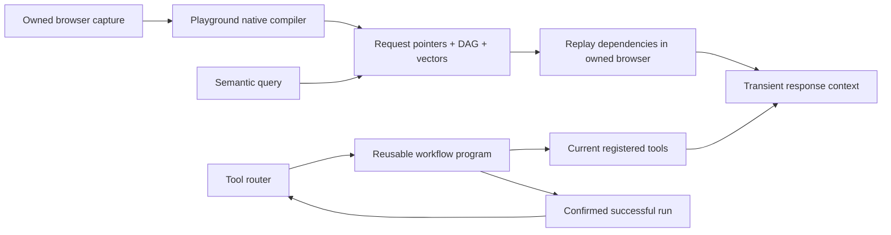

# Request memory and reusable tool workflows

Aiko learns how to fetch information again. The browser VM indexes an observed response with a local, pinned MiniLM embedding and stores its request pointer, schema, and dependency graph through the `entity-learn` library. Raw response bodies are transient. A semantic search finds pointers; hydration executes their observed GET/HEAD dependencies and supplies fresh results to the current inference context.



## Browser request memory

- `request_memory_search` searches the response embeddings, returning pointers and required caller inputs.
- `request_memory_hydrate` recomputes a pointer from current responses. Dependency bindings use the current upstream result rather than an old captured value.
- Native playground observation/compiler/runtime modules are reused in `packages/browser-runtime`; `entity-learn` is imported from `packages/entity-learn`.
- The local embedding model is `Xenova/all-MiniLM-L6-v2`, revision `751bff37182d3f1213fa05d7196b954e230abad9`, quantized CPU inference, 384 dimensions. Text is not sent to an embedding API. Only public model assets are downloaded.
- The trusted browser session supplies implicit cookies. Explicit authorization headers, writes, missing dependencies, unsafe destinations, and unresolved session requirements cannot be replayed through this path.
- The current semantic scan considers at most 100 recalled pointers and reports its coverage. It is not an unlimited vector index.

Request and response values cross the VM bridge encrypted. Native tool logs contain opaque call handles and receipts. The inference seam expands only bounded transient results. User-facing answers may quote requested facts and enter normal conversation history; this does not mean the response body is retained in the request index.

## Workflow programs

`workflow_run` accepts JSON program source and JSON runtime inputs as strings, or a saved `workflowId`. These source strings allow arbitrary parameter names through strict model-provider schemas. The program is a bounded tool-call DAG, not a general Python or shell interpreter.

For example, the program below runs two independent registered tools concurrently. Substitute real IDs returned by the tool router and parameters matching their exact schemas:

```json
{
  "version": 1,
  "id": "parallel-research-v1",
  "parameters": ["query"],
  "steps": [
    {
      "id": "first",
      "toolId": "REGISTERED_TOOL_A",
      "dependsOn": [],
      "arguments": {"query": {"kind": "input", "name": "query"}}
    },
    {
      "id": "second",
      "toolId": "REGISTERED_TOOL_B",
      "dependsOn": [],
      "arguments": {"query": {"kind": "input", "name": "query"}}
    }
  ],
  "limits": {"maxConcurrency": 2, "maxCalls": 2, "timeoutMs": 30000}
}
```

A dependent step declares `dependsOn: ["first"]` and uses a binding such as `{"kind":"result","step":"first","path":["items","0","id"]}`. Runtime inputs and step outputs are not stored with the definition. Successful runs can be promoted with `workflow_crystallize`; `workflow_list` shows the saved programs. The router exposes promoted programs with `executeWith: workflow_run` and rechecks their constituent tools on later runs.

The shipped host dispatcher supports Arcade tools explicitly classified as non-destructive reads and existing owner-built public GET capabilities, preserving Arcade-first checks. The core supports exclusive writes through an authorized dispatcher, but this host does not expose workflow writes. Parallel public reads execute concurrently; Arcade retains its existing per-owner engine serialization. Authentication remains in the connector/browser layer. An uncertain call is never automatically retried.

Runs are atomically claimed before dispatch. Definitions are immutable by digest, and terminal receipts cannot be overwritten. The local host uses private SQLite; Cloudflare uses Durable Object storage transactions. A process crash can leave an unknown/running receipt requiring inspection, rather than triggering an automatic replay.

## Model roles

Set `AIKO_CONVERSATION_PROVIDER`, `AIKO_RAG_PROVIDER`, and `AIKO_BROWSER_PROVIDER` to `codegraff` or `cerebras`; corresponding `AIKO_<ROLE>_MODEL` values select the model. Credentials remain server-side in `CODEGRAFF_API_KEY` and `CEREBRAS_API_KEY`. RAG and browser roles are configured for Cerebras `qwen-3.8-27b`; conversation retains Codegraff `glm-5.3-flash`.

Routing uses completed native tool-call provenance in the current turn. Page text cannot select a provider. The first turn uses the conversation model; after a request-memory tool it uses RAG, and after a browser tool it uses the browser model. There is no silent provider fallback. Existing local model accounting remains in effect.

Verification artifacts are under `artifacts/request-memory/`. The live Cerebras smoke command is `bun apps/agent/scripts/verify-cerebras-routing.ts --tools`; it makes one model call and validates a generated tool call without executing it.

## Native Unlock authentication

The browser factory composes the Unlock broker beneath ordinary tools. It obtains current session material using the actual SDK, sends cookies over the private encrypted VM seam, and installs them through the SDK CDP adapter before navigation. Session installation, clearing and context identity are never offered as model tools. Runtime tokens remain on the host and passwords remain in Unlock's login/renewal recipes.

This path is configured by the existing owner-to-runtime assignments in `AIKO_CONNECTOR_VAULT_JSON`; see [vault setup](connector-vault-setup.md). It remains Arcade-first. Installation requires current verified metadata, exact domain assignments, and matching owner/context/generation/revision. Expiry or revocation clears private browser scope; an expired ready session may request mechanical renewal, while revoked or stale access remains blocked. Test fixtures prove this mechanism; a production login additionally requires a deployed vault and a real owner's assignment.
