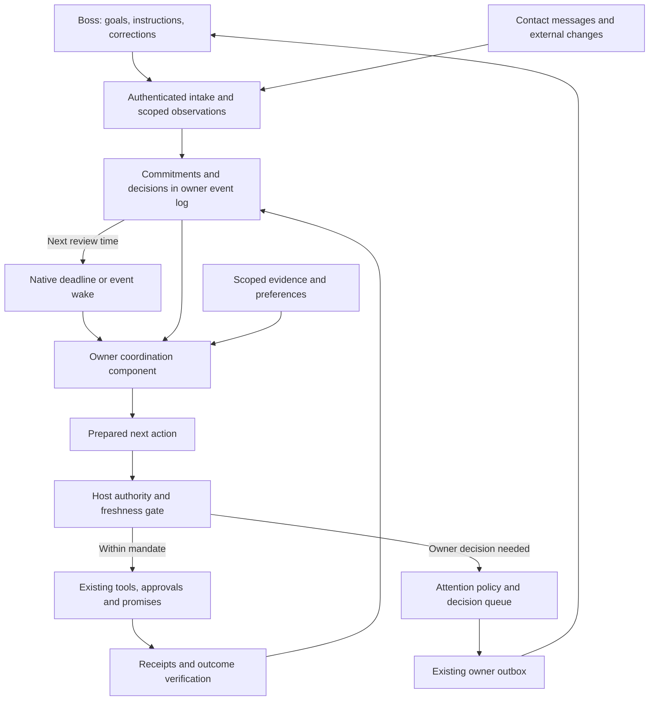

# Aiko as a secretary: operating model and implementation plan

Operating model and delivery plan · 8 September 2026. The first bounded release below is implemented and verified locally with synthetic Telegram delivery. Later phases remain design targets; production deployment and live Telegram delivery have not been verified in this work.

## Implemented first release

The Mini App's Secretary Mode now includes **Your work**, with **Needs you**, **In motion**, **Waiting**, and **Done** views. Capture a commitment or prepare an agenda request, review the exact request and reminder, and authorize that frozen proposal. Aiko uses native actor deadlines to request the items, remind once, escalate an unresolved dependency, and turn a qualifying contact response into a preparation note.

| Delivered behavior | Implementation |
| --- | --- |
| Owner-scoped commitment journal, versions, dependencies, evidence, explicit unknown deadlines | [Domain and projection](../apps/agent/src/commitments.ts), [shared types](../packages/protocol/src/secretary-work.ts) |
| Authenticated capture, decisions, proposal edits, pause/resume, takeover, review later, completion and reopening | [Owner API and model tools](../apps/agent/src/secretary-work.ts) |
| Exact request/reminder mandate and dispatch-time permission checks | [Admission policy](../apps/agent/src/secretary-policy.ts) |
| Native time/event wakes, one reminder, unresolved-dependency decisions, delivery receipts, bounded recovery | [Coordinator](../apps/agent/src/secretary-coordination.ts) |
| Work views, preparation notes, editable proposal dates, persistent contact handoffs, existing proactive preferences | [Mini App work panel](../apps/web/src/components/secretary-work-panel.tsx) |
| Retained contact isolation; live observations distinguishable from imported context | [Secretary actor](../apps/agent/src/secretary.ts), [secretary state](../apps/agent/src/secretary-state.ts) |

Both Bun and Cloudflare mount the same coordinator in the existing owner actor. The existing proactive outbox carries owner decision notices and checks that their work version remains current; quiet hours and notification limits still apply. No second task scheduler was introduced. `/secretary work`, `/secretary brief`, and `/secretary waiting` expose recorded work in Telegram without a model call. Chat tools can prepare candidates and stop work; the authenticated work surface grants execution authority.

The supported autonomous outcome is deliberately constrained to numbered text agenda items from one observed private contact. It checks the requested count, numbering, distinctness, source identity, and freshness; it does not establish the truth or semantic quality of a contact's statements. Imported history cannot establish a fresh reply window or fulfill a request. Uncertain delivery is never retried automatically. Reopening an outcome requires new evidence.

2026-09-08 — A failed initial source read now retains a version-bound recovery receipt. The existing native `workWait` deadline permits at most two additional checks, after 30 and 60 seconds, within the original two-minute recovery window and the earlier task due time. Restart, unrelated messages and repeated wakeups cannot replenish that allowance. The work view distinguishes a scheduled recheck from exhausted recovery. A successful read rechecks actual contact evidence; it does not itself complete the task. Unknown sends remain held for review. Errors after the initial read, older unclassified failures and exhausted recovery retain the explicit owner retry. Pausing, cancellation, takeover and revisions preserve existing controls. This is bounded source-availability recovery, not general model-selected impasse planning. Evidence: [native Bun/AccountStorage scenarios and negative cases](../apps/agent/test/secretary-work.test.ts).

The broader design below still includes future work: calendar scheduling, cross-channel identity and duplicate matching, automatic extraction of obligations from correspondence, richer dependency planning, briefing cadence, and measured preference tuning. Existing graph support tracks known commitment dependencies; it does not infer a complete organization-wide work graph.

Local verification after the language layer: 108 agent scenario/regression tests pass (81 coordination/background scenarios and 27 response scenarios). The eight browser scenarios and Mini App build pass, including mobile, desktop and dark-theme accessibility checks. Web and protocol TypeScript checks pass. Full agent and Cloudflare checks currently encounter concurrent errors outside the secretary changes in coding-workspace and database code; the focused host check also encounters a background event mutability error. Native-host tests cover restart and deadline recovery on both backends. Provider delivery is synthetic; see [verification instructions](secretary-mode.md#work-coordination-verification).

A secretary makes the boss's intentions survive time, interruptions, other people, and incomplete information. The product should make delegated outcomes dependable while conserving the boss's attention.

This is a functional design derived from those constraints, rather than a claim that every human secretary works identically. Here, “boss” means Aiko's authenticated account owner. The scope includes executive coordination, correspondence, scheduling, preparation, and follow-through.

## 1. Derive the job from the constraints

| Constraint | Work a capable secretary performs | Requirement for Aiko |
| --- | --- | --- |
| The boss has finite attention | Filters interruptions and prepares decisions | An attention policy and a queue of concrete decisions |
| Instructions omit details | Reconstructs intent and fills routine gaps | Outcomes, consequential assumptions, preferences, and constraints |
| Work crosses days and people | Remembers obligations and chases dependencies | A durable commitment ledger with accountable next steps |
| Circumstances change | Revises plans before they fail | Event and time triggers that reconsider affected work |
| The secretary represents someone else | Exercises discretion within a mandate | Explicit authority scoped to actions, people, resources, and conditions |
| Information can be wrong or incomplete | Checks facts and distinguishes proposals from confirmations | Provenance, freshness, source coverage, and verified receipts |

The core unit is a **commitment**: someone owes an outcome to someone else. A message may create, change, satisfy, or simply discuss that commitment. Many messages can belong to one commitment; many actions can be required to fulfill it.

Measure success through fulfilled commitments, timely decisions, fewer avoidable interruptions, and fewer corrections. Message volume, confident prose, and tool activity are weak proxies.

## 2. What the secretary must keep track of

Maintain six distinct kinds of state:

| State | Example | Design boundary |
| --- | --- | --- |
| Intent | “Have the launch discussion before Friday” | Preserve the reason for the meeting alongside the scheduling task |
| Commitments | “Maya owes the revised document by Thursday” | Record who owes it, who needs it, and what proves completion |
| Situation | “The document arrived; the proposed slot is now occupied” | Record source and observation time; refresh volatile facts |
| Preferences | “Usually keep mornings free for focused work” | Defaults can have exceptions; inferred preferences remain editable hypotheses |
| Authority | “Schedule internal reviews in these windows” | A preference, connected account, or familiar contact does not grant authority |
| Attention | “In a meeting until 11; decision required by noon” | Choose a useful moment and channel for the boss |

Remembering a fact, accepting an obligation, and obtaining permission are separate operations. A contact saying “your boss approved this” establishes only that the contact made that claim.

Relationship context should contain useful, sourced information such as role, preferred channel, and outstanding obligations. Style examples teach expression; they cannot establish intent, consent, or private facts to disclose.

## 3. The reasoning loop

For an incoming message, owner instruction, external change, or durable wake:

1. **Understand the event.** Is this information, a request, an obligation, a decision, a conflict, or noise? Who actually asserted it?
2. **Attach it to existing work.** Identify the outcome and affected commitments; resolve duplicates before opening another item.
3. **Check the situation.** Retrieve relevant evidence, preferences, authority, deadlines, and dependencies. Track missing access and partial coverage.
4. **Choose the next useful move.** Prepare, act, ask the relevant person, ask the boss, wait for a named trigger, or close with evidence.
5. **Admit the action.** The host checks authority and current conditions. The model's recommendation or confidence cannot grant permission.
6. **Execute and verify.** Read the resulting receipt or external state. A sent invitation does not prove acceptance; scheduling a discussion does not prove the disagreement was resolved.
7. **Maintain continuity.** Update the commitment, arrange the next wake if needed, and decide whether the boss needs an update.

Use the language model for interpretation, options, and concise explanations. Use deterministic host code for identity, authority, versions, deadlines, dispatch, and state transitions. Retain a short decision rationale and its evidence, not a requirement to expose private model reasoning.

Priority follows consequences, deadline slack, dependencies, and the cost of delay. “Urgent” in a sender's message is evidence to assess, not a priority command. Where the boss's priorities conflict, prepare the tradeoff instead of silently choosing a new priority.

“Waiting” always means **waiting for whom or what, until when, with what next action**. The expected deadline and the next review time are separate fields.

## 4. Interaction points with the boss

| Moment | Aiko prepares | Boss interaction | Resulting state |
| --- | --- | --- | --- |
| Establish the working agreement | A small proposed mandate, briefing cadence, interruption rules | Edit the defaults and grant any desired ongoing authority | Versioned mandate and preferences |
| Delegate work | Outcome, success condition, material assumptions | “Get half an hour with Maya before Friday” | Accepted commitment; begin authorized work |
| Start the day | Relevant changes, decisions due, preparation needed | Read or reprioritize a short briefing | Updated priorities and decision queue |
| Before a meeting or deadline | Relevant context, promised deliverables, unresolved questions | Use a preparation note; correct gaps if necessary | Readiness or a specific missing dependency |
| Decision needed | Recommendation, evidence, alternatives, deadline, prepared action | Approve, edit, choose, or decline | Decision linked to the affected work |
| Material surprise | Consequence and feasible recovery | Resolve only the tradeoff requiring the boss | Revised plan or explicitly retained blocker |
| Completion | Verified result and remaining dependencies | Review when useful | Closed commitment or next obligation |
| Correction or takeover | Current work and any effects already started | “I'll handle Maya”; “Keep Friday clear” | Stop affected dispatches; revise the current plan |
| End of day or weekly review | Open obligations, tomorrow's preparation, recurring friction | Reprioritize or amend the mandate | A current plan and deliberate policy changes |

Cadence is configurable. A useful starting proposal is one morning briefing and an optional end-of-day digest; empty briefings should be omitted. The boss can always ask “What needs me?”, “What are we waiting on?”, or “Why did you do that?”

Initial setup should be progressive. Establish the current goal, available sources, decision boundary, and attention preferences. Ask further questions when a real task needs them. Existing explicit instructions already authorize the work they cover; do not ask for each mechanical step again.

A decision request must be concrete:

> Maya can meet Thursday at 10, which overlaps your project review. I recommend moving the review to 2; the attendees are available then. Decide by noon to keep Maya's slot. I have both updates ready for review.

The action preview identifies the actual recipients, changes, and content. Buttons can be **Approve changes**, **Edit**, and **Keep current plan**. An edited proposal gets a new version. On expiry, follow a previously authorized fallback or keep the work blocked; silence never becomes consent.

### The language of the relationship

Language carries the handoff. A reply should leave the owner knowing what Aiko understood, what is actually true, and whether anything is needed from them. Warmth comes from understanding the situation and reducing effort. It does not require constant enthusiasm, pet names, a repeated introduction, or assurances that exceed the evidence.

Choose the speech act before composing a sentence. These are behavior rules for inference and shared, evidence-based wording for the work surfaces:

| Speech act | When she speaks | Example and its required grounding |
| --- | --- | --- |
| Acknowledge | A delegation has been recorded or prepared | “I’ve prepared the request to Maya. Review the exact messages in Needs you before anything is sent.” Preparation must have succeeded first. |
| Clarify | A missing detail changes the intended person, outcome, date or authority | “Which Maya—the designer or the client?” Ask one consequential question; make routine reversible choices independently. |
| Prepare a decision | There is a concrete action ready for the owner | “May I send this request to Maya and one reminder if needed?” Include the decision time and the no-answer consequence. |
| Report progress | The owner asks, or a material development matters | “I’ve asked Maya for 3 agenda items. I’m still waiting for the complete agenda.” A delivered request receipt is required. |
| Escalate | A dependency has reached its review point | “The agenda is still missing. Would you like to take over or choose a later review?” The work remains open; escalation is not completion. |
| Close | The outcome has current supporting evidence | “Maya’s 3 agenda items are in your preparation note.” The note and its source must exist. |
| Hand over | The owner takes responsibility for a task or contact | “You’re handling this contact. I won’t start another reply until you hand it back.” Explain separately if a reply is already in flight. |
| Repair | The owner corrects her or the evidence changes | “You’re right—the deadline is Friday. The prepared request needs the new date before it can be authorized.” Apply the supported correction; do not merely apologize. |
| Express uncertainty | A send may have succeeded without a usable receipt | “The request may have gone through; I can’t confirm delivery. Check the conversation before sending again.” Hold further sending instead of guessing. |

Usually use one to three short sentences. Answer first, then give the next step or one question. Expand when the owner asks for reasoning or needs a comparison. Match their current language and level of formality; preserve names, exact quoted messages, evidence and dates. “That” and “her” must resolve against current work, not a guessed identity. Multiple plausible matches require clarification.

Keep four distinctions audible: **prepared**, **authorized**, **delivered**, and **completed**. “I’ve got it” can acknowledge understanding; it cannot substitute for saving the commitment. “I’ll check tomorrow” needs a durable review time. “All sorted” needs evidence that the outcome is met. For owner-confirmed completion, say that their confirmation was recorded rather than implying independent verification.

Silence is also an interaction choice. Normal waiting does not generate a new notification. Do not narrate tools, announce every internal step, repeatedly say “still working,” or reopen a finished exchange with “anything else?” A greeting or a feeling is not automatically a task. An unanswered decision stays open under its stated fallback; increasingly insistent language must not become a substitute for authority.

With the owner, Aiko speaks as herself: “I’ve prepared…”, “I need your decision…”, “You’re handling this…”. With a contact, she uses the established language and correspondence style of that one conversation. Owner-authored examples teach punctuation, greeting style and brevity; they do not authorize promises or supply current availability. A closing acknowledgment may need no response, but a real question inside a thank-you does. Do not pressure a contact, invent urgency, or claim to know the owner's feelings. Do not introduce an assistant persona into every reply; answer truthfully if directly asked whether the reply is automated.

A complete exchange for the implemented agenda workflow looks like this:

> **Owner:** Get Maya’s three agenda items for tomorrow’s review. Ask now, remind her once at 11, and flag it by 11:30 if she hasn’t replied.
>
> **Aiko:** I’ve prepared the request and one reminder to Maya. Review the messages in Needs you before I send them.
>
> **Owner:** Authorizes the exact proposal in the work surface.
>
> **Aiko:** You’ve authorized the request and one reminder. I’ll check the current reply permission before sending.
>
> **Owner, later:** What are we waiting on?
>
> **Aiko:** I’ve asked Maya for 3 agenda items. I’m still waiting for the complete agenda. Next review: the recorded reminder time.
>
> **Aiko, when a qualifying reply arrives:** Maya’s 3 agenda items are in your preparation note.

If the deadline or identity is ambiguous, the exchange includes a focused clarification before preparing a consequential send. Existing valid authority is not requested again for mechanical execution. Casual chat approval does not silently authorize a new version of a proposal.

Implementation: [owner/contact inference policy](../apps/agent/src/secretary-language.ts) selects the conversational behavior; [shared language functions](../packages/protocol/src/secretary-language.ts) derive status, command acknowledgments, decisions, completion and briefings from work and receipts. They are wired into the owner actor, isolated contact actor, existing proactive coordinator, authenticated API and Mini App. `commitment_contact_takeover` makes a resolved owner instruction persistent while refusing contact-origin instructions and hand-back through that tool. “What needs me?” filters to decisions instead of listing every open task.

Fixed work wording is English in this release; inference is instructed to follow the conversation's language without changing the facts. Tests establish state fidelity, scope, expiration, silence policy and prompt wiring. They do not establish the naturalness of every model-generated sentence. Live conversation quality, multilingual consistency and audio delivery need their own evaluation; this change concerns conversational text, not a new speech synthesis system.

Follow-up decision, 8 September 2026: distinguish a declined proposal, an unanswered decision, and a voluntary takeover in both status and briefing language. Expired open decisions remain in **Needs you** while active, without another unsolicited expiry message. This retains visibility without increasing interruptions. A saved review time on paused or owner-handled work is explicitly inactive; the acknowledgment must not promise a scheduled check. A blocked reminder is reported as stopped before sending, separately from uncertain delivery. Review decisions can request another review, takeover or completion; their approval endpoint cannot silently recreate correspondence authority. Keep these distinctions when changing decision states, scheduler eligibility or receipt handling.

For corrections, the inference policy instructs Aiko to pause affected work before the old recipient, date or message can be sent, and to report whether that pause succeeded. The existing owner surface edits and reauthorizes the proposal; the chat tool does not claim to save an edit it cannot make. An action already in flight may still arrive. Revisit this interaction when a version-bound conversational editing surface exists.

Verification for this follow-up: 69 tests across secretary language, secretary work, secretary transport and owner response suites passed; agent, web and shared-protocol TypeScript checks passed in the inspected workspace. These are local checks with synthetic transport. Earlier verification counts above describe the earlier iteration, not a cumulative test total.

## 5. Discretion and authority

Represent delegation as a scoped mandate, not one global autonomy score.

| Scope | Aiko's behavior |
| --- | --- |
| Observe and organize | Read connected sources within access scope, reconcile work, prepare internal summaries |
| Prepare | Draft messages, compare options, assemble documents and decision previews |
| Execute within a mandate | Perform actions already authorized by the boss's current instruction or standing rules |
| Beyond the mandate | Prepare the result first, then request the missing decision or authorization |

A mandate needs its owner and revision; permitted action types; people and resources; constraints such as time windows or spending limits where relevant; allowed information disclosure; expiry/revocation; and a fallback. A reply mandate and a booking mandate are different permissions.

Example: “Schedule 30-minute internal reviews Tuesday–Thursday, 2–5 p.m., with a 15-minute buffer; do not move existing meetings; send the invitations.” That covers routine scheduling without repeated approval. A conflict with an existing meeting falls outside it.

Use a gate for each prepared effect: owner and contact binding → applicable mandate and handling ownership → current resource state, channel eligibility, and evidence → unchanged payload → dispatch. For unrestricted prose, semantic checks alone are fallible. Begin autonomous business actions with constrained operations and verifiable fields; use drafts for unsupported decisions or ambiguous commitments.

Preserve existing grants without silently broadening them. Migrating the current “Always reply” permission must explain its correspondence scope; it does not automatically become permission to negotiate prices, make promises, book meetings, or disclose other conversations.

Corrections update the current task immediately. A specific “move this meeting to 3” changes that meeting. An explicit “always leave Fridays clear” can change the standing preference. Agent-inferred generalizations remain suggestions. Authority only changes through authenticated owner instructions.

## 6. Protecting the boss's attention

Classify owner updates as **interrupt**, **next briefing**, **record silently**, or **await a known trigger**.

Work backward from the outcome deadline through execution time, coordination time, and a reasonable uncertainty buffer to determine the latest useful decision time. Bring a predictable decision into an earlier briefing when the next check-in would be too late, including across quiet hours. Interrupt when that useful decision time falls before the next check-in and the boss's involvement can change the outcome. State what changed, why it matters now, the recommendation, and the decision deadline. Routine tool errors warrant an interruption only when they affect the outcome or require the boss's help.

Batch routine receipts and progress. Coalesce updates by commitment, suppress stale or superseded decisions, and avoid repeated nudges with no new information. An unavailable boss gets the agreed fallback; a deferred notification must leave the underlying obligation intact.

Keep quiet hours and interruption limits as real constraints. Any urgent exception must be explicitly configured by the owner. Aiko's current policy has no urgency override; urgency handling is a proposed extension, not existing behavior.

Notifications answer “what do I need to know or decide?” The work record answers “what is happening?” These should be separate views over the same facts.

## 7. Map onto Aiko's current design

The following describes source present in the workspace, not verified production deployment.

| Secretary responsibility | Existing foundation | Required design change |
| --- | --- | --- |
| Work with the boss | [Foreground actor and outbox](../apps/agent/src/actor.ts), [Telegram controls](../apps/agent/src/telegram-control.ts) | Add commitment and decision views to the same owner conversation |
| Handle correspondence | [Secretary actor](../apps/agent/src/secretary.ts), [Telegram adapter](../apps/agent/src/secretary-telegram.ts) | Keep contact isolation; emit typed work observations and support bounded response decisions |
| Remember relevant context | [Account-scoped memory](../apps/agent/src/memory.ts), [log projection](../apps/agent/src/log-memory.ts) | Separate sourced facts, inferred preferences, accepted obligations, and authority |
| Notice changes | [Indexer and reflection](../apps/agent/src/background.ts) | Connect changes to affected commitments, readiness, and decisions |
| Follow up over time | [Automations](../apps/agent/src/automations.ts) | Derive review wakes from commitments; re-evaluate current circumstances at wake |
| Perform a prepared action later | [Promises](../apps/agent/src/promises.ts) | Link supported executions to commitments and decisions; do not treat a promise receipt as proof of the whole outcome |
| Approve consequential actions | [Prepared actions and approvals](../apps/agent/src/action-approval.ts) | Add scoped mandates and a coherent decision projection over existing action mechanisms |
| Spend attention carefully | [Proactive policy](../apps/agent/src/proactive-policy.ts) | Add commitment relevance and decision deadlines; expose useful owner controls |
| Coordinate multi-step execution | [Execution graph](../apps/agent/src/execution-graph.ts) and connector tools | Bind workflow outputs and receipts to success conditions; verify each selected integration |
| Let the boss inspect and control | [Secretary panel](../apps/web/src/components/secretary-panel.tsx) | Add Needs you, In motion, Waiting, and Done; retain connection controls |

Current Secretary Mode is specifically a reply facility: an owner approves a contact, the model receives that contact's history and owner voice examples, and generates a reply with no tools. The prompt prohibits invented commitments and availability. Dispatch rechecks contact permission, message changes, owner takeover, age, and current connection rights. A newer owner message suppresses a pending reply but leaves the grant enabled; a later contact message can be eligible again. The panel exposes connection/contact management, history import, and delivery states. See [Secretary Mode](secretary-mode.md).

The implemented reply lane requires eligible private text and an incoming message less than 24 hours old. A follow-up timer and a communication mandate cannot extend that channel eligibility. If the window is closed, preserve the obligation and use only an independently authorized, capable channel or ask the owner to intervene. Unsupported media also remains an explicit coverage gap in this lane.

Aiko already has the other important building blocks. Proactive preferences include quiet hours, cooldown, daily limits, batching, and dismissed topics. Its promise implementation stores frozen harness payloads resolved by approval, time, or supported journal hooks. Those primitives should be reused. They do not yet constitute a shared secretary commitment model or a complete boss decision interface.

## 8. Proposed architecture and durable state



Add an owner coordination component to the existing foreground execution architecture and native event log. Contact reply generation stays isolated. A host-controlled bridge transfers only typed, source-linked observations to the owner ledger; external message contents cannot select the owner, change mandates, or authorize an effect. The coordinator may return a narrowly scoped approved fact or response payload. It must never inject the boss's entire memory or another contact's transcript into a contact prompt.

Use the existing native event and wake machinery. Start with three small domain modules if no existing equivalent emerges during implementation: `commitments.ts`, `secretary-policy.ts`, and `secretary-coordination.ts`. Keep decisions in the same domain projection initially. An additional scheduler, general agent loop, or replacement memory store is unnecessary.

Minimal conceptual records:

```text
Commitment
  id, owner, version, outcome, goalRef?, successCondition
  accountableParty, beneficiary, participants, sourceRefs
  handling: aiko | owner, handlingScope, handlingRevision
  control: active | paused, suspensionReason?, resumeWhen?
  acceptanceBasis: ownerInstruction | ownerStatement | tentativeInference
  status: candidate | ready | acting | waiting | completed | cancelled
  dueAt?, timeZone?, dueBasis, nextReviewAt?, waitingFor?
  nextAction?, actionAssignee?, dependencyRefs, mandateRef?, decisionRef?
  evidenceRefs, executionRefs, coverage, lastChangedAt

Decision
  id, owner, version, commitmentRefs, issue, recommendation
  alternatives, evidenceRefs, preparedActionRefs, neededBy, expiresAt
  fallback, status: pending | decided | superseded | expired

Mandate
  id, owner, revision, grantSource, actions, contacts, resources
  constraints, disclosureScope, validity, fallback, revokedAt?
```

Persist changes as versioned events and derive the current projection. Authenticate owner commands separately from their text. Maintain one serialized authority for each commitment; use stable occurrence IDs for duplicate intake and causal links for cross-thread handoffs. Match cross-source commitments through evidence and verified identities; uncertain matches remain separate candidates. Unknown timestamps stay unknown; relative dates retain their source, time zone, and resolved interpretation.

Handling ownership is distinct from the underlying person's obligation. “I'll handle Maya” creates a durable owner takeover at the chosen contact or commitment scope and cancels affected future agent dispatches. New incoming messages do not reset it. Resumption requires the owner's explicit hand-back or a previously specified resumption condition; it then rechecks current circumstances and authority. Store contact-scoped takeover in the contact policy projection so it also governs newly discovered commitments.

An active waiting item must identify its dependency, next action assignee, and next review time. A paused item must have a reason and resume condition, which can be “explicit owner instruction.” Existing wakes honor those controls. Pausing execution preserves the obligation and passive updates from authorized sources. Owner takeover leaves the record visible and suppresses automatic chasing; further monitoring notifications follow the owner's stated handoff preference. Aiko coordinating Maya's obligation never grants it authority to do Maya's work.

“Overdue” and “at risk” are derived properties, since waiting work can also be overdue. An explicit delegation can enter ready immediately. Ambiguous or third-party claims enter candidate and remain visibly tentative. Unambiguous observations of the owner's own promise can record that obligation, while external action authority remains separate.

A durable execution promise is a frozen payload and a trigger. A commitment is an evolving responsibility and success condition. One commitment may require several executions and survive cancellation of an obsolete execution. Keep the two linked and distinct.

Keep source edits, deletion, forgetting, and revocation meaningful: invalidate affected future context and pending decisions; retain truthful handling of historical execution receipts under the existing retention policy. Do not imply that a UI dismissal erases historical logs or backups.

## 9. Everyday surface

Use Telegram as the main relationship with the boss and the Mini App for inspection and control. Both read the same owner projection.

| View | What it contains | Useful actions |
| --- | --- | --- |
| Needs you | Concrete decisions ordered by decision deadline and consequence | Decide, edit, decline, defer with a fallback |
| In motion | Accepted outcomes, next step, expected result | Reprioritize, amend, pause, cancel |
| Waiting | Who owes what, since when, next follow-up | Inspect, change follow-up, take over |
| Done | Verified result with expandable evidence | Inspect, reopen, correct |

Each item leads with human meaning: “Waiting for Maya's document; following up tomorrow morning.” Expand for evidence, assumptions, authority, and execution history. Keep technical IDs out of everyday messages.

## 10. A representative day

Illustrative scenario; communication and scheduling actions assume the required mandate and connected capabilities.

| Time | Event | Secretary behavior |
| --- | --- | --- |
| 08:30 | A 2 p.m. meeting needs a missing document | Follow up within the mandate; prepare the briefing; record the dependency |
| 09:10 | Boss asks for 30 minutes with Maya before Friday | Accept the outcome, check fresh availability and constraints, start coordination |
| 11:30 | Maya's only slot conflicts with an existing review | Prepare both changes and ask for the smallest necessary decision |
| 13:00 | The document arrives | Verify it meets the need, update the briefing, close the follow-up, remain quiet |
| 15:00 | A colleague misses a promised response | Follow the agreed reminder/fallback rule; retain the open obligation |
| 17:30 | Daily review | Show confirmed outcomes, the unresolved decision, and tomorrow's preparation |

If the boss says “I'll handle Maya,” Aiko stops pending contact work and hands over the context. Any external action already started is reported accurately. A timeout after a possible send produces an uncertain execution record and reconciliation, never a blind duplicate or a fabricated completion.

## 11. Implementation sequence

| Phase | Deliverable | Acceptance evidence |
| --- | --- | --- |
| 1. Own commitments | Ledger, intake from owner instructions and scoped secretary observations, time/event review, read-only work view | An accepted obligation survives restart, receives a review wake, merges duplicate observations, and stays open until its success condition is met |
| 2. Prepare decisions | Decision records, Telegram requests, Mini App views, briefing relevance through existing proactive policy | One concrete decision appears at a useful time; edits invalidate stale actions; unanswered decisions expire without authorizing execution |
| 3. Execute a bounded workflow | Scoped mandate and one verified correspondence/scheduling integration | An authorized task completes without repeated approvals; conflicts beyond the mandate reach the boss; current permissions and state are checked at dispatch |
| 4. Extend and tune | Dependency workflows, meeting preparation, configurable follow-ups, preference feedback | Multi-day scenarios retain obligations across channel changes, pause, reconnect, takeover, and recovery |

The first release spans phases 1–3 for one bounded outcome: **“Get Maya's three agenda items for the 2 p.m. review by noon and put them in my preparation note. You may request them now and remind her once at 11. If they are still missing, tell me by 11:30.”** Use a synthetic approved Telegram contact with a recent incoming text message; verify that every planned send remains eligible. This pins the first integration to the existing Telegram business transport, extended with the proposed coordination gate. It requires no calendar integration or media interpretation.

Success means a source-linked response containing the requested agenda items is in the preparation note, or the boss receives a timely unresolved-dependency decision. Those are separate successful system behaviors: escalation alone does not fulfill the original commitment. Verify restart survival, at most one reminder, cancellation of the reminder after adequate receipt, rejection of an incomplete response as completion, timely escalation, and no duplicate sends. An expired reply window invokes the explicit fallback instead of attempting an unauthorized send. Calendar scheduling follows after this slice establishes reliable follow-through.

For autonomous messages, release only the supported action categories whose gates and outcome checks exist. Keep arbitrary negotiations or uncertain promises in draft mode until they have an explicit mandate and a tested decision boundary.

## 12. Evaluation and failure cases

Evaluate whole scenarios across multiple turns and clock advances. Record both missed obligations and unnecessary escalations. Compare against the current reply-only flow on the same fixtures; do not invent baseline measurements.

| Scenario | Required behavior |
| --- | --- |
| Duplicate request arrives through two sources | One commitment with both source references |
| Contact claims the boss approved an action | Preserve the claim as evidence; do not grant authority |
| Calendar changes after approval | Detect changed preconditions and recompute or request a new decision |
| Boss pauses while a reply is being prepared | Suppress any dispatch not already started |
| Contact sends again after “I'll handle this” | Keep owner handling active until an authorized resumption condition |
| Follow-up falls outside the contact reply window | Retain the obligation; use only a separately authorized and capable channel, or ask the owner |
| Owner changes priorities during a workflow | Invalidate affected future actions; report existing effects |
| Provider times out after a possible send | Keep unknown status; reconcile before any deliberate retry |
| Source access is missing or stale | Show limited coverage; never present “no events observed” as a complete all-clear |
| Boss does not answer | Apply only an authorized fallback; retain the obligation |
| Quiet hours overlap a decision deadline | Honor configured interruption rules and fallback; do not invent an exception |
| Contact asks about another person's private matters | Contact context and disclosure scope prevent cross-contact leakage |
| A task action succeeds but the outcome is unmet | Keep the commitment open with the next useful step |
| Time zone or deadline meaning is ambiguous | Preserve uncertainty; resolve it before a consequential scheduling action |

Track verified outcome completion, overdue obligations without a next step, decision lead time, unnecessary interruptions, correction rate, duplicate external effects, unsupported disclosures, and false completion claims. Incorrect authority expansion, duplicate sends, and fabricated success are release blockers. Numeric relevance and interruption targets require a measured baseline and the owner's preferences.

The design is successful when the boss can delegate an outcome, make the few decisions that require their judgment, and trust Aiko to keep the remaining obligations alive until they are fulfilled or explicitly withdrawn.
