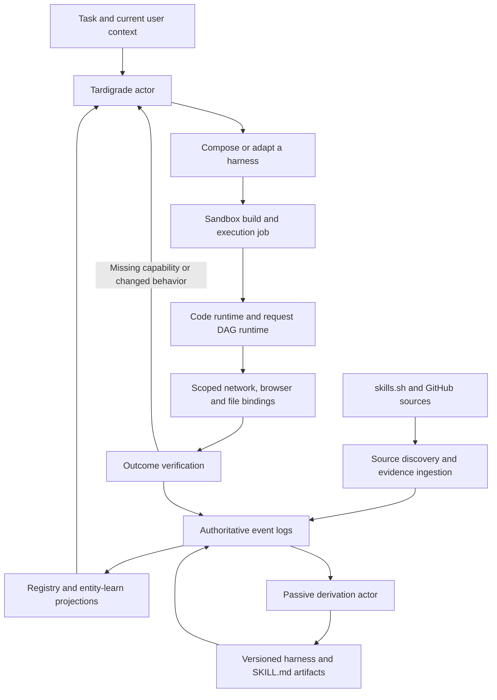
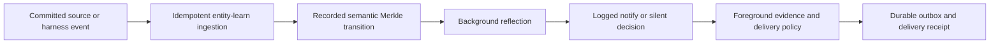
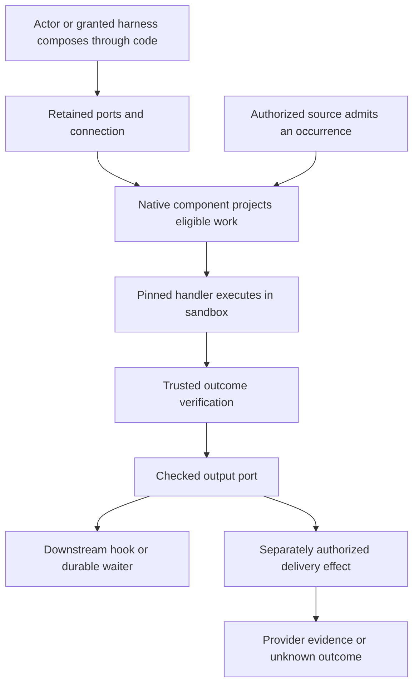
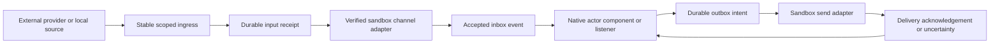

# Self-composing actor harness: the log is all you need

Planning document · 2026-09-08 · Status: target architecture with partial implementation; current evidence and gaps are tracked in [the implementation status](self-composing-harness-status.md).

Build Unlock as a self-composing dynamic harness. Actors retrieve procedural knowledge, discover missing capabilities, compose executable programs, run them in an appropriate sandbox, verify their effects, and learn reusable harnesses from the resulting log. Learned harnesses autonomously acquire `SKILL.md` documentation. Registries can be derived from successful local executions, skills.sh, and useful or popular GitHub repositories.

This document consolidates that direction. It extends [Browser requests, reusable skills, and live memory](browser-request-skills-plan.md), which contains additional SDK, scheduling, and transport details. [Self-learning harness loop](harness-self-learning.md) describes the separate product-code repair workflow. Runtime skill learning should produce versioned artifacts without requiring a product deployment for each new capability.

For self-created hooks, the design choice is **code composes durable ports; native components execute the recorded connections**. An actor or explicitly granted running harness can create an inbox, attach a verified harness, and publish its checked result into an outbox. The log retains that wiring after the composing code finishes. Learn or repair the connection when needed; reuse it for later occurrences without another composition or model call when its verified handler remains applicable. Use `channels.request` when the composing task also needs to await its result: input admission and waiter registration commit together before execution. [Section 24](#24-self-created-inboxoutbox-channels-as-harness-bindings) specifies autonomous composition, channel lifecycle, external adapters and recovery rules, including the constrained `channel.manage` bridge for harness-created child channels.

**1. Governing decisions**

- Tardigrade actors remain responsible for inference, composition, dispatch, cancellation, recovery, and durable effect outcomes. Preserve the existing `aiko` actor identity and native code-mode machinery.
- Generated source, builds, code execution, request-DAG evaluation, response transformations, and learned network effects execute inside a selected sandbox. Actor coordination and authorization remain in the control plane.
- The event log records authoritative decisions and outcomes. Catalogs, workflow status, entity-learn indexes, current versions, generated documentation, and cache metadata are projections of recorded facts.
- Entity-learn observations and semantic Merkle transitions enter the same durable causal history. Background reflection may proactively update the user when a verified change materially affects their task; routine learning stays quiet.
- Browser state transitions and human-assisted steps use the same logs and effects. A task can durably await a verified login outcome and resume when the matching attempt completes, including OTP challenges.
- Prefer a verified reusable harness for known actions. Browser exploration, browser-session network execution and direct sandbox execution implement the same outcome contract; select among them using applicability, uncertainty and measured total cost.
- Actors can create typed inbox/outbox ports through code, connect them to verified harnesses, and derive external transport adapters when needed. Channel bindings, hooks, subscriptions, cursors and deliveries are native log projections and effects; generated channel code executes through the same sandbox harness interface.
- A registry entry may describe a primitive, a composed executable, or procedural guidance that still requires an actor. Dynamic composition remains available on every task.
- Every reusable harness carries an outcome contract and runnable verifier, a versioned `SKILL.md`, and verification evidence. Fixed evaluation separates correctness gates from quality/cost/latency tradeoffs; a bounded GEPA loop improves eligible candidates. Candidate guidance is useful before executable promotion, with its status visible.
- Portability, visibility, and execution placement are independent. The same portable definition can run locally or in Codegraff with different private connection bindings.
- Existing task authorization persists. A retrieved skill, popular repository, cached program, or generated document cannot expand it.



**2. Current implementation and gaps**

These observations describe inspected code, rather than claiming every proposed feature is deployed.

| Existing component | Current behavior | Planned extension |
| --- | --- | --- |
| [Code harness](../apps/agent/src/code-harness.ts) | Tardigrade code-mode facade, native tool discovery/calls, reusable workflow drafts and verified saves | Bind dynamic harness artifacts to the same native package interface; retain durable invocation inputs and verification contracts |
| [Code sandbox adapter](../apps/agent/src/code-sandbox.ts) | Sends JavaScript segments to the VM; yielded package calls dispatch through host bindings | Route generated execution and network effects to sandbox bindings while preserving native package receipts |
| [Code VM runner](../apps/agent/src/code-sandbox-runner.ts) | QuickJS/WASM executes bounded guest JavaScript without ambient Bun, process, filesystem, network, or browser access | Add explicit dynamic dependency bindings and isolated build jobs for additional runtimes |
| [Sandbox runner](../apps/agent/src/sandbox-runner.ts) and [Codegraff provisioning](../apps/agent/src/codegraff.ts) | Owned VM, CloakBrowser provisioning, private operation transport, code segments, request hydration | One sandbox job contract for code, network, and mixed harnesses; execute HTTP-only harnesses without starting a browser |
| [Request memory](../apps/agent/src/request-memory.ts) and [browser driver](../apps/agent/src/browser-driver.ts) | Browser-side learned request graphs can recompute in the VM | Generalize the VM request evaluator for browser-independent execution |
| [Observed network](../apps/agent/src/observed-network.ts) | Some learned graphs execute through host HTTP adapters | Move graph evaluation and HTTP dispatch into the selected execution sandbox |
| [Entity-learn](../packages/entity-learn/lib/tardigrade-logs.ts) and [log memory](../apps/agent/src/log-memory.ts) | Log ingestion, observations, provenance, semantic retrieval, dependency relationships | Incremental settlement-driven capability and skill projections with replayable cursors |
| [Background actors](../apps/agent/src/background.ts) | Knowledge-change events, semantic Merkle snapshots, cited reflection decisions and foreground notification acceptance | Include harness lifecycle changes in the same causal flow, with relevance, coalescing and delivery policy |
| [Hook ingress](../apps/agent/src/cloudflare.ts), [automations](../apps/agent/src/automations.ts), and [actor outbox](../apps/agent/src/actor.ts) | Authenticated learning hooks, durable listeners and keyed reply delivery | Instantiate verified channel harnesses for provider-specific inbox ingestion, subscriptions and outbox dispatch |
| [Typed channel wiring](../apps/agent/src/channel-wiring.ts), [log sources](../apps/agent/src/channel-log-source.ts) and [provider adapters](../apps/agent/src/provider-adapter.ts) | Code-created ports and hooks, managed internal standing-hook adoption, scoped log-source admission, and the configured `signed-json-v1` provider path described in section 24 | General autonomous adapter discovery, external subscription adoption and complete lifecycle acceptance evidence |
| [Tool workflows](../apps/agent/src/tool-workflows.ts) | Existing contracts and reusable workflow storage | Immutable dependency locks, context applicability, verified promotion and stale-version handling |
| [Media processor](../apps/agent/assets/media.py) and [Codegraff adapter](../apps/agent/src/codegraff.ts) | Fixed sandbox code runs faster-whisper on CPU, samples video with FFmpeg, and extracts document text | Register these as seed artifacts, then derive missing channel capabilities through the same actor build/verify/reuse loop |

Generated JavaScript execution is already sandboxed, but code generation is coordinated by the host actor and native package effects can still execute outside the VM. The target makes the execution location explicit for every package effect. Trusted application operations such as actor scheduling and channel delivery retain their own host adapters and receipts; a generated program invokes them through authorized capabilities.

**3. What “the log is all you need” means**

Use Tardigrade's existing per-thread logs and native lifecycle events. Actor method calls, effects and settled package outcomes provide the execution history. Registry state is reconstructed from that history, including explicit promotion, supersession and revocation decisions. Tardigrade's server describes method state and reads as log projections. [Tardigrade server guide](https://github.com/clavia-labs/tardigrade/blob/main/docs/how-to/server.md).

Content-addressed storage holds source, binaries, dependency locks, reference documents, and appropriately retained encrypted inputs. Log events contain their digests and scoped references. Rebuilding a catalog requires the retained referenced artifacts as well as the log; a digest cannot recreate deleted bytes. Credentials remain in the vault. Durable storage follows explicit retention and deletion rules, and missing retained inputs produce an honest unavailable/re-read/reconcile state.

Projection rebuilding must never call a model, fetch GitHub, generate a new document, or repeat an external effect. Those are actor effects whose outputs and exact artifact versions are recorded. A previously generated `SKILL.md` is restored from its recorded content, rather than regenerated during replay.

Proposed application facts below supplement existing native events; names and schemas must be reconciled with the installed Tardigrade version before implementation:

| Fact | Required evidence and purpose |
| --- | --- |
| Source observed | Registry/repository identity, exact revision, file digests, origin, scope and coverage |
| Harness candidate recorded | Source artifact, code/request graph, schemas, dependency digests, proposed effect class |
| Verification recorded | Candidate digest, verifier version, test-context reference, outcomes and bounded evidence |
| Harness promoted or superseded | Exact version, applicable context, supporting verification and prior head |
| Invocation requested | Harness digest, encrypted input reference, selected context, operation ID and authority reference |
| Native execution and effect receipts | Reuse code/package lifecycle events; record dispatch, settlement, failure, cancellation and uncertainty |
| Skill document derived | Exact Markdown artifact, executable digest, supporting event range and derivation recipe version |
| Harness invalidated or revoked | Changed dependency, incompatible contract, failed verifier, expired authority or explicit revocation |
| Knowledge changed or unchanged | Existing knowledge event vocabulary; source cursor, semantic root transition, scoped change references and causal identity |
| Proactive decision and delivery | Existing reflection, acceptance/suppression and outbox receipts; evidence, policy version, recipient binding and delivery outcome |
| Channel binding and hook lifecycle | Owner, port/schema and adapter generations, receiving/sending grants, registration watermark, trigger identity, pinned handler, durable handoff and delivery evidence |

Projection consumers maintain contiguous cursors, deduplicate by durable identity, and commit projection updates with cursor advancement. Gaps and partial source coverage remain visible. Cross-thread views use scoped source references and per-stream cursors; wall-clock timestamps do not establish a global event order. Reuse Tardigrade append fences and effect identities instead of introducing a second workflow state machine.

**4. Actor composition and execution lifecycle**

1. Resolve the task's owner, connection, network location, accessible files, permitted effects, and freshness requirements.
2. Retrieve applicable capabilities and skill metadata from projected catalogs and entity-learn. Load full instructions and source references only when useful.
3. Choose a verified composition when compatible. Otherwise derive a candidate by combining request graphs, code modules, browser steps, or actor-guided procedures.
4. Write generated source into a private sandbox workspace. Compile with pinned dependencies and record the artifact digest before executing it. Small QuickJS segments may remain encrypted in-memory payloads with retained source artifacts.
5. Execute through native code mode and scoped bindings. Missing capabilities return structured information to the actor, which can discover, adapt and verify a new candidate.
6. Verify outputs against a declared contract and, for effects, an observable postcondition. Persist the evidence and semantic outcome.
7. Promote reusable behavior within its demonstrated scope. A background derivation actor updates documentation and retrieval projections.

A composition can contain deterministic steps and actor decision points. The selected code, inputs, dependency versions and decisions are recorded for each logical invocation. A repair produces a new candidate version and a linked attempt; it does not silently change code under a running invocation. Bind any newly discovered method between recorded segments rather than mutating the method table of an executing guest.

Initially use responsibilities within the existing actor/components: source discovery, composition, execution, verification and passive derivation. Create durable child actor invocations when independent work or recovery justifies them. This is an implementation design, not a request to spawn workers while writing this document.

**5. Unified sandbox contract**

Proposed application contract, not an existing exported API:

```ts
type HarnessInvocation = {
  operationId: string;
  harnessDigest: string;
  inputRef: string;
  contextRef: string;
  authorityRef: string;
  dependencyLockDigest: string;
  environmentDigest: string;
};
```

The host resolves references against the authenticated owner and records the selected binding. The VM accepts a bounded invocation envelope and verifies the artifact and environment before dispatch. Guest-supplied owner IDs or context references cannot select another user's sandbox.

| Execution kind | Runtime and authority |
| --- | --- |
| Code composition/transformation | Existing QuickJS isolate with explicit package bindings |
| Network graph | Existing harness DAG evaluator in the VM, with fresh HTTP transport and response-derived bindings |
| Browser-backed action | CloakBrowser through the existing trusted browser-harness adapter |
| Mixed harness | Actor/code-mode composition of the above using the same operation identities |
| Python, shell, native modules or build steps | Restricted per-job environment or separate job VM with explicit mounts and network access |

An owned VM alone does not isolate imported shell code from the trusted runner's vault. General-purpose jobs must have a separate security boundary and must not mount that vault or inherit gateway credentials. The broker resolves current credentials and injects only the material permitted for each destination. QuickJS remains the default for generated composition.

Separate VM/runtime readiness from browser-process readiness. HTTP-only execution should reuse the sandbox without launching CloakBrowser. Every new Aiko Codegraff sandbox still provisions the browser for actions that need it. Apply resource limits, cancellation and output bounds per job while preserving Tardigrade's durable recovery semantics.

**6. One harness artifact and multiple library views**

Use one immutable manifest to generate actor package bindings, TypeScript declarations, CLI/API descriptions and the discoverable skill document. The registry is the authorized projection of those artifacts.

```text
harness/
  SKILL.md
  manifest.json
  contract.json        # outcome, invariants and pinned verifier
  evaluation.json      # fixed rubric and optimization objectives
  src/                 # optional code implementations
  network/             # optional declarative request graphs
  references/          # pinned source excerpts and documentation
  tests/               # fixtures and verifiers
  environment.lock
```

The manifest describes logical identity, content digests, input/output schemas, semantic effects, required capabilities, runtime requirements, dependencies, applicability constraints, source provenance and verifier identity. Runtime bindings supply credentials, account identifiers and network endpoints where parameterization is valid. A method named `listProjects` must resolve the same schema and executable contract through the SDK and actor surface.

A harness may export another harness as a dependency or retain an actor-guided procedure where judgement is required. Avoid assuming arbitrary Markdown can be deterministically compiled. Preserve upstream procedures, derive explicit executable candidates where evidence supports them, and leave unsupported behavior clearly classified.

**7. Registries from skills.sh and GitHub**

Support three source adapters: learned local executions, existing skill registries, and repository-derived catalogs. Skills.sh supplies procedural skills and repository sources. The Agent Skills format permits `SKILL.md` plus scripts, references and assets, which maps naturally to the proposed artifact layout. [Skills documentation](https://skills.sh/docs), [Agent Skills specification](https://agentskills.io/specification).

GitHub repositories can become registry sources even when they contain no skill files. Discovery can use task relevance, topics, stars, maintenance activity, releases, documentation, examples and tests. GitHub's repository search provides the discovery API; its coverage and query limits must be respected. Popularity prioritizes inspection and does not establish correctness. [GitHub repository search](https://docs.github.com/en/rest/search/search#search-repositories).

Repository ingestion proceeds as follows:

1. Record a repository candidate and why it matches the task. Keep discovery bounded and reuse prior source observations.
2. Pin a commit and the exact files inspected. Record repository identity, license/attribution information and dependency metadata. Branch names alone do not identify immutable source.
3. Inspect exported APIs, SDKs, CLI contracts, examples, tests, OpenAPI documents and any existing skill files. Derive a catalog of candidate operations and reusable best practices.
4. Prefer adapting existing callable code or declared schemas. Convert supported request examples into network graphs; wrap suitable library functions as code capabilities. Keep prose-only practices available to the composing actor.
5. Build and verify candidates in the sandbox against fixtures and appropriate authorized contexts. Package install hooks receive the same isolation as other untrusted executable code.
6. Record verification and promote the exact artifact within its scope. Derive `SKILL.md` from the source contract and observed behavior.
7. On a source revision, ingest a new version, compute affected dependencies, and revalidate candidates. Active invocations retain their pinned versions.

An autonomous discovery actor may propose repositories when a task exposes a capability gap. A background actor may refresh already registered sources. Source text is treated as evidence and guidance; instructions embedded in a README cannot alter application policy. License and attribution obligations remain attached to reused code and redistributed packages. Publishing a private learned artifact is a separate scoped action.

**8. Autonomous passive SKILL.md derivation**

Trigger derivation from settled executions, changed executable contracts, newly verified source adapters and recurring failure evidence. Coalesce repeated triggers and use a durable derivation identity based on harness digest, evidence range and derivation recipe. Background learning should not delay the user's successful response.

The derivation actor reads approved structural evidence and retained safe projections, then produces a candidate document covering purpose, when to use it, required context, callable methods, composition examples, verified behavior, limitations, recovery guidance and provenance. Generate ordinary uppercase `SKILL.md` with compatible frontmatter and load its resources progressively. [Agent Skills specification](https://agentskills.io/specification).

Validate names and examples against the executable schema, reject embedded credentials/private captured values, and check that claims cite actual supporting evidence. A document's instructions describe existing authority; they do not grant new authority. Store the exact bytes and their digest, then record their association with the executable version. Rebuilding the registry restores that document exactly.

A single observed success can produce a useful private candidate. Generalized executable promotion requires verification with distinct inputs and relevant session/environment changes. Failed executions add limitations or repair candidates. Changing an upstream dependency marks affected versions stale while retaining their historical evidence. Tests involving new live writes follow the existing task authorization; passive learning can otherwise use fixtures and approved reads.

**9. Universal definitions and private execution contexts**

Represent three separate dimensions:

| Dimension | Examples |
| --- | --- |
| Definition applicability | Portable contract; provider/version-specific contract; account-specific learned recipe |
| Visibility | Private owner; explicitly shared organization; public source package |
| Placement | Local isolated runtime; user-network VM; hosted Codegraff sandbox |

Select placement using the required origin, current authenticated connection, network reachability, file locality, capabilities, and user policy. Probe reachability through the selected adapter. Local/private network access requires an explicit permitted origin; ordinary cloud public-web restrictions remain in force. If an authorized context is unreachable, report that requirement rather than silently moving credentials or relaxing network rules.

For example, a portable project-report harness may use a public API in Codegraff for one user and an internal endpoint in a local sandbox for another. Each binding has its own evidence and current authorization. Sharing the definition does not share cookies, response bodies, tenant identifiers, or live result caches. Export to a wider scope requires checking for private constants and establishing applicability beyond the original account.

**10. Entity-learn, caches and recovery**

Entity-learn indexes observations and relationships: source supports candidate, verification supports promotion, skill document describes artifact, and executable depends on pinned capabilities. Preserve current `supports`, `supersedes` and `dependsOn` semantics. Retrieval chooses candidates; the runtime rechecks executable validity and current authorization.

| Cache | Identity and recovery rule |
| --- | --- |
| Source/artifact cache | Content digest plus provenance and visibility; retain immutable bytes |
| Build environment | Source/dependency lock, runtime/architecture and toolchain digest; exclude credentials and private mutable profiles |
| Registry/semantic projection | Log coverage and projection version; rebuild from retained facts/artifacts |
| Private result cache | Owner, binding/context revision, artifact digest, canonical inputs, relevant resource version and freshness policy |
| Invocation/checkpoint data | Encrypted owner-scoped references, retention and operation identity; recover or report missing inputs |

A reusable request graph recomputes cookies, CSRF values, temporary identifiers and prerequisite responses from the current context. Cache hits report freshness and supporting revisions. Dependency invalidation may refresh reads; it must not repeat a completed mutation.

Retain native effect identities across restart. Repeating a durable method call or replaying code history must not produce another untracked effect. Use provider idempotency keys where supported and verified postconditions otherwise. A write dispatched before a crash has an unknown outcome until reconciled. Missing private values never imply permission to reissue it.

**11. SDK, scheduling and durable jobs**

Expose the projected registry through the existing native discovery/description/call surface and generate SDK methods from its contract. A user can invoke a pinned harness directly, while the actor can compose a new one when needed. Search and metadata reads should work without waking a VM.

Extend current automations with typed harness invocations using durable input references and operation IDs. Bulk jobs retain item identities, dependency ordering, current authorization checks, bounded concurrency and individual receipts. Scheduling stores intent; credentials and network context are resolved when execution becomes due.

Live views subscribe to log-derived query state. Refresh through explicit requests, supported webhooks, completed mutations or scheduled checks. An unchanged read can advance freshness without recomputing unrelated descendants. Results, task completion, and notification delivery have distinct receipts. Reuse the existing native outbox and stream/cursor mechanisms.

The same surface supports channel bindings whose inbox and outbox adapters are verified harness artifacts. Section 24 defines their creation, lifecycle and native hook routing; a new channel should not require deploying a new application server.

**12. Implementation sequence and acceptance evidence**

| Phase | Work | Acceptance evidence |
| --- | --- | --- |
| 0. Baseline and contract inventory | Inventory actor components, code/package effects, host HTTP paths, storage, schemas and current runtime versions | Matched baseline trace with correctness, calls/tokens, browser starts, network requests, latency and recovery behavior |
| 1. Log-derived registry | Add minimal fact schemas, retained artifact references and deterministic projections to the existing registry/log ingestion | Delete a disposable projection and rebuild identical visible entries, versions and documents without executing effects |
| 2. Unified sandbox effects | Move learned HTTP graph execution and transforms behind VM bindings; preserve native lifecycle events; separate HTTP and browser readiness | Both code and network harnesses execute in the sandbox; public HTTP-only runs launch no browser; another owner cannot bind the run |
| 3. Dynamic composition | Bind immutable harness dependencies through existing code mode; implement staged build and verification | Actor handles an unseen task by composing a network primitive and code module, then reuses the verified result with different input |
| 4. Passive documentation | Add settlement-driven derivation, claim/schema checks and document versioning | Successful execution autonomously yields `SKILL.md`; replay restores identical bytes; failures produce bounded limitations rather than false capabilities |
| 5. Registry ingestion | Implement skills.sh and pinned GitHub source adapters, including repositories without skill files | Derive and verify one code-library capability and one network capability; demonstrate a source upgrade invalidating dependent candidates |
| 6. Context portability | Implement the common local/Codegraff execution interface and scoped context selection | Same portable artifact works in both placements with separate account/session bindings; private data does not cross scopes |
| 7. Durable reuse and jobs | Retain encrypted inputs/checkpoints, scheduling and per-item reconciliation | Restart before execution, during reads, and after an uncertain write; completed writes are not duplicated and revocation blocks new effects |
| 8. SDK and live views | Expose projected registry and typed invocations/subscriptions | Actor and SDK invoke the same contract; cursor recovery and freshness changes update the correct view |

Use the current actor and native package APIs throughout. Extend existing modules before introducing another registry service, scheduler, or general execution engine. Extract provider-neutral code from the local/Codegraff seam only when both implementations exercise the same contract.

The first vertical slice should discover a suitable public repository, derive a small library operation, combine it with a verified network read, execute the composition in Codegraff, verify a held-out input, autonomously produce `SKILL.md`, and reuse the harness with fresh context. Delete a disposable registry projection and rebuild it from the log/artifacts. Repeat execution locally once the local sandbox binding is available. Use controlled fixtures for writes and recovery tests.

**13. Tardigrade implementation and verification workflow**

Follow the invoked [Tardigrade skill](/home/deck/.agents/skills/tardigrade/SKILL.md). Keep the actor name stable, mount capabilities through native `codeMode` components, and preserve event identities/history across changes. Tardigrade's migration guide calls for an inventory and a matched behavioral baseline before changing the harness. [Migration guide](https://github.com/clavia-labs/tardigrade/blob/main/docs/how-to/migrate.md).

During implementation, check the installed `tdg --help`, declared actor methods, package exports and repository commands before choosing APIs. Build and run the actor locally, invoke representative methods through the native client/CLI, and inspect the resulting Voyager trace. Read the skill's GEPA reference before optimizing actor policies from traces. Use fixtures with independently registered verifiers so generated tests do not establish success by themselves.

Report cold and warm runs separately. Record semantic correctness, model calls/tokens, generated/build work, network requests, browser launches, cache hits, wall time, cost where measurable and restart outcomes. Deliver trace URLs and receipt references for executed acceptance checks. This planning-only task does not claim a new actor run, benchmark result or deployed implementation.

The installed skill's relative CLI/server/migration guide files were absent at their listed local paths. The upstream server and migration guides were consulted; the linked upstream `cli.md` path also returned 404. Implementation must resolve current CLI guidance against the installed version rather than assuming those stale paths describe the available commands.

**14. Harness contracts and trusted verification**

Every harness carries a contract: an intended outcome plus a runnable check. Apply the [Contract skill](/home/deck/.codex/plugins/cache/personal/jesus-pattern/0.1.7/skills/contract/SKILL.md) semantics to primitives, compositions and actor-guided procedures. A successful process exit or a model's claim is insufficient evidence that the requested outcome occurred.

The actor derives a candidate contract from the user's task, declared schemas, upstream specifications and observed behavior. A trusted registration step validates the contract against that task before comparison begins. This can run autonomously under existing policy; ambiguous or unobservable requirements remain explicit gaps. The candidate implementation cannot edit its accepted outcome, verifier, evaluation fixtures, permissions, or promotion thresholds during an experiment. Evolving an evaluator requires a separately reviewed version and rescoring the baseline and candidates.

A proposed contract record contains:

```ts
type HarnessContract = {
  contractDigest: string;
  outcome: string;
  inputSchemaDigest: string;
  outputSchemaDigest: string;
  preconditions: string[];
  invariants: string[];
  verifierDigest: string;
  effect: "read" | "write" | "mixed";
  evidenceRequirements: string[];
  applicabilityDigest: string;
  recoveryPolicyDigest: string;
};

type ContractWitness = {
  contractDigest: string;
  harnessDigest: string;
  operationId: string;
  attemptId: string;
  contextDigest: string;
  verifierDigest: string;
  status: "satisfied" | "violated" | "unknown" | "blocked";
  checkResultsRef: string;
  evidenceRefs: string[];
};
```

The trusted verifier runs in an isolated environment with access to the required evidence and permitted read-back operations. It can check schemas, fixture outputs, resource invariants, recorded effects and actual remote postconditions. For subjective outputs, use a pinned rubric and separately controlled judge with reasons and calibration examples; its score remains an estimate. Prefer deterministic checks wherever the outcome permits them. Generated tests may help debugging, while independently registered checks determine contract satisfaction.

One graph node has one independently checkable residual outcome. Compose nodes using explicit dependencies, inputs, outputs and effect/resource constraints. Child witnesses establish prerequisites; a parent end-to-end verifier checks the composed outcome and cross-node invariants. All local checks passing does not automatically prove the parent contract. Use [execution-graph.ts](../apps/agent/src/execution-graph.ts) and its trusted checker/append fences where cross-task dependency execution is needed. Its immutable contract versions and scoped attempts should remain intact.

Registration, execution and verification are separate facts. Preserve `unknown` when evidence is missing or an external mutation may have occurred; a verifier timeout never becomes a pass. Derive `SKILL.md` claims from satisfied witnesses and show their applicability and limitations.

**15. Evaluation function and fixed objectives**

The requested “optimizer function” should have three distinct responsibilities: evaluate a run, propose a candidate, and select among candidates. Keep evaluation and selection outside the implementation being optimized. Suggested signatures are application design sketches, not existing SDK APIs:

```ts
verify(contract, runEvidence): Promise<ContractWitness>
evaluate(evaluatorDigest, witness, trustedTelemetry): Evaluation
propose(parentDigests, developmentFeedback, allowedChanges): Candidate
select(frontier, context, preferencePolicy): CandidateDigest
```

An evaluation records contract eligibility separately from a metric vector:

| Field | Meaning |
| --- | --- |
| `eligible` | Every required contract check and fixed hard constraint is satisfied |
| `qualityByCase` | Observable quality by development case and rubric criterion |
| `robustness` | Outcomes across declared perturbations, renewed sessions, restart and recovery cases |
| `costUsd`, `tokens`, `modelCalls` | Trusted measured consumption, with unavailable values explicitly marked |
| `latencyMs`, `networkRequests`, `browserStarts` | Execution measurements with cold/warm state and placement attached |
| `feedbackRef` | Sanitized trace evidence and actionable explanations of failures or waste |
| `evaluatorDigest`, `datasetDigest` | Exact rubric, fixture/case set, metric definitions and evaluation version |

A failed authorization constraint, wrong result or duplicated write disqualifies a run regardless of cost. Quality and efficiency can be optimized among eligible candidates. Unknown measurements are neither zero cost nor perfect reliability. Timeout, crash and failed-run costs remain in the experiment record to prevent survivorship bias.

Declare metric directions, aggregation and tolerances before running comparisons. Compare like contexts: same case set, model configuration, input fixtures, connection behavior, runtime and cache regime. Measure cold and warm performance separately. Use repeated trials and report uncertainty; two repeats are a smoke check, not evidence for a reliable tail-latency estimate. Reset mutable fixtures between candidates, control evaluation order, and keep final held-out data inaccessible to candidate generation and reflection.

**16. GEPA search inside Tardigrade**

Use the [Tardigrade GEPA guide](/home/deck/.agents/skills/tardigrade/references/gepa.md): baseline, fixed evaluation, trajectory reflection, focused mutation, comparison and held-out validation. GEPA's primary implementation supports reflective optimization of textual parameters and Pareto-aware search. The first integration can express this loop as native actor methods/effects without introducing a second scheduler or requiring DSPy. [GEPA repository](https://github.com/gepa-ai/gepa), [GEPA paper](https://arxiv.org/abs/2507.19457).

The experiment actor should:

1. Record an immutable experiment brief: target behavior, baseline digest, mutable surface, contract/verifier/evaluator digests, development/held-out split, resource limits and promotion policy.
2. Run and score the unchanged baseline through the same sandbox path as candidates. Use fresh threads and stable fixture identities; retain trace references.
3. Select a parent from eligible frontier candidates, inspect weak or wasteful development trajectories and record a concrete reflection hypothesis.
4. Generate a focused change to allowed prompts, composition code, request ordering, batching, dependency selection or cache policy. Preserve required freshness and mutation semantics. Start with one surface to attribute improvements.
5. Build the candidate in an isolated job, record the exact source diff, dependency lock and digest, and execute the fixed development cases.
6. Apply contract gates, compare case scores and resource metrics, and update the candidate archive. Rejected candidates retain failure evidence for later reflection.
7. Optionally combine complementary lessons from two eligible parents, treating the merge as a new candidate requiring full evaluation.
8. Evaluate survivors and the unchanged baseline on the held-out set, then apply the recorded promotion policy or retain the current version.

Optimization runs in bounded background experiments triggered by meaningful failure patterns, repeated cost, drift or an explicit request. Ordinary executions emit witnesses and measurements without starting an optimizer on every call. The Contract hot path uses lightweight begin/verify behavior; native Zig/BGE recommendation and its training behavior stay outside it.

Suggested initial experiment defaults, to be recorded and adjustable before execution: four development cases, two held-out cases, two repeats, at most three new candidates, at most 48 sandbox evaluation runs, 20 minutes wall time and USD 3 measured provider cost. Stop at the first reached limit, a validated promotion, cancellation, or lack of a trace-supported hypothesis. When cost cannot be measured, use an explicit conservative call/token cap and report cost as unavailable. These are proposed experiment limits; this document does not start an experiment.

If actor source changes, follow the skill's isolated candidate naming, such as `aiko-gepa-<experiment>-<candidate>`, with distinct directories and recorded source digests. Production remains the stable `aiko` actor. The Tardigrade GEPA guide notes that actor digests are not automatically immutable run metadata, so the application must explicitly bind candidate names, digests and thread IDs in the experiment log. Harness-artifact changes can retain the existing actor and select a pinned artifact instead.

**17. Pareto selection and promotion**

Use two related views. First retain per-case quality scores so an average cannot hide regressions. Follow a conservative no-regression rule for required quality cases, with tolerances declared in the brief. Then maintain a resource/quality Pareto frontier among eligible candidates in the same evaluation context. This multi-metric deployment frontier is our proposed extension around the GEPA search loop.

Candidate A dominates B when A is no worse on every selected objective and meaningfully better on at least one, accounting for metric direction and declared uncertainty/tolerance. Nondominated candidates represent different useful tradeoffs. Do not combine incompatible datasets, evaluator versions, placements or cold/warm regimes into one comparison. A frontier is evidence of relative tradeoffs, rather than proof of a global optimum.

For illustration only: a verified candidate costing USD 0.01 with 2-second latency and another costing USD 0.03 with 0.7-second latency can both remain on the frontier. A context policy chooses between them using the user's cost/latency preferences. A candidate with an incorrect result is excluded even if it is cheaper and faster. Production routing records the selected digest and preference policy for each invocation.

Promotion requires mandatory witnesses, held-out checks and no prohibited regression against the baseline. Keep the final held-out set out of repeated tuning; once exposed for reflection it becomes development data and a fresh final set is required. Borderline noisy improvements require more evidence within budget or retain the baseline. Never claim generalization from one account or one successful trace.

Private verified artifact promotion may follow explicit standing policy within the user's existing scope. Publishing shared artifacts, broadening permissions or replacing production actor source follows the target's existing authorization. For actor-policy promotion, the Tardigrade GEPA workflow requires acceptance of the comparison evidence before publication unless that acceptance is already provided by standing session authorization. Record the decision and preserve the prior stable version for rollback. Rollback changes future routing; it cannot undo external effects already performed.

**18. Contract and optimization facts in the log**

Extend the existing log-derived registry with contract, experiment and frontier projections. Proposed application facts include contract registration, witness verification, experiment registration, candidate derivation with parents/reflection, evaluation completion, promotion and retirement. Each carries the relevant digests, operation/attempt identity, scoped trace/evidence references and evaluation context.

Tardigrade's log remains authoritative for runtime state. A Contract CLI/MCP bridge maps begin/status/verify onto those facts and receipts. During development, a portable Contract task can witness a concrete engineering outcome; its local JSONL ledger is auxiliary tooling rather than a competing runtime registry. No application daemon should poll an unrelated ledger to decide whether a production effect completed.

A satisfied witness proves a particular run under a particular contract and context. Promotion is a separate decision over a set of evaluations. Registry projections expose both. Pareto frontiers are rebuilt from retained evaluations and a versioned comparison policy; replay never reruns a verifier, reflection model or experiment. New verification is a recorded effect and can supersede prior applicability without rewriting historical outcomes.

Entity-learn indexes candidate lineage, contract witnesses, learned repair lessons and dependency changes. An optimizer may retrieve this evidence while preserving owner boundaries and held-out isolation. A new public GitHub version or private API schema change marks affected candidates for revalidation. Passively derived `SKILL.md` files summarize proven contracts, measured operating context and known tradeoffs; they must not present illustrative scores or development-only gains as production measurements.

**19. Contract optimization acceptance checks**

Add outcome contracts before generalized composition promotion, and add bounded reflective optimization after the first composed harness has fixed verifiers and useful run traces. These checks extend the implementation sequence above:

| Check | Required observable result |
| --- | --- |
| Automatic witness | A harness invocation produces a trusted, digest-bound contract witness without a manual verification prompt |
| False self-report | Candidate claims success while violating a fixture; verifier rejects it and promotion is blocked |
| Frozen evaluation | Candidate attempts to change verifier, case set or policy; the change is refused or opens a new experiment with a new baseline |
| Composed contract | All child checks pass but a cross-node invariant fails; the parent remains unsatisfied |
| Uncertain effect | Crash after dispatch produces `unknown`; optimizer cannot score it as success or repeat the write blindly |
| Comparable optimization | Baseline and candidate run through the same sandbox adapter, fixtures, runtime and cache regime with trace-linked scores |
| Pareto retention | Two eligible variants with different cost/latency tradeoffs remain available; a dominated variant is excluded from routing |
| Evidence quality | Missing cost, failed runs and noisy timings remain visible; no zero-filled scores or fabricated improvements |
| Held-out gate | A development winner that fails held-out cases cannot replace the stable version |
| Replay | Rebuild contract, candidate and frontier projections without executing code, calling models or repeating effects |
| Passive documentation | Promoted artifact generates a matching `SKILL.md` with supported contract claims and source/evaluation provenance |
| Budget and cancellation | Experiment stops within recorded limits and settles pending work without publishing an unverified candidate |

The initial demonstration should optimize a composed network-read plus transformation harness from the earlier vertical slice. Make the baseline deliberately redundant in a controlled fixture, allow one batching or composition change, and verify identical required output with measured resource reduction. Follow with renewed-session, schema-drift and restart cases. Treat this as an acceptance scenario to implement, not a measured result already achieved.

**20. Channel-driven capability acquisition, including voice and video**

Any supported channel can reveal a missing capability. Normalize incoming attachments into a channel-neutral envelope containing owner, conversation/operation identity, scoped content reference, detected format, size and available duration metadata. Channel adapters acquire authorized bytes and deliver responses; the actor resolves the processing capability. Treat attachment contents as input data, not authority to install packages or expand permissions.

The current repository already implements the examples as fixed application code. `media.py` uses `faster-whisper` with the `small` model, CPU/int8 and two threads, retaining downloaded model files in the owner's VM. It uses FFprobe for streams/duration and FFmpeg for up to six evenly spaced video frames, plus transcription of the audio stream. The Codegraff adapter lazily installs the Python environment and invokes that script. Transcript segments are currently flattened into text; timestamped transcription is a planned extension. Vision interpretation is a separate model call; decoding frames does not itself understand the video.

Saved [speech evidence](../artifacts/aiko-cloudflare/speech.json) and [video evidence](../artifacts/aiko-cloudflare/video.json), generated by the [Codegraff probe](../scripts/probe-codegraff.ts), record successful synthetic transcription, six decoded frames and a red-frame vision answer. These are prior narrow smoke checks, not a fresh live run or evidence that autonomous media harness construction exists. The general missing-capability builder, automatic registration and reuse across channels remain proposed.

Implement this lifecycle using the existing composition and contract substrate:

1. Infer the required outcome from the message and task: transcription, timestamped audio, frame extraction, OCR, or a composition. Retrieve a compatible verified artifact before creating anything.
2. On a capability miss, record the need and let the actor inspect existing modules, registry entries, repository documentation and prior successful traces. Prefer adapting pinned implementations such as [faster-whisper](https://github.com/SYSTRAN/faster-whisper) and FFmpeg. Write the adapter and dependency lock inside an isolated sandbox build job.
3. Match the job to available CPU/GPU, memory, disk, network and execution budget. A CPU VM must not assume CUDA. Cold model download and warm execution are separate costs. Deduplicate concurrent builds for the same source/runtime/contract while keeping each owner's input private.
4. Execute fixed fixtures under the declared contract. Verify the artifact before private promotion, then process the pending attachment through that artifact. Bound build retries and expose unsupported, partial or budget-exhausted outcomes if acquisition fails.
5. Record the source/model/runtime digests, verification witnesses and promotion decision in Tardigrade. Derive `SKILL.md` passively from those facts, describing formats, resources, inputs/outputs, invocation and measured limitations. Future messages reuse the pinned executable with their own inputs.
6. Let repeated failures or measured waste trigger the bounded GEPA workflow. New dependencies, models or sampling strategies create new candidates; the stable artifact remains available until its replacement passes the same contract and held-out evaluation.

For voice, a reusable `audio.transcribe` artifact should return transcript segments with time bounds and language metadata, including an explicit no-speech result. For video, compose `media.probe`, `video.sample_frames`, `audio.transcribe` and an optional authorized vision capability into timestamp-linked evidence. The actor can request denser sampling around relevant intervals when the question requires it. Code controls extraction, routing and composition; speech/vision models still perform learned perception. A sparse frame sample cannot establish that a brief event never happened.

Maintain separate caches for executable artifacts, model/runtime assets and private processing results. Private result keys include owner, content digest, harness/model digests and options; never reuse transcripts across owners. Logs retain scoped references and receipts under the existing retention policy. Model downloads and package installs are recorded effects; replay restores their identities without downloading or executing again. A missing cached environment may be reconstructed from the lock in a new recorded job. Media bytes and outputs still require retained storage if exact reprocessing or recovery is expected.

Relevant precedents support particular parts of this design:

| Work | Mechanism to adapt | Scope of evidence |
| --- | --- | --- |
| [Voyager](https://arxiv.org/abs/2305.16291) | Growing executable skill library; composition and improvement from execution feedback | Demonstrated in Minecraft; the general channel/sandbox architecture is our adaptation |
| [LLMs as Tool Makers](https://arxiv.org/abs/2305.17126) | Separate tool creation from repeated use; cache reusable functionality as new requests arrive | Reasoning-task tool generation, not production attachment isolation |
| [CREATOR](https://arxiv.org/abs/2305.14318) | Generate tools through documentation and executable code, separating creation from execution | Evaluated on reasoning and tabular tasks |
| [ViperGPT](https://arxiv.org/abs/2303.08128) | Generate Python compositions of vision and language capabilities | Precedent for code-directed perception; durable skill promotion is an additional requirement |
| [GEPA](https://arxiv.org/abs/2507.19457) | Reflect on execution traces and retain complementary candidates | Use the fixed evaluators and bounded search described above; media metrics and deployment selection are our design |

Use these mechanisms within Tardigrade's existing actor/log substrate. Seed the library from the current working media code, then demonstrate acquisition of a missing variant such as timestamped transcription or scene-aware sampling without a product redeploy.

Acceptance requires observable evidence:

- A missing media capability causes an actor to write/build an adapter in the VM, verify it and register an immutable artifact plus derived `SKILL.md`.
- A second message and a second channel for the same authorized owner reuse the artifact without regenerating its code; restart preserves selection and provenance.
- Labeled multilingual audio fixtures measure transcription error and timestamp validity. Silence, noise, malformed input and long inputs have explicit outcomes; nonempty text alone is not a passing verifier.
- Videos with and without audio, changing scenes and short events check extraction timestamps, coverage and answer quality separately. Sampling omissions remain visible.
- Cold/warm execution measurements, cancellation, resource limits and cleanup are witnessed. Held-out quality regressions block a cheaper candidate's promotion.
- Concurrent acquisition does not publish conflicting heads, private attachments do not leak into shared artifacts, and replay rebuilds the registry without rerunning processing.

**21. Entity-learn Merkle events and proactive updates**

Learning is part of the actor's durable execution history. Capability discovery, sandbox execution, verified outcomes, dependency changes, repair, promotion, skill derivation and retirement should supply scoped observations to entity-learn. Record the resulting semantic Merkle transition as a log event so downstream actors can react to a precise committed change rather than polling mutable database state and guessing what happened.

Reuse the [existing background actor path](aiko-background.md). The current indexer emits `AikoKnowledgeChanged` or `AikoKnowledgeUnchanged` with a cause, previous root, snapshot and changed leaves. Reflection records `AikoDecisionRecorded`, forwards `AikoProactiveDecision`, and foreground policy records `AikoProactiveAccepted` or `AikoProactiveSuppressed`. Accepted updates enter the existing durable outbox. This foundation already exists in code; extending its coverage to all proposed harness lifecycle facts and the policies below remains implementation work.

The intended causal chain is:



Each ingestion receipt and transition must bind owner/scope, originating stream and event identity, contiguous ingestion cursor, cause/correlation ID, schema and hashing versions, previous/new semantic roots, and retained references to changed or removed subjects. Large deltas use scoped artifacts. A root alone does not contain the observations needed to rebuild memory or explain a notification. Snapshot completeness and consistent reads are required; gaps, capacity limits and unavailable evidence produce explicit failures rather than an apparently complete root.

Preserve the existing distinction between semantic content and occurrences: new timestamps, duplicate deliveries and reindexing identical content do not create new semantic changes. Record deletions and invalidations without retaining deleted private payloads indefinitely; they can invalidate cached applicability and pending citations. If the database write settles before its log receipt, retry the same deterministic observation identity and reconcile the receipt. Do not assume an atomic transaction across separate databases. Rebuild projections from retained observations and transitions without running inference, sandbox jobs or notifications.

Prevent feedback loops explicitly. Knowledge-transition receipts, reflection decisions and delivery bookkeeping must not become fresh semantic source facts that recursively trigger themselves. Preserve the original causal lineage through forwarding. A delivered update may appear in conversation history for continuity, but does not by itself constitute a new external discovery. Verified derived artifacts can create semantic changes with their own digest and derivation ancestry; repeated identical derivations are unchanged.

Proactive delivery should answer whether this change is useful to this user now. Examples include a requested media capability becoming ready after a background build, a completed repair unblocking their task, a verified result from a watched source, or a failure requiring their input. Routine indexing, every changed hash, intermediate candidates, repeated successes and the user's own just-saved content remain silent. Explain the practical outcome with evidence-backed language, such as “Timestamped voice transcription is ready for your next message.” Do not report a merely built candidate as ready before verification and promotion.

Record the relevance decision, supporting observations/witnesses, task association, policy version and notify/silent reason. Foreground delivery rechecks ownership, current citations, capability status, recipient binding and preferences. Extend existing admission controls with per-user proactive preferences, quiet hours, topic dismissal, batching, cooldowns and an interruption budget. Coalesce one build's intermediate transitions into one useful outcome. An urgent task blocker can use an explicitly defined higher-priority policy. The reflection actor proposes updates; the authorized channel adapter sends them through the outbox.

Use a semantic notification identity derived from owner, originating outcome/change and topic, independent of generated wording. Retries, restart and multiple source hooks must not create duplicate alerts. Record preparation, dispatch and acknowledgement separately. A send with an uncertain acknowledgement remains `unknown`; reconcile where the channel supports it, without claiming delivery or blindly resending. Channel selection follows the user's conversation binding and preferences; do not broadcast the same update across every connected channel.

Acceptance checks extend the existing background tests:

- A committed harness promotion is ingested once, produces a traceable Merkle transition and a cited proactive decision; a retry of the same event produces no extra observation or delivery.
- Identical semantic content, replay, delivery receipts and notification history do not trigger another reflection/notification cycle.
- A relevant verified outcome can reach the user's bound channel, while routine indexing and intermediate candidates settle with a logged silent decision.
- A correction, deletion, revocation or superseded artifact invalidates stale notification evidence before dispatch.
- Crash recovery between ingestion and receipt, and between send and acknowledgement, preserves cursor integrity and honest outcome states.
- Quiet hours, dismissal, coalescing and interruption limits survive restart; one account cannot inspect or notify another through shared registry content.

**22. Browser state, login challenges and durable waiting effects**

Browser observations are inputs to the same execution substrate as channel messages, entity changes and sandbox results. Record meaningful state transitions such as navigation settlement, a task-relevant page change, session expiry, challenge detection, verified login, download completion and browser loss. Consumers may update projections, invalidate harness applicability, schedule authorized follow-up effects, or propose a user update. Effect requests record intent; settled receipts and trusted observations record what actually happened.

“Everything is logs and effects” means every consequential transition is causally traceable. It does not mean putting raw DOM streams, passwords, OTP values, cookies or every screenshot into the general actor log. Keep scoped evidence references where appropriate, bound/coalesce high-frequency observations, and preserve sequence/gap information. Login observation must use a dedicated trusted adapter that emits value-free state. The current private-login path intentionally pauses browser telemetry and network learning; preserve that boundary while adding challenge and completion metadata.

The relevant implementation seams are already present:

| Code | Existing behavior | Planned change |
| --- | --- | --- |
| [Native renewal](../apps/agent/src/native-login-renewal.ts), `driveLogin` | Runs bounded form steps and returns when `fields` includes `code` or another origin needs approval | Return a typed challenge result tied to an attempt; arrange a durable continuation instead of relying on the current request remaining alive |
| [Private login](../apps/agent/src/native-login.ts), `nativeLogin` | Recognizes OTP fields, accepts `credentials.code`, and verifies authenticated UI plus secure session cookies during `finish` | Emit sanitized challenge/state revisions; strengthen provider-specific completion contracts as needed |
| [Browser driver](../apps/agent/src/browser-driver.ts), `nativeAuth` | Persists private login state, pauses capture and uses the private vault | Persist an attempt-bound metadata outbox alongside state transitions, then relay sanitized events without leaking private input |
| [Connector engine](../apps/agent/src/connectors.ts), `nativeControl`, `save`, `publishEvents` | Emits `AikoLoginSubmitted`, `AikoLoginProgress`, failures and `AikoConnectionChanged`; persists pending events before publication | Carry login-attempt/challenge IDs, observed revision and trusted outcome; preserve deduplication across VM/host handoff |
| [Login notifications](../apps/agent/src/connector-login.ts), `connectorLoginNotifications` | Uses `component`, keyed `effect`, `EventLog` and `Effect.tryPromise` for durable sign-in prompts | Generalize keys beyond connection ID to attempt/challenge ID; add challenge-ready and completion notices without duplicating reflection alerts |
| [Private login panel](../apps/web/src/components/native-login-panel.tsx) and [connector API](../apps/agent/src/connector-api.ts) | Owner-authenticated form interaction, OTP entry and polling | Submit against the active challenge and expose operation progress while the background continuation owns completion |
| [Background actors](../apps/agent/src/background.ts) | Ingest committed browser learning and connected-state events | Ingest sanitized browser transitions and login witnesses; route useful changes through the existing selective notification policy |

Model a requested LinkedIn login as a durable operation with an owner, connection, attempt ID, expected connection/session revision, deadline, task continuation and contract. Proposed operation states are `requested`, `opening`, `awaiting_user`, `verifying`, and terminal `connected`, `failed`, `expired` or `cancelled`; dispatch uncertainty is recorded separately. These are application states projected from events, not names of undocumented Tardigrade APIs.

The OTP sequence is:

1. A keyed effect starts or inspects the owner's private login. The trusted adapter observes an OTP form and records a challenge ID, attempt ID, method, allowed action and expiry. A form heuristic reports a challenge, not authentication success.
2. The component projects `awaiting_user`, frees the active execution slot and records one actionable update: “LinkedIn needs a verification code. Open the sign-in panel to continue.” Keep the operation pending without occupying a model loop or holding an HTTP request open.
3. The owner submits the code through the existing private panel/API. Bind it to the current owner, connection, attempt, challenge and observed revision. The secret travels only through the private path; the general log records submission identity and outcome metadata, never the OTP or a reversible/guessable digest of it.
4. Record dispatch before submission. The private adapter submits once for that submission identity and returns an observation. New browser state, an authenticated callback where available, or a bounded recorded status probe causes a verification effect. An OTP entry acknowledgement alone does not resolve the login.
5. The trusted completion check verifies the session for the intended connection, persists session custody and completes private-page cleanup. Commit the connection revision and terminal receipt. Only that receipt satisfies the login contract and makes the waiting task eligible to resume.
6. Resume the original task through its durable continuation identity after rechecking current authorization and applicability. Reuse its existing effect identities to avoid repeating an external write. A successful reconnect may permit retrying an interrupted read; it does not prove an earlier write failed. Deliver one relevant completion update if the foreground task has not already explained the outcome.

Expose promise-like semantics to callers, conceptually `await loginOutcome(operationId)`, backed by a replayable subscription to matching terminal facts. Implement it with the repository's native component state and keyed effects/hand-offs; verify the installed Tardigrade API before choosing an exact waiter helper. `Effect.tryPromise` wraps finite provider calls inside an effect, while the durable component owns waiting across calls and restarts. An in-memory resolver or an endless polling promise cannot be the authoritative completion record.

Browser callbacks are at-least-once observations with source sequence, attempt and revision checks. Fence stale callbacks from earlier attempts; a reused connection ID or reopened browser target must not resolve the wrong waiter. Browser target IDs are ephemeral across restart. Reconcile private state and current session before selecting a new target or resuming verification. If challenge recovery is impossible, record expiry and request a fresh challenge rather than replaying an old code. Timeout, cancellation and success race through a terminal-state fence; late observations remain evidence and cannot silently resurrect a cancelled task.

Use native runtime wakeups or bounded status probes when the provider lacks reliable browser events, with recorded deadlines and retry limits. Reuse the VM/connector outbox pattern so crashes between observation and forwarding are recoverable. Missing send acknowledgements produce an uncertain submission requiring session inspection; never automatically replay an OTP, password or login submission merely because its caller disconnected.

Sanitized login/session outcomes enter entity-learn as scoped observations and can change its Merkle root. Waiting-task completion consumes the trusted operation receipt directly; it must not depend on asynchronous semantic indexing or an LLM's reflection decision. Reflection handles optional explanations and broader learning, while a known OTP requirement uses deterministic user-action messaging. Share causal notification identity between these paths so both do not alert for the same challenge.

Acceptance requires a controlled login fixture that requests OTP, records `awaiting_user`, survives worker/VM restart, accepts owner input and resumes the original task once after verified completion. Include incorrect/expired codes, multiple challenges, disconnect while waiting, stale callbacks, lost submission acknowledgements, cleanup failure, and concurrent success/cancellation. Verify secret-free general logs and no duplicate prompts or repeated writes. A separate authorized live LinkedIn check is needed before claiming that site's current challenge variants work; existing generic selectors are not that evidence.

**23. One action interface, adaptive execution and learned routines**

First principles: the requested outcome defines the action, transport defines how to achieve it, and verification establishes whether it worked. The browser is both an execution method and an instrument for discovering dependencies. Repeated reasoning and UI interaction are avoidable once those dependencies become executable knowledge. Preserve feedback on every execution so a fast routine can detect when its assumptions stop holding.

Expose one typed action invocation through the existing native package/SDK surface, with action identity, inputs, owner/context binding, outcome contract, freshness and effect class. The caller may request `auto` placement/transport or pin an eligible implementation for diagnostics. Browser and network implementations are interchangeable only when they satisfy the same outcome and effect semantics in the current context. A screenshot request still needs a rendered view; a JSON read often does not. Share semantic output, evidence and error types while keeping transport details in receipts.

The eligible execution methods are:

| Method | When to use it | Work avoided |
| --- | --- | --- |
| Private result cache | The contract permits reuse and resource/context revisions and freshness still match | New processing/network execution |
| Sandbox code or direct network harness | Verified artifact; dependencies, authentication and endpoint semantics work in this transport | UI navigation, screenshots and repeated planning |
| Network harness inside the browser session | Requests require browser-held session state or browser-specific execution | UI clicking and visual reasoning; the browser may still need to run |
| Browser interaction | Missing action knowledge, visual semantics, interactive session recovery or a task that actually requires UI behavior | Provides discovery/recovery evidence for a future faster implementation |

This is a preference order under normal measured costs, not a mandatory sequence of failed attempts. Route directly to the known eligible method. For example, a browser-session-bound action should not first attempt an incompatible direct HTTP request. Never interpret “cached harness” as “cached answer”: the executable can be reused immediately while fetching fresh data for every invocation.

Start with deterministic applicability gates over the local registry projection: schema/contract match, owner and connection revision, permitted effects, freshness, dependencies, runtime availability and active browser/login state. Semantic retrieval helps resolve an unfamiliar intent; known action IDs should not require an embedding call, model arbitration or reading `SKILL.md` on each invocation. Among eligible variants, use the recorded Pareto policy with observed cold/warm latency, cost, quality and failure/recovery cost. Conceptually minimize total expected cost including verification and recovery, subject to mandatory correctness and permission gates. Unknown estimates remain unknown; do not manufacture confidence scores.

Acquire a faster route as soon as useful evidence permits:

1. Browse to achieve the user's authorized task while observing the request dependencies, inputs, pagination, response meaning and session requirements.
2. Derive a parameterized candidate from the committed trace and reuse the existing request-DAG runtime. Preserve required tokens, prerequisites and dynamic identifiers rather than freezing one captured request.
3. For an authorized read, compare the candidate's semantic result with a suitable browser-backed witness in the same resource/version context, plus fixed negative and parameter-variation checks. If live data changed between observations, record an inconclusive comparison instead of a fabricated mismatch or match.
4. Promote only the proven scope. One trace may support narrow reuse for that action; it does not prove arbitrary filters, accounts or mutations. A second visit is useful when it resolves missing evidence, not because two visits are a magic threshold. Never repeat a real mutation just to gather training examples.
5. Publish the verified artifact to the local registry immediately after its promotion receipt. The current task may use it for subsequent equivalent steps without waiting for passive skill prose, semantic embedding or a background optimization cycle. Do not repeat the step already completed during discovery.
6. Invoke the routine directly next time. Record lightweight contract checks and measurements; reserve further exploration or GEPA experiments for meaningful uncertainty, drift or measured opportunities.

The existing [request memory](../apps/agent/src/request-memory.ts) already indexes definitions, checks owned evidence and rehydrates request graphs via `executeHarnessAction`. The [browser driver](../apps/agent/src/browser-driver.ts) supplies a request transport, session checks and a browser-context fetch path. [Observed network execution](../apps/agent/src/observed-network.ts) and [workflow execution](../apps/agent/src/workflow-host.ts) provide additional reusable seams. Implement selection around these adapters and migrate remaining host execution as specified earlier; avoid creating a second request learner or duplicating the transport runtime. The unified router and evidence-driven immediate promotion described here remain proposed.

Both routes must coordinate mutable state. Bind executions to connection/session generation and relevant resource revisions. Browser login, account switching or direct response cookie changes invalidate affected assumptions; synchronize through trusted session adapters where supported. A network mutation can leave a rendered tab stale, so mark affected page/resource views dirty and refresh or verify before relying on them. Serialize operations that conflict on browser state, while allowing independent verified reads where the session contract permits concurrency. Cancellation and deadlines propagate across route changes under one operation identity.

Return to exploration according to the failure class. A 401/login observation may invoke the durable session-recovery flow; a schema/semantic mismatch marks the artifact stale and requests relearning; a rate limit respects provider backoff; a permission denial remains a denial. Do not treat every 403 or failed request as a reason to try another transport. A write with unknown outcome requires reconciliation before any fallback could repeat it. Retain successful prerequisite receipts when switching methods and bound recovery attempts to avoid browser/network oscillation.

Use browser and entity events for targeted invalidation: update the dependency leaves they affect, then re-evaluate applicable routes. Unrelated changes to an account's global Merkle root must not invalidate every harness. Each invocation logs the selected artifact/method, relevant revisions, routing policy and reason, outcome witness, and any handoff. This makes routing reproducible from the log without executing it again. Known reliable routines need no user-facing progress chatter; useful newly acquired capabilities or unresolved blockers follow the proactive policy above.

A biological analogy helps specify the control loop: deliberate exploration acquires a routine; repeated successful use makes routine execution economical; unexpected outcomes recruit deliberate control again. Daw, Niv and Dayan propose arbitration between flexible and computationally simpler controllers according to uncertainty. We adapt that principle to browser exploration versus verified executable reuse; this is an engineering analogy, not a claim that the application reproduces brain circuitry. [Uncertainty-based arbitration paper](https://www.nature.com/articles/nn1560).

The reinforcement-learning options framework provides a more concrete abstraction: an executable routine has an initiation condition, an internal policy and a termination condition. Map these to applicability checks, harness code/DAG and the terminal outcome contract. Our contracts add explicit authorization, durable effects and independent witnesses. This permits an actor to plan with whole learned actions while retaining the ability to inspect or repair their steps. [Sutton, Precup and Singh, temporal abstraction](https://www.sciencedirect.com/science/article/pii/S0004370299000521).

Acceptance demonstration: discover a paginated read through browser interaction, derive and verify a parameterized harness, and use it for the next equivalent request. Show the same semantic contract and fresh result, fewer UI/model steps, and measured total latency including verification. Cover direct-network and browser-session-only variants separately; claim zero browser starts only for an eligible direct variant with a cold browser. Also test stale result rejection, session expiry/OTP recovery, schema drift, browser/network state synchronization, irrelevant Merkle changes, owner isolation, bounded fallback, and an uncertain write that is never duplicated. Routine selection should work after restart with no model call once action and inputs are resolved.

<a id="24-self-created-inboxoutbox-channels-as-harness-bindings"></a>

**24. Self-created inbox/outbox channels as harness bindings**

The native unit is a typed actor port with a stable owner-scoped binding. Harness code creates ports and connects them; an external source or destination attaches through a separately verified adapter. An inbox is the log-derived view of accepted input and its processing receipts; an outbox is the view of requested delivery and its settlement. Reuse native actor methods, components, keyed effects and handoffs for execution. A channel does not require another agent, database queue or always-running server. Distinct threads are appropriate for independent durable work, rather than mandatory for each transport.

**Agent-facing recipe.** Create the connection once, then let recorded inputs drive it:

1. Resolve the required input, checked outcome, output destination and lifetime under the current task grant. Reuse a compatible connection or verified harness; acquire a missing handler through the existing build/verify loop.
2. Call `channels.bind` for the logical inbox and outbox, then `channels.connect` with the exact verified handler and contract. A managed handler creates its child ports through the attenuated package surface shown below.
3. Enable the separately authorized log source or external adapter only after its receiving path is ready. If a managed child hook must outlive its creating task, owner-native code first records an eligible standing adoption. Retain the source cut and readiness evidence. An internal port ID alone is not an active webhook or provider mailbox.
4. Let native components consume admitted occurrences and invoke the pinned sandbox handler. Use `channels.request` when the composing task must await its own checked result; a standing hook continues independently of a waiting task.
5. Inspect the separate setup, execution and delivery receipts. Owner-native code can explicitly adopt an eligible managed internal hook for later use. Recover existing identities after interruption; reconcile an unknown external effect before deciding whether another dispatch is permitted.



The connection is the reusable hook; each occurrence is new work with its own evidence. Its outbox can feed another harness, update a projection, resume a task or request a user message. Select that consumer explicitly. A proactive user message must pass the relevance and notification policy; creating an outbox does not itself request a notification. This recipe describes the existing internal composition surface and the broader adapter design; the supported source/provider paths and remaining gaps are bounded below.

**First-principles choice.** Keep three things explicit: the port defines what can arrive or leave, the connection defines which checked action consumes an occurrence, and the capability defines who may create or use that connection. A hook is the retained connection plus its trigger position. Generated code constructs those values through the native package bridge; the existing actor host owns their execution and recovery. The VM can exit after composition because the binding, pending work and referenced executable remain durable; accepting later input still requires a current lifetime and grant. An outbox may feed another internal port or an authorized external sender. It does not imply that every output is a user notification.

Use a native component to project an enduring hook and keyed effects to perform its finite work. Use a durable continuation when a particular task awaits one outcome. Finishing the code that registered a hook and finishing the work triggered by that hook are separate outcomes. The connection owns its recorded trigger position; each invocation owns its pinned input, selected implementation and checked result. This keeps channel composition inside the existing actor lifecycle while allowing a learned handler to process later occurrences without repeating composition.

**A hook can be the harness's checked output.** Treat “create an inbox and wire its replies” as an ordinary library capability with a creation contract. Its program calls the existing scoped channel package and returns references to the retained ports and connection. Another authorized composition can use those references as inputs. Return schema and generation, handler/contract pins, lifetime and readiness evidence with them; an address alone says neither what the port accepts nor whether its source is active. The private instance references belong to that owner's retained result, while the reusable factory code and its creation contract belong in the harness library. This is a result convention for composing the existing operations, not a new channel scheduler or an additional currently exported API.

For a factory implemented as a managed handler, returning those references completes the parent invocation and fences its task-scoped child hooks. Separate **internal construction** from **readiness for later inputs**: the factory returns the retained description; owner-native composition inspects it, records eligible standing adoption, attaches the permitted source, then verifies the requested readiness. The outer composing operation owns the enduring-hook creation contract; the child factory verifies internal construction only. The current adoption path can accept a completed parent within its original deadline, subject to current policy and reconciliation of uncertain work. It records fresh watermarks and does not restore cancelled inputs. Enable the source after this handoff so the setup gap cannot discard acknowledged work. If adoption is unavailable, report the lifetime limitation; recoverable handles alone cannot satisfy an enduring-hook creation contract. A hook used only inside a still-running parent can remain task-scoped and use `channels.request` for its result.

Keep three contracts visible when discovering that capability: **create** checks the resulting connection and requested readiness, **handle** checks each admitted input's result, and **deliver** checks any requested external outcome. A task that only needs a machine-readable output can finish at the checked output port. An external sender or a downstream hook consumes that output through its own explicit binding. Its new invocation preserves the original occurrence and causal lineage while receiving its own effect identity; copying the original identity across different effects would incorrectly deduplicate legitimate work.

**Compose hooks through shared ports.** For `inbox → transcribe → transcript → summarize → result`, the transcript port is the transcription hook's output and the summary hook's input. Give that intermediate port both `inbox` and `outbox` directions, compatible schemas and current grants. Trusted verification admits the first handler's checked output onto that port; the next connection consumes it under its own invocation identity. The same composition works with a learned network handler or a browser-backed handler when its pinned contract fits.

Establish the chain from its consumers back toward its source: connect `transcript → summarize → result`, connect `inbox → transcribe → transcript`, establish any required standing lifetimes, then enable incoming voice messages. Future-only registration deliberately excludes outputs recorded before its watermark, so enabling a producer before its consumer is ready can leave those earlier outputs outside the new hook. Recover the recorded setup identities after interruption and check readiness before enabling input. This media chain illustrates the composition; it does not attest that those particular handlers or adapters are registered.

`channels.request` awaits one directly connected handler and reply port. It does not automatically await the terminal result of an arbitrary chain. When one task needs a checked result from several steps, a granted managed parent can compose those steps with direct child requests and verify its own final output, as in the managed-handler example below. A standing chain instead gives its final output an explicit consumer. Keep user notification and external delivery as separately authorized outcomes.

**One learned action, several input sources.** Use the following compositions as the target behavior, subject to the supported adapters and grants below:

| Input and source binding | Reusable sandbox handler | Output consumer and completion evidence |
| --- | --- | --- |
| Voice attachment admitted by an authorized channel | Verified transcription harness, such as a pinned Whisper implementation | Transcript port; checked transcript resumes the requesting task or feeds its next harness |
| Video attachment | Verified FFmpeg frame/audio extraction, composed with the required interpretation harness | Structured evidence port; decoding success alone does not attest an answer about the video |
| Browser or supported API-change observation | The same applicable action contract, using a verified network routine or browser execution | Typed result port; retain the selected implementation and fresh outcome witness |
| Matching login attempt reaches a trusted terminal outcome | Existing native login continuation; no inference or transcription-style worker is needed to resolve it | Resume the original waiter once; the observational login hook can separately inform learning |
| Relevant entity-learn/Merkle transition | Authorized evidence resolution and existing reflection policy | Logged silent decision or approved notification intent, followed by a separate delivery receipt |

The useful biological analogy is a learned reflex: observation activates a retained connection, a familiar action runs, and verified feedback determines whether deliberate composition is needed again. In engineering terms, keep ordinary dispatch deterministic and invoke the actor's reasoning only for an unresolved choice, a missing capability or a repairable failure. Do not require browsing a fixed number of times or reading a skill document for every occurrence. As section 23 specifies, choose an eligible implementation before execution, pin it for that invocation, and reconcile an uncertain effect before switching routes. The channel connection supplies a stable typed boundary across those choices; the general adaptive selector remains planned work.

**Native composition model.** Treat a channel as an actor port backed by a verified harness. The actor can create its own ports and connect their typed events to existing capabilities using code. Persist the connection as data: input binding and generation, accepted event schema, optional deterministic predicate/transform artifact, target harness and contract digests, permitted output binding, and a source cursor. Do not persist a process-local callback or closure as the hook. Its handler is an immutable executable artifact invoked by a native component, so reconstruction can recover the same wiring after the code-mode segment or VM exits.

| Concern | Native representation | Work that runs |
| --- | --- | --- |
| Adapter definition | Immutable harness manifest, contract, verifier and derived `SKILL.md` | Sandbox build, decode, transform, poll, send or reconciliation |
| Channel instance | Owner-scoped binding facts with lifecycle generation and capability references | Keyed activation, subscription renewal and retirement effects |
| Inbox | Retained input references, admission facts, source identities and processing receipts | Trusted admission followed by sandbox decoding and a typed accepted event |
| Hook | Versioned binding from an accepted event schema to a pinned harness or actor method, with a cursor | Native listener/component schedules the authorized invocation |
| Outbox | Exact delivery intent and operation identity, followed by provider evidence | Keyed send/reconcile effects using the selected sandbox adapter |
| Waiting task | Correlation and deadline bound to a terminal outcome contract | Native durable continuation resumes on a matching trusted receipt |

The installed Tardigrade 0.22.0 communication layer already supplies `ChannelProvider.receive`, `Provider.send`, `channelOf`, addressed envelopes, and an `Ingress` commit/schedule boundary. Use these provider and routing interfaces where their semantics fit; [the Telegram adapter](../apps/agent/src/telegram.ts) is an existing application example. A stable provider adapter can resolve a dynamic channel binding from the log and delegate approved work to its pinned sandbox harness. Generated code need not mutate the host's provider table. Keep richer application delivery receipts alongside the native send call: a successful `Provider.send` return alone cannot prove recipient delivery. For deferred decoding, preserve durable raw-input custody before acknowledgement and normalize only after verification; the native message envelope must not bypass that admission contract.

An internal channel uses the same binding, schemas and receipts with native actor handoffs as its transport. It needs no HTTP endpoint or external subscription. Crossing an owner boundary still requires an explicit receiving capability; knowing an actor or channel ID is insufficient. External channels add a transport adapter at the edge. A browser observation, repository webhook, polled API change or voice message can consequently trigger the same verified handler without changing the actor's core execution loop.

**Smallest execution path.** Separate composing a connection from handling its occurrences:

1. During composition, code selects or derives a verified handler, allocates scoped ports and commits their versioned connection. Artifact reuse avoids repeating source discovery and compilation.
2. On input, the trusted receiving boundary retains the payload and admits a typed occurrence with its source identity. The native component projects matching connections and claims each eligible invocation under a durable identity.
3. A keyed effect hands the pinned artifact and permitted private input to the sandbox. The trusted contract verifier records its outcome; the component places an eligible checked output in the permitted port or prepares an external delivery intent.
4. A downstream connection or durable waiter consumes that result. The existing actor host drives pending work and deadlines. Another model call is needed only when the known handler cannot resolve the task or a capability must be acquired.

This makes a hook a retained event-to-action binding. Its reusable code belongs in the harness library; its account, port, cursor and delivery state belong in the owner's log. The same handler can serve several authorized bindings without copying private instance state into its artifact or `SKILL.md`. Port creation by a running harness uses these same package calls and retained receipts, including the parent operation's child bindings.

The biological analogy is a learned routine: composition establishes a path, ordinary inputs activate it, and failed expectations recruit deliberate repair. Verification supplies feedback on every execution; a repair creates a new artifact and wiring generation. This is a design analogy. It does not require a model to reconsider a proven connection on every event, and it does not make an unverified candidate eligible for delivery.

**Autonomous creation and reuse.** A missing inbox, output route or hook is a capability gap in the existing composition loop. The actor resolves the desired source, accepted schema, required outcome, output binding, lifetime and current grants from the task. It first looks for a compatible active connection, then a reusable verified artifact, then derives the missing adapter or handler from authorized browsing, registry guidance or repository code. A connection is reusable only when its owner, source/destination scope, schema, lifetime and current authority match; sharing an artifact does not merge two channel instances.

The composing operation retains its chosen artifacts and child binding identities before enabling their sources. Connect the verified handler and its output first, then attach a log source or prepare external ingress and activation. Record the readiness result at each boundary. A crash resumes that operation's retained setup; a conflicting request under the same identity fails. An external activation with an unknown result is reconciled under its original operation identity. Generating replacement code or finding a faster transport cannot justify repeating that mutation.

Keep the three kinds of work separate within the same native actor:

| Work | What starts it | What remains after it finishes |
| --- | --- | --- |
| Acquire or repair | Missing capability, failed applicability check or verified contract failure | Pinned candidate, independent verification, promotion decision and passively derived `SKILL.md` |
| Establish the hook | An authorized composing operation with a selected artifact | Ports, connection generation, source cut, readiness receipts and bounded lifecycle |
| Handle an occurrence | A new admitted source identity on an active connection | Pinned invocation, checked output and any separately authorized delivery settlement |

The ordinary occurrence path uses the known code or network harness directly in the sandbox. Browser work enters through the same action contract when its session or rendering capability is required. A result-cache hit is eligible only under that occurrence's freshness contract. Learning, setup and execution therefore have different durable identities: a second voice message reuses the transcription artifact, but receives its own input identity, processing witness and bound reply. Completing an invocation does not retire a standing hook, and completing a setup script does not extend a task-scoped hook's authority.

This is the desired autonomous decision policy around the existing package and lifecycle seams. The constrained internal composition, managed-hook lifetime and configured source/provider paths below are implemented to their stated scope. Standing adoption requires the explicit owner-native decision described below; unrestricted source discovery and external account creation remain outside those paths.

**Code creates the wiring.** The minimum host capabilities are scoped port allocation, immutable harness lookup/verification, sandbox dispatch, durable event admission and native continuation. Given those capabilities, a composing actor can derive its own adapter and handler, verify them, create ports, and retain the wiring. The resulting harness may itself create additional ports within the same grant and resource budget. Store those child bindings as outputs of the parent operation so recovery finds them instead of allocating another set. Retrieved registry code supplies implementation knowledge; the host supplies authority.

The composition boundary is the existing native code-mode package bridge. Code executing in the VM calls scoped `channels.*` capabilities; the host validates the call and records the binding through its native effect. Ordinary registry handlers use the `pure`/`channel.reply` execution path. The [managed continuation bridge](../apps/agent/src/channel-registry.ts) additionally executes pinned, single-file JavaScript handlers declaring `channel.manage`: their code can create child ports, connect an allowed handler, await its checked output and return a result to their own independent contract verifier. This path requires an explicit retained management grant. Python, multi-file and network-runtime management handlers remain unsupported. Keep private credentials, event admission and terminal verification in their existing trusted capabilities.

For a managed invocation, trusted host code derives that grant from the retained parent claim and current policy. It pins the allowed child handlers and bounds methods, calls, depth, bytes, backlog, hops and the absolute deadline. The sandbox cannot supply an owner, grant or operation identity. Child identities derive from the parent execution, policy revision and native call ordinal, so resuming the same call finds its existing ports and receipts. Every management call and private result read rechecks current authority. A child needs its own explicit grant to compose further; an incoming event or registry `SKILL.md` cannot confer one. Management revocation stops further management and continuation reads, while already accepted work still follows its own receiving authorization and settlement rules.

The reusable definition contains code, schemas, effect declarations, verifier and derived `SKILL.md`. The instance contains owner, grant references, ports, wiring generation, source cursor and pending operations. This separation lets the same learned hook run locally or in Codegraff and serve multiple authorized channel instances. Each execution still uses that instance's current authority and private context. Composition, repair and adapter acquisition may use inference; an already verified deterministic handler can process ordinary occurrences through native effects without another model decision.

The application package in [channel-wiring.ts](../apps/agent/src/channel-wiring.ts) now defines the following operations. They are application operations mounted through native code mode, rather than new primitives exported by Tardigrade. Availability depends on the host mounting the package and supplying the required bindings.

| Operation | Durable meaning |
| --- | --- |
| `channels.bind` | Create or recover an internal typed port with bounded capacity and a scoped grant |
| `channels.connect` | Register a versioned hook, its immutable handler/contract and its initial source watermark |
| `channels.emit` | Admit an authorized typed occurrence with source identity and correlation |
| `channels.request` | Atomically register a reply waiter and admit its typed input, then park until the exact invocation produces a checked result or reaches its deadline |
| `channels.wait` | Register a correlated waiter and park the native continuation until a matching checked result or deadline |
| `channels.reconcile` | Inspect/reconcile an interrupted invocation under the same operation identity |
| `channels.hooks` | Inspect retained managed hooks within the current owner grant |
| `channels.adopt` | Retain an explicitly authorized standing lifetime for an eligible managed hook, preserving its ports and handler pins |
| `channels.retireHook` | Stop future use of that managed hook and retain its cleanup and pending-work disposition |

The last three lifecycle operations (`hooks`, `adopt`, `retireHook`) belong to owner-native composition code. A sandboxed management handler receives only the five-method surface listed below. Creating a child hook cannot implicitly grant that child a standing lifetime.

This example uses the current internal package shape with the `channel.text.echo` seed. The handler and contract digests must already be verified and the grant must cover these ports. The media compositions below follow the same design once their adapter capabilities are available. External adapter creation/publication is a separate lifecycle described below; it is not an extra field accepted by the current `channels.bind`.

```ts
// Illustrative inputs; authorityRef refers to an existing scoped host grant.
const input = await channels.bind({
  name: "text-input",
  schema: "text.message.v1",
  directions: ["inbox", "outbox"],
  authorityRef,
  operationId: "task-42:create-input",
});
const output = await channels.bind({
  name: "text-output",
  schema: "text.message.v1",
  directions: ["inbox", "outbox"],
  authorityRef,
  operationId: "task-42:create-output",
});

const hook = await channels.connect({
  name: "text-handler",
  generation: 1,
  input: { channel: input.channel, generation: input.generation },
  accepts: "text.message.v1",
  handler: { harness: verifiedEchoDigest, contract: echoContractDigest },
  output: {
    channel: output.channel, generation: output.generation, mode: "port",
  },
  authorityRef,
  start: "after-registration",
  operationId: "task-42:connect-text-hook",
});
if (hook.status !== "active") throw new Error("Hook unavailable");

const result = await channels.request({
  operationId: "task-42:echo",
  send: {
    port: { channel: input.channel, generation: input.generation },
    schema: "text.message.v1", value: { text: "Hello" },
    occurrence: "source-message-42", correlation: "task-42:echo",
    authorityRef,
  },
  reply: {
    port: { channel: output.channel, generation: output.generation },
    handler: { harness: verifiedEchoDigest, contract: echoContractDigest },
    schema: "text.message.v1", correlation: "task-42:echo",
    deadline: absoluteDeadlineMs, authorityRef,
  },
});
// Read result.value only when result.status === "satisfied".
```

**A harness creating its own channels.** Inside a granted `channel.manage` handler, the same operations have an attenuated call shape. The bridge supplies names, authority, source-occurrence identities and operation IDs. The following is illustrative handler code; `childPin` is an immutable allowed harness/contract pair embedded when this parent artifact is built, and the requested deadline must fit the retained grant. The parent's declared input supplies `value.text` and `value.deadline`; only the text is forwarded to the child's `text.message.v1` schema:

```js
const inbox = await channels.bind({
  schema: "text.message.v1", directions: ["inbox", "outbox"],
});
const outbox = await channels.bind({
  schema: "text.message.v1", directions: ["inbox", "outbox"],
});
const hook = await channels.connect({
  generation: 1,
  input: { channel: inbox.channel, generation: inbox.generation },
  accepts: "text.message.v1", handler: childPin,
  output: { channel: outbox.channel, generation: outbox.generation, mode: "port" },
  start: "after-registration",
});
if (hook.status !== "active") throw new Error("Child hook unavailable");
const result = await channels.request({
  send: {
    port: { channel: inbox.channel, generation: inbox.generation },
    schema: "text.message.v1", value: { text: input.value.text },
    correlation: input.correlation,
  },
  reply: {
    port: { channel: outbox.channel, generation: outbox.generation },
    handler: childPin, schema: "text.message.v1",
    correlation: input.correlation, deadline: input.value.deadline,
  },
});
if (result.status !== "satisfied") throw new Error(`Child hook ${result.status}`);
return result.value; // The parent outcome still passes its own trusted verifier.
```

This composition creates a durable internal hook during execution. Reusing the parent artifact on a new invocation creates that invocation's scoped child instances; recovering the same invocation reuses its retained instances. The currently supported managed surface covers `bind`, `connect`, `emit`, `request` and `wait`. External publication, subscription management, backfill and arbitrary port access require separate capabilities. The [integration guide](../apps/agent/src/channel-wiring-integration.md#attenuated-management-bridge-for-native-sandbox-continuations) gives the exact grant and host assembly boundaries.

These calls record binding/wiring intent and return durable identities. The current internal `channels.bind` persists the port during the call; `channels.connect` validates schema compatibility, declared effect classes and available capabilities, then records `active` or `failed` wiring. External activation additionally progresses through native verification and effects, exposing pending, active or failed readiness. Allocating an ID does not attest that an external subscription is active. Unsupported transforms become new sandbox candidates that must be verified. Generated code cannot enlarge the host grant by naming a different destination or adding another operation.

Treat creation as three separately inspectable results: the internal port exists, the handler is verified and connected, and any external subscription is active. An internal-only harness can operate after the first two. External readiness additionally requires the provider handshake, current receiving grant and a recoverable input path. For providers that can emit during subscription creation, prepare bounded durable custody before the remote registration call, then release accepted input only to its verified wiring. Failed activation leaves an inspectable pending/failed binding and cleanup intent. A successfully verified adapter alone does not attest that a particular account is subscribed.

**Hook delivery and recovery.** Record registration together with its initial per-source watermark so events racing with registration cannot fall into a read-then-subscribe gap. Default to future accepted events; an explicit bounded backfill records its starting cursor and authority. Claim each trigger with an identity derived from the wiring generation and source occurrence. Advance the consumer cursor only after recording a durable invocation handoff or an explicit rejection, not merely because a wakeup was scheduled. Wakeups may be coalesced because the log retains pending work. Reconstruction reads existing receipts and schedules only unresolved work; it does not invoke every historical event again.

Pin each accepted input to its wiring and adapter versions. A failed handler remains pending, rejected or exhausted under its recorded retry policy; its provider acknowledgement and actor completion stay separate. Bound the handler chain, concurrency and queued bytes. A reply capability is minted from the authenticated input binding and correlation, rather than from a `replyTo` URL supplied by the sender. A hook may resume a durable waiter or call a known harness with no model invocation. Invoke inference only for unresolved interpretation or capability acquisition.

Waiting follows the same rule as subscribing: retain the waiter and its source watermark before enabling the trigger whose result is awaited. Prefer the implemented `channels.request({operationId, send, reply})` for a task that produces input and awaits its reply. One journal transaction retains the waiter and accepted internal occurrence before native dispatch, closing the fast-result race. The request requires one active matching connection and pins the exact source and handler invocation as well as the reply port, generation, schema, contract, correlation and deadline. A copied correlation from another invocation cannot satisfy it. Replaying the same native call reuses the retained pair; an operation ID cannot attach an unrelated continuation.

`channels.wait` remains appropriate for an independently produced future result. It parks immediately: sequential `emit` then `wait` can miss a fast result, and awaiting `wait` before `emit` prevents the emit in that segment. Current request results are `satisfied`, `expired` or `unavailable`; some rejected/exhausted handler outcomes remain pending until their deadline. Cancellation and uncertain external dispatch have separate receipts. Neither cancelling the continuation nor reaching its deadline retracts admitted work or undoes a provider effect. Internal request admission does not itself register an external subscription or grant arbitrary send authority. See the [atomic request/reply integration details](../apps/agent/src/channel-wiring-integration.md#atomic-native-requestreply) for custody, authorization and recovery boundaries.

**One mechanism across the earlier examples.** These are intended compositions of the same ports and receipts; they are not claims that every adapter is implemented:

| Input | Pinned action | Checked output and continuation |
| --- | --- | --- |
| Voice-message content reference | Reused sandbox transcription harness from section 20 | Transcript with evidence and coverage; continue the originating conversation |
| Video-message content reference | Sandbox FFmpeg frame extraction and the selected interpretation harness | Timestamped frame references and bounded findings; continue the same task |
| Browser login challenge or session observation | Attempt-bound login workflow from section 22 | Challenge requests human input through the private path; only a trusted verified-session receipt resumes the login waiter |
| Entity-learn/Merkle change | Relevance policy from section 21 | Logged silent decision or accepted notification intent through the existing user outbox |
| Provider webhook or polled occurrence | Applicable verified action from section 23 | Fresh result on its typed output port, with external replies restricted to the authenticated conversation binding |

An OTP-bearing message is private input to the matching login attempt, not proof that login succeeded. Likewise, an HTTP acknowledgement, transcription result and successful user delivery are different contract outcomes. The wiring selects the exact terminal fact a downstream task needs.

**From log facts to hook inputs.** The [log-source component](../apps/agent/src/channel-log-source.ts) now supplies three owner-scoped adapters: browser results, entity-learning changes and private-login metadata. Each selects allowed event fields, binds a source fact to a typed port and generation, and retains source identity and causal lineage. `channel_source_catalog/bind/status/revoke` are application tools available through native code mode when the Bun or Worker host supplies explicit source grants and the required registry bindings. Source-reading and receiving authority are checked separately, including after asynchronous payload sealing. `channel.manage` alone does not permit source access. `channels.connect` continues to consume accepted occurrences on its input port; derived observations cannot mint a verified-session receipt, checked harness result or delivery confirmation.

The source binding needs its own registration receipt: owner-resolved source stream, permitted fact schema, pinned normalization recipe, target port generation, receiving grant, lifetime and a retained starting cursor. Browser results and login observations generally arrive in the foreground stream; `AikoKnowledgeChanged` originates in the existing indexer stream. Read that exact owner-bound stream through the host, and use a native handoff to wake the consumer. Keep that handoff pending until native admission is retained, so later source changes still wake the hook after a restart. A wake message supplies no authority or trusted event content. Re-read the source under the binding's current grant before accepting an input. Each stream retains its own cursor; timestamps do not define a cross-stream subscription boundary.

Retain the initial source cut before reporting source activation, then scan from that cut even if a wake arrived during registration. Replaying registration reuses the cut. If a source fact was already admitted before a crash, reuse its occurrence receipt before advancing the source cursor. If the port is full, retain pending work and resume when capacity returns. An invalid source envelope gets an explicit rejection; a lost source segment gets an unavailable/gap outcome. Neither case silently moves the cursor past unaccounted work. The [source-binding integration](../apps/agent/src/channel-wiring-integration.md#log-source-bindings) gives the exact callable tools and safe observation schemas. Current activation is future-only, bounded to 24 hours, 32 occurrences per batch and 128 per binding lifetime. Exhaustion requires a new explicitly authorized composition; source backfill and automatic renewal remain additional work. Knowledge changes derived from the fixed acknowledgment handlers are explicitly rejected to stop their documentation from recursively triggering the same acknowledgment. Native host fixtures cover this path with controlled producer data; live browser/provider-session verification remains separate.

For internal `channels.emit`, admission currently checks the port's schema identity and bounds; the connected handler checks the payload against its pinned input schema before claiming execution. An accepted occurrence therefore attests durable admission, not payload correctness, handler success or permission to send. Keep those outcomes separate in hook contracts and derived `SKILL.md` guidance.

**One action surface, several transports.** Use the action contract and routing policy in section 23 inside channel handlers too. Once browser exploration supplies a verified network routine, later occurrences can use that routine directly in the sandbox. Browser rendering or a missing session capability still selects an eligible browser implementation. Pin the selected implementation, connection context and effect identity for each admitted invocation; a route change applies to a new invocation or explicit repair attempt. It cannot replay an uncertain send through another transport. Polling, push hooks and browser observations are interchangeable event sources only where their schema, source identity, coverage and freshness contracts match. Reusing a harness reuses executable knowledge; each occurrence still obtains the fresh evidence its contract requires.

`channels.connect` itself pins one handler/contract pair. It does not choose or swap browser and network implementations on each input. That choice belongs to the verified action-routing layer within the handler or to a new explicit wiring generation. Repair preserves the previous attempt's uncertainty and receipts, and cannot reset authority or resource limits.

An actor may discover a provider's documented webhook, polling or send interface, derive adapter code, build it in a sandbox, verify its contract and instantiate the resulting capability within the user's authorized scope. This includes creating an internal inbox address, registering an available provider subscription, or binding an existing external mailbox. Creating a real provider account/mailbox is a separate provider capability with its own prerequisites and effect receipt; generating an internal channel ID does not create one. No endpoint or external subscription is created by this planning update.

A reusable channel harness declares supported directions; input/output schemas; source authentication requirements; attachment handling; optional subscription create/renew/remove, poll, decode, send and reconcile operations; rate/concurrency limits; and verifiers. Derive its `SKILL.md` after verification through the existing passive process. A channel instance binds artifact/contract digest, owner, provider account, permitted source and destination, actor route, credential references, lifecycle generation, delivery policy and retention. Keep secrets and private addresses out of shared artifacts. An inbox-only capability cannot acquire send permission simply by adding an outbox field.

Use a stable trusted ingress service in the existing host/Worker, with channel routes projected from registration events. Fixed ingress code authenticates and bounds requests, binds the channel generation, retains permitted input and records a receipt. Generated provider decoding, transforms, polling and outbound network code run through the sandbox adapter. Provider signature schemes should use trusted verifier capabilities where available; any generated verifier requires a fixed evaluation contract and bounded execution before its output can authorize acceptance. Provider challenge/handshake deadlines must fit the declared ingress capabilities; a cold sandbox cannot be assumed to meet a synchronous webhook deadline.

This design keeps webhook availability independent of the VM lifecycle. A suspended sandbox can process retained inbox input after wakeup. A transport acknowledgement means durable receipt under the declared provider protocol, not successful decoding or actor completion. Record received-but-unverified input separately; only verified, schema-valid input may enter the accepted channel stream. If durable custody fails, return a retryable error rather than an acknowledgement that loses the event. Private login secrets continue through the dedicated private path from section 22, not this general payload store.



Ingress envelopes carry channel ID/generation, provider occurrence ID or declared deduplication identity, source principal, conversation/reply correlation, schema version, causal ancestry and scoped content references. Owner and actor routing come from the binding, never from arbitrary payload fields. An adapter produces typed external observations; it cannot forge internal `Checked`, authorization, session-verification or delivery-settled events. Trusted components validate evidence and mint those receipts. Not every hook needs a model turn: deterministic routing may invalidate a cache, resume a waiter, start a known harness or update entity-learn directly. Inference is used when interpretation is required.

Use the same private artifact custody for typed inputs and checked outputs as for other harness invocations. Log schema, digest and owner-scoped retained references; hydrate permitted values only at the execution/delivery boundary. Raw messages, media bytes and private addresses must not enter a shared registry or passive `SKILL.md` derivation. Missing retained bytes produce an unavailable outcome rather than reconstructed content or an automatic repeated send. The current [private custody adapter](../apps/agent/src/channel-custody.ts) seals new typed payloads and package arguments/results when the host installs its sandbox layer and owner blob store. Historical plaintext migration, physical retention and independent end-to-end channel attestation remain outstanding; control metadata must use opaque references.

For push delivery, commit a provider occurrence once and return the existing receipt on a matching retry; conflicting content under the same identity is a conflict. For pull delivery, persist the next cursor only after the fetched batch has durable accepted or explicit rejected outcomes, retaining enough source data to recover. Use source IDs and cursors rather than a global payload hash that would collapse two legitimate identical messages. Ordering is per declared source partition; record gaps and do not infer global order from timestamps. Poll-only services use existing native wakeups and verified read harnesses, with unchanged results producing no new semantic alert.

Outbox intent binds the exact payload/reference, destination, channel/artifact generation, originating task, authorization and operation ID before dispatch. A keyed effect invokes the send adapter with provider idempotency support where available. Distinguish `prepared`, `dispatched`, `accepted_by_provider`, `delivered`, `failed` and `unknown` according to actual provider evidence. A 202 queue acknowledgement does not prove recipient delivery. On a lost acknowledgement, reconcile through the provider when possible; avoid blind resend when that could duplicate a message. Retry transient failures with recorded deadlines/backoff; retain exhausted attempts for inspection. Rendering a private user notification and forwarding a machine event can use separate adapters under the same delivery contract.

**Lifecycle policy.** Channel creation and retirement are projections of retained decisions and receipts. The table describes the target lifecycle; the implemented internal and configured provider paths are bounded as described below. The table does not add package methods or establish support for an unverified provider.

| Transition | Retained decision | Native work and evidence |
| --- | --- | --- |
| Derive and verify | Adapter/handler artifact, immutable contract, dependencies and allowed effects | Sandbox build/evaluation produces an independent witness before the artifact becomes eligible |
| Bind and connect | Owner-scoped ports, schemas, exact handler pins, authority, lifetime and initial watermark | Existing internal package calls establish the port and checked connection; inspect each result |
| Activate an external source | Subscription intent and operation identity, exact provider/account/filter and prepared private input custody | Keyed registration/handshake plus provider-specific readiness evidence; retain the observed remote identity, or reconcile an unknown outcome using the original operation identity |
| Handle an occurrence | Authenticated source identity, pinned generation, input reference and invocation identity | Native handoff, sandbox execution and trusted verification; checked output may then enter its permitted port or delivery outbox |
| Renew, pause or upgrade | Current authority, recorded decision and explicit boundary for accepting new work | Finite effects preserve admitted inputs' original pins; queued work follows the recorded drain/cancel policy |
| Retire | Admission revoked, cleanup identity and disposition of pending work | Reconcile/remove any remote subscription, settle outstanding operations and record cleanup evidence; unknown external effects remain inspectable |

Choose the binding's lifetime explicitly. A task-scoped hook serves its parent operation and follows a recorded cleanup policy when that operation ends. A standing hook serves later authorized inputs until its own expiry or revocation. Promoting a task-created hook to a standing hook requires an explicit retained decision within the owner's existing authority; artifact promotion alone cannot make that change.

Managed internal child hooks now retain their parent, absolute deadline and cancel policy. Parent completion, cancellation or expiry fences future admission before the existing wiring component records cleanup; unresolved started effects retain their unknown disposition. `channels.adopt` requires a current trusted standing-hook policy, exact handler pins and receiving grant. It preserves the ports and limits, records a fresh source watermark and never revives cancelled queued work. Replaying adoption cannot extend its expiry. Owner-native code can adopt an eligible hook after parent completion while the original task deadline remains valid; cancelled, expired or explicitly retired tasks cannot be adopted. The current code reactor serializes code executions, so this does not promise a second script can adopt while the parent script is parked.

The [lifetime integration guide](../apps/agent/src/channel-wiring-integration.md#lifecycle-ownership) records actual Bun/Worker fixture coverage and custom-host assembly. These guarantees cover managed internal hooks. Ordinary `channels.bind` has no lifetime argument, external subscription adoption is unfinished, and physical artifact deletion is a separate retention policy. No provider authority is inherited. The existing native deadline calculation includes hook expiry; cleanup receipts require the wiring component to be mounted.

The lifecycle controller reads the log and selects the next eligible finite effect; it does not rebuild a parallel workflow database. Persist every external operation's identity and intermediate receipts so recovery can reconcile the same subscription or send. Projection replay reconstructs bindings, cursors and pending work with zero provisioning or delivery. A fresh execution of an unresolved effect still checks current authority. A lost acknowledgement and a completed retirement are distinct outcomes.

**Contracts for the hook itself.** Verify channel readiness, handler correctness and delivery separately. The handler's success witness cannot establish that a subscription exists or that a recipient received its output. A hook's reusable contract declares accepted/emitted schemas, permitted effects, terminal outcomes and the evidence each outcome needs. Its owner-bound connection supplies source identity, destination scope, cursor and lifecycle policy. An optimizer may propose a new handler or transport artifact, but cannot change the fixed evaluator, receiving scope, reply destination or an admitted invocation's pins to improve its score. Derive the hook's `SKILL.md` from these declarations and retained verified examples, with readiness and unsupported provider features stated explicitly.

For a harness whose output is a new hook, its creation contract checks the retained connection it produced. Check the exact owner-scoped ports, compatible verified handler, source registration boundary, permitted output and requested lifetime; require provider readiness evidence when external activation is part of the requested outcome. A child handler's passing example cannot alone satisfy that creation contract. Later inputs use their own execution contracts, and a user-facing send has its own delivery contract. Generated documentation must distinguish these outcomes so another actor can discover an inbox-creation capability without mistaking it for a send grant or a promise of delivered messages.

Enforce bounded backlog, per-channel resource limits and backpressure; an over-capacity inbox must not silently drop acknowledged work. A delivery that returns through a subscribed inbox retains provider IDs and causal lineage, allowing echo suppression without discarding legitimate replies. Apply hop limits to automatic channel-to-channel wiring. Channel activity may feed entity-learn/Merkle updates and proactive reflection under the earlier relevance policy, while delivery bookkeeping alone cannot generate a recursive notification loop. A hook is evidence or an authorized trigger, never new permission supplied by its sender.

Extend these existing seams:

- `cloudflare.ts` currently admits `/v1/hooks` and `/v1/hooks/unbrowse`, deduplicates `AikoHookReceived`, commits before returning acceptance and wakes the native host. Preserve those routes and add scoped dynamic binding resolution; do not silently widen the existing learning-hook schema.
- `automations.ts` provides native listener/schedule components and hook forwarding. Add typed channel-event subscriptions and harness invocation while retaining recorded trigger identities and policy.
- `actor.ts` supplies `voiceAndOutbox`, keyed send effects and `AikoDeliverySettled`. Extract or extend its reusable delivery portion with channel bindings while preserving existing Telegram behavior and receipt history.
- `channel-response.ts` validates actor reply requests against their originating message. Extend binding-aware reply routing so a newly created channel can be used without trusting a destination supplied by incoming content.
- `background.ts`, the registry and the sandbox adapter provide ingestion, artifact selection and execution. Channel lifecycle facts are additional inputs to those existing components.

The current worktree has [channel binding projections](../apps/agent/src/channel-bindings.ts), [channel runtime components](../apps/agent/src/channel-runtime.ts), [typed wiring](../apps/agent/src/channel-wiring.ts), an [optional host bridge](../apps/agent/src/channel-host.ts), [provider ingress/bridging](../apps/agent/src/channel-ingress.ts), and [generated provider adapters](../apps/agent/src/provider-adapter.ts). The [integration guide](../apps/agent/src/channel-wiring-integration.md) records package/component mounts, event keys, atomic guards and native deadline wakeups. Reuse those seams and their shared journal.

Configured default Bun and Worker registries now support the bounded [`signed-json-v1` provider path](../apps/agent/src/provider-adapter-integration.md). Native tools acquire and independently evaluate a pinned planner, bind existing typed ports and a verified hook, and arm private ingress before the native subscription effect. Verified activation enables decoded text input and correlated checked replies. Signed provider receipts and explicit GET reconciliation handle unknown subscribe/send/remove acknowledgements under their original mutation identities. Acquisition itself performs no subscription or send; binding returns pending until provider readiness is verified. Controlled tests exercise both production host entries with local sandbox guests and fixture HTTP services; they do not establish live third-party compatibility or deployment.

The provider path also exposes `provider_adapter_control` for explicit bounded polling, renewal, pause/resume, retirement and reconciliation. A poll-only binding activates locally without allocating a provider subscription. Its fixed protocol covers one configured account partition: retain the private fetched batch, then atomically record its accepted/rejected dispositions and cursor advancement. Restart consumes that retained batch; unchanged polls emit no semantic occurrence, and a signed gap stops the partition. Unknown renewal uses signed GET reconciliation with its original renewal key. An upgrade selects a new immutable candidate and binding generation after retirement, fencing the old ingress generation and following the runtime's pinned-generation cancellation policy for queued work. With a trusted `automaticControls` policy, `schedule` and `cancel-schedule` additionally support finite polling or renewal through existing native alarms. Automatic renewal requires verified `signed-lease-v1` expiry evidence; an unknown outcome stops the plan for explicit reconciliation. The [provider integration guide](../apps/agent/src/provider-adapter-integration.md#finite-automatic-controls-native-host-no-separate-scheduler) records the limits and controlled Bun/Worker evidence. External standing-hook adoption and live-provider verification remain outstanding.

The general channel API uses owner authentication; public ingress uses a configured receive-only capability and trusted signature verifier. The supported protocol requires `X-Channel-Receive-Capability` and provider signature/occurrence/conversation headers. Other protocols need an explicitly supported admission adapter and policy. Arbitrary attachment bridges, synchronous provider challenges, provider account/mailbox creation, general retry scheduling, physical retention and cross-owner receiving-capability exchange remain incomplete. Internal port schemas are immutable; a schema change needs another port. External providers must not receive a broad owner credential simply to call an inbox.

The current worktree includes conditional Bun, Worker and actor mounts for managed registry continuations, alongside ordinary `pure`/`channel.reply` handlers. The [standing management policy](../apps/agent/src/registry-management.ts) admits explicitly pinned parents with one management level and allowed pure/reply children; it requires the retained parent claim, current receiving authority, matching policy revision and an available sandbox transport. These source mounts are not deployed verification. Pure preflight fixtures establish limited registration eligibility; they do not attest the parent's channel effects. An actual managed invocation must execute those effects and independently verify its final output.

Compositions beyond the supplied verified adapters still need their own capability paths. Configured code-mode hosts provide default registry assembly, fixed-contract acquisition and a same-owner internal grant; custom bindings can override them. This default does not supply a missing sandbox transport, provider verifier or external receiving/sending grant. Expose that absence through readiness and unavailable outcomes; library discovery alone cannot activate a channel. General autonomous acquisition and provider setup beyond the configured `signed-json-v1` path remain implementation work.

The first demonstration should derive a webhook inbox plus response outbox for a controlled fixture service, activate it without a product redeploy, ingest an event while the VM is stopped, wake and invoke a known harness, and deliver a correlated response. Then exercise a poll-only source and a channel whose input triggers the media capability from section 20. Verify duplicate/conflicting input, restart at every handoff, invalid signatures, cross-owner routing rejection, version upgrades, cursor recovery, backlog limits, echo suppression, lost send acknowledgement and subscription cleanup. These checks establish channel capability; actual third-party setup/sending needs the corresponding existing task authorization.

Also demonstrate a code-created internal channel and typed hook with no HTTP listener, no external subscription and no inference for a known handler. Race input with registration and restart after admission, handoff and dispatch; verify no lost trigger or duplicate external effect. Explicit backfill must cover only its selected range. Reject an incompatible schema, stale wiring generation, forged reply destination and unauthorized cross-owner connection. Rebuilding the wiring projection must preserve identities and cursors with zero model, build, subscribe or send effects.

**25. Completion criteria**

The design is implemented when an actor can discover or derive a missing capability, compose executable code and request graphs, run the composition inside the appropriate sandbox, verify its outcome, autonomously derive a truthful `SKILL.md`, and later reuse or repair that harness from log-backed evidence. The same process must handle skills.sh sources, ordinary GitHub repositories, and private learned network contexts. Registry rebuilding and execution recovery must preserve authority and effect outcomes without depending on process memory as the sole durable record.

Contract-based completion also requires automatic trusted witnesses, fixed evaluation, bounded GEPA experiments, context-specific Pareto selection and held-out promotion gates. The optimizer improves the implementation while the accepted outcome and current authorization remain fixed.

Channel-driven completion additionally requires a demonstrated missing media capability being acquired and reused across messages and channels through this same substrate, including truthful coverage limits and owner-scoped data handling.

Learning and communication completion requires harness lifecycle changes to flow through durable entity-learn/Merkle events and selective, evidence-backed proactive delivery, with replay-safe deduplication and no recursive alert loop.

Browser-driven completion requires a task to wait durably through a human-assisted login challenge, consume a trusted terminal session receipt and resume once, while sanitized browser changes feed the same learning and notification path.

Adaptive execution completion requires one action contract to select verified cached/network/browser implementations, learn a faster routine from observed execution, use it promptly for subsequent calls, and recover from drift without stale results or duplicate effects.

Channel composition completion requires an actor to derive, verify and instantiate an inbox/outbox harness, use incoming hooks to drive native effects and return correlated outputs, and recover its subscriptions, cursors and deliveries from logs without a per-channel product deployment.
