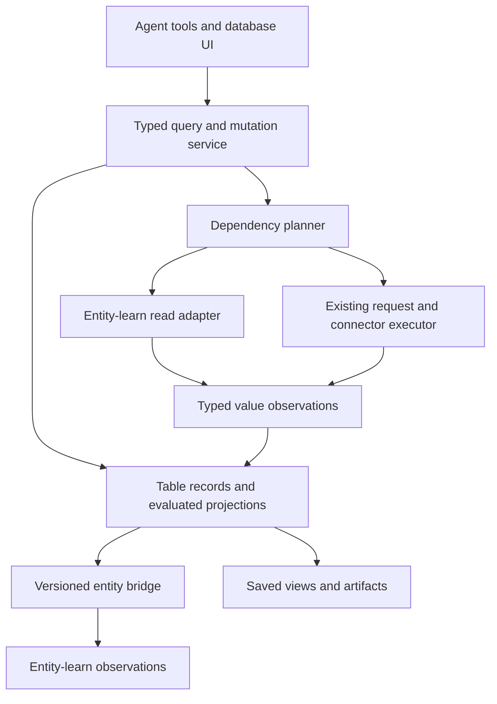

# Structured databases, live fields, and entity memory

Status: architecture proposal, 2026-09-08. This document describes proposed behavior; it does not implement or enable it.

Implementation: [Tardigrade-native databases and artifacts plan](tardigrade-databases-plan.md) maps this design onto the existing actor, native tools/effects, account storage, scheduling, approval services, and response outbox, with ordered milestones and recovery tests.

## Decision

Add an owner-scoped structured database component alongside entity-learn, with a typed bridge between them. Give agents and people the same table operations. Store flexible records, typed columns, stable relations, live field bindings, and saved views. Use the existing account SQLite infrastructure initially; a flexible document model does not require a separate NoSQL service.

Make database artifacts a standard response type, rendered through an application-owned json-render catalog. Use the same collection/query/view interface for user databases and system collections such as approvals, tasks, and runs. System collections retain their domain services as write authorities.

A row may represent an entity, a measurement, a task, a comparison, or temporary working state. Entity association is optional. Tables are exact, queryable working data; entity-learn remains the authority for memory observations, evidence, corrections, and retrieval. Each mapped field has one designated write authority, so the two components do not become competing masters.

The essential distinction is between a field's definition and its evaluated value. A live field stores how to obtain a value and the conditions under which that value can be retained or reused.

## Existing foundations

- [Memory integration](aiko-entity-learn.md) mounts entity-learn through native tools. Its [types](../packages/entity-learn/lib/types.ts) already support arbitrary JSON payloads, stable subjects, immutable observations, exact corrections, supporting observations, and current-input dependencies. The gap is structured query, field-level binding, table lifecycle, and editing semantics.
- [Request memory](request-memory-and-workflows.md) learns request definitions and dependency graphs. [RequestMemory](../apps/agent/src/request-memory.ts) keeps raw responses transient and has a host-owned consume callback during hydration. Public replay is constrained to supported read operations; authenticated execution uses existing host/connector authority.
- [Request lab](request-lab.md) documents a concrete issue: unchanged checks advance observation heads and invalidate dependent records. Separate check history from value versions before making this the basis of table updates.
- [Compiled knowledge](aiko-knowledge.md) already distinguishes authenticated, inert HTML snapshots from interactive editing. Tables should preserve that distinction.
- [Cloudflare storage](../packages/entity-learn/lib/cloudflare.ts) exposes host-owned SQLite transactions. The [account host](../apps/agent/src/cloudflare-host.ts) owns durable execution and scheduling. Extend these boundaries instead of adding a second agent loop.

## Example

An agent creates a Projects table for planning:

| Field | Definition | Example value |
| --- | --- | --- |
| Name | Local text | Website refresh |
| Company | Relation to Companies row | Acme |
| Owner | Entity field reference | Maya |
| Open issues | Live request binding using this row's repository ID | 12 |
| Company tier | Lookup through Company relation | Enterprise |
| Priority | Formula over tier, issue count, and deadline | High |
| Notes | Local rich text | Waiting for design review |

Companies can have its own live fields. Another table can reference Projects. The agent can join them, answer from a reproducible local snapshot, show a table or board, and selectively publish useful facts to entity-learn. It can also create an isolated comparison table with no entity mappings at all.

## Logical model

| Object | Responsibility |
| --- | --- |
| Database | Owner-scoped namespace, lifecycle, retention defaults, and access policy |
| Table | Schema version, columns, row membership, indexes, and optional source mapping |
| Row | Immutable row ID, revision, local values, tombstone, optional entity mapping |
| Column | Immutable column ID, display name, output type, validation, default binding, write authority |
| Binding | Definition of a literal, entity field, request result, lookup, or formula |
| Relation | Typed edges between stable row IDs, with declared cardinality |
| Source | Pinned executable contract plus owner-bound connection reference and input mapping |
| Value version | Typed selected value or private retained reference, digest, lineage, and observation time |
| Check receipt | Refresh attempt, outcome, check time, source generation, and coverage |
| View | Query plus display configuration over existing tables |
| Artifact | Authenticated live view reference or explicitly frozen view result |
| Entity mapping | Stable row/subject association and versioned field mappings with write directions |

Column types start with text, boolean, integer, decimal, timestamp, enum, JSON, relation, and attachment reference. Use canonical decimal representations for exact arithmetic. Missing, explicit null, unavailable, and erroneous values are distinct. Column IDs survive renaming; formulas and references never depend on display names or array positions.

Row identity is separate from entity identity. Multiple tables may legitimately contain different rows associated with the same entity. Import deduplication uses a declared key such as `(source, source generation, remote ID)`, never a similarity score or row title. The mapping specifies whether multiple rows per entity are allowed.

Relations are stored edges, not copied target names. Support one-to-one, many-to-one, and many-to-many, with optional reverse views. A target deletion defaults to a visible missing-target reference; cascading deletion must be explicitly configured.

## Field bindings

Store definitions separately from values. Column bindings apply to every row, with explicitly recorded per-row overrides when needed. Binding variants are:

1. **Literal:** a stored value owned by the table.
2. **Entity field:** entity subject plus payload path, following its current observation or pinned to a particular observation.
3. **Request field:** pinned source contract, typed inputs bound to constants or row fields, response step and selector, output schema, freshness policy, and retention policy.
4. **Lookup:** relation column plus target column; multi-valued targets require an explicit list or aggregation rule.
5. **Formula:** a bounded, typed expression over other columns and lookups.

For example, the definition of Open issues could be:

```json
{
  "kind": "request",
  "sourceId": "github-repository-read",
  "contractDigest": "<pinned digest>",
  "inputs": { "repositoryId": { "rowField": "col_repository_id" } },
  "select": { "stepId": "repository", "jsonPointer": "/open_issues_count" },
  "outputType": "integer",
  "refresh": { "mode": "on-demand", "maxAgeSeconds": 300 },
  "retention": "reference-only"
}
```

The referenced source maps to a learned request or registered read capability. Credentials and transport implementation remain host-owned. Arbitrary URL strings or cell text do not become executable network requests. A digest change requires binding revalidation.

A computed field is read-only by default. A user can deliberately replace its binding, add an override with visible source metadata, or use an explicit source write operation. Editing an API-backed field does not implicitly PATCH the remote service. Source writeback is a later capability with operation identity and reconciliation.

## Evaluation and freshness



Evaluation separates local query from external refresh:

1. Authorize the caller, requested fields, and each source before reading or dispatching.
2. Expand required dependencies into a bounded graph. Reject formula/request cycles; cyclic relations alone are valid.
3. Read a local revision snapshot. Reuse allowed cached values that satisfy the requested freshness mode.
4. Group identical source invocations by owner, connection generation, contract digest, and normalized inputs. Fetch once per group and select multiple fields from that result. Use provider batch reads when the registered contract supports them.
5. Execute through existing native effects, with budgets for calls, time, response bytes, rows, and dependency depth. Apply rate limits, backoff, and cancellation.
6. Validate selected fields and record check receipts. Advance a value version only if the canonical typed value or its meaningful lineage changes. An unchanged check updates freshness without moving the value head.
7. Commit only if the binding generation and input revisions still match. Discard or reschedule a late result from an old row, source, or contract revision.
8. Recompute affected formulas, joins, and views, then publish owner-scoped change events.

The returned cell separates value state (`ready`, `missing`, `error`, `unavailable`) from freshness (`fresh`, `stale`, `unknown`) and refresh activity. Include checked time, observed time, source, value version, and a typed error where applicable. A failed refresh does not replace a known value with null. It may expose the prior value as stale only while current access and retention policy still permit it; revoked access hides it.

Default queries read the local projection and never cause network access. Refresh is a separate operation, or an explicit query mode: `cached`, `refresh-stale`, or `require-fresh`. A saved view can opt into refresh on open or on a schedule within an owner-approved budget. Receiving a source change event normally invalidates values; deterministic refresh can run without a model turn.

Keep value-change events separate from check/freshness events so a freshness indicator can update without recomputing every aggregate. Consumers that explicitly depend on check time can subscribe to check changes.

## Retention and reproducibility

Request definitions currently retain no raw response bodies. Preserve this default and expose three policies for table values:

| Policy | Persisted data | Offline behavior |
| --- | --- | --- |
| Reference-only | Binding, safe structural lineage, and check metadata | Needs a fresh authorized evaluation; value exists only during that evaluation |
| Materialized | Selected typed fields in owner-private storage, with retention limits | Can return permitted cached values with freshness labels |
| Snapshot | Explicit immutable selected result with observation and provenance metadata | Reproduces the captured result; does not claim to be live |

Local literal values are durable. API-derived values require a declared retention policy; materializing a table or exporting an artifact must not silently broaden retention. Selected sensitive fields use existing private custody primitives where appropriate, and native orchestration logs retain opaque references rather than raw rows or API inputs. A reference-only query may perform joins over transient values during its evaluation but cannot promise offline sorting/filtering of unknown values.

Queries return a local revision token, evaluation ID, source/check versions, coverage, and observation time range. Local data can be transactionally consistent; independent external services do not provide a shared point-in-time snapshot. `require-fresh` reports incomplete/error status when any required source cannot meet its freshness contract. It never manufactures a globally atomic remote snapshot.

Frozen artifacts require retained selected values. A reference-only artifact must either remain live or explicitly transition eligible fields to snapshot retention. Export JSON with bindings/provenance when round-trip fidelity matters; CSV is a lossy value export.

## Queries and joins

Expose a typed query AST supporting select, filter, sort, group, aggregate, and bounded joins. Compile it into parameterized local SQL or a bounded transient evaluator. Do not expose arbitrary SQL, JavaScript, or network functions through formulas.

Support inner and left joins on relations or explicitly typed keys. Require cardinality and row-expansion limits. Left joins preserve missing targets; aggregates document null handling and never silently count unavailable values as zero. Surface pagination, source coverage, and truncated joins in the result. Global aggregates require scanning the complete eligible input, not just the displayed page; otherwise return a visibly partial aggregate.

Local literal, relation, and materialized fields are indexable. Filters on unresolved live fields may require bounded hydration of the candidate set and can return partial coverage. Push remote filters or pagination only when the registered source contract defines equivalent semantics. Never represent a filtered page as the full source.

Source-backed table membership is explicit: an import records a complete/partial source enumeration and stable remote keys. A missing row becomes a deletion candidate only after a successful complete enumeration or an authoritative deletion event. Timeouts and partial pages cannot delete rows.

## Moving between tables and entity-learn

Use a persistent mapping rather than repeated extraction from prose. Store the subject identity, row identity, schema/mapping version, field paths, direction, and both last-synchronized revisions.

| Operation | Semantics |
| --- | --- |
| Project entities into a table | Query recorded observations and expose selected payload paths as live references; retain their exact observation IDs |
| Materialize entity fields | Copy permitted values into editable row fields with original evidence and baseline revisions |
| Link a row to an entity | Associate identities without copying data or changing authority |
| Promote row fields to memory | Write a typed observation through entity-learn with table revision, evidence references, and producer attribution |
| Edit a writable entity projection | Apply an explicit entity-learn correction using the expected observation ID, then update the table projection |
| Detach a projection | Freeze permitted values locally and remove synchronization; retain provenance |

Mapped fields have one authority: `table`, `entity`, or `external`. A reversible projection can route edits back to that authority. For materialized copies, compare against the last synchronized baseline; divergent changes produce a visible conflict, not a last-write-wins guess. Local overrides remain distinct from the underlying source value.

Round trips preserve stable IDs, types, mappings, and provenance for reversible field selections. Aggregates, lossy transforms, and inferred schemas are explicitly non-invertible. Promote an aggregate as a derived observation with dependencies; do not attempt to reconstruct its input entities. Candidate identity matches require a declared key or explicit linking decision.

Use exact entity observations in `supports` and current-value dependencies in `dependsOn` where applicable. Table revisions are not automatically valid entity-learn observation IDs: the bridge must first register an appropriately attributed table observation through a host-owned adapter. Table edits retain whether their producer was a user, an agent, or a source; promoting them does not upgrade a claim into verified truth.

Bridge deliveries use an outbox and idempotency keys tied to mapping ID and source revision. Preserve causal origin across both directions to prevent echo loops. Forget/suppression and source revocation invalidate dependent projections before they can be served, even while background cleanup is pending. Independent local records are governed by their own provenance and retention, not deleted merely because they resemble an entity.

Keep ordinary working rows in the structured store. Index table descriptions and selected useful facts in entity-learn, giving recall an entry point to an exact query without embedding every cell after every refresh.

## Storage and execution boundaries

Start with a new structured-data library and thin native host adapters. Keep the pinned entity-learn core unchanged until a concrete reusable primitive requires an upstream extension.

Use a fixed set of application-owned SQLite tables for database/table definitions, column definitions, row revisions and current heads, relation edges, bindings, typed cell projections, value versions, check receipts, views, mappings, and outbox operations. Store flexible literal payloads as JSON keyed by column ID; use typed projections/indexes for queried fields. Agents create logical tables through validated operations rather than issuing DDL for each user table.

Choose one authority for each structure: the structured store for table state, entity-learn for memory observations, and native runtime effects for scheduling/execution. A local row revision, head update, and bridge outbox entry commit together. The bridge applies the memory write idempotently and records settlement; it must recover from a crash between these steps without assuming a cross-store transaction. Native logs reference structured operation IDs and private payload handles.

Node uses owner-private SQLite storage. Worker uses the authenticated account's SQLite Durable Object through a portable storage interface. Never hold a database transaction across a network await. Use row/schema revision compare-and-swap for edits, explicit migration operations for incompatible type changes, and tombstones for referenced deletions. Successful migration must validate all affected values or expose a staged failed migration; no silent coercion.

Extend account export/import and backup manifests to include structured revisions, bindings, views, mappings, retained values, pending outbox state, and schema versions. Derived indexes can rebuild. Restoring data does not re-enable revoked connections or execute pending remote actions automatically. The initial deployment assumes bounded owner-sized operational tables; large analytical workloads can later move behind the same query interface after measurement.

## Agent surface and UI

Proposed tools share a service with the UI:

- `database_create`, `table_define`, `table_upsert`, and `table_query` manage structure and exact data.
- `table_bind` and `table_refresh` declare and evaluate live fields with explicit budgets.
- `table_project_entities`, `table_link_entity`, and `table_promote` manage the memory bridge.
- `view_save`, `view_open`, and `view_snapshot` create durable presentations.
- `table_explain` reports a cell's binding, lineage, stale/error cause, and downstream dependents.

Database lifecycle distinguishes temporary task state, durable internal memory, and user-visible collections. Temporary collections have explicit expiry, and references cannot silently outlive their targets. The agent can choose a table for comparisons, inventories, schedules, measurements, or relational work without first inventing entities.

The first UI is a schema-driven grid: typed editors, relation pickers, sort/filter/group, pagination, freshness indicators, refresh status, and a row detail panel. Subsequent board, list, calendar, and chart views share the same query model. Renaming, deleting, or changing a field shows affected formulas/views before commit. Conflicts show both values and their sources.

Live artifacts store a view ID and query configuration, reauthorize every read, and subscribe to revisioned change events. Reconnection resynchronizes from a cursor or reloads a snapshot when history is unavailable. Frozen artifacts capture a declared view revision, selected values, coverage, and source observation times. Shared artifacts apply view/field access at query time, and derived fields cannot leak inaccessible inputs. MVP artifacts remain owner-authenticated; broader sharing needs explicit grants.

An agent supplies a declarative view specification to a trusted renderer. Cell contents are data, including content from external APIs. Generated executable UI is unnecessary for ordinary database views.

## json-render and inline mini apps

Use json-render as the presentation adapter. Its documented model lets the application define typed component/action catalogs and map them to owned implementations; it also supports inline conversational presentation. These are rendering primitives, not a database or backend permission system. See the official [introduction](https://json-render.dev/docs), [catalog](https://json-render.dev/docs/catalog), and [registry](https://json-render.dev/docs/registry), inspected 2026-09-08.

The [site's example Table](https://json-render.dev/) accepts column labels and string rows. Register our own `DatabaseView` and typed cell components for persistent identities, server-side queries, relations, edits, large results, and freshness. Keep a versioned artifact envelope independent of the renderer so stored databases do not depend on a specific UI framework release.

The proposed application catalog includes `DatabaseView`, `RecordDetail`, `RelationCell`, `FreshnessBadge`, `FilterBar`, `Metric`, and `ArtifactLink`. A protected system catalog additionally provides `ApprovalDetail` and its host-controlled decision controls. Standard table layouts can be compiled deterministically from the schema and saved view; model generation is useful for composing a custom dashboard around them.

An illustrative application envelope, not a built-in json-render schema:

```json
{
  "schemaVersion": 1,
  "kind": "database",
  "artifactId": "artifact_projects",
  "title": "Launch tracker",
  "viewId": "view_launch",
  "viewRevision": 3,
  "dataMode": "live",
  "presentation": { "inline": "preview", "expanded": "mini-app" },
  "renderer": { "kind": "json-render", "catalogVersion": "aiko-db/v1" }
}
```

The server resolves owner, query, permissions, validated spec, and supported actions from the artifact. The envelope contains identifiers, not credentials or authorization claims. Keep view-definition revisions separate from changing data revisions: a live artifact can pin its layout while reading current data.

The interaction is one continuous object: an inline card shows a bounded preview, clicking opens the same artifact/view in a drawer or mini app, and edits update all subscribed instances. A standalone route can open that same object. Host-owned layout constraints keep inline cards small; expanding does not create or copy another database. A snapshot remains visibly frozen.

Extend the current text-only [response tool](../apps/agent/src/channel-response.ts) with validated artifact references and corresponding durable response events/outbox encoding. For example, proposed `respond({text, artifacts:[{artifactId}]})`. Persist and authorize the artifact before queuing its reference, and preserve existing origin-channel routing and delivery deduplication. Rendering or opening an artifact must not resend a response or rerun the agent.

Channel adapters negotiate presentation: the web conversation renders inline components and expands to its mini-app shell; channels that cannot embed interactive UI receive a textual preview and authenticated open action. Telegram integration should use its supported Mini App launch surface and verified host identity, with a link fallback where necessary; arbitrary inline web rendering is not assumed. Provider-specific launch behavior needs integration verification.

Data binding goes through our authenticated query/subscription client. json-render state holds visible results and edit drafts; changing client state does not commit a row. Named mutation handlers call the host with expected revisions and reconcile its response. Unknown catalogs or invalid specs render a safe unavailable card. Loading, streaming, mounting, and replaying a spec never submit mutations. Abort subscriptions and discard late responses when an artifact closes or its principal changes.

## Approvals as the first system collection

Yes: the approval queue should implement this standard. Expose `system.approvals` through the same query, relation, saved-view, and artifact service. It can join to projects, tasks, connections, or runs and appear as a grid, filtered inbox, or record detail mini app.

The standard needs two collection modes:

| Mode | Reads | Writes |
| --- | --- | --- |
| Stored collection | Structured store revisions | Validated table CRUD |
| Domain collection | Adapter/projection of authoritative domain state | Named commands routed to that domain service |

Approvals use the domain mode. The current [action approval service](../apps/agent/src/action-approval.ts) already binds decisions to owner, immutable prepared payload hash, connection revision, expiration, and a durable transition sequence. It explicitly reserves decisions for authenticated humans through the host. Preserve that authority; expose its events as table rows and route decisions back through its existing service. Extend the column authority vocabulary with `domain` for these host-owned fields.

An approval row exposes safe fields such as action ID, operation, target summary, related task/project, state, version, expiry, and outcome. Protected payload details are fetched only by the authorized detail component. Optional notes or tags live in a separate editable annotation collection joined by action ID. Generic CRUD rejects changes to approval state, payload, grants, connection revision, or expiry, including through entity mappings and imports.

The decision flow is:

1. The agent prepares an action using the existing capability flow. The approval service creates its immutable request; a projection exposes its row.
2. The agent returns an approval artifact, optionally filtered to the task at hand.
3. Opening a row loads canonical action details into a trusted `ApprovalDetail` component. Critical operation, target, payload, and decision labels come from the host; generated layout cannot hide, replace, or rebind them.
4. A human decision goes through a host-owned authenticated command using the exact action ID and payload hash. The host rechecks current pending state, expiry, ownership, and relevant authority. An expected version may be added as an explicit API extension; the current handler accepts ID, hash, and decision.
5. The approval state transition updates the collection and every live artifact. Existing dispatch logic separately consumes consent and executes the stored payload with its connection checks.

An agent may query pending items and prepare proposals; it cannot approve by setting a cell, invoking a renderer action, importing an approved row, changing local UI state, or promoting an entity fact. Decision handlers are not mounted in the model's generic tool/action surface or spec watchers. They are owned by the trusted human interaction component and independently authenticated at the server. A copied/frozen artifact contains no actionable consent.

Show approval state and execution outcome separately. Preserve the existing `pending`, `approved`, `rejected`, `expired`, `dispatched`, `settled`, and `unknown` semantics; an approved action has not necessarily executed. Changing an operation payload produces a new approval request. Reopening or replaying a UI cannot consume consent twice. A stale projection cannot authorize a transition because commands always consult the domain service.

This standard can later cover `system.tasks`, `system.runs`, and `system.connections`, each with its own adapter and command rules. It provides consistent querying and rendering while keeping each domain's state transitions explicit. Do not put credentials into a connections collection, or turn system records into writable generic JSON.

## Delivery sequence and acceptance

1. **Collections and artifacts:** define stored/domain collection interfaces, the versioned artifact envelope, and the json-render catalog. Deliver local durable CRUD, stable IDs, validation, typed queries, relations/joins, CAS edits, saved grid views, backup/restore, and inline-to-mini-app navigation. Project the existing approval queue through a domain adapter and trusted decision component as the first system view. Demonstrate a planning database surviving restart and an approval artifact preserving the existing decision/dispatch checks.
2. **Live fields:** registered request bindings, selected-field validation, separate value/check histories, retention modes, deduplicated hydration, bounded refresh, and source generation fencing. Demonstrate two fields using one request, unchanged checks preserving value heads, and a failed check preserving only permitted stale values.
3. **Entity bridge:** identity mapping, reversible projections, promotion with valid evidence, conflict resolution, durable outbox recovery, and suppression propagation. Demonstrate entity → table → edit → entity with stable identity and a crash at every bridge boundary producing one logical update.
4. **Expanded artifacts and automation:** frozen exports, scheduled refresh, dependency change events, additional views, and further channel adapters. Demonstrate a joined artifact updating only after relevant value changes and accurately disclosing incomplete remote coverage.

Cross-cutting acceptance covers owner isolation across direct reads, joins, aggregates, exports and subscriptions; revoked access to cached values; cycles and fanout limits; binding edits during fetch; missing/null distinctions; partial enumeration without accidental deletion; schema migration failure; and backup restoration without duplicate bridge writes or implicit source execution.

Artifact/approval acceptance additionally covers missing or invalid specs, artifact authorization on open, loss of access during a subscription, response replay without duplicate artifact delivery, read-only channel fallback, filtered/hidden critical approval details, forged decision events, expired/stale decisions, two tabs deciding concurrently, changed payload/connection state, copied snapshots, and agent attempts to approve through table CRUD or entity synchronization. UI tests must exercise actual host decision transitions; a changed button label is insufficient evidence.

The first end-to-end example should be Projects → Companies, one live request-derived field, one lookup, one formula, a linked entity, and a saved view. This exercises the architecture's central behavior before expanding the renderer or query language.
