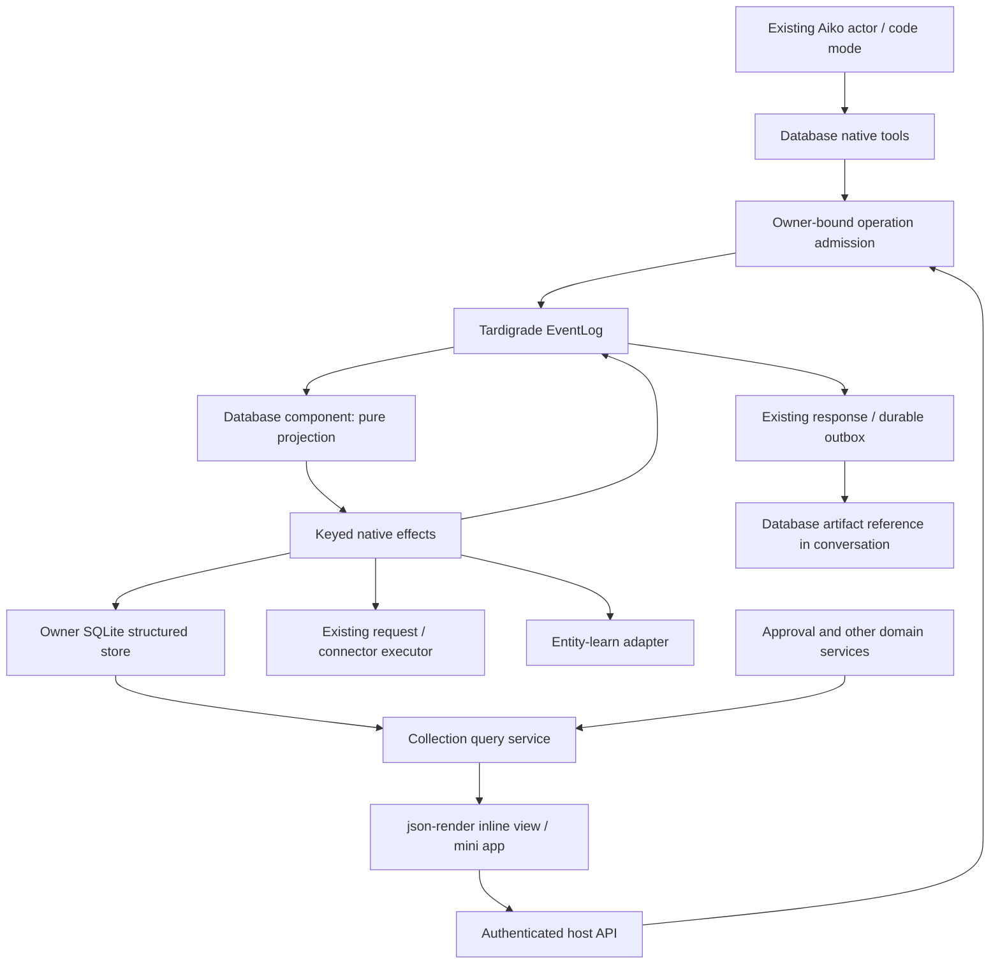

# Tardigrade-native databases and artifacts: implementation plan

Status: implementation blueprint, updated 2026-09-08. Partial implementation exists in this checkout; the milestone checklists below define acceptance, not a claim that the feature is complete. See the [implementation ledger](structured-databases-status.md) for recorded evidence; recheck the working tree before continuing because host integration is also in progress.

The working tree includes native reply artifact references, the json-render database UI with table/list/board/calendar/chart layouts, authenticated mini-app launch, protected approval detail, bounded staged manual refresh through registered read contracts, loaded-page source refresh controls with acknowledgement recovery, exact entity observation references, versioned row/subject mappings, and manual table-to-memory publication with native recovery. It also contains mapped entity correction and explicit `publish-table` conflict resolution commands. Layouts, saving new views, and the mapped-memory editor have native-host browser evidence, including concurrent edits, failed reads, lost acknowledgements and read-only boundaries; see the implementation ledger. Transient live queries, scheduled refresh, projection enumeration, detach, full capability controls, baseline comparison/resolution UI, and automatic bridge delivery remain unfinished parts of the target.

This plan implements the [structured database design](structured-databases-design.md) inside Aiko's existing Tardigrade runtime. It covers agent-created tables, live API fields, relations and joins, entity-learn round trips, json-render artifacts, inline mini apps, and a standard collection interface for the approval queue.

## Decisions at a glance

| Question | Decision |
| --- | --- |
| What does the agent create? | Logical databases containing flexible JSON rows, typed columns, stable relations, and saved views. A row does not need an entity identity. |
| Where does it live? | Existing owner-scoped SQLite storage, shared by agent tools and the authenticated UI. Introduce another storage backend only when measured requirements justify it. |
| What makes it Tardigrade-native? | The existing actor admits commands and runs keyed effects; its event log, host wake mechanism, cancellation, and recovery drive database work. |
| What makes a field live? | A persisted binding identifies an entity observation, registered API read, lookup, or formula. Evaluated values carry freshness and provenance separately. |
| How does memory round-trip? | Versioned row/subject and field mappings, explicit write authority, exact revision checks, and durable evidence-backed deliveries. |
| What does the agent return? | A stable database artifact reference that opens the same saved view inline or as a mini app. |
| Can approvals use this standard? | Yes: the approval service exposes a domain collection. Its existing authenticated decision commands remain the authority for approval transitions. |

First delivery: an agent creates related Projects and Companies tables, returns a saved table artifact in chat, and opens it as an editable mini app. The same renderer shows an approval collection with trusted review controls. Subsequent milestones add live sources and complete entity round trips. Existing implementation work is a foundation; acceptance requires the evidence listed below.

## Product contract

The agent can create a database for a task, populate and join its tables, bind selected fields to live sources or entity observations, and return a saved view as an artifact. The same artifact opens as a compact conversation preview, an expanded mini app, or a standalone authenticated view. Internal working tables need not become entities or user-visible artifacts.

Standardize the collection contract across three kinds of data:

| Collection | Canonical state | How edits work |
| --- | --- | --- |
| Agent/user table | Structured row revisions | Validated native table commands |
| Entity projection | Exact entity-learn observations, with a persistent field mapping | Explicit correction or promotion through the mapped field's authority |
| System collection, initially approvals | Existing domain service | Named domain commands; approval decisions remain authenticated human actions |

All three expose stable record identities, typed fields, bounded queries, relations, saved views, revision cursors, and declared capabilities. Capabilities describe which controls to offer; the host still checks every read and command. A join returns a derived view and does not transfer write authority between collections.

The implemented capability envelope describes current query/record actions: local editable fields, mapped-memory review, record creation from selected fields, view saving, and registered domain review. It is calculated from the authenticated caller and current host policy and is never persisted as a grant. Query changes, opening a snapshot, or credential changes require fresh hints. Missing hints expose no mutation controls. New source, lifecycle and bridge actions must extend this contract as they are implemented.

The standard response carries an artifact reference, not a serialized database or a generated executable app. The artifact pins its view definition and renderer catalog; its data mode determines whether opening it reads current authorized values or a retained snapshot. Table identity, entity identity, view identity, and artifact identity remain separate.

For example: create `Companies` and `Projects`, link each project to a company, map the company contact to an entity observation, and bind open issue count to a registered read request. Save a joined launch view and return its artifact in chat. A separate approval view can join pending actions to those same projects. Refresh updates the issue value through native effects; a human decision updates the approval service. Both changes update the open views through the collection subscription contract.

### Simple user experience

The user asks for a tracker, comparison, inventory, or approval inbox. The agent chooses a table when the task needs rows, fields, or joins; entity creation is optional. Offer the same plain controls wherever the collection appears: **Open**, **Filter**, **Refresh**, and authorized editing. A field's detail explains its source and last check. Internal tables become visible only when the agent or user publishes a view.

An ordinary table edit saves through a native command. Editing a mapped memory field explicitly updates memory; editing a local field stays local until publication is requested. If both sides changed, show the two current values and the last synchronized value before asking which to keep. A successful memory write followed by a projection conflict should say “Memory updated; table needs reconciliation,” preserving the user's edit and the actual outcome.

Approval rows share navigation, filtering, relations, and presentation with other tables. Their row detail retains the existing trusted review interaction. This makes the approval queue a first-class database artifact without making approval state an ordinary editable cell.

## 1. Architectural decision

Keep the existing `aiko` actor identity. Mount a database component and native tools in its current composition. Tardigrade owns operation admission, execution, durable continuation, scheduling, cancellation, recovery, and response delivery. The structured store owns table revisions and query indexes. Entity-learn owns memory observations. Existing domain services own system state transitions, including approvals.

One owner can have many logical databases, tables, and artifacts. These are records in owner-scoped storage, not separate actors or deployed databases. Initial orchestration runs on the existing `user-${owner}` thread. Pure queries can read authorized store snapshots directly through the host; writes and refreshes enter durable native operations. Bound effect batches so background maintenance can yield to foreground work.

The normal path is:



No new model loop, process queue, cron daemon, generic workflow interpreter, or per-table actor is needed. Database dependency planning is a bounded pure algorithm invoked by native effects. Durable execution resumes from native operation events and stored receipts.

### One native operation, end to end

For “refresh the launch tracker and show me the result,” the intended execution is:

1. A native tool or authenticated UI command supplies the saved view and freshness budget. The host derives owner and operation identity, retains private inputs, and admits the operation to the existing thread.
2. The component projects recorded events into a bounded plan. A keyed effect resolves row relations, source inputs, and current grants; it groups fields sharing one registered read request.
3. The existing request executor reads the source. Selected values are validated and committed with their lineage only if row inputs, binding generation, connection authority, and cancellation still permit the commit.
4. Store receipts let a resumed effect recover committed work. Pending dependency or memory deliveries continue through native effects; live UI subscriptions consume authorized revision changes.
5. The operation reports freshness and coverage. The actor returns the stable artifact reference through its existing response outbox; opening that reference reads the saved view without another inference turn.

Cached reads can skip refresh entirely. A `require-fresh` request must report incomplete/unavailable when the budget or source prevents freshness; it cannot quietly return stale data as current. Reference-only results need an evaluation-scoped delivery path to the caller because their values cannot be reconstructed from persisted receipts. These transient query and subscription paths are acceptance requirements, not claims about today's implementation. The current local query boundary rejects unsupported fresh modes rather than ignoring them. Code mode presently retains tool results even when `retain:false`; exposing transient selected values requires a coordinated change to that shared custody boundary first.

## 2. Grounding in this checkout

The implementation target is the workspace-pinned `tardie@0.22.0` and Effect `4.0.0-rc.110`, including the existing Tardie patch. Verify these pins before implementation rather than upgrading as part of this feature.

| Existing integration | Reuse |
| --- | --- |
| [actor.ts](../apps/agent/src/actor.ts) | `actor({name: "aiko"})`, `NativeTool<Self \| EventLog>`, `tool(nativeTools)`, and the current code-mode tool package |
| [login-operation.ts](../apps/agent/src/login-operation.ts) | Example of a native operation component, host-private ingress, cancellation, wake calculation, and durable method waiting |
| [automations.ts](../apps/agent/src/automations.ts) | Keyed trigger identities and versioned schedules; database maintenance should execute deterministically without prompting an agent |
| [cloudflare-host.ts](../apps/agent/src/cloudflare-host.ts) | Native reconciler/driver, durable thread logs, append preconditions, recovery alarms, and host-owned SQLite |
| [cloudflare.ts](../apps/agent/src/cloudflare.ts), [server.ts](../apps/agent/src/server.ts) | Owner-bound bindings, ingress authentication, native tool mounting, and host wake integration |
| [memory.ts](../apps/agent/src/memory.ts) | Native identity-derived write keys, owner scope, and actual entity-learn core APIs |
| [request-memory.ts](../apps/agent/src/request-memory.ts), [observed-network.ts](../apps/agent/src/observed-network.ts) | Learned request definitions, current execution checks, bounded response consumption, and approved action execution |
| [action-approval.ts](../apps/agent/src/action-approval.ts) | Authoritative immutable action payloads, human decisions, transition versions, and consent consumption |
| [channel-response.ts](../apps/agent/src/channel-response.ts), `voiceAndOutbox` in actor.ts | Origin-channel response intent, preparation, delivery, and replay identity |
| [audit-native-memory.ts](../apps/agent/scripts/audit-native-memory.ts) | Real CLI witness using deterministic injected inference and isolated durable state |

The installed tardigrade skill's relative CLI/server guide paths do not resolve in this environment; no copies were found in the inspected workspace/skill paths. This plan uses the pinned runtime source and existing CLI witness for concrete APIs. Resolve the guide locations before deployment work. This task does not migrate the actor, optimize inference, or deploy it.

## 3. Component and host contract

Introduce an application-owned `DatabaseBinding` containing the authenticated owner/thread, structured storage port, current authorization checks, private payload custody, existing source-read adapters, and entity-learn access. Resolve binding authority from the host. Tool arguments cannot select an owner, file path, credential, service implementation, or actor identity.

Mount `databaseComponent(binding)` beside the existing application components in `actor.ts`. Add `databaseTools(binding)` to `nativeTools`; the current code-mode package should discover those same tools through its existing search/describe/call path. Do not install a second MCP server or duplicate tool dispatcher. Keep host-only methods and approval decisions outside that tool list.

The component follows Tardigrade's current shape:

```text
initial()                    -> empty operation/schedule projection
step(state, event)            -> pure next state
output(state)                -> bounded view + native transitions
effect({key, input, act})     -> perform authorized I/O and return events
```

These are composition instructions, not a new public Tardigrade database API. `initial`, `step`, and `output` do not open databases, read clocks, generate IDs, fetch sources, or call models. Durable ingress supplies time and identity; effects record observations before later decisions depend on them. Real-time access and expiry checks occur again at the execution boundary.

Suggested native tool groups:

- Structure/data: `database_create`, `table_define`, `table_upsert`, `table_delete_rows`, `table_query`.
- Bindings/evaluation: `table_bind`, `table_refresh`, `database_operation`, `table_explain`.
- Memory: `table_project_entities`, `table_link_entity`, `table_promote`, `table_correct_entity`, `table_detach`.
- Presentation: `view_save`, `artifact_create`, `artifact_snapshot`.

Tools return typed outcomes: `committed`, `queued`, `conflict`, `partial`, `unavailable`, or `rejected`, with operation/revision references and bounded coverage. `queued` never means the requested table update or artifact evaluation has completed. Long refreshes return an operation ID; use the existing durable method/intent pattern if a caller needs to wait, and otherwise inspect that operation without resubmitting it.

All mutations use one admitted command format and execution service, regardless of whether they originate in code mode, a native tool, or the UI. Cached reads use the same query engine and permissions without creating a model turn. Queries with refresh requested first admit a refresh operation, then read its evaluated result.

## 4. Durable operation protocol

Proposed application event names below must be validated and registered in both host event-key/admission paths. They are not built-in Tardigrade events.

| Event | Purpose |
| --- | --- |
| `AikoDatabaseOperationRequested` | Authorized command reference, operation identity, expected revisions, cause, deadline |
| `AikoDatabaseOperationProgressed` | Completed bounded stage and next continuation reference |
| `AikoDatabaseOperationSettled` | Stable outcome and committed revision/result reference |
| `AikoDatabaseScheduleChanged` | Schedule generation, enabled state, next due time, refresh scope/budget reference |
| `AikoDatabaseRefreshDue` | Host-generated occurrence for a specific schedule generation and due slot |
| `AikoDatabaseValueChanged` | Changed value version, affected identities, and lineage reference |
| `AikoDatabaseCheckRecorded` | Refresh/freshness outcome without implying value change |
| `AikoDatabaseBridgeSettled` | Idempotent entity mapping delivery result |
| `AikoDatabaseArtifactCommitted` | Validated artifact identity and definition revision |

Keep large plans, row contents, formulas containing private literals, and API inputs behind private retained references. Native tool invocation logging must use the existing custody/wrapping approach before private arguments reach durable `ToolCalled` or code-dispatch records; redacting only returned results is insufficient. Query outputs supplied to the model follow the same private-result policy and bounds.

Operation identity:

- Agent calls derive identity from actor, instance, thread, turn, persisted call ID, execution epoch where the current native call contract requires it, and operation kind. Use the existing memory/tool identity helpers as the starting point; verify cancel/resume behavior in tests.
- UI/API writes bind a submitted idempotency key to the authenticated principal, operation kind, and exact command digest. Reuse with a different command conflicts.
- Scheduled refresh identity binds schedule ID, schedule generation, and scheduled occurrence. Redelivering an alarm does not create a second occurrence.

A keyed effect alone cannot guarantee one physical external request. Enforce local exactly-once *logical commits* with an operation receipt and command digest in SQLite. External reads may be retried only under the source contract and budget; refresh retries retain attempt evidence. Source writeback remains outside the initial database binding capability and continues through existing approval/dispatch semantics.

Commit/recovery protocol:

1. Seal and retain the authorized command, append `OperationRequested`, and durably mark the thread for settlement before acknowledging admission. A crash after sealing but before admission leaves an unreferenced object eligible for later cleanup.
2. The component emits a keyed effect for the next bounded stage. The effect first looks for a completed store receipt for that operation/stage.
3. Execute local changes in one transaction: check revisions and authority generation, apply rows/value versions, record the stable receipt, and insert pending bridge/change deliveries.
4. Return native settlement/progress events containing that receipt identity. If the process stops between steps 3 and 4, replay reads the receipt and emits the same logical result without writing again.
5. Drain pending bridge/change deliveries through further native effects. The store outbox is durable delivery bookkeeping, not an independent worker or scheduler. Recovery checks pending entries even if their original wake notification was lost.

Never hold a transaction across a network await. Fence late responses against binding generation, connection generation, row inputs, and cancellation before commit. Typed failed/conflict/cancelled outcomes settle operations without unhandled effect errors. Unknown remote mutation outcomes remain unknown through the existing domain service.

## 5. Tables, sources, and entity bridge

Use an owner-private SQLite structured store with fixed application tables for logical schema, current rows and revisions, relation edges, bindings, value/check histories, typed indexes, operations, outbox deliveries, views, artifacts, and entity mappings. Flexible row values are keyed by immutable column IDs. Node and SQLite Durable Object adapters share the same store contract; the core cannot import Bun/Node runtime APIs into Worker code.

Support stored collections and domain-backed collections. The initial query AST includes typed filters, sorts, relation joins, bounded key joins, groups, and aggregates. Distinguish missing, null, unavailable, stale, and partial data. Index materialized fields; disclose when a query over reference-only live fields requires fetching more candidates than its budget permits. Global aggregates must not silently summarize only the current page.

Live request fields bind to existing registered read contracts, declared typed inputs, a response step/selector, refresh policy, and retention policy. Fetch a shared source once per evaluation/input group, then derive multiple selected fields. Do not add SQL network functions or arbitrary URL execution. Existing request hydration returns receipts and consumes transient values through a host callback; add a scoped selected-field consumer, preserving the existing API's response-retention boundary.

Separate value versions from check receipts before wiring dependencies. An unchanged canonical typed value with unchanged semantic lineage preserves its value version while check time advances. Changed values invalidate downstream formulas and entity derivations. Explicit check-dependent views can update from check events. Use native effects to compute deterministic formulas; no inference is needed for ordinary refresh or joins.

Implement `reference-only`, `materialized`, and `snapshot` retention. Reference-only results exist only for the authorized evaluation and cannot promise offline re-rendering after a crash. A missing transient result reports unavailable or starts a new explicitly allowed evaluation; it is not reconstructed from a digest. Materialized/snapshot selected fields obey owner retention and current access. Frozen exports cannot silently retain fields whose policy forbids it.

Entity bridge operations call the actual entity-learn core through the host adapter. Preserve subject/row mappings, exact observation IDs, field paths, mapping versions, baseline revisions, and producer/evidence attribution. Each field has one write authority: table, entity, external, or domain. Correct an entity with its expected current observation; table and entity divergence produces a conflict.

Table revisions must become valid source observations before they can be cited through entity-learn `supports`/`dependsOn`; a table revision string is not an observation ID. Suppression/current grants are rechecked on derived reads and exports, so background invalidation delay cannot expose suppressed evidence. Bridge keys and causal ancestry prevent feedback loops. Treat aggregate projections as explicitly non-invertible.

### Explicit round-trip behavior

These are planned product operations; their labels do not imply that every operation is implemented in the current tool surface.

| User intent | Operation and resulting authority |
| --- | --- |
| “Show these entities as a table” | Project selected subjects into rows with stable mappings. Entity-owned fields follow exact memory observations; unrelated local columns remain table-owned. |
| “Remember these selected rows” | Publish explicitly mapped, retainable table-owned fields. Create table evidence first, then write entity observations that cite it. Preserve unmapped entity fields. |
| “Correct this memory field here” | Submit an entity correction through the memory adapter with the expected observation ID. Refresh the projection from the accepted observation. |
| “Use a local copy instead” | Detach an allowed selected value into a literal and record its origin. Future source changes no longer update that field; retention restrictions still apply. |
| “Both sides changed” | Show the baseline, current table value, and current entity value. Resolve against fresh revisions using an explicit choice or merge. |

A mapping records the table/row ID, entity subject, mapping version, column-to-payload paths, per-field authority, and last synchronized row/observation revisions. There is no automatic title matching. Each delivery records its originating operation and causal ancestry so its own resulting observation does not trigger a feedback write.

For a table-owned field, publication follows this sequence:

1. Read an authorized row revision and the expected entity head; validate field mappings and retention.
2. Persist a private delivery plan and stable idempotency keys before crossing stores.
3. Create or recover the exact table evidence observation.
4. Create or recover the target memory observation, citing that evidence and checking the expected head.
5. Advance the mapping baseline only if the table, mapping, and target still match. Otherwise report a conflict that distinguishes an already-applied memory write from a rejected write.
6. Settle the delivery through native events. Resume pending deliveries after restart by checking receipts before writing again.

SQLite state and entity memory need not share a transaction. A lost acknowledgement must not create a second observation. Manual publication is the first bridge milestone; automatic propagation requires durable delivery draining, causal invalidation, and independent recovery tests before it is enabled. Arbitrary JSON and aggregates cannot promise a lossless inverse: declare direct path mappings as writable and transformations as read-only unless an explicit inverse is defined and validated.

For an entity-owned correction, require the exact mapping revision, row revision, and current observation ID. Apply only the requested writable paths, preserve unrelated payload and existing provenance dependencies, and project the accepted observation back into eligible mapped cells. Preserve original validity and expiry for untouched facts; correcting a field is not a fresh source check of the whole entity. Record memory commit, projection commit, and baseline advancement separately so a crash or concurrent edit cannot be reported as an all-or-nothing success.

The current commands expose this distinction through `appliedToMemory`, `projectionUpdated`, and `baselineUpdated`. A mixed table/entity mapping with unpublished local changes must retain its prior baseline. Explicit `resolveConflict: "publish-table"` permits a deliberate table-owned replacement against the exact current head; it is not a blanket bypass of revision checks. Complete the other resolution choices and user-facing comparison flow before describing the bridge as fully bidirectional.

## 6. Scheduling, cancellation, and host parity

Add proposed `databaseNextWake`, `databaseWakeEvent`, `databaseEventKey`, and append/admission predicates following current application patterns. Compose them with existing host wake/deadline calculations. Cloudflare uses its existing single account alarm and reconciler driver; Node uses its existing native host wake/lifetime infrastructure. Implementation must inspect and wire each host's actual path, not assume the Worker helper is sufficient for both.

Persist schedule generation, next due slot, budgets, and occurrence identity. Default missed-slot behavior coalesces overdue refreshes into one current check; do not replay every elapsed interval after an outage. Pausing, replacing, or revoking a schedule invalidates pending work. Read current generations at admission and before accepting results.

Use small native effect batches with saved stage cursors. Cancellation interrupts outstanding reads and prevents new stages; committed stages remain visible with partial/cancelled coverage. Manual staged-refresh recovery now reconciles existing receipts before new-work authority checks, preserving earlier commits and measured/reserved costs after cancellation, revocation, conflicts and expired deadlines. The selected-cell transaction rechecks cancellation after hashing and current target-field access. This does not implement recurring schedule admission or wake composition. Cancelling a foreground wait does not implicitly cancel an independently configured recurring schedule. Database refresh never launches an inference turn just to poll a source.

Resource limits cover candidate rows, joined rows, selected bytes, formula operations, dependency depth, source calls, concurrent refresh groups, and wall-clock deadline. Reject computational cycles, permit ordinary cyclic relations, and expose exhausted budgets. Coalesce repeated invalidations and apply bounded retry/backoff to avoid hot alarm loops.

## 7. Standard artifacts and json-render

Preserve the renderer-independent artifact envelope from the design: artifact ID, kind, saved view ID/revision, live/snapshot mode, presentation hints, and catalog version. Treat source refs and view identities as data; server-side grants remain authoritative.

Use an application-owned json-render catalog and registry for `DatabaseView`, `RecordDetail`, relation cells, freshness/status indicators, filters, and metrics. Compile ordinary table views deterministically. Let the model compose layouts from permitted components when useful. Persist the validated complete spec/version; streamed partial specs cannot execute mutations.

The official [catalog](https://json-render.dev/docs/catalog) and [registry](https://json-render.dev/docs/registry) documentation describes typed component/action definitions mapped to application-owned implementations; the [introduction](https://json-render.dev/docs) also documents inline conversation presentation. Rechecked 2026-09-08. Use our `DatabaseView` component for typed editing, relation navigation, pagination, subscriptions, and command reconciliation; these database semantics belong to our application contract. The web package currently pins `@json-render/core` and `@json-render/react` to `0.20.0`; keep persisted catalog versions explicit and verify APIs against that installed version before adopting examples from newer documentation.

Wire the host query/subscription client into the renderer. Client state holds result pages and edit drafts. Typed handlers submit durable commands with expected row revisions and reconcile results. Inline preview, expanded mini app, and standalone route open the same artifact. Reconnect from a revision cursor, or reload an authorized snapshot if the cursor has expired. Permission loss tears down subscriptions and clears retained client data.

Saved views carry a layout plus optional `titleField`, `groupField`, `dateField`, and `valueField`, validated against the selected query output, including aggregate aliases. Board views require a compatible grouping field; calendars require a timestamp; charts require a numeric value field. All layouts use the same authorized query and canonical record detail. Calendar days use UTC. Charts show exact values for each returned record; aggregations belong in the backend query. Layouts disclose loaded-page coverage, retain undated/unavailable records visibly, and never imply that a page is the whole database.

**Save as new view** creates a new native view and artifact while preserving filters and sorting and removing pagination cursors. It leaves existing artifact definitions pinned. The UI retains immutable command identities through uncertain acknowledgements and background reloads, checking the original operation before retrying. The current two-command flow can leave a saved view if artifact creation fails; it must disclose that partial outcome. Current controls consume host capability hints; the remaining source/lifecycle/bridge actions and client recovery across a full page close remain follow-up work. Snapshot layout changes affect presentation only and expose no live mutation controls. **Refresh sources** separately refreshes selected retained source fields for the loaded root records under an explicit budget; it preserves drafts and the admitted identity through a lost acknowledgement. **Reload table** and background polling remain cached reads. Transient fresh-query controls are not enabled.

Extend `respond` and the existing `AikoResponseRequested` → preparation → delivery path with validated artifact references. Carry them through `Speech`/prepared reply types, durable outbox payloads, protocol/SDK responses, and each supported channel adapter. Validate artifact existence and current access before admission and again before delivery. Preserve backward-compatible text responses and existing exactly-once logical response intent.

The persona/text composer can rewrite accompanying prose but must not rewrite artifact IDs, view specs, critical approval details, or action bindings. Artifacts are stored before their response reference is queued. Replaying a completed response reuses its artifact identity and delivery record. Opening a mini app cannot send another message or execute the actor again.

Web supports an inline preview and expansion. Telegram and other channels use their verified supported launch surfaces or authenticated link fallback; implement/test each channel rather than assuming arbitrary interactive web content can render inside a message. Snapshot exports are visibly frozen and carry coverage/source times.

## 8. Approval queue as a native domain collection

Expose `system.approvals` using a domain collection adapter over authoritative approval events. The initial adapter targets `createActionApprovals`; inventory any other browser/secretary approval stores before presenting an account-wide queue, and disclose coverage until they are mapped. Do not fabricate migrated approval transitions.

Rows expose safe operation/target summaries, expiry, state, version, outcome, and optional task/project relations. Local annotations live in a separate editable table. Generic CRUD, imports, entity promotion, or client state changes cannot alter the domain-owned approval fields.

Use a trusted `ApprovalDetail` component whose critical details and decision controls come from canonical host data. The model can include the component by reference, but cannot replace its operation summary, labels, payload hash, or action target. Host-owned human decisions call the existing authenticated approval API with exact ID/hash; inspect current canonical state before transition. The current handler does not accept an expected version, so add that only as a deliberate backward-compatible extension if needed.

Keep human decision handlers outside native agent tools, generated spec watchers, mount effects, and generic action execution. Authenticate every decision independently of its JSON body. Existing connection revision, expiry, consent consumption, dispatch, and unknown-outcome handling remain authoritative. A duplicate click or stale table projection cannot authorize a second dispatch.

Approval is not execution: retain pending/approved/rejected/expired/dispatched/settled/unknown and separate success/failure outcome. Changed payloads require a new prepared request. Copies, joins, entity observations, and frozen artifacts never carry actionable consent.

## 9. File-level work map

Names marked proposed are planned application boundaries, not upstream Tardigrade APIs. Some targets now exist in the working tree; inspect and extend them rather than scaffolding duplicates. Consolidate adjacent modules if the implementation stays small.

| Location | Work |
| --- | --- |
| `packages/structured-data/` | Runtime-independent schemas, store/query engine, binding planner, storage interfaces; no actor loop or scheduler |
| `apps/agent/src/database.ts` | Owner-bound native tool admission, receipts, query adapter |
| `apps/agent/src/database-component.ts` | Native operation projection/effects, event keys, scheduling and cancellation |
| `apps/agent/src/database-host.ts` | Storage, custody, source and memory bindings; domain collection adapters |
| `apps/agent/src/database-entities.ts`, `database-bridge.ts` | Actual entity-learn reads/writes, mapping deliveries, evidence and cross-store reconciliation |
| `apps/agent/src/database-api.ts` | Authenticated query/command/operation/subscription and artifact endpoints |
| `apps/agent/src/actor.ts` | Mount component/tools; extend artifact-bearing response preparation |
| `apps/agent/src/server.ts`, `cloudflare.ts`, `cloudflare-host.ts` | Host binding and admission/recovery/deadline integration; alter generic host only where an actual gap requires it |
| `apps/agent/src/request-memory.ts`, `observed-network.ts` | Scoped selected-field read adapter and value/check separation; preserve connector authority |
| `apps/agent/src/memory.ts`, `log-memory.ts` | Bridge attribution and selective searchable table/artifact references |
| `apps/agent/src/channel-response.ts`, channel/Telegram response adapters | Artifact reference transport through current durable delivery |
| `apps/agent/src/action-approval.ts` and existing approval API | Preserve canonical commands; expose safe projection and any explicit contract extension |
| `packages/protocol/`, `packages/sdk/` | Collection/query/command/artifact contracts and client methods |
| `apps/web/src/components/database-artifact.tsx`, `database-workspace.tsx`, `mini-app-screen.tsx` | json-render catalog/registry, grid, record detail, mini-app shell, protected approval detail |
| Existing backup/export/import modules | Include structured state, retained values, schedules, receipts and pending deliveries |
| `apps/agent/scripts/audit-native-databases.ts` (proposed) | CLI fixture using the real mounted component/tools and deterministic `Infer` |

Keep the pinned entity-learn package unchanged unless a necessary library primitive is missing. Make any such extension upstream, update provenance deliberately, and run its existing identity verification. No second memory engine should appear in the application adapter.

## 10. Ordered implementation milestones

### M0 — Freeze contracts and capture baseline

- [ ] Verify dependency pins and source fingerprints; record current tests/build results and existing failures separately.
- [ ] Finalize collection modes, query AST, authority/retention rules, operation/events, and artifact envelope.
- [ ] Capture existing native response and approval behavior before edits, including restart/replay.
- [ ] Inventory Node/Worker storage, wake, custody, approval and backup paths; resolve missing skill guide locations.

Exit: reviewable contracts and a comparable baseline. No runtime replacement or dependency upgrade.

### M1 — Native local tables

- [ ] Implement store/schema, stable row/column IDs, CAS CRUD, relations, bounded typed queries, and operation receipts.
- [ ] Mount tools/component in the existing actor and code-mode surface.
- [ ] Implement authenticated UI/API command admission and owner-bound cached queries.
- [ ] Verify interrupted commit/receipt delivery and restart preserve one logical update on Node and Worker storage adapters.

Exit: the native actor creates and joins Projects → Companies, then reads the same committed state after restart.

### M2 — Database artifact and approval vertical slice

- [ ] Save a view/artifact and render it through the owned json-render registry.
- [ ] Return its reference through the existing response/outbox, show an inline preview, and expand the same view.
- [ ] Project current action approvals as a domain collection; implement protected human review through existing decision commands.
- [ ] Preserve legacy text replies and approval entry points during rollout.

Exit: one editable planning table and one real approval queue use the same artifact standard. Actual host approval transitions are tested; UI-only status changes do not count.

### M3 — Live sources and native refresh

- [ ] Add source bindings, selected-field validation, retention policies, dependency planning, and shared-request deduplication.
- [ ] Separate value/check histories, implement bounded stages and late-result fencing.
- [ ] Compose scheduled refresh with native host alarms and cancellation on both hosts.
- [ ] Verify unchanged/changed/missing/failed/partial source scenarios and no inference calls during deterministic refresh.

Exit: a live field, relation lookup, and formula update with correct freshness; repeated alarms and restart do not duplicate logical occurrences.

### M4 — Entity-learn round trips

- [ ] Implement projection, linking, selective promotion, writable mappings, detach, and non-invertible transform rules.
- [ ] Add exact evidence observations, baseline conflict detection, and durable bridge deliveries.
- [ ] Complete correction/conflict UI and explicit resolution choices; disclose memory commit, projection commit, and baseline advancement independently.
- [ ] Verify suppression/revocation across tables, joins, artifacts and exports before serving results.
- [ ] Crash at each bridge boundary and verify one logical target observation with stable identity.

Exit: entity → table → edit → entity works without losing attribution or creating feedback loops.

### M5 — Recovery, portability, and rollout

- [ ] Extend backup/import manifests and consistency checks; retain operation receipts/outbox state and native log boundary together.
- [ ] Restore into an idle target without automatically executing schedules or previously uncertain external actions. Revalidate current grants before enabling native work.
- [ ] Verify native CLI lifecycle, browser artifact flows, supported channel launches, and full affected regression suites.
- [ ] Enable by owner-scoped feature flag; disabling prevents new work/automatic refresh while retaining readable history and existing approval fallback.
- [ ] Record evidence, remaining limits, native trace URL, and before/after metrics. Deployment remains a separate concrete step after implementation review.

Exit: both host paths are verified; rollout has a reversible feature boundary and no unverified global migration.

## 11. Verification and evidence

Use the real pinned `tdg` CLI in an isolated fixture directory, following the existing native memory witness. Export an actor fixture that mounts production database tools/components and injects deterministic `Infer`; do not replace the operation engine with a fake fixture implementation. Use a synthetic local source and no private account state.

The fixture should build, discover methods, create/link rows through native tools, create an artifact, restart, replay the same invocation ID, and query retained results. Extend it with a controlled interrupted refresh, an unchanged response, a changed response, and entity bridge recovery. Capture the actual Voyager trace URL and state location; label whether the server remains available.

Illustrative CLI sequence, after the fixture exists; use the workspace-pinned CLI executable and verify its supported flags:

```sh
tdg build actor.ts --json
tdg dev
tdg methods --json
tdg call message '{"text":"seed database fixture"}' --thread database-audit --id seed-1 --json
tdg events database-audit --json
```

Stop/restart against the same isolated database, repeat `seed-1`, and assert unchanged completed output, no duplicate logical mutations, and no repeated delivery. Do not claim that this witness alone proves production provider or Telegram behavior.

Required fault/behavior matrix:

| Case | Expected evidence |
| --- | --- |
| Crash after store commit, before native receipt | Same receipt/result recovered; row revision advances once |
| Duplicate UI request / alarm occurrence | Same operation result; no second logical mutation/refresh occurrence |
| Schema/binding/input edit during fetch | Old result rejected; new generation remains authoritative |
| Same value, successful new check | Check advances; value version and dependent formula stay unchanged |
| Failed refresh / partial enumeration | Explicit stale/partial state; no invented nulls or accidental row deletion |
| Cancel midway / pause schedule | No new stages admitted; committed partial work disclosed |
| Conflicting entity/table edits | Visible conflict; no silent last-write-wins correction |
| Bridge commit before acknowledgement loss | Exactly one logical entity observation; replay settles delivery |
| Owner/grant revocation | Direct/joined/aggregate/subscription/export access enforced immediately |
| Forged approval CRUD/action, two deciding tabs | Domain command checks hold; at most one consent-consuming dispatch |
| Artifact open / streamed spec / response replay | No mutation on render and no extra message delivery |
| Snapshot / reference-only result | Retention respected; offline availability claims match retained bytes |
| Restore with pending work | Consistent receipts/logs; no implicit connection authorization or remote action replay |

Run focused store/component/bridge/approval/response tests, Node and Worker typechecks, relevant production-host recovery tests, and browser interaction/accessibility checks. Then run repository-required broader checks once; report unrelated existing failures without calling the workspace wholly green. Documentation-only work does not require these runtime checks.

Report baseline and candidate harness lines, dependency changes, source call counts, deduplication, changed-value recomputations, latency, and actual model tokens/cost where measured. Deterministic fixtures should report zero inference calls for refresh, joins, and approval projection. Keep implementation evidence in the linked ledger. This planning update does not establish production latency, provider metrics, or a Voyager witness, and does not deploy the feature or execute an approval.
