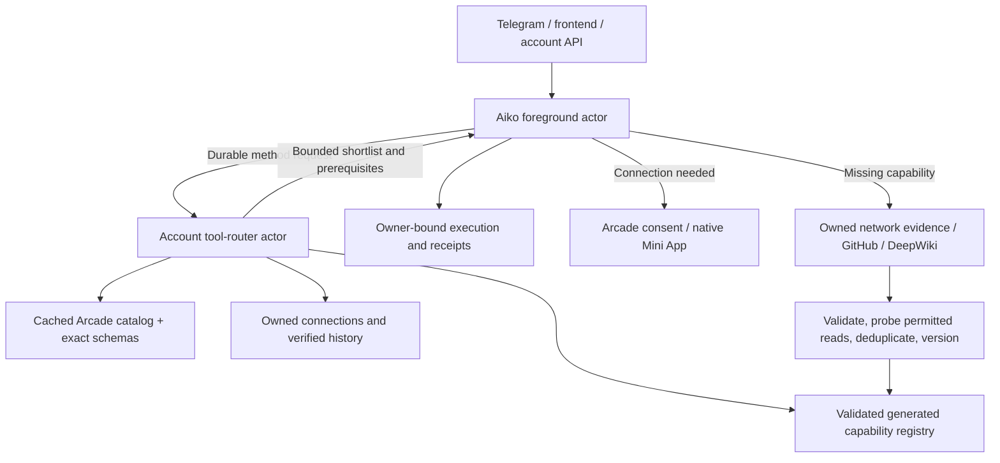

# Aiko meta-tool router: research and implementation decision

Research date: 2026-09-06. Objective: serve the same account from Telegram, frontend, and API while selecting from Arcade's live catalog and evidence-backed generated capabilities. A live read-only project probe returned 8,252 tools. This is a tool count, not a count of distinct services or authorized accounts.

## Recommended design

Use one durable router actor per account. Aiko asks for a route with the current task and relevant, non-secret execution history. The router returns a small set of exact tool identifiers and schemas, plus explicit connection/discovery state. A separate execution path enforces authentication, user authority and receipts. Store catalog metadata separately from private connection records. Persist route decisions and their catalog version so restart/replay can be inspected and stale decisions rejected.

Start with a measurable lexical/provider-aware baseline, retaining a replaceable retrieval/reranking boundary. Split multi-service requests into atomic needs and ensure the shortlist covers each; do not simply take ten variants of the same search operation. Re-query after new evidence, missing prerequisites or failures. Ranking scores are not calibrated probabilities.

Arcade is the preferred integration/authentication source. Catalog outages, incomplete pagination, or unknown website mappings cannot prove a service absent. Only verified absence releases the fallback path. For missing capabilities: retrieve owned observed API evidence or public docs, derive a declarative tool, validate it, probe permitted read behavior, deduplicate, persist version and provenance, then make it retrievable. Public documents cannot authorize actions or introduce credentials.

## Evidence and implications

| Primary paper | Finding relevant here | Aiko decision / limitation |
|---|---|---|
| [ToolACE-MCP (2026)](https://arxiv.org/abs/2601.08276) | Trains a router conditioned on query/history; its lightweight wrapper separates routing and execution. | Small router interface and history-aware decisions. We are not reproducing its Qwen training, synthetic trajectories or reported benchmark results. |
| [Tool-to-Agent Retrieval (2025)](https://arxiv.org/abs/2511.01854) | Indexes fine-grained tools and connects them to their parent agents, avoiding information loss from coarse agent summaries. | Store tool → toolkit/provider/actor relationships. Retrieve individual capabilities before choosing an executor. |
| [AnyTool (2024)](https://arxiv.org/abs/2402.04253) | Uses hierarchical API retrieval, a solver, and self-reflection that revisits retrieval when solving fails. | Separate discovery, selection and execution; allow retrieval recovery based on receipts. Its evaluation does not establish universal website support. |
| [ToolRet (2025)](https://arxiv.org/abs/2503.01763) | Benchmarks 7.6K tasks over 43K tools; general information-retrieval strength does not reliably translate to tool retrieval, and rerankers can hurt. | Compare retrievers on our actual tasks. Measure completeness and task success, not only semantic similarity. |
| [Tools are under-documented (2025)](https://arxiv.org/abs/2510.22670) | Structured tool-document expansion improves retrieval in the authors' experiments. | Index schemas, required inputs, outputs, provider and examples. Any generated enrichment remains a labeled claim and cannot change executable schema. |
| [CRAFT (2023)](https://arxiv.org/abs/2309.17428) | Creates task-specific toolsets through validation, reusable abstraction, deduplication and retrieval. | Promote generated capabilities only after checks; reuse existing versions before generating new ones. CRAFT's task domains differ from authenticated web APIs. |
| [ToolGen (2024)](https://arxiv.org/abs/2410.03439) | Represents tools as tokens learned in model parameters to combine retrieval and calling. | A research alternative; a changing private catalog favors an external versioned registry for our initial implementation. |

These papers motivate the design; none proves this combination is the best architecture for Aiko. That requires a matched evaluation.

## Verification cases

- Single service expressed by name, website, and natural-language task.
- Multi-service task requiring complementary tools; missing prerequisite inputs.
- Connected tool versus relevant disconnected tool; no connection creation without a real provider flow.
- Catalog failure, malformed/partial pages and unresolved domain aliases stay unavailable, not absent.
- Owned log evidence versus foreign log, copied prose, secret-bearing URL, unsafe host and stale definition.
- Actor restart, duplicate route ID, changed catalog, changed connection and uncertain execution.
- Measure recall/completeness at 5 and 10, schema validity, end-to-end success, cold/warm latency, main-context bytes and auth/fallback violations.

## Skill discovery

`npx skills find arxiv` found these candidates; repository metadata was checked through GitHub's API:

- [google-deepmind/science-skills: literature-search-arxiv](https://skills.sh/google-deepmind/science-skills/literature-search-arxiv): 2.5K installs reported by Skills CLI; repository 2,845 stars, active. Focused search, metadata and paper download utilities. Instructions inspected from the official repository. Install: `npx skills add google-deepmind/science-skills@literature-search-arxiv`.
- [karpathy/nanochat: read-arxiv-paper](https://skills.sh/karpathy/nanochat/read-arxiv-paper): 2.7K installs; repository 57,810 stars, active. Candidate for close paper reading. Install: `npx skills add karpathy/nanochat@read-arxiv-paper`.

No global skill installation was needed: this review used primary arXiv pages directly. Popularity is a screening signal, not validation of scientific claims or script security.

## First live baseline (before ranking refinement)

The native router ran against the real Arcade catalog in 20.9 seconds with no inference calls. It selected Slack message search correctly but misranked Gmail mutation tools for “Find unread emails in Gmail.” That is a failed read-intent routing case, despite passing fixture structure/isolation tests. The baseline receipt is artifacts/connectors/native-live-router-baseline.json. Refinement must distinguish operation intent and be checked against live catalog evidence; this demonstrates why retrieval quality must be measured separately from implementation correctness.

The first shipping router is deterministic and does not require a paid router inference call. Native durable messaging is necessary: invoking the host's global drive/wake from inside a foreground tool can deadlock the scheduler. Both the standalone router API and foreground bridge therefore require separate native-runtime tests.

## Verified refinement

The revised live shortlist selects Gmail.SearchEmailsByQuery and Gmail.SearchThreads for unread-email discovery, and SlackApi.SearchSlackMessages for Slack search. The account remains needs_connection: routing does not authorize accounts. The native receipt is `artifacts/connectors/native-live-router.json`. All 285 agent tests passed; frontend and agent typechecks passed. This is a small live regression check, not a benchmark claim.

## Deployment witness

Live at https://aiko-agent.lewis-6d8.workers.dev/connect. `artifacts/connectors/deployment.json` verifies the real 8,252-tool catalog and native Gmail/Slack routing; `telegram-menu.json` confirms the native Mini App menu. No test messages sent. Static assets explicitly disable HTML canonicalization to avoid /connect redirects; Arcade requests use manual redirect handling and reject all 3xx without forwarding credentials.

Remaining: a configured encrypted password relay and broader authenticated generated capabilities. Generated execution currently supports validated public GETs; other observed definitions require review. The complete original connect-anything witness stays incomplete.
